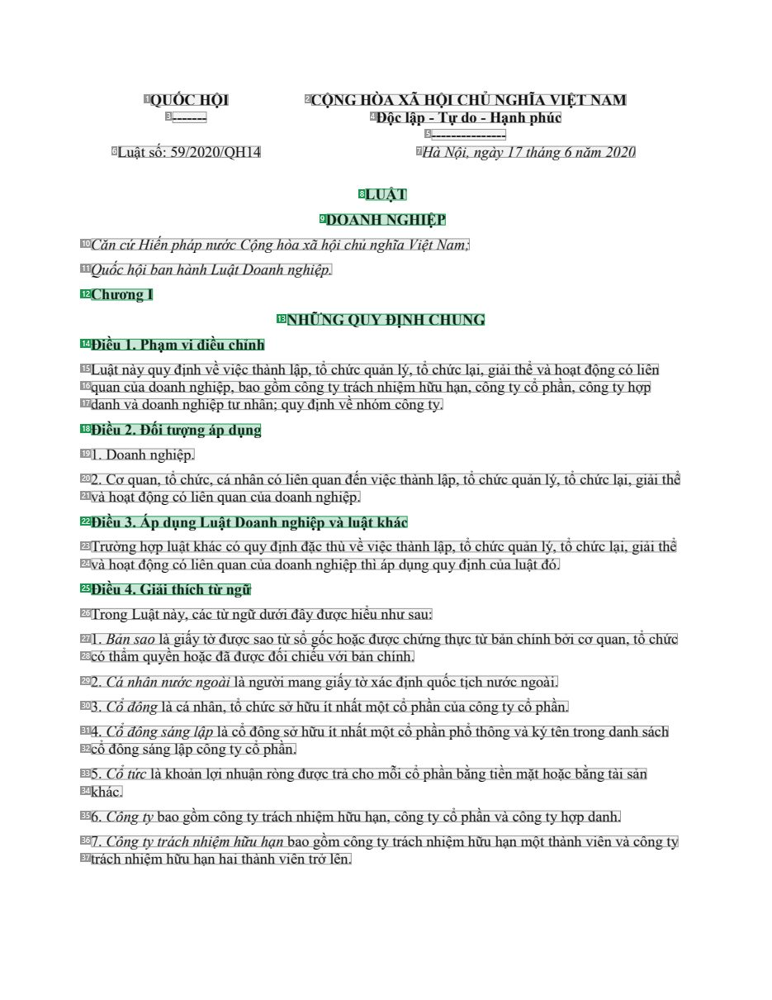
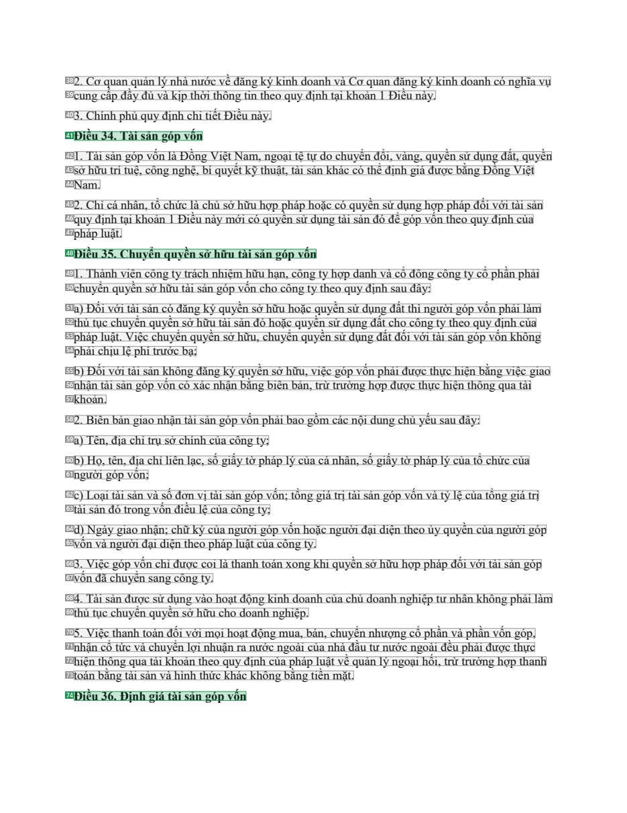
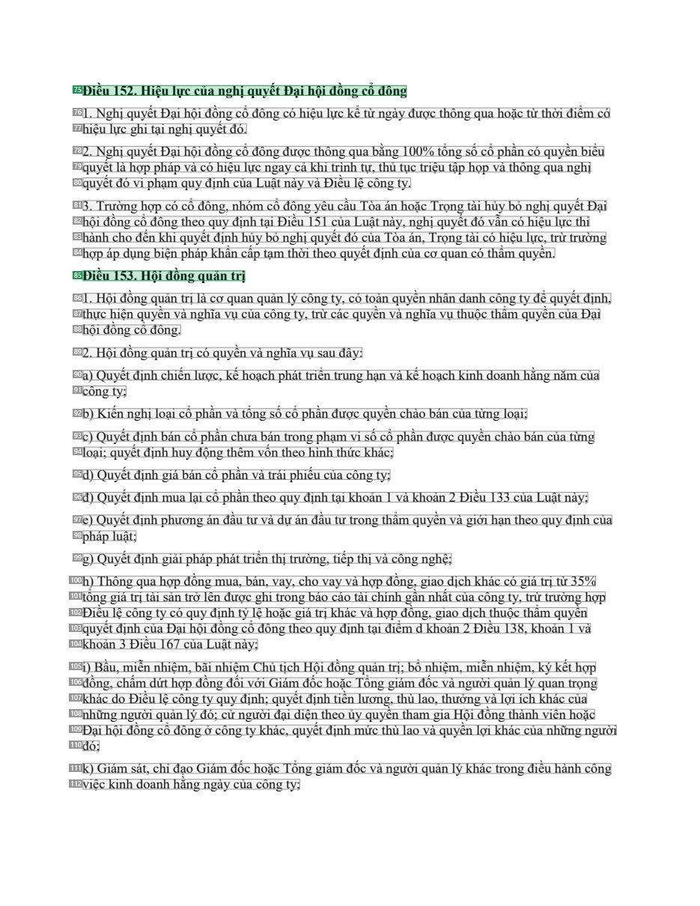

# 003 — `todo10_8/heading_corpus_100/01_phap_quy/003_Luat_Doanh_nghiep_59-2020-QH14.pdf`

Draft `P7_F1Q_HELDOUT_GOLD_DRAFT_V2`, status `DRAFT_REVIEWER_A_NOT_APPROVED`, draft sha256 `6211bb3d7587f0a3e1046d4cbbc99218e7c709e5b2e48c8c8d6a30b639c6f236`. Source sha256 `909d1da77ead7b5db5e4c3ddcae5e9aeb74405af75ed5a56c30eb7a24ca39060`. [Back to index](README.md)

Approve or correct with `review-apply` lines: `APPROVE 003 by <reviewer> [because <note>]`, `003 <alias> -> E|R|O because <reason>`.

## Page 1 (FIRST)

| # | alias | text | font | draft | flag | rationale |
|---:|---|---|---|---|---|---|
| 1 | L0000:S0 | QUỐC HỘI | 12 B | **OTHER** |  | Issuer &quot;QUỐC HỘI&quot; (letterhead) |
| 2 | L0000:S1 | CỘNG H&#210;A X&#195; HỘI CHỦ NGHĨA VIỆT NAM | 12 B | **OTHER** |  | National name (letterhead) |
| 3 | L0001:S0 | ------- | 12 B | **OTHER** |  | Default: body text, list item, table cell, page number or other non-heading content on this page |
| 4 | L0001:S1 | Độc lập - Tự do - Hạnh ph&#250;c | 12 B | **OTHER** |  | National motto |
| 5 | L0002:S0 | --------------- | 12 B | **OTHER** |  | Default: body text, list item, table cell, page number or other non-heading content on this page |
| 6 | L0003:S0 | Luật số: 59/2020/QH14 | 12 | **OTHER** |  | Document number &quot;Luật số: 59/2020/QH14&quot; |
| 7 | L0003:S1 | H&#224; Nội, ng&#224;y 17 th&#225;ng 6 năm 2020 | 12 I | **OTHER** |  | Place and date &quot;H&#224; Nội, ng&#224;y 17 th&#225;ng 6 năm 2020&quot; |
| 8 | L0004:S0 | LUẬT | 12 B | **ESTABLISHES** |  | Document type title &quot;LUẬT&quot; (bold, centred) |
| 9 | L0005:S0 | DOANH NGHIỆP | 12 B | **ESTABLISHES** |  | Document title &quot;DOANH NGHIỆP&quot; (bold, centred) |
| 10 | L0006:S0 | Căn cứ Hiến ph&#225;p nước Cộng h&#242;a x&#227; hội chủ nghĩa Việt Nam; | 12 I | **OTHER** |  | Default: body text, list item, table cell, page number or other non-heading content on this page |
| 11 | L0007:S0 | Quốc hội ban h&#224;nh Luật Doanh nghiệp. | 12 I | **OTHER** |  | Default: body text, list item, table cell, page number or other non-heading content on this page |
| 12 | L0008:S0 | Chương I | 12 B | **ESTABLISHES** |  | Chapter label &quot;Chương I&quot; (bold) |
| 13 | L0009:S0 | NHỮNG QUY ĐỊNH CHUNG | 12 B | **ESTABLISHES** |  | Chapter title &quot;NHỮNG QUY ĐỊNH CHUNG&quot; (bold) |
| 14 | L0010:S0 | Điều 1. Phạm vi điều chỉnh | 12 B | **ESTABLISHES** |  | Article heading &quot;Điều 1. Phạm vi điều chỉnh&quot; (bold) |
| 15 | L0011:S0 | Luật n&#224;y quy định về việc th&#224;nh lập, tổ chức quản l&#253;, tổ chức lại, giải thể v&#224; hoạt động c&#243; li&… | 12 | **OTHER** |  | Default: body text, list item, table cell, page number or other non-heading content on this page |
| 16 | L0012:S0 | quan của doanh nghiệp, bao gồm c&#244;ng ty tr&#225;ch nhiệm hữu hạn, c&#244;ng ty cổ phần, c&#244;ng ty hợp | 12 | **OTHER** |  | Default: body text, list item, table cell, page number or other non-heading content on this page |
| 17 | L0013:S0 | danh v&#224; doanh nghiệp tư nh&#226;n; quy định về nh&#243;m c&#244;ng ty. | 12 | **OTHER** |  | Default: body text, list item, table cell, page number or other non-heading content on this page |
| 18 | L0014:S0 | Điều 2. Đối tượng &#225;p dụng | 12 B | **ESTABLISHES** |  | Article heading &quot;Điều 2. Đối tượng &#225;p dụng&quot; (bold) |
| 19 | L0015:S0 | 1. Doanh nghiệp. | 12 | **OTHER** |  | Default: body text, list item, table cell, page number or other non-heading content on this page |
| 20 | L0016:S0 | 2. Cơ quan, tổ chức, c&#225; nh&#226;n c&#243; li&#234;n quan đến việc th&#224;nh lập, tổ chức quản l&#253;, tổ chức lại… | 12 | **OTHER** |  | Default: body text, list item, table cell, page number or other non-heading content on this page |
| 21 | L0017:S0 | v&#224; hoạt động c&#243; li&#234;n quan của doanh nghiệp. | 12 | **OTHER** |  | Default: body text, list item, table cell, page number or other non-heading content on this page |
| 22 | L0018:S0 | Điều 3. &#193;p dụng Luật Doanh nghiệp v&#224; luật kh&#225;c | 12 B | **ESTABLISHES** |  | Article heading &quot;Điều 3. &#193;p dụng Luật Doanh nghiệp v&#224; luật kh&#225;c&quot; (bold) |
| 23 | L0019:S0 | Trường hợp luật kh&#225;c c&#243; quy định đặc th&#249; về việc th&#224;nh lập, tổ chức quản l&#253;, tổ chức lại, giải … | 12 | **OTHER** |  | Default: body text, list item, table cell, page number or other non-heading content on this page |
| 24 | L0020:S0 | v&#224; hoạt động c&#243; li&#234;n quan của doanh nghiệp th&#236; &#225;p dụng quy định của luật đ&#243;. | 12 | **OTHER** |  | Default: body text, list item, table cell, page number or other non-heading content on this page |
| 25 | L0021:S0 | Điều 4. Giải th&#237;ch từ ngữ | 12 B | **ESTABLISHES** |  | Article heading &quot;Điều 4. Giải th&#237;ch từ ngữ&quot; (bold) |
| 26 | L0022:S0 | Trong Luật n&#224;y, c&#225;c từ ngữ dưới đ&#226;y được hiểu như sau: | 12 | **OTHER** |  | Default: body text, list item, table cell, page number or other non-heading content on this page |
| 27 | L0023:S0 | 1. Bản sao l&#224; giấy tờ được sao từ sổ gốc hoặc được chứng thực từ bản ch&#237;nh bởi cơ quan, tổ chức | 12 | **OTHER** |  | Default: body text, list item, table cell, page number or other non-heading content on this page |
| 28 | L0024:S0 | c&#243; thẩm quyền hoặc đ&#227; được đối chiếu với bản ch&#237;nh. | 12 | **OTHER** |  | Default: body text, list item, table cell, page number or other non-heading content on this page |
| 29 | L0025:S0 | 2. C&#225; nh&#226;n nước ngo&#224;i l&#224; người mang giấy tờ x&#225;c định quốc tịch nước ngo&#224;i. | 12 | **OTHER** |  | Default: body text, list item, table cell, page number or other non-heading content on this page |
| 30 | L0026:S0 | 3. Cổ đ&#244;ng l&#224; c&#225; nh&#226;n, tổ chức sở hữu &#237;t nhất một cổ phần của c&#244;ng ty cổ phần. | 12 | **OTHER** |  | Default: body text, list item, table cell, page number or other non-heading content on this page |
| 31 | L0027:S0 | 4. Cổ đ&#244;ng s&#225;ng lập l&#224; cổ đ&#244;ng sở hữu &#237;t nhất một cổ phần phổ th&#244;ng v&#224; k&#253; t&#234… | 12 | **OTHER** |  | Default: body text, list item, table cell, page number or other non-heading content on this page |
| 32 | L0028:S0 | cổ đ&#244;ng s&#225;ng lập c&#244;ng ty cổ phần. | 12 | **OTHER** |  | Default: body text, list item, table cell, page number or other non-heading content on this page |
| 33 | L0029:S0 | 5. Cổ tức l&#224; khoản lợi nhuận r&#242;ng được trả cho mỗi cổ phần bằng tiền mặt hoặc bằng t&#224;i sản | 12 | **OTHER** |  | Default: body text, list item, table cell, page number or other non-heading content on this page |
| 34 | L0030:S0 | kh&#225;c. | 12 | **OTHER** |  | Default: body text, list item, table cell, page number or other non-heading content on this page |
| 35 | L0031:S0 | 6. C&#244;ng ty bao gồm c&#244;ng ty tr&#225;ch nhiệm hữu hạn, c&#244;ng ty cổ phần v&#224; c&#244;ng ty hợp danh. | 12 | **OTHER** |  | Default: body text, list item, table cell, page number or other non-heading content on this page |
| 36 | L0032:S0 | 7. C&#244;ng ty tr&#225;ch nhiệm hữu hạn bao gồm c&#244;ng ty tr&#225;ch nhiệm hữu hạn một th&#224;nh vi&#234;n v&#224; … | 12 | **OTHER** |  | Default: body text, list item, table cell, page number or other non-heading content on this page |
| 37 | L0033:S0 | tr&#225;ch nhiệm hữu hạn hai th&#224;nh vi&#234;n trở l&#234;n. | 12 | **OTHER** |  | Default: body text, list item, table cell, page number or other non-heading content on this page |

**OTHER rows to check for a missed heading on page 1** (body size 12pt; bold or ≥ body+1pt, ≤ 12 words): #1 `L0000:S0` QUỐC HỘI (12 B), #2 `L0000:S1` CỘNG H&#210;A X&#195; HỘI CHỦ NGHĨA VIỆT NAM (12 B), #3 `L0001:S0` ------- (12 B), #4 `L0001:S1` Độc lập - Tự do - Hạnh ph&#250;c (12 B), #5 `L0002:S0` --------------- (12 B).

## Page 18 (SEEDED_INTERIOR)

| # | alias | text | font | draft | flag | rationale |
|---:|---|---|---|---|---|---|
| 38 | L0653:S0 | 2. Cơ quan quản l&#253; nh&#224; nước về đăng k&#253; kinh doanh v&#224; Cơ quan đăng k&#253; kinh doanh c&#243; nghĩa v… | 12 | **OTHER** |  | Default: body text, list item, table cell, page number or other non-heading content on this page |
| 39 | L0654:S0 | cung cấp đầy đủ v&#224; kịp thời th&#244;ng tin theo quy định tại khoản 1 Điều n&#224;y. | 12 | **OTHER** |  | Default: body text, list item, table cell, page number or other non-heading content on this page |
| 40 | L0655:S0 | 3. Ch&#237;nh phủ quy định chi tiết Điều n&#224;y. | 12 | **OTHER** |  | Default: body text, list item, table cell, page number or other non-heading content on this page |
| 41 | L0656:S0 | Điều 34. T&#224;i sản g&#243;p vốn | 12 B | **ESTABLISHES** |  | Article heading &quot;Điều 34. T&#224;i sản g&#243;p vốn&quot; (bold) |
| 42 | L0657:S0 | 1. T&#224;i sản g&#243;p vốn l&#224; Đồng Việt Nam, ngoại tệ tự do chuyển đổi, v&#224;ng, quyền sử dụng đất, quyền | 12 | **OTHER** |  | Default: body text, list item, table cell, page number or other non-heading content on this page |
| 43 | L0658:S0 | sở hữu tr&#237; tuệ, c&#244;ng nghệ, b&#237; quyết kỹ thuật, t&#224;i sản kh&#225;c c&#243; thể định gi&#225; được bằng … | 12 | **OTHER** |  | Default: body text, list item, table cell, page number or other non-heading content on this page |
| 44 | L0659:S0 | Nam. | 12 | **OTHER** |  | Default: body text, list item, table cell, page number or other non-heading content on this page |
| 45 | L0660:S0 | 2. Chỉ c&#225; nh&#226;n, tổ chức l&#224; chủ sở hữu hợp ph&#225;p hoặc c&#243; quyền sử dụng hợp ph&#225;p đối với t&#2… | 12 | **OTHER** |  | Default: body text, list item, table cell, page number or other non-heading content on this page |
| 46 | L0661:S0 | quy định tại khoản 1 Điều n&#224;y mới c&#243; quyền sử dụng t&#224;i sản đ&#243; để g&#243;p vốn theo quy định của | 12 | **OTHER** |  | Default: body text, list item, table cell, page number or other non-heading content on this page |
| 47 | L0662:S0 | ph&#225;p luật. | 12 | **OTHER** |  | Default: body text, list item, table cell, page number or other non-heading content on this page |
| 48 | L0663:S0 | Điều 35. Chuyển quyền sở hữu t&#224;i sản g&#243;p vốn | 12 B | **ESTABLISHES** |  | Article heading &quot;Điều 35. Chuyển quyền sở hữu t&#224;i sản g&#243;p vốn&quot; (bold) |
| 49 | L0664:S0 | 1. Th&#224;nh vi&#234;n c&#244;ng ty tr&#225;ch nhiệm hữu hạn, c&#244;ng ty hợp danh v&#224; cổ đ&#244;ng c&#244;ng ty c… | 12 | **OTHER** |  | Default: body text, list item, table cell, page number or other non-heading content on this page |
| 50 | L0665:S0 | chuyển quyền sở hữu t&#224;i sản g&#243;p vốn cho c&#244;ng ty theo quy định sau đ&#226;y: | 12 | **OTHER** |  | Default: body text, list item, table cell, page number or other non-heading content on this page |
| 51 | L0666:S0 | a) Đối với t&#224;i sản c&#243; đăng k&#253; quyền sở hữu hoặc quyền sử dụng đất th&#236; người g&#243;p vốn phải l&#224… | 12 | **OTHER** |  | Default: body text, list item, table cell, page number or other non-heading content on this page |
| 52 | L0667:S0 | thủ tục chuyển quyền sở hữu t&#224;i sản đ&#243; hoặc quyền sử dụng đất cho c&#244;ng ty theo quy định của | 12 | **OTHER** |  | Default: body text, list item, table cell, page number or other non-heading content on this page |
| 53 | L0668:S0 | ph&#225;p luật. Việc chuyển quyền sở hữu, chuyển quyền sử dụng đất đối với t&#224;i sản g&#243;p vốn kh&#244;ng | 12 | **OTHER** |  | Default: body text, list item, table cell, page number or other non-heading content on this page |
| 54 | L0669:S0 | phải chịu lệ ph&#237; trước bạ; | 12 | **OTHER** |  | Default: body text, list item, table cell, page number or other non-heading content on this page |
| 55 | L0670:S0 | b) Đối với t&#224;i sản kh&#244;ng đăng k&#253; quyền sở hữu, việc g&#243;p vốn phải được thực hiện bằng việc giao | 12 | **OTHER** |  | Default: body text, list item, table cell, page number or other non-heading content on this page |
| 56 | L0671:S0 | nhận t&#224;i sản g&#243;p vốn c&#243; x&#225;c nhận bằng bi&#234;n bản, trừ trường hợp được thực hiện th&#244;ng qua t&… | 12 | **OTHER** |  | Default: body text, list item, table cell, page number or other non-heading content on this page |
| 57 | L0672:S0 | khoản. | 12 | **OTHER** |  | Default: body text, list item, table cell, page number or other non-heading content on this page |
| 58 | L0673:S0 | 2. Bi&#234;n bản giao nhận t&#224;i sản g&#243;p vốn phải bao gồm c&#225;c nội dung chủ yếu sau đ&#226;y: | 12 | **OTHER** |  | Default: body text, list item, table cell, page number or other non-heading content on this page |
| 59 | L0674:S0 | a) T&#234;n, địa chỉ trụ sở ch&#237;nh của c&#244;ng ty; | 12 | **OTHER** |  | Default: body text, list item, table cell, page number or other non-heading content on this page |
| 60 | L0675:S0 | b) Họ, t&#234;n, địa chỉ li&#234;n lạc, số giấy tờ ph&#225;p l&#253; của c&#225; nh&#226;n, số giấy tờ ph&#225;p l&#253;… | 12 | **OTHER** |  | Default: body text, list item, table cell, page number or other non-heading content on this page |
| 61 | L0676:S0 | người g&#243;p vốn; | 12 | **OTHER** |  | Default: body text, list item, table cell, page number or other non-heading content on this page |
| 62 | L0677:S0 | c) Loại t&#224;i sản v&#224; số đơn vị t&#224;i sản g&#243;p vốn; tổng gi&#225; trị t&#224;i sản g&#243;p vốn v&#224; tỷ… | 12 | **OTHER** |  | Default: body text, list item, table cell, page number or other non-heading content on this page |
| 63 | L0678:S0 | t&#224;i sản đ&#243; trong vốn điều lệ của c&#244;ng ty; | 12 | **OTHER** |  | Default: body text, list item, table cell, page number or other non-heading content on this page |
| 64 | L0679:S0 | d) Ng&#224;y giao nhận; chữ k&#253; của người g&#243;p vốn hoặc người đại diện theo ủy quyền của người g&#243;p | 12 | **OTHER** |  | Default: body text, list item, table cell, page number or other non-heading content on this page |
| 65 | L0680:S0 | vốn v&#224; người đại diện theo ph&#225;p luật của c&#244;ng ty. | 12 | **OTHER** |  | Default: body text, list item, table cell, page number or other non-heading content on this page |
| 66 | L0681:S0 | 3. Việc g&#243;p vốn chỉ được coi l&#224; thanh to&#225;n xong khi quyền sở hữu hợp ph&#225;p đối với t&#224;i sản g&#24… | 12 | **OTHER** |  | Default: body text, list item, table cell, page number or other non-heading content on this page |
| 67 | L0682:S0 | vốn đ&#227; chuyển sang c&#244;ng ty. | 12 | **OTHER** |  | Default: body text, list item, table cell, page number or other non-heading content on this page |
| 68 | L0683:S0 | 4. T&#224;i sản được sử dụng v&#224;o hoạt động kinh doanh của chủ doanh nghiệp tư nh&#226;n kh&#244;ng phải l&#224;m | 12 | **OTHER** |  | Default: body text, list item, table cell, page number or other non-heading content on this page |
| 69 | L0684:S0 | thủ tục chuyển quyền sở hữu cho doanh nghiệp. | 12 | **OTHER** |  | Default: body text, list item, table cell, page number or other non-heading content on this page |
| 70 | L0685:S0 | 5. Việc thanh to&#225;n đối với mọi hoạt động mua, b&#225;n, chuyển nhượng cổ phần v&#224; phần vốn g&#243;p, | 12 | **OTHER** |  | Default: body text, list item, table cell, page number or other non-heading content on this page |
| 71 | L0686:S0 | nhận cổ tức v&#224; chuyển lợi nhuận ra nước ngo&#224;i của nh&#224; đầu tư nước ngo&#224;i đều phải được thực | 12 | **OTHER** |  | Default: body text, list item, table cell, page number or other non-heading content on this page |
| 72 | L0687:S0 | hiện th&#244;ng qua t&#224;i khoản theo quy định của ph&#225;p luật về quản l&#253; ngoại hối, trừ trường hợp thanh | 12 | **OTHER** |  | Default: body text, list item, table cell, page number or other non-heading content on this page |
| 73 | L0688:S0 | to&#225;n bằng t&#224;i sản v&#224; h&#236;nh thức kh&#225;c kh&#244;ng bằng tiền mặt. | 12 | **OTHER** |  | Default: body text, list item, table cell, page number or other non-heading content on this page |
| 74 | L0689:S0 | Điều 36. Định gi&#225; t&#224;i sản g&#243;p vốn | 12 B | **ESTABLISHES** |  | Article heading &quot;Điều 36. Định gi&#225; t&#224;i sản g&#243;p vốn&quot; (bold) |

**OTHER rows to check for a missed heading on page 18** (body size 12pt; bold or ≥ body+1pt, ≤ 12 words): none.

## Page 79 (SEEDED_INTERIOR)

| # | alias | text | font | draft | flag | rationale |
|---:|---|---|---|---|---|---|
| 75 | L3005:S0 | Điều 152. Hiệu lực của nghị quyết Đại hội đồng cổ đ&#244;ng | 12 B | **ESTABLISHES** |  | Article heading &quot;Điều 152. Hiệu lực của nghị quyết Đại hội đồng cổ đ&#244;ng&quot; (bold) |
| 76 | L3006:S0 | 1. Nghị quyết Đại hội đồng cổ đ&#244;ng c&#243; hiệu lực kể từ ng&#224;y được th&#244;ng qua hoặc từ thời điểm c&#243; | 12 | **OTHER** |  | Default: body text, list item, table cell, page number or other non-heading content on this page |
| 77 | L3007:S0 | hiệu lực ghi tại nghị quyết đ&#243;. | 12 | **OTHER** |  | Default: body text, list item, table cell, page number or other non-heading content on this page |
| 78 | L3008:S0 | 2. Nghị quyết Đại hội đồng cổ đ&#244;ng được th&#244;ng qua bằng 100% tổng số cổ phần c&#243; quyền biểu | 12 | **OTHER** |  | Default: body text, list item, table cell, page number or other non-heading content on this page |
| 79 | L3009:S0 | quyết l&#224; hợp ph&#225;p v&#224; c&#243; hiệu lực ngay cả khi tr&#236;nh tự, thủ tục triệu tập họp v&#224; th&#244;ng… | 12 | **OTHER** |  | Default: body text, list item, table cell, page number or other non-heading content on this page |
| 80 | L3010:S0 | quyết đ&#243; vi phạm quy định của Luật n&#224;y v&#224; Điều lệ c&#244;ng ty. | 12 | **OTHER** |  | Default: body text, list item, table cell, page number or other non-heading content on this page |
| 81 | L3011:S0 | 3. Trường hợp c&#243; cổ đ&#244;ng, nh&#243;m cổ đ&#244;ng y&#234;u cầu T&#242;a &#225;n hoặc Trọng t&#224;i hủy bỏ nghị… | 12 | **OTHER** |  | Default: body text, list item, table cell, page number or other non-heading content on this page |
| 82 | L3012:S0 | hội đồng cổ đ&#244;ng theo quy định tại Điều 151 của Luật n&#224;y, nghị quyết đ&#243; vẫn c&#243; hiệu lực thi | 12 | **OTHER** |  | Default: body text, list item, table cell, page number or other non-heading content on this page |
| 83 | L3013:S0 | h&#224;nh cho đến khi quyết định hủy bỏ nghị quyết đ&#243; của T&#242;a &#225;n, Trọng t&#224;i c&#243; hiệu lực, trừ tr… | 12 | **OTHER** |  | Default: body text, list item, table cell, page number or other non-heading content on this page |
| 84 | L3014:S0 | hợp &#225;p dụng biện ph&#225;p khẩn cấp tạm thời theo quyết định của cơ quan c&#243; thẩm quyền. | 12 | **OTHER** |  | Default: body text, list item, table cell, page number or other non-heading content on this page |
| 85 | L3015:S0 | Điều 153. Hội đồng quản trị | 12 B | **ESTABLISHES** |  | Article heading &quot;Điều 153. Hội đồng quản trị&quot; (bold) |
| 86 | L3016:S0 | 1. Hội đồng quản trị l&#224; cơ quan quản l&#253; c&#244;ng ty, c&#243; to&#224;n quyền nh&#226;n danh c&#244;ng ty để q… | 12 | **OTHER** |  | Default: body text, list item, table cell, page number or other non-heading content on this page |
| 87 | L3017:S0 | thực hiện quyền v&#224; nghĩa vụ của c&#244;ng ty, trừ c&#225;c quyền v&#224; nghĩa vụ thuộc thẩm quyền của Đại | 12 | **OTHER** |  | Default: body text, list item, table cell, page number or other non-heading content on this page |
| 88 | L3018:S0 | hội đồng cổ đ&#244;ng. | 12 | **OTHER** |  | Default: body text, list item, table cell, page number or other non-heading content on this page |
| 89 | L3019:S0 | 2. Hội đồng quản trị c&#243; quyền v&#224; nghĩa vụ sau đ&#226;y: | 12 | **OTHER** |  | Default: body text, list item, table cell, page number or other non-heading content on this page |
| 90 | L3020:S0 | a) Quyết định chiến lược, kế hoạch ph&#225;t triển trung hạn v&#224; kế hoạch kinh doanh hằng năm của | 12 | **OTHER** |  | Default: body text, list item, table cell, page number or other non-heading content on this page |
| 91 | L3021:S0 | c&#244;ng ty; | 12 | **OTHER** |  | Default: body text, list item, table cell, page number or other non-heading content on this page |
| 92 | L3022:S0 | b) Kiến nghị loại cổ phần v&#224; tổng số cổ phần được quyền ch&#224;o b&#225;n của từng loại; | 12 | **OTHER** |  | Default: body text, list item, table cell, page number or other non-heading content on this page |
| 93 | L3023:S0 | c) Quyết định b&#225;n cổ phần chưa b&#225;n trong phạm vi số cổ phần được quyền ch&#224;o b&#225;n của từng | 12 | **OTHER** |  | Default: body text, list item, table cell, page number or other non-heading content on this page |
| 94 | L3024:S0 | loại; quyết định huy động th&#234;m vốn theo h&#236;nh thức kh&#225;c; | 12 | **OTHER** |  | Default: body text, list item, table cell, page number or other non-heading content on this page |
| 95 | L3025:S0 | d) Quyết định gi&#225; b&#225;n cổ phần v&#224; tr&#225;i phiếu của c&#244;ng ty; | 12 | **OTHER** |  | Default: body text, list item, table cell, page number or other non-heading content on this page |
| 96 | L3026:S0 | đ) Quyết định mua lại cổ phần theo quy định tại khoản 1 v&#224; khoản 2 Điều 133 của Luật n&#224;y; | 12 | **OTHER** |  | Default: body text, list item, table cell, page number or other non-heading content on this page |
| 97 | L3027:S0 | e) Quyết định phương &#225;n đầu tư v&#224; dự &#225;n đầu tư trong thẩm quyền v&#224; giới hạn theo quy định của | 12 | **OTHER** |  | Default: body text, list item, table cell, page number or other non-heading content on this page |
| 98 | L3028:S0 | ph&#225;p luật; | 12 | **OTHER** |  | Default: body text, list item, table cell, page number or other non-heading content on this page |
| 99 | L3029:S0 | g) Quyết định giải ph&#225;p ph&#225;t triển thị trường, tiếp thị v&#224; c&#244;ng nghệ; | 12 | **OTHER** |  | Default: body text, list item, table cell, page number or other non-heading content on this page |
| 100 | L3030:S0 | h) Th&#244;ng qua hợp đồng mua, b&#225;n, vay, cho vay v&#224; hợp đồng, giao dịch kh&#225;c c&#243; gi&#225; trị từ 35% | 12 | **OTHER** |  | Default: body text, list item, table cell, page number or other non-heading content on this page |
| 101 | L3031:S0 | tổng gi&#225; trị t&#224;i sản trở l&#234;n được ghi trong b&#225;o c&#225;o t&#224;i ch&#237;nh gần nhất của c&#244;ng … | 12 | **OTHER** |  | Default: body text, list item, table cell, page number or other non-heading content on this page |
| 102 | L3032:S0 | Điều lệ c&#244;ng ty c&#243; quy định tỷ lệ hoặc gi&#225; trị kh&#225;c v&#224; hợp đồng, giao dịch thuộc thẩm quyền | 12 | **OTHER** |  | Default: body text, list item, table cell, page number or other non-heading content on this page |
| 103 | L3033:S0 | quyết định của Đại hội đồng cổ đ&#244;ng theo quy định tại điểm d khoản 2 Điều 138, khoản 1 v&#224; | 12 | **OTHER** |  | Default: body text, list item, table cell, page number or other non-heading content on this page |
| 104 | L3034:S0 | khoản 3 Điều 167 của Luật n&#224;y; | 12 | **OTHER** |  | Default: body text, list item, table cell, page number or other non-heading content on this page |
| 105 | L3035:S0 | i) Bầu, miễn nhiệm, b&#227;i nhiệm Chủ tịch Hội đồng quản trị; bổ nhiệm, miễn nhiệm, k&#253; kết hợp | 12 | **OTHER** |  | Default: body text, list item, table cell, page number or other non-heading content on this page |
| 106 | L3036:S0 | đồng, chấm dứt hợp đồng đối với Gi&#225;m đốc hoặc Tổng gi&#225;m đốc v&#224; người quản l&#253; quan trọng | 12 | **OTHER** |  | Default: body text, list item, table cell, page number or other non-heading content on this page |
| 107 | L3037:S0 | kh&#225;c do Điều lệ c&#244;ng ty quy định; quyết định tiền lương, th&#249; lao, thưởng v&#224; lợi &#237;ch kh&#225;c c… | 12 | **OTHER** |  | Default: body text, list item, table cell, page number or other non-heading content on this page |
| 108 | L3038:S0 | những người quản l&#253; đ&#243;; cử người đại diện theo ủy quyền tham gia Hội đồng th&#224;nh vi&#234;n hoặc | 12 | **OTHER** |  | Default: body text, list item, table cell, page number or other non-heading content on this page |
| 109 | L3039:S0 | Đại hội đồng cổ đ&#244;ng ở c&#244;ng ty kh&#225;c, quyết định mức th&#249; lao v&#224; quyền lợi kh&#225;c của những ng… | 12 | **OTHER** |  | Default: body text, list item, table cell, page number or other non-heading content on this page |
| 110 | L3040:S0 | đ&#243;; | 12 | **OTHER** |  | Default: body text, list item, table cell, page number or other non-heading content on this page |
| 111 | L3041:S0 | k) Gi&#225;m s&#225;t, chỉ đạo Gi&#225;m đốc hoặc Tổng gi&#225;m đốc v&#224; người quản l&#253; kh&#225;c trong điều h&#… | 12 | **OTHER** |  | Default: body text, list item, table cell, page number or other non-heading content on this page |
| 112 | L3042:S0 | việc kinh doanh hằng ng&#224;y của c&#244;ng ty; | 12 | **OTHER** |  | Default: body text, list item, table cell, page number or other non-heading content on this page |

**OTHER rows to check for a missed heading on page 79** (body size 12pt; bold or ≥ body+1pt, ≤ 12 words): none.
