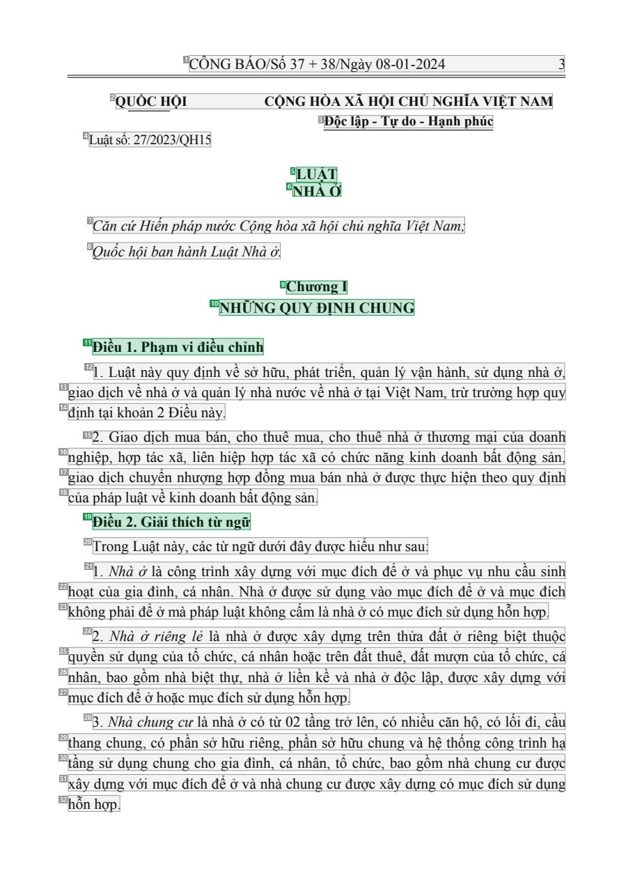
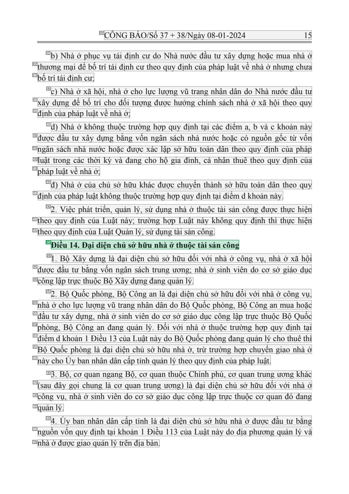
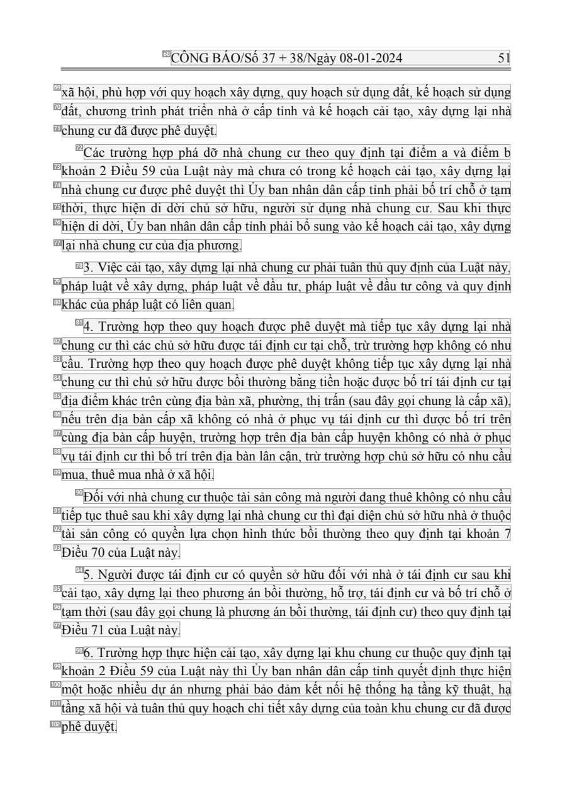

# 007 — `todo10_8/heading_corpus_100/01_phap_quy/007_Luat_Nha_o_27-2023-QH15.pdf`

Draft `P7_F1Q_HELDOUT_GOLD_DRAFT_V2`, status `DRAFT_REVIEWER_A_NOT_APPROVED`, draft sha256 `318b78da7deb80ffea641f19fadacfff3ee99b2157a15474ea02f3371ed07830`. Source sha256 `c647b16e5570e74ade61f6fc23128f8d878a81d979753f95160579cb5a3fb907`. [Back to index](README.md)

Approve or correct with `review-apply` lines: `APPROVE 007 by <reviewer> [because <note>]`, `007 <alias> -> E|R|O because <reason>`.

## Page 1 (FIRST)

| # | alias | text | font | draft | flag | rationale |
|---:|---|---|---|---|---|---|
| 1 | L0000:S0 | C&#212;NG B&#193;O/Số 37 + 38/Ng&#224;y 08-01-2024 3 | 14 | **OTHER** |  | C&#244;ng B&#225;o running header (page furniture) |
| 2 | L0001:S0 | QUỐC HỘI CỘNG H&#210;A X&#195; HỘI CHỦ NGHĨA VIỆT NAM | 13 B | **OTHER** |  | Issuer and national name (letterhead) |
| 3 | L0002:S0 | Độc lập - Tự do - Hạnh ph&#250;c | 13 B | **OTHER** |  | National motto |
| 4 | L0003:S0 | Luật số: 27/2023/QH15 | 13 | **OTHER** |  | Document number &quot;Luật số: 27/2023/QH15&quot; |
| 5 | L0004:S0 | LUẬT | 14 B | **ESTABLISHES** |  | Document type title &quot;LUẬT&quot; (bold, centred) |
| 6 | L0005:S0 | NH&#192; Ở | 14 B | **ESTABLISHES** |  | Document title &quot;NH&#192; Ở&quot; (bold, centred) |
| 7 | L0006:S0 | Căn cứHiến ph&#225;p nước Cộng h&#242;a x&#227; hội chủ nghĩa Việt Nam; | 14 I | **OTHER** |  | Default: body text, list item, table cell, page number or other non-heading content on this page |
| 8 | L0007:S0 | Quốc hội ban h&#224;nh Luật Nh&#224; ở. | 14 I | **OTHER** |  | Default: body text, list item, table cell, page number or other non-heading content on this page |
| 9 | L0008:S0 | Chương I | 14 B | **ESTABLISHES** |  | Chapter label &quot;Chương I&quot; (bold) |
| 10 | L0009:S0 | NHỮNG QUY ĐỊNH CHUNG | 14 B | **ESTABLISHES** |  | Chapter title &quot;NHỮNG QUY ĐỊNH CHUNG&quot; (bold) |
| 11 | L0010:S0 | Điều 1. Phạm vi điều chỉnh | 14 B | **ESTABLISHES** |  | Article heading &quot;Điều 1. Phạm vi điều chỉnh&quot; (bold) |
| 12 | L0011:S0 | 1 . Luật n&#224;y quy định về sở hữu, ph&#225;t triển, quản l&#253; vận h&#224;nh, sử dụng nh&#224; ở, | 14 | **OTHER** |  | Default: body text, list item, table cell, page number or other non-heading content on this page |
| 13 | L0012:S0 | giao dịch về nh&#224; ở v&#224; quản l&#253; nh&#224; nước về nh&#224; ở tại Việt Nam, trừ trường hợp quy | 14 | **OTHER** |  | Default: body text, list item, table cell, page number or other non-heading content on this page |
| 14 | L0013:S0 | định tại khoản 2 Điều n&#224;y. | 14 | **OTHER** |  | Default: body text, list item, table cell, page number or other non-heading content on this page |
| 15 | L0014:S0 | 2. Giao dịch mua b&#225;n, cho thu&#234; mua, cho thu&#234; nh&#224; ở thương mại của doanh | 14 | **OTHER** |  | Default: body text, list item, table cell, page number or other non-heading content on this page |
| 16 | L0015:S0 | nghiệp, hợp t&#225;c x&#227;, li&#234;n hiệp hợp t&#225;c x&#227; c&#243; chức năng kinh doanh bất động sản, | 14 | **OTHER** |  | Default: body text, list item, table cell, page number or other non-heading content on this page |
| 17 | L0016:S0 | giao dịch chuyển nhượng hợp đồng mua b&#225;n nh&#224; ở được thực hiện theo quy định | 14 | **OTHER** |  | Default: body text, list item, table cell, page number or other non-heading content on this page |
| 18 | L0017:S0 | của ph&#225;p luật về kinh doanh bất động sản. | 14 | **OTHER** |  | Default: body text, list item, table cell, page number or other non-heading content on this page |
| 19 | L0018:S0 | Điều 2. Giải th&#237;ch từ ngữ | 14 B | **ESTABLISHES** |  | Article heading &quot;Điều 2. Giải th&#237;ch từ ngữ&quot; (bold) |
| 20 | L0019:S0 | Trong Luật n&#224;y, c&#225;c từ ngữ dưới đ&#226;y được hiểu như sau: | 14 | **OTHER** |  | Default: body text, list item, table cell, page number or other non-heading content on this page |
| 21 | L0020:S0 | 1 . Nh&#224; ở l&#224; c&#244;ng tr&#236;nh x&#226;y dựng với mục đ&#237;ch để ở v&#224; phục vụ nhu cầu sinh | 14 | **OTHER** |  | Default: body text, list item, table cell, page number or other non-heading content on this page |
| 22 | L0021:S0 | hoạt của gia đ&#236;nh, c&#225; nh&#226;n. Nh&#224; ở được sử dụng v&#224;o mục đ&#237;ch để ở v&#224; mục đ&#237;ch | 14 | **OTHER** |  | Default: body text, list item, table cell, page number or other non-heading content on this page |
| 23 | L0022:S0 | kh&#244;ng phải để ở m&#224; ph&#225;p luật kh&#244;ng cấm l&#224; nh&#224; ở c&#243; mục đ&#237;ch sử dụng hỗn hợp. | 14 | **OTHER** |  | Default: body text, list item, table cell, page number or other non-heading content on this page |
| 24 | L0023:S0 | 2. Nh&#224; ở ri&#234;ng lẻ l&#224; nh&#224; ở được x&#226;y dựng tr&#234;n thửa đất ở ri&#234;ng biệt thuộc | 14 | **OTHER** |  | Default: body text, list item, table cell, page number or other non-heading content on this page |
| 25 | L0024:S0 | quyền sử dụng của tổ chức, c&#225; nh&#226;n hoặc tr&#234;n đất thu&#234;, đất mượn của tổ chức, c&#225; | 14 | **OTHER** |  | Default: body text, list item, table cell, page number or other non-heading content on this page |
| 26 | L0025:S0 | nh&#226;n, bao gồm nh&#224; biệt thự, nh&#224; ở liền kề v&#224; nh&#224; ở độc lập, được x&#226;y dựng với | 14 | **OTHER** |  | Default: body text, list item, table cell, page number or other non-heading content on this page |
| 27 | L0026:S0 | mục đ&#237;ch để ở hoặc mục đ&#237;ch sử dụng hỗn hợp. | 14 | **OTHER** |  | Default: body text, list item, table cell, page number or other non-heading content on this page |
| 28 | L0027:S0 | 3. Nh&#224; chung cư l&#224; nh&#224; ở c&#243; từ 02 tầng trở l&#234;n, c&#243; nhiều căn hộ, c&#243; lối đi, cầu | 14 | **OTHER** |  | Default: body text, list item, table cell, page number or other non-heading content on this page |
| 29 | L0028:S0 | thang chung, c&#243; phần sở hữu ri&#234;ng, phần sở hữu chung v&#224; hệ thống c&#244;ng tr&#236;nh hạ | 14 | **OTHER** |  | Default: body text, list item, table cell, page number or other non-heading content on this page |
| 30 | L0029:S0 | tầng sử dụng chung cho gia đ&#236;nh, c&#225; nh&#226;n, tổ chức, bao gồm nh&#224; chung cư được | 14 | **OTHER** |  | Default: body text, list item, table cell, page number or other non-heading content on this page |
| 31 | L0030:S0 | x&#226;y dựng với mục đ&#237;ch để ở v&#224; nh&#224; chung cư được x&#226;y dựng c&#243; mục đ&#237;ch sử dụng | 14 | **OTHER** |  | Default: body text, list item, table cell, page number or other non-heading content on this page |
| 32 | L0031:S0 | hỗn hợp. | 14 | **OTHER** |  | Default: body text, list item, table cell, page number or other non-heading content on this page |

**OTHER rows to check for a missed heading on page 1** (body size 14pt; bold or ≥ body+1pt, ≤ 12 words): #2 `L0001:S0` QUỐC HỘI CỘNG H&#210;A X&#195; HỘI CHỦ NGHĨA VIỆT NAM (13 B), #3 `L0002:S0` Độc lập - Tự do - Hạnh ph&#250;c (13 B).

## Page 13 (SEEDED_INTERIOR)

| # | alias | text | font | draft | flag | rationale |
|---:|---|---|---|---|---|---|
| 33 | L0405:S0 | C&#212;NG B&#193;O/Số 37 + 38/Ng&#224;y 08-01-2024 15 | 14 | **OTHER** |  | C&#244;ng B&#225;o running header (page furniture) |
| 34 | L0406:S0 | b) Nh&#224; ở phục vụ t&#225;i định cư do Nh&#224; nước đầu tư x&#226;y dựng hoặc mua nh&#224; ở | 14 | **OTHER** |  | Default: body text, list item, table cell, page number or other non-heading content on this page |
| 35 | L0407:S0 | thương mại để bố tr&#237; t&#225;i định cư theo quy định của ph&#225;p luật về nh&#224; ở nhưng chưa | 14 | **OTHER** |  | Default: body text, list item, table cell, page number or other non-heading content on this page |
| 36 | L0408:S0 | bố tr&#237; t&#225;i định cư; | 14 | **OTHER** |  | Default: body text, list item, table cell, page number or other non-heading content on this page |
| 37 | L0409:S0 | c) Nh&#224; ở x&#227; hội, nh&#224; ở cho lực lượng vũ trang nh&#226;n d&#226;n do Nh&#224; nước đầu tư | 14 | **OTHER** |  | Default: body text, list item, table cell, page number or other non-heading content on this page |
| 38 | L0410:S0 | x&#226;y dựng để bố tr&#237; cho đối tượng được hưởng ch&#237;nh s&#225;ch nh&#224; ở x&#227; hội theo quy | 14 | **OTHER** |  | Default: body text, list item, table cell, page number or other non-heading content on this page |
| 39 | L0411:S0 | định của ph&#225;p luật về nh&#224; ở; | 14 | **OTHER** |  | Default: body text, list item, table cell, page number or other non-heading content on this page |
| 40 | L0412:S0 | d) Nh&#224; ở kh&#244;ng thuộc trường hợp quy định tại c&#225;c điểm a, b v&#224; c khoản n&#224;y | 14 | **OTHER** |  | Default: body text, list item, table cell, page number or other non-heading content on this page |
| 41 | L0413:S0 | được đầu tư x&#226;y dựng bằng vốn ng&#226;n s&#225;ch nh&#224; nước hoặc c&#243; nguồn gốc từ vốn | 14 | **OTHER** |  | Default: body text, list item, table cell, page number or other non-heading content on this page |
| 42 | L0414:S0 | ng&#226;n s&#225;ch nh&#224; nước hoặc được x&#225;c lập sở hữu to&#224;n d&#226;n theo quy định của ph&#225;p | 14 | **OTHER** |  | Default: body text, list item, table cell, page number or other non-heading content on this page |
| 43 | L0415:S0 | luật trong c&#225;c thời kỳ v&#224; đang cho hộ gia đ&#236;nh, c&#225; nh&#226;n thu&#234; theo quy định của | 14 | **OTHER** |  | Default: body text, list item, table cell, page number or other non-heading content on this page |
| 44 | L0416:S0 | ph&#225;p luật về nh&#224; ở; | 14 | **OTHER** |  | Default: body text, list item, table cell, page number or other non-heading content on this page |
| 45 | L0417:S0 | đ) Nh&#224; ở của chủ sở hữu kh&#225;c được chuyển th&#224;nh sở hữu to&#224;n d&#226;n theo quy | 14 | **OTHER** |  | Default: body text, list item, table cell, page number or other non-heading content on this page |
| 46 | L0418:S0 | định của ph&#225;p luật kh&#244;ng thuộc trường hợp quy định tại điểm d khoản n&#224;y. | 14 | **OTHER** |  | Default: body text, list item, table cell, page number or other non-heading content on this page |
| 47 | L0419:S0 | 2. Việc ph&#225;t triển, quản l&#253;, sử dụng nh&#224; ở thuộc t&#224;i sản c&#244;ng được thực hiện | 14 | **OTHER** |  | Default: body text, list item, table cell, page number or other non-heading content on this page |
| 48 | L0420:S0 | theo quy định của Luật n&#224;y; trường hợp Luật n&#224;y kh&#244;ng quy định th&#236; thực hiện | 14 | **OTHER** |  | Default: body text, list item, table cell, page number or other non-heading content on this page |
| 49 | L0421:S0 | theo quy định của Luật Quản l&#253;, sử dụng t&#224;i sản c&#244;ng. | 14 | **OTHER** |  | Default: body text, list item, table cell, page number or other non-heading content on this page |
| 50 | L0422:S0 | Điều 14. Đại diện chủ sở hữu nh&#224; ở thuộc t&#224;i sản c&#244;ng | 14 B | **ESTABLISHES** |  | Article heading &quot;Điều 14. Đại diện chủ sở hữu nh&#224; ở thuộc t&#224;i sản c&#244;ng&quot; (bold) |
| 51 | L0423:S0 | 1 . Bộ X&#226;y dựng l&#224; đại diện chủ sở hữu đối với nh&#224; ở c&#244;ng vụ, nh&#224; ở x&#227; hội | 14 | **OTHER** |  | Default: body text, list item, table cell, page number or other non-heading content on this page |
| 52 | L0424:S0 | được đầu tư bằng vốn ng&#226;n s&#225;ch trung ương; nh&#224; ở sinh vi&#234;n do cơ sở gi&#225;o dục | 14 | **OTHER** |  | Default: body text, list item, table cell, page number or other non-heading content on this page |
| 53 | L0425:S0 | c&#244;ng lập trực thuộc Bộ X&#226;y dựng đang quản l&#253;. | 14 | **OTHER** |  | Default: body text, list item, table cell, page number or other non-heading content on this page |
| 54 | L0426:S0 | 2. Bộ Quốc ph&#242;ng, Bộ C&#244;ng an l&#224; đại diện chủ sở hữu đối với nh&#224; ở c&#244;ng vụ, | 14 | **OTHER** |  | Default: body text, list item, table cell, page number or other non-heading content on this page |
| 55 | L0427:S0 | nh&#224; ở cho lực lượng vũ trang nh&#226;n d&#226;n do Bộ Quốc ph&#242;ng, Bộ C&#244;ng an mua hoặc | 14 | **OTHER** |  | Default: body text, list item, table cell, page number or other non-heading content on this page |
| 56 | L0428:S0 | đầu tư x&#226;y dựng, nh&#224; ở sinh vi&#234;n do cơ sở gi&#225;o dục c&#244;ng lập trực thuộc Bộ Quốc | 14 | **OTHER** |  | Default: body text, list item, table cell, page number or other non-heading content on this page |
| 57 | L0429:S0 | ph&#242;ng, Bộ C&#244;ng an đang quản l&#253;. Đối với nh&#224; ở thuộc trường hợp quy định tại | 14 | **OTHER** |  | Default: body text, list item, table cell, page number or other non-heading content on this page |
| 58 | L0430:S0 | điểm d khoản 1 Điều 13 của Luật n&#224;y do Bộ Quốc ph&#242;ng đang quản l&#253; cho thu&#234; th&#236; | 14 | **OTHER** |  | Default: body text, list item, table cell, page number or other non-heading content on this page |
| 59 | L0431:S0 | Bộ Quốc ph&#242;ng l&#224; đại diện chủ sở hữu nh&#224; ở, trừ trường hợp chuyển giao nh&#224; ở | 14 | **OTHER** |  | Default: body text, list item, table cell, page number or other non-heading content on this page |
| 60 | L0432:S0 | n&#224;y cho Ủy ban nh&#226;n d&#226;n cấp tỉnh quản l&#253; theo quy định của ph&#225;p luật. | 14 | **OTHER** |  | Default: body text, list item, table cell, page number or other non-heading content on this page |
| 61 | L0433:S0 | 3. Bộ, cơ quan ngang Bộ, cơ quan thuộc Ch&#237;nh phủ, cơ quan trung ương kh&#225;c | 14 | **OTHER** |  | Default: body text, list item, table cell, page number or other non-heading content on this page |
| 62 | L0434:S0 | (sau đ&#226;y gọi chung l&#224; cơ quan trung ương) l&#224; đại diện chủ sở hữu đối với nh&#224; ở | 14 | **OTHER** |  | Default: body text, list item, table cell, page number or other non-heading content on this page |
| 63 | L0435:S0 | c&#244;ng vụ, nh&#224; ở sinh vi&#234;n do cơ sở gi&#225;o dục c&#244;ng lập trực thuộc cơ quan đ&#243; đang | 14 | **OTHER** |  | Default: body text, list item, table cell, page number or other non-heading content on this page |
| 64 | L0436:S0 | quản l&#253;. | 14 | **OTHER** |  | Default: body text, list item, table cell, page number or other non-heading content on this page |
| 65 | L0437:S0 | 4. Ủy ban nh&#226;n d&#226;n cấp tỉnh l&#224; đại diện chủ sở hữu nh&#224; ở được đầu tư bằng | 14 | **OTHER** |  | Default: body text, list item, table cell, page number or other non-heading content on this page |
| 66 | L0438:S0 | nguồn vốn quy định tại khoản 1 Điều 1 13 của Luật n&#224;y do địa phương quản l&#253; v&#224; | 14 | **OTHER** |  | Default: body text, list item, table cell, page number or other non-heading content on this page |
| 67 | L0439:S0 | nh&#224; ở được giao quản l&#253; tr&#234;n địa b&#224;n. | 14 | **OTHER** |  | Default: body text, list item, table cell, page number or other non-heading content on this page |

**OTHER rows to check for a missed heading on page 13** (body size 14pt; bold or ≥ body+1pt, ≤ 12 words): none.

## Page 49 (SEEDED_INTERIOR)

| # | alias | text | font | draft | flag | rationale |
|---:|---|---|---|---|---|---|
| 68 | L1601:S0 | C&#212;NG B&#193;O/Số 37 + 38/Ng&#224;y 08-01-2024 5 1 | 14 | **OTHER** |  | C&#244;ng B&#225;o running header (page furniture) |
| 69 | L1602:S0 | x&#227; hội, ph&#249; hợp với quy hoạch x&#226;y dựng, quy hoạch sử dụng đất, kế hoạch sử dụng | 14 | **OTHER** |  | Default: body text, list item, table cell, page number or other non-heading content on this page |
| 70 | L1603:S0 | đất, chương tr&#236;nh ph&#225;t triển nh&#224; ở cấp tỉnh v&#224; kế hoạch cải tạo, x&#226;y dựng lại nh&#224; | 14 | **OTHER** |  | Default: body text, list item, table cell, page number or other non-heading content on this page |
| 71 | L1604:S0 | chung cư đ&#227; được ph&#234; duyệt. | 14 | **OTHER** |  | Default: body text, list item, table cell, page number or other non-heading content on this page |
| 72 | L1605:S0 | C&#225;c trường hợp ph&#225; dỡ nh&#224; chung cư theo quy định tại điểm a v&#224; điểm b | 14 | **OTHER** |  | Default: body text, list item, table cell, page number or other non-heading content on this page |
| 73 | L1606:S0 | khoản 2 Điều 59 của Luật n&#224;y m&#224; chưa c&#243; trong kế hoạch cải tạo, x&#226;y dựng lại | 14 | **OTHER** |  | Default: body text, list item, table cell, page number or other non-heading content on this page |
| 74 | L1607:S0 | nh&#224; chung cư được ph&#234; duyệt th&#236; Ủy ban nh&#226;n d&#226;n cấp tỉnh phải bố tr&#237; chỗ ở tạm | 14 | **OTHER** |  | Default: body text, list item, table cell, page number or other non-heading content on this page |
| 75 | L1608:S0 | thời, thực hiện di dời chủ sở hữu, người sử dụng nh&#224; chung cư. Sau khi thực | 14 | **OTHER** |  | Default: body text, list item, table cell, page number or other non-heading content on this page |
| 76 | L1609:S0 | hiện di dời, Ủy ban nh&#226;n d&#226;n cấp tỉnh phải bổ sung v&#224;o kế hoạch cải tạo, x&#226;y dựng | 14 | **OTHER** |  | Default: body text, list item, table cell, page number or other non-heading content on this page |
| 77 | L1610:S0 | lại nh&#224; chung cư của địa phương. | 14 | **OTHER** |  | Default: body text, list item, table cell, page number or other non-heading content on this page |
| 78 | L1611:S0 | 3. Việc cải tạo, x&#226;y dựng lại nh&#224; chung cư phải tu&#226;n thủ quy định của Luật n&#224;y, | 14 | **OTHER** |  | Default: body text, list item, table cell, page number or other non-heading content on this page |
| 79 | L1612:S0 | ph&#225;p luật về x&#226;y dựng, ph&#225;p luật về đầu tư, ph&#225;p luật về đầu tư c&#244;ng v&#224; quy định | 14 | **OTHER** |  | Default: body text, list item, table cell, page number or other non-heading content on this page |
| 80 | L1613:S0 | kh&#225;c của ph&#225;p luật c&#243; li&#234;n quan. | 14 | **OTHER** |  | Default: body text, list item, table cell, page number or other non-heading content on this page |
| 81 | L1614:S0 | 4. Trường hợp theo quy hoạch được ph&#234; duyệt m&#224; tiếp tục x&#226;y dựng lại nh&#224; | 14 | **OTHER** |  | Default: body text, list item, table cell, page number or other non-heading content on this page |
| 82 | L1615:S0 | chung cư th&#236; c&#225;c chủ sở hữu được t&#225;i định cư tại chỗ, trừ trường hợp kh&#244;ng c&#243; nhu | 14 | **OTHER** |  | Default: body text, list item, table cell, page number or other non-heading content on this page |
| 83 | L1616:S0 | cầu. Trường hợp theo quy hoạch được ph&#234; duyệt kh&#244;ng tiếp tục x&#226;y dựng lại nh&#224; | 14 | **OTHER** |  | Default: body text, list item, table cell, page number or other non-heading content on this page |
| 84 | L1617:S0 | chung cư th&#236; chủ sở hữu được bồi thường bằng tiền hoặc được bố tr&#237; t&#225;i định cư tại | 14 | **OTHER** |  | Default: body text, list item, table cell, page number or other non-heading content on this page |
| 85 | L1618:S0 | địa điểm kh&#225;c tr&#234;n c&#249;ng địa b&#224;n x&#227;, phường, thị trấn (sau đ&#226;y gọi chung l&#224; cấp x&#227… | 14 | **OTHER** |  | Default: body text, list item, table cell, page number or other non-heading content on this page |
| 86 | L1619:S0 | nếu tr&#234;n địa b&#224;n cấp x&#227; kh&#244;ng c&#243; nh&#224; ở phục vụ t&#225;i định cư th&#236; được bố tr&#237; … | 14 | **OTHER** |  | Default: body text, list item, table cell, page number or other non-heading content on this page |
| 87 | L1620:S0 | c&#249;ng địa b&#224;n cấp huyện, trường hợp tr&#234;n địa b&#224;n cấp huyện kh&#244;ng c&#243; nh&#224; ở phục | 14 | **OTHER** |  | Default: body text, list item, table cell, page number or other non-heading content on this page |
| 88 | L1621:S0 | vụ t&#225;i định cư th&#236; bố tr&#237; tr&#234;n địa b&#224;n l&#226;n cận, trừ trường hợp chủ sở hữu c&#243; nhu cầu | 14 | **OTHER** |  | Default: body text, list item, table cell, page number or other non-heading content on this page |
| 89 | L1622:S0 | mua, thu&#234; mua nh&#224; ở x&#227; hội. | 14 | **OTHER** |  | Default: body text, list item, table cell, page number or other non-heading content on this page |
| 90 | L1623:S0 | Đối với nh&#224; chung cư thuộc t&#224;i sản c&#244;ng m&#224; người đang thu&#234; kh&#244;ng c&#243; nhu cầu | 14 | **OTHER** |  | Default: body text, list item, table cell, page number or other non-heading content on this page |
| 91 | L1624:S0 | tiếp tục thu&#234; sau khi x&#226;y dựng lại nh&#224; chung cư th&#236; đại diện chủ sở hữu nh&#224; ở thuộc | 14 | **OTHER** |  | Default: body text, list item, table cell, page number or other non-heading content on this page |
| 92 | L1625:S0 | t&#224;i sản c&#244;ng c&#243; quyền lựa chọn h&#236;nh thức bồi thường theo quy định tại khoản 7 | 14 | **OTHER** |  | Default: body text, list item, table cell, page number or other non-heading content on this page |
| 93 | L1626:S0 | Điều 70 của Luật n&#224;y. | 14 | **OTHER** |  | Default: body text, list item, table cell, page number or other non-heading content on this page |
| 94 | L1627:S0 | 5. Người được t&#225;i định cư c&#243; quyền sở hữu đối với nh&#224; ở t&#225;i định cư sau khi | 14 | **OTHER** |  | Default: body text, list item, table cell, page number or other non-heading content on this page |
| 95 | L1628:S0 | cải tạo, x&#226;y dựng lại theo phương &#225;n bồi thường, hỗ trợ, t&#225;i định cư v&#224; bố tr&#237; chỗ ở | 14 | **OTHER** |  | Default: body text, list item, table cell, page number or other non-heading content on this page |
| 96 | L1629:S0 | tạm thời (sau đ&#226;y gọi chung l&#224; phương &#225;n bồi thường, t&#225;i định cư) theo quy định tại | 14 | **OTHER** |  | Default: body text, list item, table cell, page number or other non-heading content on this page |
| 97 | L1630:S0 | Điều 71 của Luật n&#224;y. | 14 | **OTHER** |  | Default: body text, list item, table cell, page number or other non-heading content on this page |
| 98 | L1631:S0 | 6. Trường hợp thực hiện cải tạo, x&#226;y dựng lại khu chung cư thuộc quy định tại | 14 | **OTHER** |  | Default: body text, list item, table cell, page number or other non-heading content on this page |
| 99 | L1632:S0 | khoản 2 Điều 59 của Luật n&#224;y th&#236; Ủy ban nh&#226;n d&#226;n cấp tỉnh quyết định thực hiện | 14 | **OTHER** |  | Default: body text, list item, table cell, page number or other non-heading content on this page |
| 100 | L1633:S0 | một hoặc nhiều dự &#225;n nhưng phải bảo đảm kết nối hệ thống hạ tầng kỹ thuật, hạ | 14 | **OTHER** |  | Default: body text, list item, table cell, page number or other non-heading content on this page |
| 101 | L1634:S0 | tầng x&#227; hội v&#224; tu&#226;n thủ quy hoạch chi tiết x&#226;y dựng của to&#224;n khu chung cư đ&#227; được | 14 | **OTHER** |  | Default: body text, list item, table cell, page number or other non-heading content on this page |
| 102 | L1635:S0 | ph&#234; duyệt. | 14 | **OTHER** |  | Default: body text, list item, table cell, page number or other non-heading content on this page |

**OTHER rows to check for a missed heading on page 49** (body size 14pt; bold or ≥ body+1pt, ≤ 12 words): none.
