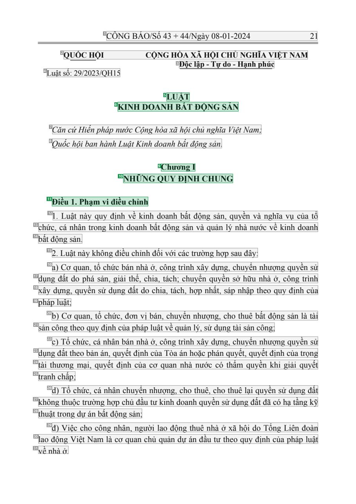
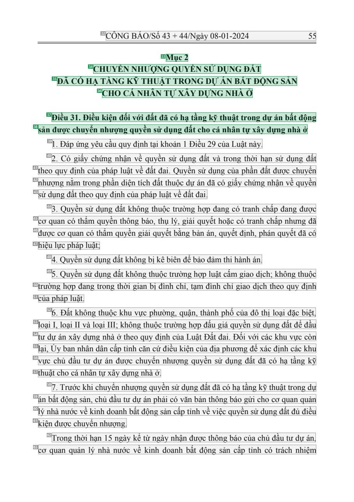
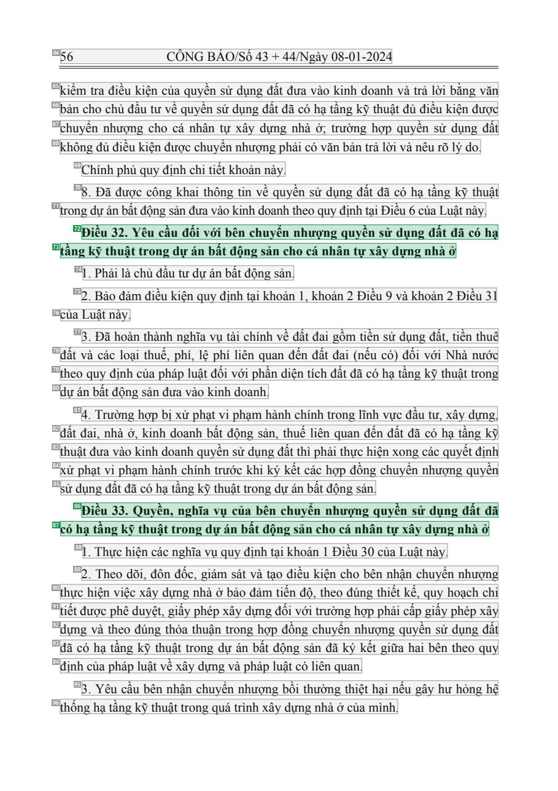

# 008 — `todo10_8/heading_corpus_100/01_phap_quy/008_Luat_Kinh_doanh_BDS_29-2023-QH15.pdf`

Draft `P7_F1Q_HELDOUT_GOLD_DRAFT_V2`, status `DRAFT_REVIEWER_A_NOT_APPROVED`, draft sha256 `23a040dd2d16fa61f9192e9b528c7f0fbe29af829ee90fe49d244d120d1317a0`. Source sha256 `a4399dc8e26063d753ecdf96e5833cfb573ad9265c3e74ab86e3e6f51ce00063`. [Back to index](README.md)

Approve or correct with `review-apply` lines: `APPROVE 008 by <reviewer> [because <note>]`, `008 <alias> -> E|R|O because <reason>`.

## Page 1 (FIRST)

| # | alias | text | font | draft | flag | rationale |
|---:|---|---|---|---|---|---|
| 1 | L0000:S0 | C&#212;NG B&#193;O/Số 43 + 44/Ng&#224;y 08-01-2024 21 | 14 | **OTHER** |  | C&#244;ng B&#225;o running header (page furniture) |
| 2 | L0001:S0 | QUỐC HỘI CỘNG H&#210;A X&#195; HỘI CHỦ NGHĨA VIỆT NAM | 13 B | **OTHER** |  | Issuer &quot;QUỐC HỘI&quot; and national name (letterhead) |
| 3 | L0002:S0 | Độc lập - Tự do - Hạnh ph&#250;c | 13 B | **OTHER** |  | National motto |
| 4 | L0003:S0 | Luật số: 29/2023/QH15 | 13 | **OTHER** |  | Document number &quot;Luật số: 29/2023/QH15&quot; |
| 5 | L0004:S0 | LUẬT | 14 B | **ESTABLISHES** |  | Document type title &quot;LUẬT&quot; (bold, centred) |
| 6 | L0005:S0 | KINH DOANH BẤT ĐỘNG SẢN | 14 B | **ESTABLISHES** |  | Document title &quot;KINH DOANH BẤT ĐỘNG SẢN&quot; (bold, centred) |
| 7 | L0006:S0 | Căn cứHiến ph&#225;p nước Cộng h&#242;a x&#227; hội chủ nghĩa Việt Nam; | 14 I | **OTHER** |  | Default: body text, list item, table cell, page number or other non-heading content on this page |
| 8 | L0007:S0 | Quốc hội ban h&#224;nh Luật Kinh doanh bất động sản. | 14 I | **OTHER** |  | Default: body text, list item, table cell, page number or other non-heading content on this page |
| 9 | L0008:S0 | Chương I | 14 B | **ESTABLISHES** |  | Chapter label &quot;Chương I&quot; (bold, centred) |
| 10 | L0009:S0 | NHỮNG QUY ĐỊNH CHUNG | 14 B | **ESTABLISHES** |  | Chapter title &quot;NHỮNG QUY ĐỊNH CHUNG&quot; (bold, centred) |
| 11 | L0010:S0 | Điều 1. Phạm vi điều chỉnh | 14 B | **ESTABLISHES** |  | Article heading &quot;Điều 1. Phạm vi điều chỉnh&quot; (bold) |
| 12 | L0011:S0 | 1 . Luật n&#224;y quy định về kinh doanh bất động sản, quyền v&#224; nghĩa vụ của tổ | 14 | **OTHER** |  | Default: body text, list item, table cell, page number or other non-heading content on this page |
| 13 | L0012:S0 | chức, c&#225; nh&#226;n trong kinh doanh bất động sản v&#224; quản l&#253; nh&#224; nước về kinh doanh | 14 | **OTHER** |  | Default: body text, list item, table cell, page number or other non-heading content on this page |
| 14 | L0013:S0 | bất động sản. | 14 | **OTHER** |  | Default: body text, list item, table cell, page number or other non-heading content on this page |
| 15 | L0014:S0 | 2. Luật n&#224;y kh&#244;ng điều chỉnh đối với c&#225;c trường hợp sau đ&#226;y: | 14 | **OTHER** |  | Default: body text, list item, table cell, page number or other non-heading content on this page |
| 16 | L0015:S0 | a) Cơ quan, tổ chức b&#225;n nh&#224; ở, c&#244;ng tr&#236;nh x&#226;y dựng, chuyển nhượng quyền sử | 14 | **OTHER** |  | Default: body text, list item, table cell, page number or other non-heading content on this page |
| 17 | L0016:S0 | dụng đất do ph&#225; sản, giải thể, chia, t&#225;ch; chuyển quyền sở hữu nh&#224; ở, c&#244;ng tr&#236;nh | 14 | **OTHER** |  | Default: body text, list item, table cell, page number or other non-heading content on this page |
| 18 | L0017:S0 | x&#226;y dựng, quyền sử dụng đất do chia, t&#225;ch, hợp nhất, s&#225;p nhập theo quy định của | 14 | **OTHER** |  | Default: body text, list item, table cell, page number or other non-heading content on this page |
| 19 | L0018:S0 | ph&#225;p luật; | 14 | **OTHER** |  | Default: body text, list item, table cell, page number or other non-heading content on this page |
| 20 | L0019:S0 | b) Cơ quan, tổ chức, đơn vị b&#225;n, chuyển nhượng, cho thu&#234; bất động sản l&#224; t&#224;i | 14 | **OTHER** |  | Default: body text, list item, table cell, page number or other non-heading content on this page |
| 21 | L0020:S0 | sản c&#244;ng theo quy định của ph&#225;p luật về quản l&#253;, sử dụng t&#224;i sản c&#244;ng; | 14 | **OTHER** |  | Default: body text, list item, table cell, page number or other non-heading content on this page |
| 22 | L0021:S0 | c) Tổ chức, c&#225; nh&#226;n b&#225;n nh&#224; ở, c&#244;ng tr&#236;nh x&#226;y dựng, chuyển nhượng quyền sử | 14 | **OTHER** |  | Default: body text, list item, table cell, page number or other non-heading content on this page |
| 23 | L0022:S0 | dụng đất theo bản &#225;n, quyết định của T&#242;a &#225;n hoặc ph&#225;n quyết, quyết định của trọng | 14 | **OTHER** |  | Default: body text, list item, table cell, page number or other non-heading content on this page |
| 24 | L0023:S0 | t&#224;i thương mại, quyết định của cơ quan nh&#224; nước c&#243; thẩm quyền khi giải quyết | 14 | **OTHER** |  | Default: body text, list item, table cell, page number or other non-heading content on this page |
| 25 | L0024:S0 | tranh chấp; | 14 | **OTHER** |  | Default: body text, list item, table cell, page number or other non-heading content on this page |
| 26 | L0025:S0 | d) Tổ chức, c&#225; nh&#226;n chuyển nhượng, cho thu&#234;, cho thu&#234; lại quyền sử dụng đất | 14 | **OTHER** |  | Default: body text, list item, table cell, page number or other non-heading content on this page |
| 27 | L0026:S0 | kh&#244;ng thuộc trường hợp chủ đầu tư kinh doanh quyền sử dụng đất đ&#227; c&#243; hạ tầng kỹ | 14 | **OTHER** |  | Default: body text, list item, table cell, page number or other non-heading content on this page |
| 28 | L0027:S0 | thuật trong dự &#225;n bất động sản; | 14 | **OTHER** |  | Default: body text, list item, table cell, page number or other non-heading content on this page |
| 29 | L0028:S0 | đ) Việc cho c&#244;ng nh&#226;n, người lao động thu&#234; nh&#224; ở x&#227; hội do Tổng Li&#234;n đo&#224;n | 14 | **OTHER** |  | Default: body text, list item, table cell, page number or other non-heading content on this page |
| 30 | L0029:S0 | lao động Việt Nam l&#224; cơ quan chủ quản dự &#225;n đầu tư theo quy định của ph&#225;p luật | 14 | **OTHER** |  | Default: body text, list item, table cell, page number or other non-heading content on this page |
| 31 | L0030:S0 | về nh&#224; ở. | 14 | **OTHER** |  | Default: body text, list item, table cell, page number or other non-heading content on this page |

**OTHER rows to check for a missed heading on page 1** (body size 14pt; bold or ≥ body+1pt, ≤ 12 words): #2 `L0001:S0` QUỐC HỘI CỘNG H&#210;A X&#195; HỘI CHỦ NGHĨA VIỆT NAM (13 B), #3 `L0002:S0` Độc lập - Tự do - Hạnh ph&#250;c (13 B).

## Page 35 (SEEDED_INTERIOR)

| # | alias | text | font | draft | flag | rationale |
|---:|---|---|---|---|---|---|
| 32 | L1118:S0 | C&#212;NG B&#193;O/Số 43 + 44/Ng&#224;y 08-01-2024 55 | 14 | **OTHER** |  | C&#244;ng B&#225;o running header (page furniture) |
| 33 | L1119:S0 | Mục 2 | 14 B | **ESTABLISHES** |  | Section label &quot;Mục 2&quot; (bold, centred) |
| 34 | L1120:S0 | CHUYỂN NHƯỢNG QUYỀN SỬDỤNG ĐẤT | 14 B | **ESTABLISHES** |  | Section title line 1 &quot;CHUYỂN NHƯỢNG QUYỀN SỬ DỤNG ĐẤT&quot; (bold, centred) |
| 35 | L1121:S0 | Đ&#195; C&#211; HẠ TẦNG KỸ THUẬT TRONG DỰ&#193;N BẤT ĐỘNG SẢN | 14 B | **ESTABLISHES** |  | Section title line 2 (bold, centred) |
| 36 | L1122:S0 | CHO C&#193; NH&#194;N TỰX&#194;Y DỰNG NH&#192; Ở | 14 B | **ESTABLISHES** |  | Section title line 3 (bold, centred) |
| 37 | L1123:S0 | Điều 31. Điều kiện đối với đất đ&#227; c&#243; hạ tầng kỹ thuật trong dự &#225;n bất động | 14 B | **ESTABLISHES** |  | Article heading &quot;Điều 31. Điều kiện đối với đất ...&quot; line 1 (bold) |
| 38 | L1124:S0 | sản được chuyển nhượng quyền sử dụng đất cho c&#225; nh&#226;n tự x&#226;y dựng nh&#224; ở | 14 B | **ESTABLISHES** |  | Article heading line 2 (bold continuation) |
| 39 | L1125:S0 | 1 . Đ&#225;p ứng y&#234;u cầu quy định tại khoản 1 Điều 29 của Luật n&#224;y. | 14 | **OTHER** |  | Default: body text, list item, table cell, page number or other non-heading content on this page |
| 40 | L1126:S0 | 2. C&#243; giấy chứng nhận về quyền sử dụng đất v&#224; trong thời hạn sử dụng đất | 14 | **OTHER** |  | Default: body text, list item, table cell, page number or other non-heading content on this page |
| 41 | L1127:S0 | theo quy định của ph&#225;p luật về đất đai. Quyền sử dụng của phần đất được chuyển | 14 | **OTHER** |  | Default: body text, list item, table cell, page number or other non-heading content on this page |
| 42 | L1128:S0 | nhượng nằm trong phần diện t&#237;ch đất thuộc dự &#225;n đ&#227; c&#243; giấy chứng nhận về quyền | 14 | **OTHER** |  | Default: body text, list item, table cell, page number or other non-heading content on this page |
| 43 | L1129:S0 | sử dụng đất theo quy định của ph&#225;p luật về đất đai. | 14 | **OTHER** |  | Default: body text, list item, table cell, page number or other non-heading content on this page |
| 44 | L1130:S0 | 3. Quyền sử dụng đất kh&#244;ng thuộc trường hợp đang c&#243; tranh chấp đang được | 14 | **OTHER** |  | Default: body text, list item, table cell, page number or other non-heading content on this page |
| 45 | L1131:S0 | cơ quan c&#243; thẩm quyền th&#244;ng b&#225;o, thụ l&#253;, giải quyết hoặc c&#243; tranh chấp nhưng đ&#227; | 14 | **OTHER** |  | Default: body text, list item, table cell, page number or other non-heading content on this page |
| 46 | L1132:S0 | được cơ quan c&#243; thẩm quyền giải quyết bằng bản &#225;n, quyết định, ph&#225;n quyết đ&#227; c&#243; | 14 | **OTHER** |  | Default: body text, list item, table cell, page number or other non-heading content on this page |
| 47 | L1133:S0 | hiệu lực ph&#225;p luật; | 14 | **OTHER** |  | Default: body text, list item, table cell, page number or other non-heading content on this page |
| 48 | L1134:S0 | 4. Quyền sử dụng đất kh&#244;ng bị k&#234; bi&#234;n để bảo đảm thi h&#224;nh &#225;n. | 14 | **OTHER** |  | Default: body text, list item, table cell, page number or other non-heading content on this page |
| 49 | L1135:S0 | 5. Quyền sử dụng đất kh&#244;ng thuộc trường hợp luật cấm giao dịch; kh&#244;ng thuộc | 14 | **OTHER** |  | Default: body text, list item, table cell, page number or other non-heading content on this page |
| 50 | L1136:S0 | trường hợp đang trong thời gian bị đ&#236;nh chỉ, tạm đ&#236;nh chỉ giao dịch theo quy định | 14 | **OTHER** |  | Default: body text, list item, table cell, page number or other non-heading content on this page |
| 51 | L1137:S0 | của ph&#225;p luật. | 14 | **OTHER** |  | Default: body text, list item, table cell, page number or other non-heading content on this page |
| 52 | L1138:S0 | 6. Đất kh&#244;ng thuộc khu vực phường, quận, th&#224;nh phố của đ&#244; thị loại đặc biệt, | 14 | **OTHER** |  | Default: body text, list item, table cell, page number or other non-heading content on this page |
| 53 | L1139:S0 | loại I, loại II v&#224; loại III; kh&#244;ng thuộc trường hợp đấu gi&#225; quyền sử dụng đất để đầu | 14 | **OTHER** |  | Default: body text, list item, table cell, page number or other non-heading content on this page |
| 54 | L1140:S0 | tư dự &#225;n x&#226;y dựng nh&#224; ở theo quy định của Luật Đất đai. Đối với c&#225;c khu vực c&#242;n | 14 | **OTHER** |  | Default: body text, list item, table cell, page number or other non-heading content on this page |
| 55 | L1141:S0 | lại, Ủy ban nh&#226;n d&#226;n cấp tỉnh căn cứ điều kiện của địa phương để x&#225;c định c&#225;c khu | 14 | **OTHER** |  | Default: body text, list item, table cell, page number or other non-heading content on this page |
| 56 | L1142:S0 | vực chủ đầu tư dự &#225;n được chuyển nhượng quyền sử dụng đất đ&#227; c&#243; hạ tầng kỹ | 14 | **OTHER** |  | Default: body text, list item, table cell, page number or other non-heading content on this page |
| 57 | L1143:S0 | thuật cho c&#225; nh&#226;n tự x&#226;y dựng nh&#224; ở. | 14 | **OTHER** |  | Default: body text, list item, table cell, page number or other non-heading content on this page |
| 58 | L1144:S0 | 7. Trước khi chuyển nhượng quyền sử dụng đất đ&#227; c&#243; hạ tầng kỹ thuật trong dự | 14 | **OTHER** |  | Default: body text, list item, table cell, page number or other non-heading content on this page |
| 59 | L1145:S0 | &#225;n bất động sản, chủ đầu tư dự &#225;n phải c&#243; văn bản th&#244;ng b&#225;o gửi cho cơ quan quản | 14 | **OTHER** |  | Default: body text, list item, table cell, page number or other non-heading content on this page |
| 60 | L1146:S0 | l&#253; nh&#224; nước về kinh doanh bất động sản cấp tỉnh về việc quyền sử dụng đất đủ điều | 14 | **OTHER** |  | Default: body text, list item, table cell, page number or other non-heading content on this page |
| 61 | L1147:S0 | kiện được chuyển nhượng. | 14 | **OTHER** |  | Default: body text, list item, table cell, page number or other non-heading content on this page |
| 62 | L1148:S0 | Trong thời hạn 15 ng&#224;y kể từ ng&#224;y nhận được th&#244;ng b&#225;o của chủ đầu tư dự &#225;n, | 14 | **OTHER** |  | Default: body text, list item, table cell, page number or other non-heading content on this page |
| 63 | L1149:S0 | cơ quan quản l&#253; nh&#224; nước về kinh doanh bất động sản cấp tỉnh c&#243; tr&#225;ch nhiệm | 14 | **OTHER** |  | Default: body text, list item, table cell, page number or other non-heading content on this page |

**OTHER rows to check for a missed heading on page 35** (body size 14pt; bold or ≥ body+1pt, ≤ 12 words): none.

## Page 36 (SEEDED_INTERIOR)

| # | alias | text | font | draft | flag | rationale |
|---:|---|---|---|---|---|---|
| 64 | L1150:S0 | 56 C&#212;NG B&#193;O/Số 43 + 44/Ng&#224;y 08-01-2024 | 14 | **OTHER** |  | C&#244;ng B&#225;o running header (page furniture) |
| 65 | L1151:S0 | kiểm tra điều kiện của quyền sử dụng đất đưa v&#224;o kinh doanh v&#224; trả lời bằng văn | 14 | **OTHER** |  | Default: body text, list item, table cell, page number or other non-heading content on this page |
| 66 | L1152:S0 | bản cho chủ đầu tư về quyền sử dụng đất đ&#227; c&#243; hạ tầng kỹ thuật đủ điều kiện được | 14 | **OTHER** |  | Default: body text, list item, table cell, page number or other non-heading content on this page |
| 67 | L1153:S0 | chuyển nhượng cho c&#225; nh&#226;n tự x&#226;y dựng nh&#224; ở; trường hợp quyền sử dụng đất | 14 | **OTHER** |  | Default: body text, list item, table cell, page number or other non-heading content on this page |
| 68 | L1154:S0 | kh&#244;ng đủ điều kiện được chuyển nhượng phải c&#243; văn bản trả lời v&#224; n&#234;u r&#245; l&#253; do. | 14 | **OTHER** |  | Default: body text, list item, table cell, page number or other non-heading content on this page |
| 69 | L1155:S0 | Ch&#237;nh phủ quy định chi tiết khoản n&#224;y. | 14 | **OTHER** |  | Default: body text, list item, table cell, page number or other non-heading content on this page |
| 70 | L1156:S0 | 8. Đ&#227; được c&#244;ng khai th&#244;ng tin về quyền sử dụng đất đ&#227; c&#243; hạ tầng kỹ thuật | 14 | **OTHER** |  | Default: body text, list item, table cell, page number or other non-heading content on this page |
| 71 | L1157:S0 | trong dự &#225;n bất động sản đưa v&#224;o kinh doanh theo quy định tại Điều 6 của Luật n&#224;y. | 14 | **OTHER** |  | Default: body text, list item, table cell, page number or other non-heading content on this page |
| 72 | L1158:S0 | Điều 32. Y&#234;u cầu đối với b&#234;n chuyển nhượng quyền sử dụng đất đ&#227; c&#243; hạ | 14 B | **ESTABLISHES** |  | Article heading &quot;Điều 32. Y&#234;u cầu đối với b&#234;n chuyển nhượng ...&quot; line 1 (bold) |
| 73 | L1159:S0 | tầng kỹ thuật trong dự &#225;n bất động sản cho c&#225; nh&#226;n tự x&#226;y dựng nh&#224; ở | 14 B | **ESTABLISHES** |  | Article heading line 2 (bold continuation) |
| 74 | L1160:S0 | 1 . Phải l&#224; chủ đầu tư dự &#225;n bất động sản. | 14 | **OTHER** |  | Default: body text, list item, table cell, page number or other non-heading content on this page |
| 75 | L1161:S0 | 2. Bảo đảm điều kiện quy định tại khoản 1, khoản 2 Điều 9 v&#224; khoản 2 Điều 3 1 | 14 | **OTHER** |  | Default: body text, list item, table cell, page number or other non-heading content on this page |
| 76 | L1162:S0 | của Luật n&#224;y. | 14 | **OTHER** |  | Default: body text, list item, table cell, page number or other non-heading content on this page |
| 77 | L1163:S0 | 3. Đ&#227; ho&#224;n th&#224;nh nghĩa vụ t&#224;i ch&#237;nh về đất đai gồm tiền sử dụng đất, tiền thu&#234; | 14 | **OTHER** |  | Default: body text, list item, table cell, page number or other non-heading content on this page |
| 78 | L1164:S0 | đất v&#224; c&#225;c loại thuế, ph&#237;, lệ ph&#237; li&#234;n quan đến đất đai (nếu c&#243;) đối với Nh&#224; nước | 14 | **OTHER** |  | Default: body text, list item, table cell, page number or other non-heading content on this page |
| 79 | L1165:S0 | theo quy định của ph&#225;p luật đối với phần diện t&#237;ch đất đ&#227; c&#243; hạ tầng kỹ thuật trong | 14 | **OTHER** |  | Default: body text, list item, table cell, page number or other non-heading content on this page |
| 80 | L1166:S0 | dự &#225;n bất động sản đưa v&#224;o kinh doanh. | 14 | **OTHER** |  | Default: body text, list item, table cell, page number or other non-heading content on this page |
| 81 | L1167:S0 | 4. Trường hợp bị xử phạt vi phạm h&#224;nh ch&#237;nh trong lĩnh vực đầu tư, x&#226;y dựng, | 14 | **OTHER** |  | Default: body text, list item, table cell, page number or other non-heading content on this page |
| 82 | L1168:S0 | đất đai, nh&#224; ở, kinh doanh bất động sản, thuế li&#234;n quan đến đất đ&#227; c&#243; hạ tầng kỹ | 14 | **OTHER** |  | Default: body text, list item, table cell, page number or other non-heading content on this page |
| 83 | L1169:S0 | thuật đưa v&#224;o kinh doanh quyền sử dụng đất th&#236; phải thực hiện xong c&#225;c quyết định | 14 | **OTHER** |  | Default: body text, list item, table cell, page number or other non-heading content on this page |
| 84 | L1170:S0 | xử phạt vi phạm h&#224;nh ch&#237;nh trước khi k&#253; kết c&#225;c hợp đồng chuyển nhượng quyền | 14 | **OTHER** |  | Default: body text, list item, table cell, page number or other non-heading content on this page |
| 85 | L1171:S0 | sử dụng đất đ&#227; c&#243; hạ tầng kỹ thuật trong dự &#225;n bất động sản. | 14 | **OTHER** |  | Default: body text, list item, table cell, page number or other non-heading content on this page |
| 86 | L1172:S0 | Điều 33. Quyền, nghĩa vụ của b&#234;n chuyển nhượng quyền sử dụng đất đ&#227; | 14 B | **ESTABLISHES** |  | Article heading &quot;Điều 33. Quyền, nghĩa vụ của b&#234;n chuyển nhượng ...&quot; line 1 (bold) |
| 87 | L1173:S0 | c&#243; hạ tầng kỹ thuật trong dự &#225;n bất động sản cho c&#225; nh&#226;n tự x&#226;y dựng nh&#224; ở | 14 B | **ESTABLISHES** |  | Article heading line 2 (bold continuation) |
| 88 | L1174:S0 | 1 . Thực hiện c&#225;c nghĩa vụ quy định tại khoản 1 Điều 30 của Luật n&#224;y. | 14 | **OTHER** |  | Default: body text, list item, table cell, page number or other non-heading content on this page |
| 89 | L1175:S0 | 2. Theo d&#245;i, đ&#244;n đốc, gi&#225;m s&#225;t v&#224; tạo điều kiện cho b&#234;n nhận chuyển nhượng | 14 | **OTHER** |  | Default: body text, list item, table cell, page number or other non-heading content on this page |
| 90 | L1176:S0 | thực hiện việc x&#226;y dựng nh&#224; ở bảo đảm tiến độ, theo đ&#250;ng thiết kế, quy hoạch chi | 14 | **OTHER** |  | Default: body text, list item, table cell, page number or other non-heading content on this page |
| 91 | L1177:S0 | tiết được ph&#234; duyệt, giấy ph&#233;p x&#226;y dựng đối với trường hợp phải cấp giấy ph&#233;p x&#226;y | 14 | **OTHER** |  | Default: body text, list item, table cell, page number or other non-heading content on this page |
| 92 | L1178:S0 | dựng v&#224; theo đ&#250;ng thỏa thuận trong hợp đồng chuyển nhượng quyền sử dụng đất | 14 | **OTHER** |  | Default: body text, list item, table cell, page number or other non-heading content on this page |
| 93 | L1179:S0 | đ&#227; c&#243; hạ tầng kỹ thuật trong dự &#225;n bất động sản đ&#227; k&#253; kết giữa hai b&#234;n theo quy | 14 | **OTHER** |  | Default: body text, list item, table cell, page number or other non-heading content on this page |
| 94 | L1180:S0 | định của ph&#225;p luật về x&#226;y dựng v&#224; ph&#225;p luật c&#243; li&#234;n quan. | 14 | **OTHER** |  | Default: body text, list item, table cell, page number or other non-heading content on this page |
| 95 | L1181:S0 | 3. Y&#234;u cầu b&#234;n nhận chuyển nhượng bồi thường thiệt hại nếu g&#226;y hư hỏng hệ | 14 | **OTHER** |  | Default: body text, list item, table cell, page number or other non-heading content on this page |
| 96 | L1182:S0 | thống hạ tầng kỹ thuật trong qu&#225; tr&#236;nh x&#226;y dựng nh&#224; ở của m&#236;nh. | 14 | **OTHER** |  | Default: body text, list item, table cell, page number or other non-heading content on this page |

**OTHER rows to check for a missed heading on page 36** (body size 14pt; bold or ≥ body+1pt, ≤ 12 words): none.
