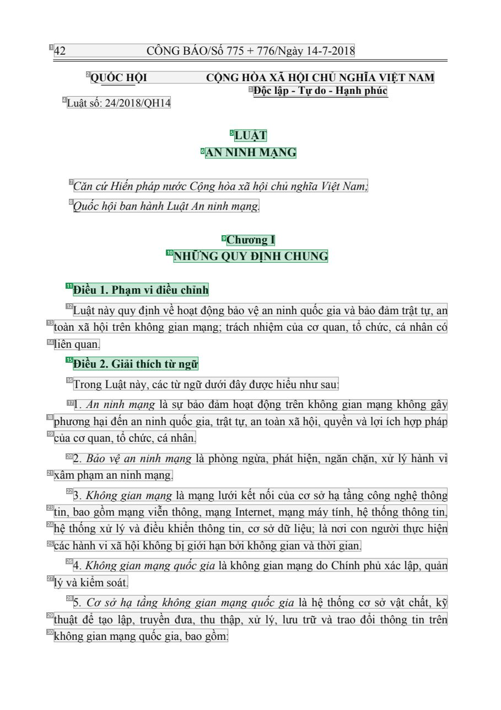
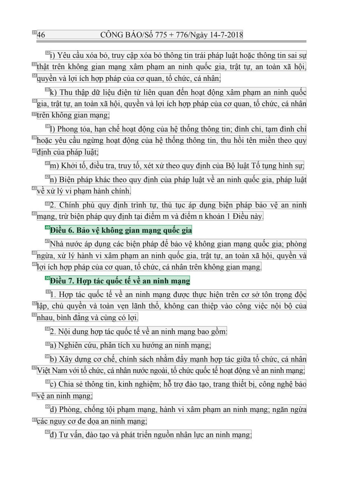
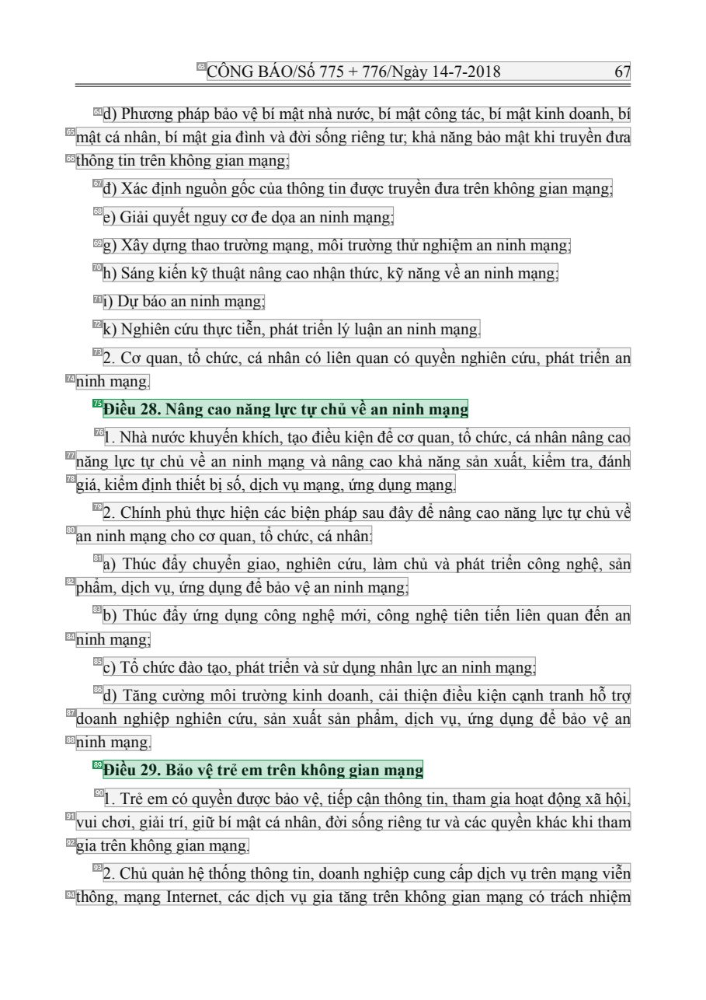

# 010 — `todo10_8/heading_corpus_100/01_phap_quy/010_Luat_An_ninh_mang_24-2018-QH14.pdf`

Draft `P7_F1Q_HELDOUT_GOLD_DRAFT_V2`, status `DRAFT_REVIEWER_A_NOT_APPROVED`, draft sha256 `c793fd0fdc4fe99a5519d48c9bfc266663a8f3d58a3ad0e5833d3793461b7ddd`. Source sha256 `7ba6b742325359b442b4e5a7a905defba286eedb39210f59a1d8983d3d916a4a`. [Back to index](README.md)

Approve or correct with `review-apply` lines: `APPROVE 010 by <reviewer> [because <note>]`, `010 <alias> -> E|R|O because <reason>`.

## Page 1 (FIRST)

| # | alias | text | font | draft | flag | rationale |
|---:|---|---|---|---|---|---|
| 1 | L0000:S0 | 42 C&#212;NG B&#193;O/Số 775 + 776/Ng&#224;y 14-7-2018 | 14 | **OTHER** |  | C&#244;ng B&#225;o running header &quot;42 C&#212;NG B&#193;O/Số 775 + 776/Ng&#224;y 14-7-2018&quot; (page furniture) |
| 2 | L0001:S0 | QUỐC HỘI CỘNG H&#210;A X&#195; HỘI CHỦ NGHĨA VIỆT NAM | 13 B | **OTHER** |  | Issuer &quot;QUỐC HỘI&quot; and national name on the same line (letterhead) |
| 3 | L0002:S0 | Độc lập - Tự do - Hạnh ph&#250;c | 13 B | **OTHER** |  | National motto &quot;Độc lập - Tự do - Hạnh ph&#250;c&quot; |
| 4 | L0003:S0 | Luật số: 24/201 8/QH14 | 13 | **OTHER** |  | Document number &quot;Luật số: 24/2018/QH14&quot; |
| 5 | L0004:S0 | LUẬT | 14 B | **ESTABLISHES** |  | Document type title &quot;LUẬT&quot; (bold, centred) |
| 6 | L0005:S0 | AN NINH MẠNG | 14 B | **ESTABLISHES** |  | Document title &quot;AN NINH MẠNG&quot; (bold, centred) |
| 7 | L0006:S0 | Căn cứHiến ph&#225;p nước Cộng h&#242;a x&#227; hội chủ nghĩa Việt Nam; | 14 I | **OTHER** |  | Default: body text, list item, table cell, page number or other non-heading content on this page |
| 8 | L0007:S0 | Quốc hội ban h&#224;nh Luật An ninh mạng. | 14 I | **OTHER** |  | Default: body text, list item, table cell, page number or other non-heading content on this page |
| 9 | L0008:S0 | Chương I | 14 B | **ESTABLISHES** |  | Chapter label &quot;Chương I&quot; (bold, centred) |
| 10 | L0009:S0 | NHỮNG QUY ĐỊNH CHUNG | 14 B | **ESTABLISHES** |  | Chapter title &quot;NHỮNG QUY ĐỊNH CHUNG&quot; (bold, centred) |
| 11 | L0010:S0 | Điều 1. Phạm vi điều chỉnh | 14 B | **ESTABLISHES** |  | Article heading &quot;Điều 1. Phạm vi điều chỉnh&quot; (bold) |
| 12 | L0011:S0 | Luật n&#224;y quy định về hoạt động bảo vệ an ninh quốc gia v&#224; bảo đảm trật tự, an | 14 | **OTHER** |  | Default: body text, list item, table cell, page number or other non-heading content on this page |
| 13 | L0012:S0 | to&#224;n x&#227; hội tr&#234;n kh&#244;ng gian mạng; tr&#225;ch nhiệm của cơ quan, tổ chức, c&#225; nh&#226;n c&#243; | 14 | **OTHER** |  | Default: body text, list item, table cell, page number or other non-heading content on this page |
| 14 | L0013:S0 | li&#234;n quan. | 14 | **OTHER** |  | Default: body text, list item, table cell, page number or other non-heading content on this page |
| 15 | L0014:S0 | Điều 2. Giải th&#237;ch từ ngữ | 14 B | **ESTABLISHES** |  | Article heading &quot;Điều 2. Giải th&#237;ch từ ngữ&quot; (bold) |
| 16 | L0015:S0 | Trong Luật n&#224;y, c&#225;c từ ngữ dưới đ&#226;y được hiểu như sau: | 14 | **OTHER** |  | Default: body text, list item, table cell, page number or other non-heading content on this page |
| 17 | L0016:S0 | 1 . An ninh mạng l&#224; sự bảo đảm hoạt động tr&#234;n kh&#244;ng gian mạng kh&#244;ng g&#226;y | 14 | **OTHER** |  | Default: body text, list item, table cell, page number or other non-heading content on this page |
| 18 | L0017:S0 | phương hại đến an ninh quốc gia, trật tự, an to&#224;n x&#227; hội, quyền v&#224; lợi &#237;ch hợp ph&#225;p | 14 | **OTHER** |  | Default: body text, list item, table cell, page number or other non-heading content on this page |
| 19 | L0018:S0 | của cơ quan, tổ chức, c&#225; nh&#226;n. | 14 | **OTHER** |  | Default: body text, list item, table cell, page number or other non-heading content on this page |
| 20 | L0019:S0 | 2. Bảo vệ an ninh mạng l&#224; ph&#242;ng ngừa, ph&#225;t hiện, ngăn chặn, xử l&#253; h&#224;nh vi | 14 | **OTHER** |  | Default: body text, list item, table cell, page number or other non-heading content on this page |
| 21 | L0020:S0 | x&#226;m phạm an ninh mạng. | 14 | **OTHER** |  | Default: body text, list item, table cell, page number or other non-heading content on this page |
| 22 | L0021:S0 | 3. Kh&#244;ng gian mạng l&#224; mạng lưới kết nối của cơ sở hạ tầng c&#244;ng nghệ th&#244;ng | 14 | **OTHER** |  | Default: body text, list item, table cell, page number or other non-heading content on this page |
| 23 | L0022:S0 | tin, bao gồm mạng viễn th&#244;ng, mạng Internet, mạng m&#225;y t&#237;nh, hệ thống th&#244;ng tin, | 14 | **OTHER** |  | Default: body text, list item, table cell, page number or other non-heading content on this page |
| 24 | L0023:S0 | hệ thống xử l&#253; v&#224; điều khiển th&#244;ng tin, cơ sở dữ liệu; l&#224; nơi con người thực hiện | 14 | **OTHER** |  | Default: body text, list item, table cell, page number or other non-heading content on this page |
| 25 | L0024:S0 | c&#225;c h&#224;nh vi x&#227; hội kh&#244;ng bị giới hạn bởi kh&#244;ng gian v&#224; thời gian. | 14 | **OTHER** |  | Default: body text, list item, table cell, page number or other non-heading content on this page |
| 26 | L0025:S0 | 4. Kh&#244;ng gian mạng quốc gia l&#224; kh&#244;ng gian mạng do Ch&#237;nh phủ x&#225;c lập, quản | 14 | **OTHER** |  | Default: body text, list item, table cell, page number or other non-heading content on this page |
| 27 | L0026:S0 | l&#253; v&#224; kiểm so&#225;t. | 14 | **OTHER** |  | Default: body text, list item, table cell, page number or other non-heading content on this page |
| 28 | L0027:S0 | 5. Cơ sở hạ tầng kh&#244;ng gian mạng quốc gia l&#224; hệ thống cơ sở vật chất, kỹ | 14 | **OTHER** |  | Default: body text, list item, table cell, page number or other non-heading content on this page |
| 29 | L0028:S0 | thuật để tạo lập, truyền đưa, thu thập, xử l&#253;, lưu trữ v&#224; trao đổi th&#244;ng tin tr&#234;n | 14 | **OTHER** |  | Default: body text, list item, table cell, page number or other non-heading content on this page |
| 30 | L0029:S0 | kh&#244;ng gian mạng quốc gia, bao gồm: | 14 | **OTHER** |  | Default: body text, list item, table cell, page number or other non-heading content on this page |

**OTHER rows to check for a missed heading on page 1** (body size 14pt; bold or ≥ body+1pt, ≤ 12 words): #2 `L0001:S0` QUỐC HỘI CỘNG H&#210;A X&#195; HỘI CHỦ NGHĨA VIỆT NAM (13 B), #3 `L0002:S0` Độc lập - Tự do - Hạnh ph&#250;c (13 B).

## Page 5 (SEEDED_INTERIOR)

| # | alias | text | font | draft | flag | rationale |
|---:|---|---|---|---|---|---|
| 31 | L0128:S0 | 46 C&#212;NG B&#193;O/Số 775 + 776/Ng&#224;y 14-7-2018 | 14 | **OTHER** |  | C&#244;ng B&#225;o running header (page furniture) |
| 32 | L0129:S0 | i) Y&#234;u cầu x&#243;a bỏ, truy cập x&#243;a bỏ th&#244;ng tin tr&#225;i ph&#225;p luật hoặc th&#244;ng tin sai sự | 14 | **OTHER** |  | Default: body text, list item, table cell, page number or other non-heading content on this page |
| 33 | L0130:S0 | thật tr&#234;n kh&#244;ng gian mạng x&#226;m phạm an ninh quốc gia, trật tự, an to&#224;n x&#227; hội, | 14 | **OTHER** |  | Default: body text, list item, table cell, page number or other non-heading content on this page |
| 34 | L0131:S0 | quyền v&#224; lợi &#237;ch hợp ph&#225;p của cơ quan, tổ chức, c&#225; nh&#226;n; | 14 | **OTHER** |  | Default: body text, list item, table cell, page number or other non-heading content on this page |
| 35 | L0132:S0 | k) Thu thập dữ liệu điện tử li&#234;n quan đến hoạt động x&#226;m phạm an ninh quốc | 14 | **OTHER** |  | Default: body text, list item, table cell, page number or other non-heading content on this page |
| 36 | L0133:S0 | gia, trật tự, an to&#224;n x&#227; hội, quyền v&#224; lợi &#237;ch hợp ph&#225;p của cơ quan, tổ chức, c&#225; nh&#226;n | 14 | **OTHER** |  | Default: body text, list item, table cell, page number or other non-heading content on this page |
| 37 | L0134:S0 | tr&#234;n kh&#244;ng gian mạng; | 14 | **OTHER** |  | Default: body text, list item, table cell, page number or other non-heading content on this page |
| 38 | L0135:S0 | l) Phong tỏa, hạn chế hoạt động của hệ thống th&#244;ng tin; đ&#236;nh chỉ, tạm đ&#236;nh chỉ | 14 | **OTHER** |  | Default: body text, list item, table cell, page number or other non-heading content on this page |
| 39 | L0136:S0 | hoặc y&#234;u cầu ngừng hoạt động của hệ thống th&#244;ng tin, thu hồi t&#234;n miền theo quy | 14 | **OTHER** |  | Default: body text, list item, table cell, page number or other non-heading content on this page |
| 40 | L0137:S0 | định của ph&#225;p luật; | 14 | **OTHER** |  | Default: body text, list item, table cell, page number or other non-heading content on this page |
| 41 | L0138:S0 | m) Khởi tố, điều tra, truy tố, x&#233;t xử theo quy định của Bộ luật Tố tụng h&#236;nh sự; | 14 | **OTHER** |  | Default: body text, list item, table cell, page number or other non-heading content on this page |
| 42 | L0139:S0 | n) Biện ph&#225;p kh&#225;c theo quy định của ph&#225;p luật về an ninh quốc gia, ph&#225;p luật | 14 | **OTHER** |  | Default: body text, list item, table cell, page number or other non-heading content on this page |
| 43 | L0140:S0 | về xử l&#253; vi phạm h&#224;nh ch&#237;nh. | 14 | **OTHER** |  | Default: body text, list item, table cell, page number or other non-heading content on this page |
| 44 | L0141:S0 | 2. Ch&#237;nh phủ quy định tr&#236;nh tự, thủ tục &#225;p dụng biện ph&#225;p bảo vệ an ninh | 14 | **OTHER** |  | Default: body text, list item, table cell, page number or other non-heading content on this page |
| 45 | L0142:S0 | mạng, trừ biện ph&#225;p quy định tại điểm m v&#224; điểm n khoản 1 Điều n&#224;y. | 14 | **OTHER** |  | Default: body text, list item, table cell, page number or other non-heading content on this page |
| 46 | L0143:S0 | Điều 6. Bảo vệ kh&#244;ng gian mạng quốc gia | 14 B | **ESTABLISHES** |  | Article heading &quot;Điều 6. Bảo vệ kh&#244;ng gian mạng quốc gia&quot; (bold) |
| 47 | L0144:S0 | Nh&#224; nước &#225;p dụng c&#225;c biện ph&#225;p để bảo vệ kh&#244;ng gian mạng quốc gia; ph&#242;ng | 14 | **OTHER** |  | Default: body text, list item, table cell, page number or other non-heading content on this page |
| 48 | L0145:S0 | ngừa, xử l&#253; h&#224;nh vi x&#226;m phạm an ninh quốc gia, trật tự, an to&#224;n x&#227; hội, quyền v&#224; | 14 | **OTHER** |  | Default: body text, list item, table cell, page number or other non-heading content on this page |
| 49 | L0146:S0 | lợi &#237;ch hợp ph&#225;p của cơ quan, tổ chức, c&#225; nh&#226;n tr&#234;n kh&#244;ng gian mạng. | 14 | **OTHER** |  | Default: body text, list item, table cell, page number or other non-heading content on this page |
| 50 | L0147:S0 | Điều 7. Hợp t&#225;c quốc tế về an ninh mạng | 14 B | **ESTABLISHES** |  | Article heading &quot;Điều 7. Hợp t&#225;c quốc tế về an ninh mạng&quot; (bold) |
| 51 | L0148:S0 | 1 . Hợp t&#225;c quốc tế về an ninh mạng được thực hiện tr&#234;n cơ sở t&#244;n trọng độc | 14 | **OTHER** |  | Default: body text, list item, table cell, page number or other non-heading content on this page |
| 52 | L0149:S0 | lập, chủ quyền v&#224; to&#224;n vẹn l&#227;nh thổ, kh&#244;ng can thiệp v&#224;o c&#244;ng việc nội bộ của | 14 | **OTHER** |  | Default: body text, list item, table cell, page number or other non-heading content on this page |
| 53 | L0150:S0 | nhau, b&#236;nh đẳng v&#224; c&#249;ng c&#243; lợi. | 14 | **OTHER** |  | Default: body text, list item, table cell, page number or other non-heading content on this page |
| 54 | L0151:S0 | 2. Nội dung hợp t&#225;c quốc tế về an ninh mạng bao gồm: | 14 | **OTHER** |  | Default: body text, list item, table cell, page number or other non-heading content on this page |
| 55 | L0152:S0 | a) Nghi&#234;n cứu, ph&#226;n t&#237;ch xu hướng an ninh mạng; | 14 | **OTHER** |  | Default: body text, list item, table cell, page number or other non-heading content on this page |
| 56 | L0153:S0 | b) X&#226;y dựng cơ chế, ch&#237;nh s&#225;ch nhằm đẩy mạnh hợp t&#225;c giữa tổ chức, c&#225; nh&#226;n | 14 | **OTHER** |  | Default: body text, list item, table cell, page number or other non-heading content on this page |
| 57 | L0154:S0 | Việt Nam với tổ chức, c&#225; nh&#226;n nước ngo&#224;i, tổ chức quốc tếhoạt động về an ninh mạng; | 14 | **OTHER** |  | Default: body text, list item, table cell, page number or other non-heading content on this page |
| 58 | L0155:S0 | c) Chia sẻ th&#244;ng tin, kinh nghiệm; hỗ trợ đ&#224;o tạo, trang thiết bị, c&#244;ng nghệ bảo | 14 | **OTHER** |  | Default: body text, list item, table cell, page number or other non-heading content on this page |
| 59 | L0156:S0 | vệ an ninh mạng; | 14 | **OTHER** |  | Default: body text, list item, table cell, page number or other non-heading content on this page |
| 60 | L0157:S0 | d) Ph&#242;ng, chống tội phạm mạng, h&#224;nh vi x&#226;m phạm an ninh mạng; ngăn ngừa | 14 | **OTHER** |  | Default: body text, list item, table cell, page number or other non-heading content on this page |
| 61 | L0158:S0 | c&#225;c nguy cơ đe dọa an ninh mạng; | 14 | **OTHER** |  | Default: body text, list item, table cell, page number or other non-heading content on this page |
| 62 | L0159:S0 | đ) Tư vấn, đ&#224;o tạo v&#224; ph&#225;t triển nguồn nh&#226;n lực an ninh mạng; | 14 | **OTHER** |  | Default: body text, list item, table cell, page number or other non-heading content on this page |

**OTHER rows to check for a missed heading on page 5** (body size 14pt; bold or ≥ body+1pt, ≤ 12 words): none.

## Page 26 (SEEDED_INTERIOR)

| # | alias | text | font | draft | flag | rationale |
|---:|---|---|---|---|---|---|
| 63 | L0804:S0 | C&#212;NG B&#193;O/Số 775 + 776/Ng&#224;y 14-7-2018 67 | 14 | **OTHER** |  | C&#244;ng B&#225;o running header (page furniture) |
| 64 | L0805:S0 | d) Phương ph&#225;p bảo vệ b&#237; mật nh&#224; nước, b&#237; mật c&#244;ng t&#225;c, b&#237; mật kinh doanh, b&#237; | 14 | **OTHER** |  | Default: body text, list item, table cell, page number or other non-heading content on this page |
| 65 | L0806:S0 | mật c&#225; nh&#226;n, b&#237; mật gia đ&#236;nh v&#224; đời sống ri&#234;ng tư; khả năng bảo mật khi truyền đưa | 14 | **OTHER** |  | Default: body text, list item, table cell, page number or other non-heading content on this page |
| 66 | L0807:S0 | th&#244;ng tin tr&#234;n kh&#244;ng gian mạng; | 14 | **OTHER** |  | Default: body text, list item, table cell, page number or other non-heading content on this page |
| 67 | L0808:S0 | đ) X&#225;c định nguồn gốc của th&#244;ng tin được truyền đưa tr&#234;n kh&#244;ng gian mạng; | 14 | **OTHER** |  | Default: body text, list item, table cell, page number or other non-heading content on this page |
| 68 | L0809:S0 | e) Giải quyết nguy cơ đe dọa an ninh mạng; | 14 | **OTHER** |  | Default: body text, list item, table cell, page number or other non-heading content on this page |
| 69 | L0810:S0 | g) X&#226;y dựng thao trường mạng, m&#244;i trường thử nghiệm an ninh mạng; | 14 | **OTHER** |  | Default: body text, list item, table cell, page number or other non-heading content on this page |
| 70 | L0811:S0 | h) S&#225;ng kiến kỹ thuật n&#226;ng cao nhận thức, kỹ năng về an ninh mạng; | 14 | **OTHER** |  | Default: body text, list item, table cell, page number or other non-heading content on this page |
| 71 | L0812:S0 | i) Dự b&#225;o an ninh mạng; | 14 | **OTHER** |  | Default: body text, list item, table cell, page number or other non-heading content on this page |
| 72 | L0813:S0 | k) Nghi&#234;n cứu thực tiễn, ph&#225;t triển l&#253; luận an ninh mạng. | 14 | **OTHER** |  | Default: body text, list item, table cell, page number or other non-heading content on this page |
| 73 | L0814:S0 | 2. Cơ quan, tổ chức, c&#225; nh&#226;n c&#243; li&#234;n quan c&#243; quyền nghi&#234;n cứu, ph&#225;t triển an | 14 | **OTHER** |  | Default: body text, list item, table cell, page number or other non-heading content on this page |
| 74 | L0815:S0 | ninh mạng. | 14 | **OTHER** |  | Default: body text, list item, table cell, page number or other non-heading content on this page |
| 75 | L0816:S0 | Điều 28. N&#226;ng cao năng lực tự chủ về an ninh mạng | 14 B | **ESTABLISHES** |  | Article heading &quot;Điều 28. N&#226;ng cao năng lực tự chủ về an ninh mạng&quot; (bold) |
| 76 | L0817:S0 | 1 . Nh&#224; nước khuyến kh&#237;ch, tạo điều kiện để cơ quan, tổ chức, c&#225; nh&#226;n n&#226;ng cao | 14 | **OTHER** |  | Default: body text, list item, table cell, page number or other non-heading content on this page |
| 77 | L0818:S0 | năng lực tự chủ về an ninh mạng v&#224; n&#226;ng cao khả năng sản xuất, kiểm tra, đ&#225;nh | 14 | **OTHER** |  | Default: body text, list item, table cell, page number or other non-heading content on this page |
| 78 | L0819:S0 | gi&#225;, kiểm định thiết bị số, dịch vụ mạng, ứng dụng mạng. | 14 | **OTHER** |  | Default: body text, list item, table cell, page number or other non-heading content on this page |
| 79 | L0820:S0 | 2. Ch&#237;nh phủ thực hiện c&#225;c biện ph&#225;p sau đ&#226;y để n&#226;ng cao năng lực tự chủ về | 14 | **OTHER** |  | Default: body text, list item, table cell, page number or other non-heading content on this page |
| 80 | L0821:S0 | an ninh mạng cho cơ quan, tổ chức, c&#225; nh&#226;n: | 14 | **OTHER** |  | Default: body text, list item, table cell, page number or other non-heading content on this page |
| 81 | L0822:S0 | a) Th&#250;c đẩy chuyển giao, nghi&#234;n cứu, l&#224;m chủ v&#224; ph&#225;t triển c&#244;ng nghệ, sản | 14 | **OTHER** |  | Default: body text, list item, table cell, page number or other non-heading content on this page |
| 82 | L0823:S0 | phẩm, dịch vụ, ứng dụng để bảo vệ an ninh mạng; | 14 | **OTHER** |  | Default: body text, list item, table cell, page number or other non-heading content on this page |
| 83 | L0824:S0 | b) Th&#250;c đẩy ứng dụng c&#244;ng nghệ mới, c&#244;ng nghệ ti&#234;n tiến li&#234;n quan đến an | 14 | **OTHER** |  | Default: body text, list item, table cell, page number or other non-heading content on this page |
| 84 | L0825:S0 | ninh mạng; | 14 | **OTHER** |  | Default: body text, list item, table cell, page number or other non-heading content on this page |
| 85 | L0826:S0 | c) Tổ chức đ&#224;o tạo, ph&#225;t triển v&#224; sử dụng nh&#226;n lực an ninh mạng; | 14 | **OTHER** |  | Default: body text, list item, table cell, page number or other non-heading content on this page |
| 86 | L0827:S0 | d) Tăng cường m&#244;i trường kinh doanh, cải thiện điều kiện cạnh tranh hỗ trợ | 14 | **OTHER** |  | Default: body text, list item, table cell, page number or other non-heading content on this page |
| 87 | L0828:S0 | doanh nghiệp nghi&#234;n cứu, sản xuất sản phẩm, dịch vụ, ứng dụng để bảo vệ an | 14 | **OTHER** |  | Default: body text, list item, table cell, page number or other non-heading content on this page |
| 88 | L0829:S0 | ninh mạng. | 14 | **OTHER** |  | Default: body text, list item, table cell, page number or other non-heading content on this page |
| 89 | L0830:S0 | Điều 29. Bảo vệ trẻ em tr&#234;n kh&#244;ng gian mạng | 14 B | **ESTABLISHES** |  | Article heading &quot;Điều 29. Bảo vệ trẻ em tr&#234;n kh&#244;ng gian mạng&quot; (bold) |
| 90 | L0831:S0 | 1 . Trẻ em c&#243; quyền được bảo vệ, tiếp cận th&#244;ng tin, tham gia hoạt động x&#227; hội, | 14 | **OTHER** |  | Default: body text, list item, table cell, page number or other non-heading content on this page |
| 91 | L0832:S0 | vui chơi, giải tr&#237;, giữ b&#237; mật c&#225; nh&#226;n, đời sống ri&#234;ng tư v&#224; c&#225;c quyền kh&#225;c khi … | 14 | **OTHER** |  | Default: body text, list item, table cell, page number or other non-heading content on this page |
| 92 | L0833:S0 | gia tr&#234;n kh&#244;ng gian mạng. | 14 | **OTHER** |  | Default: body text, list item, table cell, page number or other non-heading content on this page |
| 93 | L0834:S0 | 2. Chủ quản hệ thống th&#244;ng tin, doanh nghiệp cung cấp dịch vụ tr&#234;n mạng viễn | 14 | **OTHER** |  | Default: body text, list item, table cell, page number or other non-heading content on this page |
| 94 | L0835:S0 | th&#244;ng, mạng Internet, c&#225;c dịch vụ gia tăng tr&#234;n kh&#244;ng gian mạng c&#243; tr&#225;ch nhiệm | 14 | **OTHER** |  | Default: body text, list item, table cell, page number or other non-heading content on this page |

**OTHER rows to check for a missed heading on page 26** (body size 14pt; bold or ≥ body+1pt, ≤ 12 words): none.
