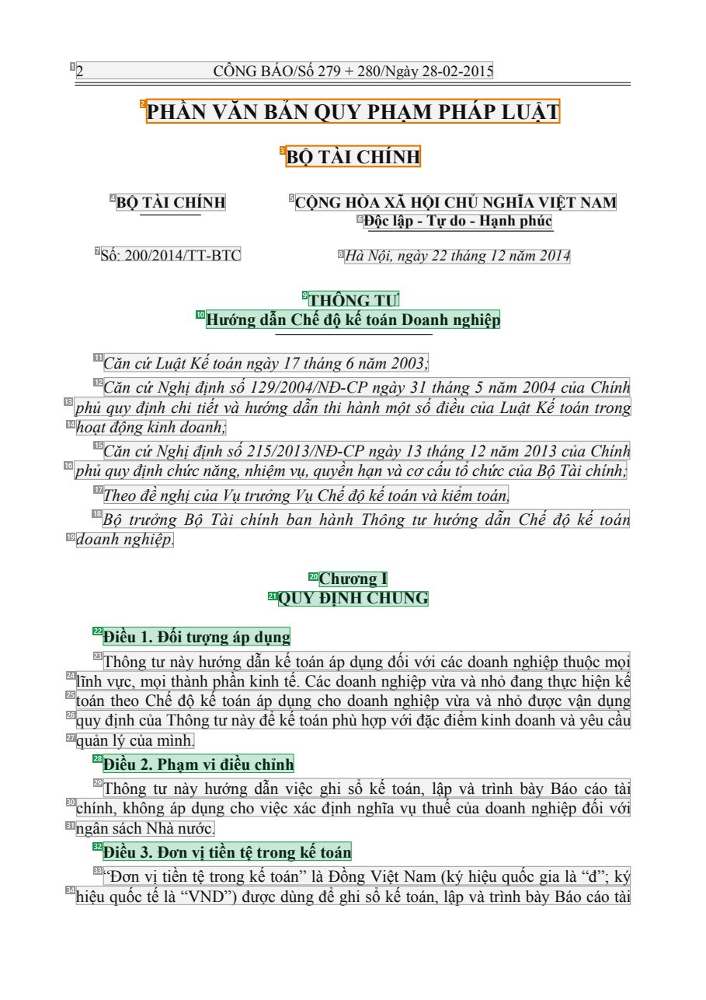
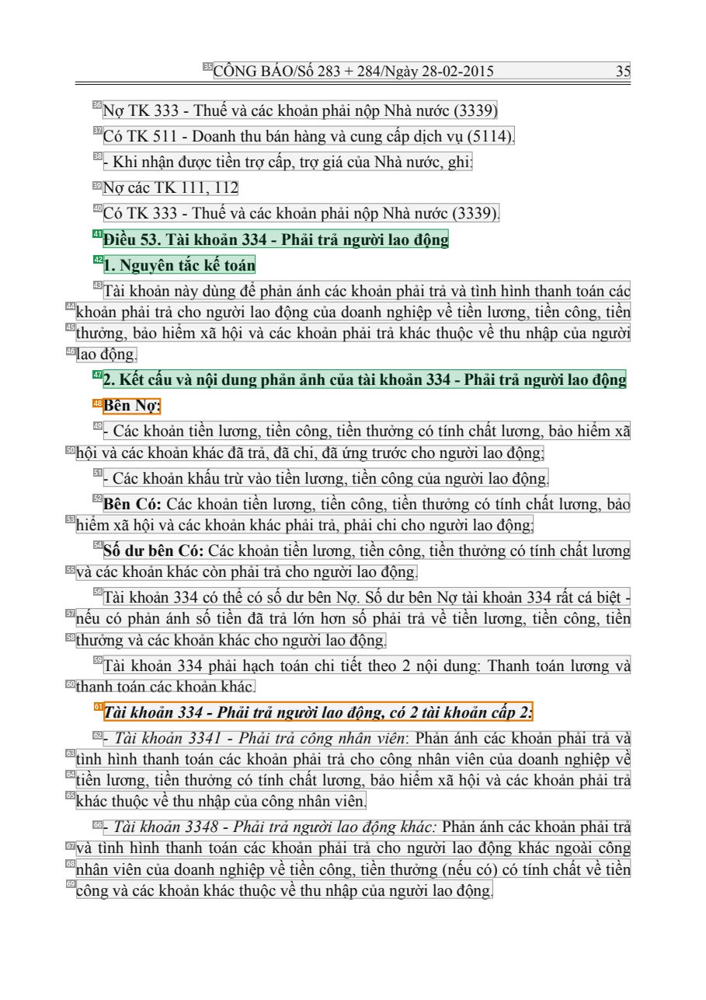
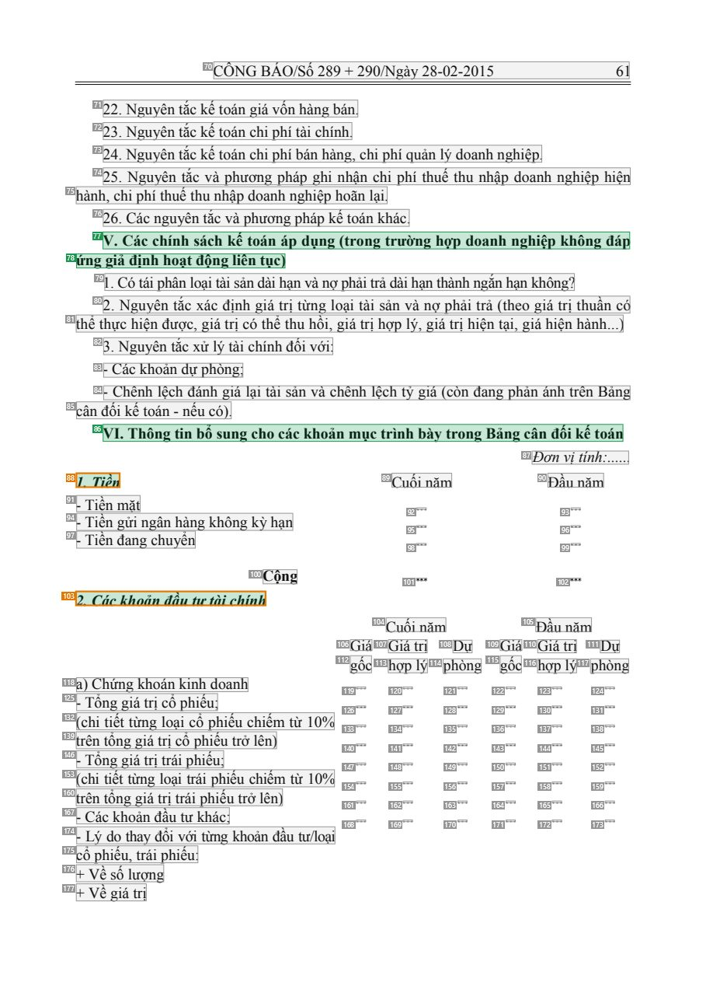
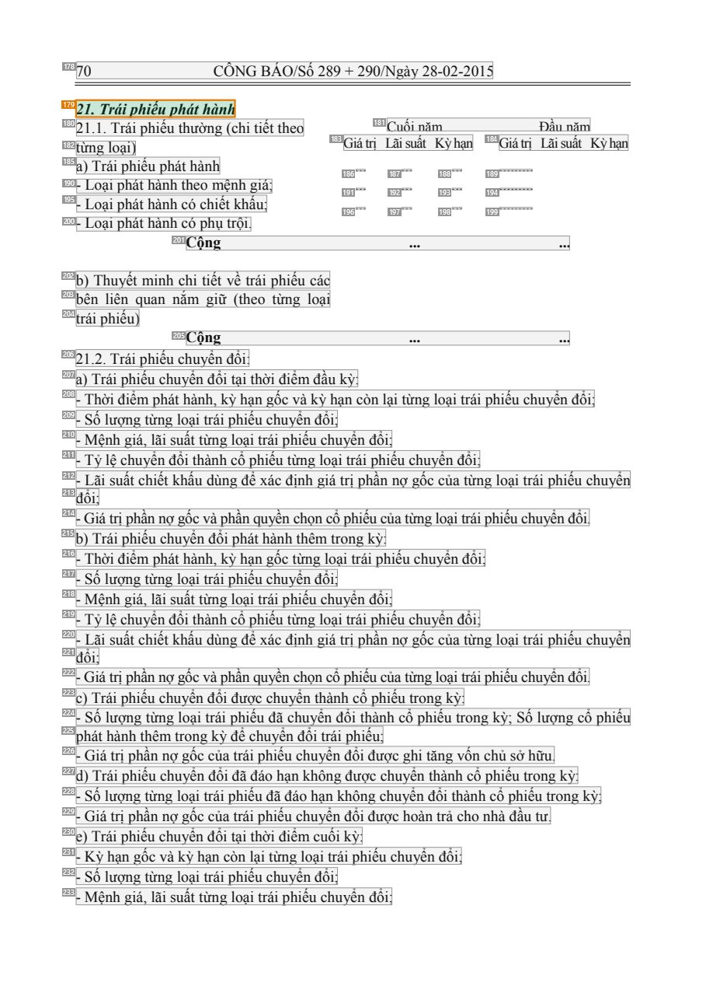

# 019 — `todo10_8/heading_corpus_100/01_phap_quy/019_TT_200-2014_Che_do_ke_toan_DN.pdf`

Draft `P7_F1Q_HELDOUT_GOLD_DRAFT_V2`, status `DRAFT_REVIEWER_A_NOT_APPROVED`, draft sha256 `ab9fb4ff9e8500523e84e037f46bad4842eaac7faeb82344fdca2baefceb0041`. Source sha256 `6173038de76a842c0fed697f70f3bf109d45566dbfda014ab984d1930533e44c`. [Back to index](README.md)

Approve or correct with `review-apply` lines: `APPROVE 019 by <reviewer> [because <note>]`, `019 <alias> -> E|R|O because <reason>`.

## Page 1 (FIRST)

| # | alias | text | font | draft | flag | rationale |
|---:|---|---|---|---|---|---|
| 1 | L0000:S0 | 2 C&#212;NG B&#193;O/Số 279 + 280/Ng&#224;y 28-02-2015 | 13 | **OTHER** |  | C&#244;ng B&#225;o running header (page furniture) |
| 2 | L0001:S0 | PHẦN VĂN BẢN QUY PHẠM PH&#193;P LUẬT | 18 B | **OTHER** | REVIEW_FOCUS | Gazette part banner &quot;PHẦN VĂN BẢN QUY PHẠM PH&#193;P LUẬT&quot; (18pt bold, C&#244;ng B&#225;o furniture, not this document&#39;s headi… |
| 3 | L0002:S0 | BỘ T&#192;I CH&#205;NH | 16 B | **OTHER** | REVIEW_FOCUS | Gazette issuer banner &quot;BỘ T&#192;I CH&#205;NH&quot; (16pt bold, C&#244;ng B&#225;o section label) |
| 4 | L0003:S0 | BỘ T&#192;I CH&#205;NH | 13 B | **OTHER** |  | Issuer &quot;BỘ T&#192;I CH&#205;NH&quot; (letterhead) |
| 5 | L0003:S1 | CỘNG H&#210;A X&#195; HỘI CHỦ NGHĨA VIỆT NAM | 13 B | **OTHER** |  | National name (letterhead) |
| 6 | L0004:S0 | Độc lập - Tự do - Hạnh ph&#250;c | 13 B | **OTHER** |  | National motto |
| 7 | L0005:S0 | Số: 200/2014/TT-BTC | 13 | **OTHER** |  | Document number &quot;Số: 200/2014/TT-BTC&quot; |
| 8 | L0005:S1 | H&#224; Nội, ng&#224;y 22 th&#225;ng 12 năm 2014 | 13 I | **OTHER** |  | Place and date |
| 9 | L0006:S0 | TH&#212;NG TƯ | 14 B | **ESTABLISHES** |  | Document type title &quot;TH&#212;NG TƯ&quot; (bold, centred) |
| 10 | L0007:S0 | Hướng dẫn Chế độ kế to&#225;n Doanh nghiệp | 14 B | **ESTABLISHES** |  | Document title &quot;Hướng dẫn Chế độ kế to&#225;n Doanh nghiệp&quot; (bold, centred) |
| 11 | L0008:S0 | Căn cứLuật Kếto&#225;n ng&#224;y 1 7 th&#225;ng 6 năm 2003; | 14 I | **OTHER** |  | Default: body text, list item, table cell, page number or other non-heading content on this page |
| 12 | L0009:S0 | Căn cứ Nghị định số 129/2004/NĐ-CP ng&#224;y 31 th&#225;ng 5 năm 2004 của Ch&#237;nh | 14 I | **OTHER** |  | Default: body text, list item, table cell, page number or other non-heading content on this page |
| 13 | L0010:S0 | phủ quy định chi tiết v&#224; hướng dẫn thi h&#224;nh một số điều của Luật Kế to&#225;n trong | 14 I | **OTHER** |  | Default: body text, list item, table cell, page number or other non-heading content on this page |
| 14 | L0011:S0 | hoạt động kinh doanh; | 14 I | **OTHER** |  | Default: body text, list item, table cell, page number or other non-heading content on this page |
| 15 | L0012:S0 | Căn cứ Nghị định số 215/2013/NĐ-CP ng&#224;y 13 th&#225;ng 12 năm 2013 của Ch&#237;nh | 14 I | **OTHER** |  | Default: body text, list item, table cell, page number or other non-heading content on this page |
| 16 | L0013:S0 | phủ quy định chức năng, nhiệm vụ, quyền hạn v&#224; cơ cấu tổ chức của Bộ T&#224;i ch&#237;nh; | 14 I | **OTHER** |  | Default: body text, list item, table cell, page number or other non-heading content on this page |
| 17 | L0014:S0 | Theo đề nghị của Vụ trưởng Vụ Chếđộ kếto&#225;n v&#224; kiểm to&#225;n, | 14 I | **OTHER** |  | Default: body text, list item, table cell, page number or other non-heading content on this page |
| 18 | L0015:S0 | Bộ trưởng Bộ T&#224;i ch&#237;nh ban h&#224;nh Th&#244;ng tư hướng dẫn Chế độ kế to&#225;n | 14 I | **OTHER** |  | Default: body text, list item, table cell, page number or other non-heading content on this page |
| 19 | L0016:S0 | doanh nghiệp. | 14 I | **OTHER** |  | Default: body text, list item, table cell, page number or other non-heading content on this page |
| 20 | L0017:S0 | Chương I | 14 B | **ESTABLISHES** |  | Chapter label &quot;Chương I&quot; (bold) |
| 21 | L0018:S0 | QUY ĐỊNH CHUNG | 14 B | **ESTABLISHES** |  | Chapter title &quot;QUY ĐỊNH CHUNG&quot; (bold) |
| 22 | L0019:S0 | Điều 1. Đối tượng &#225;p dụng | 14 B | **ESTABLISHES** |  | Article heading &quot;Điều 1. Đối tượng &#225;p dụng&quot; (bold) |
| 23 | L0020:S0 | Th&#244;ng tư n&#224;y hướng dẫn kế to&#225;n &#225;p dụng đối với c&#225;c doanh nghiệp thuộc mọi | 14 | **OTHER** |  | Default: body text, list item, table cell, page number or other non-heading content on this page |
| 24 | L0021:S0 | lĩnh vực, mọi th&#224;nh phần kinh tế. C&#225;c doanh nghiệp vừa v&#224; nhỏ đang thực hiện kế | 14 | **OTHER** |  | Default: body text, list item, table cell, page number or other non-heading content on this page |
| 25 | L0022:S0 | to&#225;n theo Chế độ kế to&#225;n &#225;p dụng cho doanh nghiệp vừa v&#224; nhỏ được vận dụng | 14 | **OTHER** |  | Default: body text, list item, table cell, page number or other non-heading content on this page |
| 26 | L0023:S0 | quy định của Th&#244;ng tư n&#224;y để kế to&#225;n ph&#249; hợp với đặc điểm kinh doanh v&#224; y&#234;u cầu | 14 | **OTHER** |  | Default: body text, list item, table cell, page number or other non-heading content on this page |
| 27 | L0024:S0 | quản l&#253; của m&#236;nh. | 14 | **OTHER** |  | Default: body text, list item, table cell, page number or other non-heading content on this page |
| 28 | L0025:S0 | Điều 2. Phạm vi điều chỉnh | 14 B | **ESTABLISHES** |  | Article heading &quot;Điều 2. Phạm vi điều chỉnh&quot; (bold) |
| 29 | L0026:S0 | Th&#244;ng tư n&#224;y hướng dẫn việc ghi sổ kế to&#225;n, lập v&#224; tr&#236;nh b&#224;y B&#225;o c&#225;o t&#224;i | 14 | **OTHER** |  | Default: body text, list item, table cell, page number or other non-heading content on this page |
| 30 | L0027:S0 | ch&#237;nh, kh&#244;ng &#225;p dụng cho việc x&#225;c định nghĩa vụ thuế của doanh nghiệp đối với | 14 | **OTHER** |  | Default: body text, list item, table cell, page number or other non-heading content on this page |
| 31 | L0028:S0 | ng&#226;n s&#225;ch Nh&#224; nước. | 14 | **OTHER** |  | Default: body text, list item, table cell, page number or other non-heading content on this page |
| 32 | L0029:S0 | Điều 3. Đơn vị tiền tệ trong kế to&#225;n | 14 B | **ESTABLISHES** |  | Article heading &quot;Điều 3. Đơn vị tiền tệ trong kế to&#225;n&quot; (bold) |
| 33 | L0030:S0 | “Đơn vị tiền tệ trong kế to&#225;n” l&#224; Đồng Việt Nam (k&#253; hiệu quốc gia l&#224; “đ”; k&#253; | 14 | **OTHER** |  | Default: body text, list item, table cell, page number or other non-heading content on this page |
| 34 | L0031:S0 | hiệu quốc tế l&#224; “VND”) được d&#249;ng để ghi sổ kế to&#225;n, lập v&#224; tr&#236;nh b&#224;y B&#225;o c&#225;o t&#… | 14 | **OTHER** |  | Default: body text, list item, table cell, page number or other non-heading content on this page |

**OTHER rows to check for a missed heading on page 1** (body size 14pt; bold or ≥ body+1pt, ≤ 12 words): #2 `L0001:S0` PHẦN VĂN BẢN QUY PHẠM PH&#193;P LUẬT (18 B), #3 `L0002:S0` BỘ T&#192;I CH&#205;NH (16 B), #4 `L0003:S0` BỘ T&#192;I CH&#205;NH (13 B), #5 `L0003:S1` CỘNG H&#210;A X&#195; HỘI CHỦ NGHĨA VIỆT NAM (13 B), #6 `L0004:S0` Độc lập - Tự do - Hạnh ph&#250;c (13 B).

## Page 226 (SEEDED_INTERIOR)

| # | alias | text | font | draft | flag | rationale |
|---:|---|---|---|---|---|---|
| 35 | L8360:S0 | C&#212;NG B&#193;O/Số 283 + 284/Ng&#224;y 28-02-2015 35 | 13 | **OTHER** |  | C&#244;ng B&#225;o running header (page furniture) |
| 36 | L8361:S0 | Nợ TK 333 - Thuế v&#224; c&#225;c khoản phải nộp Nh&#224; nước (3339) | 14 | **OTHER** |  | Default: body text, list item, table cell, page number or other non-heading content on this page |
| 37 | L8362:S0 | C&#243; TK 5 1 1 - Doanh thu b&#225;n h&#224;ng v&#224; cung cấp dịch vụ (5 1 14). | 14 | **OTHER** |  | Default: body text, list item, table cell, page number or other non-heading content on this page |
| 38 | L8363:S0 | - Khi nhận được tiền trợ cấp, trợ gi&#225; của Nh&#224; nước, ghi: | 14 | **OTHER** |  | Default: body text, list item, table cell, page number or other non-heading content on this page |
| 39 | L8364:S0 | Nợ c&#225;c TK 1 1 1, 1 12 | 14 | **OTHER** |  | Default: body text, list item, table cell, page number or other non-heading content on this page |
| 40 | L8365:S0 | C&#243; TK 333 - Thuế v&#224; c&#225;c khoản phải nộp Nh&#224; nước (3339). | 14 | **OTHER** |  | Default: body text, list item, table cell, page number or other non-heading content on this page |
| 41 | L8366:S0 | Điều 53. T&#224;i khoản 334 - Phải trả người lao động | 14 B | **ESTABLISHES** |  | Article heading &quot;Điều 53. T&#224;i khoản 334 - Phải trả người lao động&quot; (bold) |
| 42 | L8367:S0 | 1. Nguy&#234;n tắc kế to&#225;n | 14 B | **ESTABLISHES** |  | Sub-heading &quot;1. Nguy&#234;n tắc kế to&#225;n&quot; (bold, own line) inside the article |
| 43 | L8368:S0 | T&#224;i khoản n&#224;y d&#249;ng để phản &#225;nh c&#225;c khoản phải trả v&#224; t&#236;nh h&#236;nh thanh to&#225;n c… | 14 | **OTHER** |  | Default: body text, list item, table cell, page number or other non-heading content on this page |
| 44 | L8369:S0 | khoản phải trả cho người lao động của doanh nghiệp về tiền lương, tiền c&#244;ng, tiền | 14 | **OTHER** |  | Default: body text, list item, table cell, page number or other non-heading content on this page |
| 45 | L8370:S0 | thưởng, bảo hiểm x&#227; hội v&#224; c&#225;c khoản phải trả kh&#225;c thuộc về thu nhập của người | 14 | **OTHER** |  | Default: body text, list item, table cell, page number or other non-heading content on this page |
| 46 | L8371:S0 | lao động. | 14 | **OTHER** |  | Default: body text, list item, table cell, page number or other non-heading content on this page |
| 47 | L8372:S0 | 2. Kết cấu v&#224; nội dung phản ảnh của t&#224;i khoản 334 - Phải trả người lao động | 14 B | **ESTABLISHES** |  | Sub-heading &quot;2. Kết cấu v&#224; nội dung phản ảnh của t&#224;i khoản 334 ...&quot; (bold, own line) |
| 48 | L8373:S0 | B&#234;n Nợ: | 14 B | **OTHER** | REVIEW_FOCUS | Bold run-in label &quot;B&#234;n Nợ:&quot; introducing a list of debit entries (label, not a heading) |
| 49 | L8374:S0 | - C&#225;c khoản tiền lương, tiền c&#244;ng, tiền thưởng c&#243; t&#237;nh chất lương, bảo hiểm x&#227; | 14 | **OTHER** |  | Default: body text, list item, table cell, page number or other non-heading content on this page |
| 50 | L8375:S0 | hội v&#224; c&#225;c khoản kh&#225;c đ&#227; trả, đ&#227; chi, đ&#227; ứng trước cho người lao động; | 14 | **OTHER** |  | Default: body text, list item, table cell, page number or other non-heading content on this page |
| 51 | L8376:S0 | - C&#225;c khoản khấu trừ v&#224;o tiền lương, tiền c&#244;ng của người lao động. | 14 | **OTHER** |  | Default: body text, list item, table cell, page number or other non-heading content on this page |
| 52 | L8377:S0 | B&#234;n C&#243;: C&#225;c khoản tiền lương, tiền c&#244;ng, tiền thưởng c&#243; t&#237;nh chất lương, bảo | 14 | **OTHER** |  | Default: body text, list item, table cell, page number or other non-heading content on this page |
| 53 | L8378:S0 | hiểm x&#227; hội v&#224; c&#225;c khoản kh&#225;c phải trả, phải chi cho người lao động; | 14 | **OTHER** |  | Default: body text, list item, table cell, page number or other non-heading content on this page |
| 54 | L8379:S0 | Số dư b&#234;n C&#243;: C&#225;c khoản tiền lương, tiền c&#244;ng, tiền thưởng c&#243; t&#237;nh chất lương | 14 | **OTHER** |  | Default: body text, list item, table cell, page number or other non-heading content on this page |
| 55 | L8380:S0 | v&#224; c&#225;c khoản kh&#225;c c&#242;n phải trả cho người lao động. | 14 | **OTHER** |  | Default: body text, list item, table cell, page number or other non-heading content on this page |
| 56 | L8381:S0 | T&#224;i khoản 334 c&#243; thể c&#243; số dư b&#234;n Nợ. Số dư b&#234;n Nợ t&#224;i khoản 334 rất c&#225; biệt - | 14 | **OTHER** |  | Default: body text, list item, table cell, page number or other non-heading content on this page |
| 57 | L8382:S0 | nếu c&#243; phản &#225;nh số tiền đ&#227; trả lớn hơn số phải trả về tiền lương, tiền c&#244;ng, tiền | 14 | **OTHER** |  | Default: body text, list item, table cell, page number or other non-heading content on this page |
| 58 | L8383:S0 | thưởng v&#224; c&#225;c khoản kh&#225;c cho người lao động. | 14 | **OTHER** |  | Default: body text, list item, table cell, page number or other non-heading content on this page |
| 59 | L8384:S0 | T&#224;i khoản 334 phải hạch to&#225;n chi tiết theo 2 nội dung: Thanh to&#225;n lương v&#224; | 14 | **OTHER** |  | Default: body text, list item, table cell, page number or other non-heading content on this page |
| 60 | L8385:S0 | thanh to&#225;n c&#225;c khoản kh&#225;c. | 14 | **OTHER** |  | Default: body text, list item, table cell, page number or other non-heading content on this page |
| 61 | L8386:S0 | T&#224;i khoản 334 - Phải trả người lao động, c&#243; 2 t&#224;i khoản cấp 2: | 14 B I | **OTHER** | REVIEW_FOCUS | Bold-italic lead sentence &quot;T&#224;i khoản 334 ... c&#243; 2 t&#224;i khoản cấp 2:&quot; (sentence introducing a list) |
| 62 | L8387:S0 | - T&#224;i khoản 3341 - Phải trả c&#244;ng nh&#226;n vi&#234;n : Phản &#225;nh c&#225;c khoản phải trả v&#224; | 14 I | **OTHER** |  | Default: body text, list item, table cell, page number or other non-heading content on this page |
| 63 | L8388:S0 | t&#236;nh h&#236;nh thanh to&#225;n c&#225;c khoản phải trả cho c&#244;ng nh&#226;n vi&#234;n của doanh nghiệp về | 14 | **OTHER** |  | Default: body text, list item, table cell, page number or other non-heading content on this page |
| 64 | L8389:S0 | tiền lương, tiền thưởng c&#243; t&#237;nh chất lương, bảo hiểm x&#227; hội v&#224; c&#225;c khoản phải trả | 14 | **OTHER** |  | Default: body text, list item, table cell, page number or other non-heading content on this page |
| 65 | L8390:S0 | kh&#225;c thuộc về thu nhập của c&#244;ng nh&#226;n vi&#234;n. | 14 | **OTHER** |  | Default: body text, list item, table cell, page number or other non-heading content on this page |
| 66 | L8391:S0 | - T&#224;i khoản 3348 - Phải trả người lao động kh&#225;c: Phản &#225;nh c&#225;c khoản phải trả | 14 I | **OTHER** |  | Default: body text, list item, table cell, page number or other non-heading content on this page |
| 67 | L8392:S0 | v&#224; t&#236;nh h&#236;nh thanh to&#225;n c&#225;c khoản phải trả cho người lao động kh&#225;c ngo&#224;i c&#244;ng | 14 | **OTHER** |  | Default: body text, list item, table cell, page number or other non-heading content on this page |
| 68 | L8393:S0 | nh&#226;n vi&#234;n của doanh nghiệp về tiền c&#244;ng, tiền thưởng (nếu c&#243;) c&#243; t&#237;nh chất về tiền | 14 | **OTHER** |  | Default: body text, list item, table cell, page number or other non-heading content on this page |
| 69 | L8394:S0 | c&#244;ng v&#224; c&#225;c khoản kh&#225;c thuộc về thu nhập của người lao động. | 14 | **OTHER** |  | Default: body text, list item, table cell, page number or other non-heading content on this page |

**OTHER rows to check for a missed heading on page 226** (body size 14pt; bold or ≥ body+1pt, ≤ 12 words): #48 `L8373:S0` B&#234;n Nợ: (14 B).

## Page 428 (SEEDED_INTERIOR)

| # | alias | text | font | draft | flag | rationale |
|---:|---|---|---|---|---|---|
| 70 | L15882:S0 | C&#212;NG B&#193;O/Số 289 + 290/Ng&#224;y 28-02-2015 61 | 13 | **OTHER** |  | C&#244;ng B&#225;o running header (page furniture) |
| 71 | L15883:S0 | 22. Nguy&#234;n tắc kế to&#225;n gi&#225; vốn h&#224;ng b&#225;n. | 13 | **OTHER** |  | Default: body text, list item, table cell, page number or other non-heading content on this page |
| 72 | L15884:S0 | 23. Nguy&#234;n tắc kế to&#225;n chi ph&#237; t&#224;i ch&#237;nh. | 13 | **OTHER** |  | Default: body text, list item, table cell, page number or other non-heading content on this page |
| 73 | L15885:S0 | 24. Nguy&#234;n tắc kế to&#225;n chi ph&#237; b&#225;n h&#224;ng, chi ph&#237; quản l&#253; doanh nghiệp. | 13 | **OTHER** |  | Default: body text, list item, table cell, page number or other non-heading content on this page |
| 74 | L15886:S0 | 25. Nguy&#234;n tắc v&#224; phương ph&#225;p ghi nhận chi ph&#237; thuế thu nhập doanh nghiệp hiện | 13 | **OTHER** |  | Default: body text, list item, table cell, page number or other non-heading content on this page |
| 75 | L15887:S0 | h&#224;nh, chi ph&#237; thuế thu nhập doanh nghiệp ho&#227;n lại. | 13 | **OTHER** |  | Default: body text, list item, table cell, page number or other non-heading content on this page |
| 76 | L15888:S0 | 26. C&#225;c nguy&#234;n tắc v&#224; phương ph&#225;p kế to&#225;n kh&#225;c. | 13 | **OTHER** |  | Default: body text, list item, table cell, page number or other non-heading content on this page |
| 77 | L15889:S0 | V. C&#225;c ch&#237;nh s&#225;ch kế to&#225;n &#225;p dụng (trong trường hợp doanh nghiệp kh&#244;ng đ&#225;p | 13 B | **ESTABLISHES** |  | Section heading &quot;V. C&#225;c ch&#237;nh s&#225;ch kế to&#225;n &#225;p dụng (...)&quot; line 1 (bold, roman numeral, template section) |
| 78 | L15890:S0 | ứng giả định hoạt động li&#234;n tục) | 13 B | **ESTABLISHES** |  | Section heading line 2 &quot;ứng giả định hoạt động li&#234;n tục)&quot; (bold continuation) |
| 79 | L15891:S0 | 1. C&#243; t&#225;i ph&#226;n loại t&#224;i sản d&#224;i hạn v&#224; nợ phải trả d&#224;i hạn th&#224;nh ngắn hạn kh&#24… | 13 | **OTHER** |  | Default: body text, list item, table cell, page number or other non-heading content on this page |
| 80 | L15892:S0 | 2. Nguy&#234;n tắc x&#225;c định gi&#225; trị từng loại t&#224;i sản v&#224; nợ phải trả (theo gi&#225; trị thuần c&#243… | 13 | **OTHER** |  | Default: body text, list item, table cell, page number or other non-heading content on this page |
| 81 | L15893:S0 | thể thực hiện được, gi&#225; trị c&#243; thể thu hồi, gi&#225; trị hợp l&#253;, gi&#225; trị hiện tại, gi&#225; hiện h&#… | 13 | **OTHER** |  | Default: body text, list item, table cell, page number or other non-heading content on this page |
| 82 | L15894:S0 | 3. Nguy&#234;n tắc xử l&#253; t&#224;i ch&#237;nh đối với: | 13 | **OTHER** |  | Default: body text, list item, table cell, page number or other non-heading content on this page |
| 83 | L15895:S0 | - C&#225;c khoản dự ph&#242;ng; | 13 | **OTHER** |  | Default: body text, list item, table cell, page number or other non-heading content on this page |
| 84 | L15896:S0 | - Ch&#234;nh lệch đ&#225;nh gi&#225; lại t&#224;i sản v&#224; ch&#234;nh lệch tỷ gi&#225; (c&#242;n đang phản &#225;nh t… | 13 | **OTHER** |  | Default: body text, list item, table cell, page number or other non-heading content on this page |
| 85 | L15897:S0 | c&#226;n đối kế to&#225;n - nếu c&#243;). | 13 | **OTHER** |  | Default: body text, list item, table cell, page number or other non-heading content on this page |
| 86 | L15898:S0 | VI. Th&#244;ng tin bổ sung cho c&#225;c khoản mục tr&#236;nh b&#224;y trong Bảng c&#226;n đối kế to&#225;n | 13 B | **ESTABLISHES** |  | Section heading &quot;VI. Th&#244;ng tin bổ sung cho c&#225;c khoản mục tr&#236;nh b&#224;y trong Bảng c&#226;n đối kế to&#225;n&quot; (bold… |
| 87 | L15899:S0 | Đơn vị t&#237;nh:. . . . . . | 13 I | **OTHER** |  | Default: body text, list item, table cell, page number or other non-heading content on this page |
| 88 | L15900:S0 | 1. Tiền | 13 B I | **ESTABLISHES** | REVIEW_FOCUS | Note heading &quot;1. Tiền&quot; (bold italic) heading the cash note table (note heading vs table title: confirm) |
| 89 | L15900:S1 | Cuối năm | 13 | **OTHER** |  | Default: body text, list item, table cell, page number or other non-heading content on this page |
| 90 | L15900:S2 | Đầu năm | 13 | **OTHER** |  | Default: body text, list item, table cell, page number or other non-heading content on this page |
| 91 | L15901:S0 | - Tiền mặt | 13 | **OTHER** |  | Default: body text, list item, table cell, page number or other non-heading content on this page |
| 92 | L15901:S1 | . . . | 13 | **OTHER** |  | Default: body text, list item, table cell, page number or other non-heading content on this page |
| 93 | L15901:S2 | . . . | 13 | **OTHER** |  | Default: body text, list item, table cell, page number or other non-heading content on this page |
| 94 | L15902:S0 | - Tiền gửi ng&#226;n h&#224;ng kh&#244;ng kỳ hạn | 13 | **OTHER** |  | Default: body text, list item, table cell, page number or other non-heading content on this page |
| 95 | L15902:S1 | . . . | 13 | **OTHER** |  | Default: body text, list item, table cell, page number or other non-heading content on this page |
| 96 | L15902:S2 | . . . | 13 | **OTHER** |  | Default: body text, list item, table cell, page number or other non-heading content on this page |
| 97 | L15903:S0 | - Tiền đang chuyển | 13 | **OTHER** |  | Default: body text, list item, table cell, page number or other non-heading content on this page |
| 98 | L15903:S1 | . . . | 13 | **OTHER** |  | Default: body text, list item, table cell, page number or other non-heading content on this page |
| 99 | L15903:S2 | . . . | 13 | **OTHER** |  | Default: body text, list item, table cell, page number or other non-heading content on this page |
| 100 | L15904:S0 | Cộng | 13 B | **OTHER** |  | Default: body text, list item, table cell, page number or other non-heading content on this page |
| 101 | L15904:S1 | ... | 13 B | **OTHER** |  | Default: body text, list item, table cell, page number or other non-heading content on this page |
| 102 | L15904:S2 | ... | 13 B | **OTHER** |  | Default: body text, list item, table cell, page number or other non-heading content on this page |
| 103 | L15905:S0 | 2. C&#225;c khoản đầu tư t&#224;i ch&#237;nh | 13 B I | **ESTABLISHES** | REVIEW_FOCUS | Note heading &quot;2. C&#225;c khoản đầu tư t&#224;i ch&#237;nh&quot; (bold italic) heading the investments note table |
| 104 | L15906:S0 | Cuối năm | 13 | **OTHER** |  | Default: body text, list item, table cell, page number or other non-heading content on this page |
| 105 | L15906:S1 | Đầu năm | 13 | **OTHER** |  | Default: body text, list item, table cell, page number or other non-heading content on this page |
| 106 | L15907:S0 | Gi&#225; | 13 | **OTHER** |  | Default: body text, list item, table cell, page number or other non-heading content on this page |
| 107 | L15907:S1 | Gi&#225; trị | 13 | **OTHER** |  | Default: body text, list item, table cell, page number or other non-heading content on this page |
| 108 | L15907:S2 | Dự | 13 | **OTHER** |  | Default: body text, list item, table cell, page number or other non-heading content on this page |
| 109 | L15907:S3 | Gi&#225; | 13 | **OTHER** |  | Default: body text, list item, table cell, page number or other non-heading content on this page |
| 110 | L15907:S4 | Gi&#225; trị | 13 | **OTHER** |  | Default: body text, list item, table cell, page number or other non-heading content on this page |
| 111 | L15907:S5 | Dự | 13 | **OTHER** |  | Default: body text, list item, table cell, page number or other non-heading content on this page |
| 112 | L15908:S0 | gốc | 13 | **OTHER** |  | Default: body text, list item, table cell, page number or other non-heading content on this page |
| 113 | L15908:S1 | hợp l&#253; | 13 | **OTHER** |  | Default: body text, list item, table cell, page number or other non-heading content on this page |
| 114 | L15908:S2 | ph&#242;ng | 13 | **OTHER** |  | Default: body text, list item, table cell, page number or other non-heading content on this page |
| 115 | L15908:S3 | gốc | 13 | **OTHER** |  | Default: body text, list item, table cell, page number or other non-heading content on this page |
| 116 | L15908:S4 | hợp l&#253; | 13 | **OTHER** |  | Default: body text, list item, table cell, page number or other non-heading content on this page |
| 117 | L15908:S5 | ph&#242;ng | 13 | **OTHER** |  | Default: body text, list item, table cell, page number or other non-heading content on this page |
| 118 | L15909:S0 | a) Chứng kho&#225;n kinh doanh | 13 | **OTHER** |  | Default: body text, list item, table cell, page number or other non-heading content on this page |
| 119 | L15909:S1 | . . . | 13 | **OTHER** |  | Default: body text, list item, table cell, page number or other non-heading content on this page |
| 120 | L15909:S2 | . . . | 13 | **OTHER** |  | Default: body text, list item, table cell, page number or other non-heading content on this page |
| 121 | L15909:S3 | . . . | 13 | **OTHER** |  | Default: body text, list item, table cell, page number or other non-heading content on this page |
| 122 | L15909:S4 | . . . | 13 | **OTHER** |  | Default: body text, list item, table cell, page number or other non-heading content on this page |
| 123 | L15909:S5 | . . . | 13 | **OTHER** |  | Default: body text, list item, table cell, page number or other non-heading content on this page |
| 124 | L15909:S6 | . . . | 13 | **OTHER** |  | Default: body text, list item, table cell, page number or other non-heading content on this page |
| 125 | L15910:S0 | - Tổng gi&#225; trị cổ phiếu; | 13 | **OTHER** |  | Default: body text, list item, table cell, page number or other non-heading content on this page |
| 126 | L15910:S1 | . . . | 13 | **OTHER** |  | Default: body text, list item, table cell, page number or other non-heading content on this page |
| 127 | L15910:S2 | . . . | 13 | **OTHER** |  | Default: body text, list item, table cell, page number or other non-heading content on this page |
| 128 | L15910:S3 | . . . | 13 | **OTHER** |  | Default: body text, list item, table cell, page number or other non-heading content on this page |
| 129 | L15910:S4 | . . . | 13 | **OTHER** |  | Default: body text, list item, table cell, page number or other non-heading content on this page |
| 130 | L15910:S5 | . . . | 13 | **OTHER** |  | Default: body text, list item, table cell, page number or other non-heading content on this page |
| 131 | L15910:S6 | . . . | 13 | **OTHER** |  | Default: body text, list item, table cell, page number or other non-heading content on this page |
| 132 | L15911:S0 | (chi tiết từng loại cổ phiếu chiếm từ 10% | 13 | **OTHER** |  | Default: body text, list item, table cell, page number or other non-heading content on this page |
| 133 | L15911:S1 | . . . | 13 | **OTHER** |  | Default: body text, list item, table cell, page number or other non-heading content on this page |
| 134 | L15911:S2 | . . . | 13 | **OTHER** |  | Default: body text, list item, table cell, page number or other non-heading content on this page |
| 135 | L15911:S3 | . . . | 13 | **OTHER** |  | Default: body text, list item, table cell, page number or other non-heading content on this page |
| 136 | L15911:S4 | . . . | 13 | **OTHER** |  | Default: body text, list item, table cell, page number or other non-heading content on this page |
| 137 | L15911:S5 | . . . | 13 | **OTHER** |  | Default: body text, list item, table cell, page number or other non-heading content on this page |
| 138 | L15911:S6 | . . . | 13 | **OTHER** |  | Default: body text, list item, table cell, page number or other non-heading content on this page |
| 139 | L15912:S0 | tr&#234;n tổng gi&#225; trị cổ phiếu trở l&#234;n) | 13 | **OTHER** |  | Default: body text, list item, table cell, page number or other non-heading content on this page |
| 140 | L15912:S1 | . . . | 13 | **OTHER** |  | Default: body text, list item, table cell, page number or other non-heading content on this page |
| 141 | L15912:S2 | . . . | 13 | **OTHER** |  | Default: body text, list item, table cell, page number or other non-heading content on this page |
| 142 | L15912:S3 | . . . | 13 | **OTHER** |  | Default: body text, list item, table cell, page number or other non-heading content on this page |
| 143 | L15912:S4 | . . . | 13 | **OTHER** |  | Default: body text, list item, table cell, page number or other non-heading content on this page |
| 144 | L15912:S5 | . . . | 13 | **OTHER** |  | Default: body text, list item, table cell, page number or other non-heading content on this page |
| 145 | L15912:S6 | . . . | 13 | **OTHER** |  | Default: body text, list item, table cell, page number or other non-heading content on this page |
| 146 | L15913:S0 | - Tổng gi&#225; trị tr&#225;i phiếu; | 13 | **OTHER** |  | Default: body text, list item, table cell, page number or other non-heading content on this page |
| 147 | L15913:S1 | . . . | 13 | **OTHER** |  | Default: body text, list item, table cell, page number or other non-heading content on this page |
| 148 | L15913:S2 | . . . | 13 | **OTHER** |  | Default: body text, list item, table cell, page number or other non-heading content on this page |
| 149 | L15913:S3 | . . . | 13 | **OTHER** |  | Default: body text, list item, table cell, page number or other non-heading content on this page |
| 150 | L15913:S4 | . . . | 13 | **OTHER** |  | Default: body text, list item, table cell, page number or other non-heading content on this page |
| 151 | L15913:S5 | . . . | 13 | **OTHER** |  | Default: body text, list item, table cell, page number or other non-heading content on this page |
| 152 | L15913:S6 | . . . | 13 | **OTHER** |  | Default: body text, list item, table cell, page number or other non-heading content on this page |
| 153 | L15914:S0 | (chi tiết từng loại tr&#225;i phiếu chiếm từ 10% | 13 | **OTHER** |  | Default: body text, list item, table cell, page number or other non-heading content on this page |
| 154 | L15914:S1 | . . . | 13 | **OTHER** |  | Default: body text, list item, table cell, page number or other non-heading content on this page |
| 155 | L15914:S2 | . . . | 13 | **OTHER** |  | Default: body text, list item, table cell, page number or other non-heading content on this page |
| 156 | L15914:S3 | . . . | 13 | **OTHER** |  | Default: body text, list item, table cell, page number or other non-heading content on this page |
| 157 | L15914:S4 | . . . | 13 | **OTHER** |  | Default: body text, list item, table cell, page number or other non-heading content on this page |
| 158 | L15914:S5 | . . . | 13 | **OTHER** |  | Default: body text, list item, table cell, page number or other non-heading content on this page |
| 159 | L15914:S6 | . . . | 13 | **OTHER** |  | Default: body text, list item, table cell, page number or other non-heading content on this page |
| 160 | L15915:S0 | tr&#234;n tổng gi&#225; trị tr&#225;i phiếu trở l&#234;n) | 13 | **OTHER** |  | Default: body text, list item, table cell, page number or other non-heading content on this page |
| 161 | L15915:S1 | . . . | 13 | **OTHER** |  | Default: body text, list item, table cell, page number or other non-heading content on this page |
| 162 | L15915:S2 | . . . | 13 | **OTHER** |  | Default: body text, list item, table cell, page number or other non-heading content on this page |
| 163 | L15915:S3 | . . . | 13 | **OTHER** |  | Default: body text, list item, table cell, page number or other non-heading content on this page |
| 164 | L15915:S4 | . . . | 13 | **OTHER** |  | Default: body text, list item, table cell, page number or other non-heading content on this page |
| 165 | L15915:S5 | . . . | 13 | **OTHER** |  | Default: body text, list item, table cell, page number or other non-heading content on this page |
| 166 | L15915:S6 | . . . | 13 | **OTHER** |  | Default: body text, list item, table cell, page number or other non-heading content on this page |
| 167 | L15916:S0 | - C&#225;c khoản đầu tư kh&#225;c; | 13 | **OTHER** |  | Default: body text, list item, table cell, page number or other non-heading content on this page |
| 168 | L15916:S1 | . . . | 13 | **OTHER** |  | Default: body text, list item, table cell, page number or other non-heading content on this page |
| 169 | L15916:S2 | . . . | 13 | **OTHER** |  | Default: body text, list item, table cell, page number or other non-heading content on this page |
| 170 | L15916:S3 | . . . | 13 | **OTHER** |  | Default: body text, list item, table cell, page number or other non-heading content on this page |
| 171 | L15916:S4 | . . . | 13 | **OTHER** |  | Default: body text, list item, table cell, page number or other non-heading content on this page |
| 172 | L15916:S5 | . . . | 13 | **OTHER** |  | Default: body text, list item, table cell, page number or other non-heading content on this page |
| 173 | L15916:S6 | . . . | 13 | **OTHER** |  | Default: body text, list item, table cell, page number or other non-heading content on this page |
| 174 | L15917:S0 | - L&#253; do thay đổi với từng khoản đầu tư/loại | 13 | **OTHER** |  | Default: body text, list item, table cell, page number or other non-heading content on this page |
| 175 | L15918:S0 | cổ phiếu, tr&#225;i phiếu: | 13 | **OTHER** |  | Default: body text, list item, table cell, page number or other non-heading content on this page |
| 176 | L15919:S0 | + Về số lượng | 13 | **OTHER** |  | Default: body text, list item, table cell, page number or other non-heading content on this page |
| 177 | L15920:S0 | + Về gi&#225; trị | 13 | **OTHER** |  | Default: body text, list item, table cell, page number or other non-heading content on this page |

**OTHER rows to check for a missed heading on page 428** (body size 13pt; bold or ≥ body+1pt, ≤ 12 words): #100 `L15904:S0` Cộng (13 B), #101 `L15904:S1` ... (13 B), #102 `L15904:S2` ... (13 B).

## Page 437 (TARGETED_STRUCTURE)

| # | alias | text | font | draft | flag | rationale |
|---:|---|---|---|---|---|---|
| 178 | L16267:S0 | 70 C&#212;NG B&#193;O/Số 289 + 290/Ng&#224;y 28-02-2015 | 13 | **OTHER** |  | C&#244;ng B&#225;o running header (page furniture) |
| 179 | L16268:S0 | 21. Tr&#225;iphiếu ph&#225;t h&#224;nh | 13 B I | **ESTABLISHES** | REVIEW_FOCUS | Note heading &quot;21. Tr&#225;i phiếu ph&#225;t h&#224;nh&quot; (bold italic) heading the bonds note |
| 180 | L16269:S0 | 21 . 1 . Tr&#225;i phiếu thường (chi tiết theo | 13 | **OTHER** |  | Default: body text, list item, table cell, page number or other non-heading content on this page |
| 181 | L16269:S1 | Cuối năm Đầu năm | 12 | **OTHER** |  | Default: body text, list item, table cell, page number or other non-heading content on this page |
| 182 | L16270:S0 | từng loại) | 13 | **OTHER** |  | Default: body text, list item, table cell, page number or other non-heading content on this page |
| 183 | L16270:S1 | Gi&#225;trị L&#227;i suất Kỳhạn | 12 | **OTHER** |  | Default: body text, list item, table cell, page number or other non-heading content on this page |
| 184 | L16270:S2 | Gi&#225;trị L&#227;i suất Kỳhạn | 12 | **OTHER** |  | Default: body text, list item, table cell, page number or other non-heading content on this page |
| 185 | L16271:S0 | a) Tr&#225;i phiếu ph&#225;t h&#224;nh | 13 | **OTHER** |  | Default: body text, list item, table cell, page number or other non-heading content on this page |
| 186 | L16271:S1 | . . . | 13 | **OTHER** |  | Default: body text, list item, table cell, page number or other non-heading content on this page |
| 187 | L16271:S2 | . . . | 13 | **OTHER** |  | Default: body text, list item, table cell, page number or other non-heading content on this page |
| 188 | L16271:S3 | . . . | 13 | **OTHER** |  | Default: body text, list item, table cell, page number or other non-heading content on this page |
| 189 | L16271:S4 | . . . . . . . . . | 13 | **OTHER** |  | Default: body text, list item, table cell, page number or other non-heading content on this page |
| 190 | L16272:S0 | - Loại ph&#225;t h&#224;nh theo mệnh gi&#225;; | 13 | **OTHER** |  | Default: body text, list item, table cell, page number or other non-heading content on this page |
| 191 | L16272:S1 | . . . | 13 | **OTHER** |  | Default: body text, list item, table cell, page number or other non-heading content on this page |
| 192 | L16272:S2 | . . . | 13 | **OTHER** |  | Default: body text, list item, table cell, page number or other non-heading content on this page |
| 193 | L16272:S3 | . . . | 13 | **OTHER** |  | Default: body text, list item, table cell, page number or other non-heading content on this page |
| 194 | L16272:S4 | . . . . . . . . . | 13 | **OTHER** |  | Default: body text, list item, table cell, page number or other non-heading content on this page |
| 195 | L16273:S0 | - Loại ph&#225;t h&#224;nh c&#243; chiết khấu; | 13 | **OTHER** |  | Default: body text, list item, table cell, page number or other non-heading content on this page |
| 196 | L16273:S1 | . . . | 13 | **OTHER** |  | Default: body text, list item, table cell, page number or other non-heading content on this page |
| 197 | L16273:S2 | . . . | 13 | **OTHER** |  | Default: body text, list item, table cell, page number or other non-heading content on this page |
| 198 | L16273:S3 | . . . | 13 | **OTHER** |  | Default: body text, list item, table cell, page number or other non-heading content on this page |
| 199 | L16273:S4 | . . . . . . . . . | 13 | **OTHER** |  | Default: body text, list item, table cell, page number or other non-heading content on this page |
| 200 | L16274:S0 | - Loại ph&#225;t h&#224;nh c&#243; phụ trội. | 13 | **OTHER** |  | Default: body text, list item, table cell, page number or other non-heading content on this page |
| 201 | L16275:S0 | Cộng ... ... | 13 B | **OTHER** |  | Default: body text, list item, table cell, page number or other non-heading content on this page |
| 202 | L16276:S0 | b) Thuyết minh chi tiết về tr&#225;i phiếu c&#225;c | 13 | **OTHER** |  | Default: body text, list item, table cell, page number or other non-heading content on this page |
| 203 | L16277:S0 | b&#234;n li&#234;n quan nắm giữ (theo từng loại | 13 | **OTHER** |  | Default: body text, list item, table cell, page number or other non-heading content on this page |
| 204 | L16278:S0 | tr&#225;i phiếu) | 13 | **OTHER** |  | Default: body text, list item, table cell, page number or other non-heading content on this page |
| 205 | L16279:S0 | Cộng ... ... | 13 B | **OTHER** |  | Default: body text, list item, table cell, page number or other non-heading content on this page |
| 206 | L16280:S0 | 21 .2. Tr&#225;i phiếu chuyển đổi: | 13 | **OTHER** |  | Default: body text, list item, table cell, page number or other non-heading content on this page |
| 207 | L16281:S0 | a) Tr&#225;i phiếu chuyển đổi tại thời điểm đầu kỳ: | 13 | **OTHER** |  | Default: body text, list item, table cell, page number or other non-heading content on this page |
| 208 | L16282:S0 | - Thời điểm ph&#225;t h&#224;nh, kỳ hạn gốc v&#224; kỳ hạn c&#242;n lại từng loại tr&#225;i phiếu chuyển đổi; | 13 | **OTHER** |  | Default: body text, list item, table cell, page number or other non-heading content on this page |
| 209 | L16283:S0 | - Số lượng từng loại tr&#225;i phiếu chuyển đổi; | 13 | **OTHER** |  | Default: body text, list item, table cell, page number or other non-heading content on this page |
| 210 | L16284:S0 | - Mệnh gi&#225;, l&#227;i suất từng loại tr&#225;i phiếu chuyển đổi; | 13 | **OTHER** |  | Default: body text, list item, table cell, page number or other non-heading content on this page |
| 211 | L16285:S0 | - Tỷ lệ chuyển đổi th&#224;nh cổ phiếu từng loại tr&#225;i phiếu chuyển đổi; | 13 | **OTHER** |  | Default: body text, list item, table cell, page number or other non-heading content on this page |
| 212 | L16286:S0 | - L&#227;i suất chiết khấu d&#249;ng để x&#225;c định gi&#225; trị phần nợ gốc của từng loại tr&#225;i phiếu chuyển | 13 | **OTHER** |  | Default: body text, list item, table cell, page number or other non-heading content on this page |
| 213 | L16287:S0 | đổi; | 13 | **OTHER** |  | Default: body text, list item, table cell, page number or other non-heading content on this page |
| 214 | L16288:S0 | - Gi&#225; trị phần nợ gốc v&#224; phần quyền chọn cổ phiếu của từng loại tr&#225;i phiếu chuyển đổi. | 13 | **OTHER** |  | Default: body text, list item, table cell, page number or other non-heading content on this page |
| 215 | L16289:S0 | b) Tr&#225;i phiếu chuyển đổi ph&#225;t h&#224;nh th&#234;m trong kỳ: | 13 | **OTHER** |  | Default: body text, list item, table cell, page number or other non-heading content on this page |
| 216 | L16290:S0 | - Thời điểm ph&#225;t h&#224;nh, kỳ hạn gốc từng loại tr&#225;i phiếu chuyển đổi; | 13 | **OTHER** |  | Default: body text, list item, table cell, page number or other non-heading content on this page |
| 217 | L16291:S0 | - Số lượng từng loại tr&#225;i phiếu chuyển đổi; | 13 | **OTHER** |  | Default: body text, list item, table cell, page number or other non-heading content on this page |
| 218 | L16292:S0 | - Mệnh gi&#225;, l&#227;i suất từng loại tr&#225;i phiếu chuyển đổi; | 13 | **OTHER** |  | Default: body text, list item, table cell, page number or other non-heading content on this page |
| 219 | L16293:S0 | - Tỷ lệ chuyển đổi th&#224;nh cổ phiếu từng loại tr&#225;i phiếu chuyển đổi; | 13 | **OTHER** |  | Default: body text, list item, table cell, page number or other non-heading content on this page |
| 220 | L16294:S0 | - L&#227;i suất chiết khấu d&#249;ng để x&#225;c định gi&#225; trị phần nợ gốc của từng loại tr&#225;i phiếu chuyển | 13 | **OTHER** |  | Default: body text, list item, table cell, page number or other non-heading content on this page |
| 221 | L16295:S0 | đổi; | 13 | **OTHER** |  | Default: body text, list item, table cell, page number or other non-heading content on this page |
| 222 | L16296:S0 | - Gi&#225; trị phần nợ gốc v&#224; phần quyền chọn cổ phiếu của từng loại tr&#225;i phiếu chuyển đổi. | 13 | **OTHER** |  | Default: body text, list item, table cell, page number or other non-heading content on this page |
| 223 | L16297:S0 | c) Tr&#225;i phiếu chuyển đổi được chuyển th&#224;nh cổ phiếu trong kỳ: | 13 | **OTHER** |  | Default: body text, list item, table cell, page number or other non-heading content on this page |
| 224 | L16298:S0 | - Số lượng từng loại tr&#225;i phiếu đ&#227; chuyển đổi th&#224;nh cổ phiếu trong kỳ; Số lượng cổ phiếu | 13 | **OTHER** |  | Default: body text, list item, table cell, page number or other non-heading content on this page |
| 225 | L16299:S0 | ph&#225;t h&#224;nh th&#234;m trong kỳ để chuyển đổi tr&#225;i phiếu; | 13 | **OTHER** |  | Default: body text, list item, table cell, page number or other non-heading content on this page |
| 226 | L16300:S0 | - Gi&#225; trị phần nợ gốc của tr&#225;i phiếu chuyển đổi được ghi tăng vốn chủ sở hữu. | 13 | **OTHER** |  | Default: body text, list item, table cell, page number or other non-heading content on this page |
| 227 | L16301:S0 | d) Tr&#225;i phiếu chuyển đổi đ&#227; đ&#225;o hạn kh&#244;ng được chuyển th&#224;nh cổ phiếu trong kỳ: | 13 | **OTHER** |  | Default: body text, list item, table cell, page number or other non-heading content on this page |
| 228 | L16302:S0 | - Số lượng từng loại tr&#225;i phiếu đ&#227; đ&#225;o hạn kh&#244;ng chuyển đổi th&#224;nh cổ phiếu trong kỳ; | 13 | **OTHER** |  | Default: body text, list item, table cell, page number or other non-heading content on this page |
| 229 | L16303:S0 | - Gi&#225; trị phần nợ gốc của tr&#225;i phiếu chuyển đổi được ho&#224;n trả cho nh&#224; đầu tư. | 13 | **OTHER** |  | Default: body text, list item, table cell, page number or other non-heading content on this page |
| 230 | L16304:S0 | e) Tr&#225;i phiếu chuyển đổi tại thời điểm cuối kỳ: | 13 | **OTHER** |  | Default: body text, list item, table cell, page number or other non-heading content on this page |
| 231 | L16305:S0 | - Kỳ hạn gốc v&#224; kỳ hạn c&#242;n lại từng loại tr&#225;i phiếu chuyển đổi; | 13 | **OTHER** |  | Default: body text, list item, table cell, page number or other non-heading content on this page |
| 232 | L16306:S0 | - Số lượng từng loại tr&#225;i phiếu chuyển đổi; | 13 | **OTHER** |  | Default: body text, list item, table cell, page number or other non-heading content on this page |
| 233 | L16307:S0 | - Mệnh gi&#225;, l&#227;i suất từng loại tr&#225;i phiếu chuyển đổi; | 13 | **OTHER** |  | Default: body text, list item, table cell, page number or other non-heading content on this page |

**OTHER rows to check for a missed heading on page 437** (body size 13pt; bold or ≥ body+1pt, ≤ 12 words): #201 `L16275:S0` Cộng ... ... (13 B), #205 `L16279:S0` Cộng ... ... (13 B).
