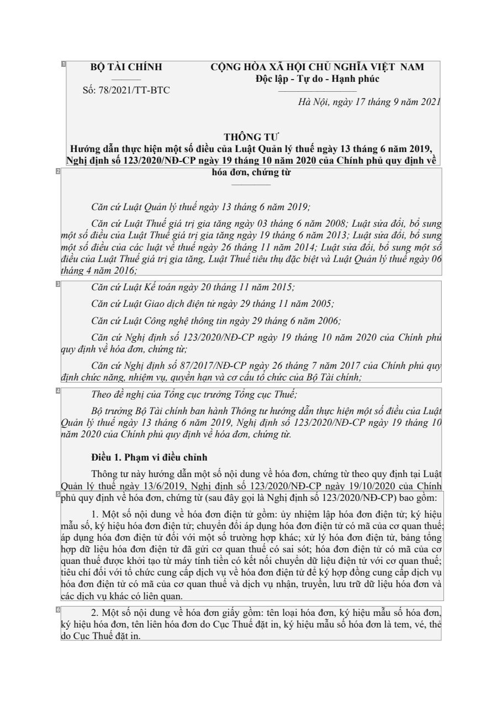
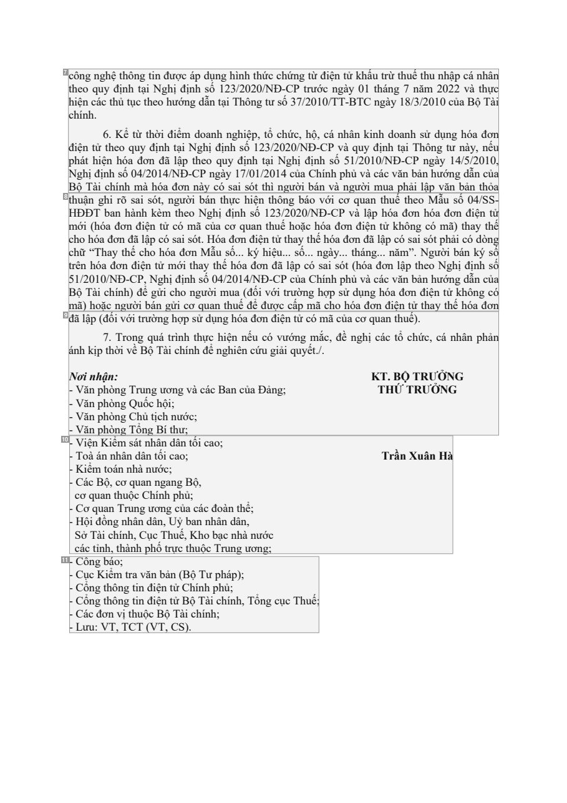
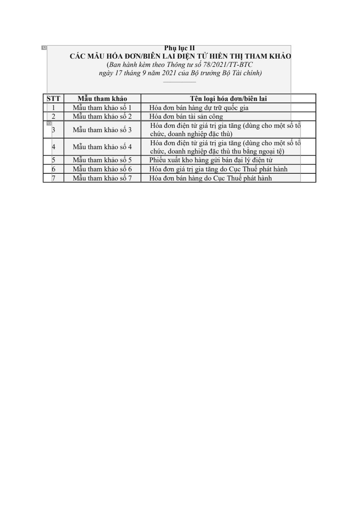

# 021 — `todo10_8/heading_corpus_100/01_phap_quy/021_TT_78-2021_Hoa_don_dien_tu.pdf`

Draft `P7_F1Q_HELDOUT_GOLD_DRAFT_V2`, status `DRAFT_REVIEWER_A_NOT_APPROVED`, draft sha256 `944495d04ec4b2c22e48d6fac5d6985dd5709c5182b94bf3ac33a8c890a37829`. Source sha256 `1447272076823c6450966e3f2119f03f5441b9a787763139004a7acb070a7c8c`. [Back to index](README.md)

Approve or correct with `review-apply` lines: `APPROVE 021 by <reviewer> [because <note>]`, `021 <alias> -> E|R|O because <reason>`.

## Page 1 (FIRST)

| # | alias | text | font | draft | flag | rationale |
|---:|---|---|---|---|---|---|
| 1 | L0000:S0 | NHgưhSịớốđnB:ịgỘn7dh8T/ẫ_2sn&#192;_ố0__It21_h_1C2ự_/3_THc_/T2&#205;h0N-iB2ệH0nT/CNmĐột-CsốPđnigều&#224;CycỘủ1TN9aHGtLh&#… | 12 B | **OTHER** |  | Default: body text, list item, table cell, page number or other non-heading content on this page |
| 2 | L0001:S0 | mmđthiộộ&#225;ềuttngsscốốủ4ađđCCniiLăăềăềnnuuumậcccc2tứủứủ0TaaLL1hLuc6uuậu&#225;;ậếậcttgtQTliu&#225;Thuậhuảtturếnịếvgglề… | 12 I | **OTHER** |  | Default: body text, list item, table cell, page number or other non-heading content on this page |
| 3 | L0002:S0 | đqịunyhđcịhnhứCCCCCcăăăăăvnnnnnềnăhcccccnứứứ&#243;ứứgaLLL,NNđnuuuggơhậậậhhntttiịệị,KCGmđcđ&#244;ếiịhịannvnứtohgụohn,&#22… | 12 I | **OTHER** |  | Default: body text, list item, table cell, page number or other non-heading content on this page |
| 4 | L0003:S0 | nQQăuumảảnn20ll&#253;&#253;B2ĐTT0hhộttihhềe&#244;ctuuuonrủếếưgađ1ởnề.ntCngưPgngh&#224;&#224;hgny&#237;yBnhạ&#224;hymịộ11… | 12 I | **OTHER** |  | Default: body text, list item, table cell, page number or other non-heading content on this page |
| 5 | L0004:S0 | phhmtqc&#225;ip&#225;uhợ&#243;&#234;ẫcủupaaudndđụqcdsịhtunơữcốh&#237;yngh,u1đlkđếvi.đhốệ&#253;ịụMi&#243;điunệahưvhnkộhiớ… | 12 | **OTHER** |  | Default: body text, list item, table cell, page number or other non-heading content on this page |
| 6 | L0005:S0 | kd&#253;ohCiụệcu2Th.h&#243;Muaếđộđtơặnstố,itnn&#234;.nộilid&#234;unnhg&#243;vaềđhơ&#243;nadđoơCnụgciấTyhguồếmđặ:tt&#234;… | 12 | **OTHER** |  | Default: body text, list item, table cell, page number or other non-heading content on this page |

**OTHER rows to check for a missed heading on page 1** (body size 12pt; bold or ≥ body+1pt, ≤ 12 words): #1 `L0000:S0` NHgưhSịớốđnB:ịgỘn7dh8T/ẫ_2sn&#192;_ố0__It21_h_1C2ự_/3_THc_/T… (12 B).

## Page 14 (SEEDED_INTERIOR)

| # | alias | text | font | draft | flag | rationale |
|---:|---|---|---|---|---|---|
| 7 | L0077:S0 | NphtBđcchh&#244;hiiộgệệen&#237;&#225;nnnhotgThịcthq&#224;nđ.ử&#225;uiigịcệ6nycthnhht.hệhđeK&#237;hủsntoịn&#243;hốểhtha&#… | 12 | **OTHER** |  | Default: body text, list item, table cell, page number or other non-heading content on this page |
| 8 | L0078:S0 | mmttBHcc5hrhh1&#234;ộĐuớ&#227;ữo/n)2ậiĐThn0“hh(&#224;T&#243;hTo1&#243;iga&#243;0hặahbc/acađhNiađyơđnn&#237;ơrĐnnơg&#245;… | 12 | **OTHER** |  | Default: body text, list item, table cell, page number or other non-heading content on this page |
| 9 | L0079:S0 | Nđ&#225;----n&#227;VVVVơhliăăăăậknnnnnpịhppppp(ậđhhhh7tnhố&#242;&#242;&#242;&#242;.i:ờnnnnTviggggrớvoTTQCniềrổhugtuBrnủố… | 12 | **OTHER** |  | Default: body text, list item, table cell, page number or other non-heading content on this page |
| 10 | L0080:S0 | ------ccSVKHTCCơ&#225;ởoơ&#225;iiộcệểc&#224;qiTnmqtuđỉB&#225;&#224;unaKnồiatộhnnocnin,,ểhg&#225;tchthmTn&#237;hơn&#226;n… | 12 | **OTHER** |  | Default: body text, list item, table cell, page number or other non-heading content on this page |
| 11 | L0081:S0 | ------LCCCCCưụ&#244;ổổ&#225;cunnncggg:đKVơbttihhnểT&#225;&#244;&#244;mo,vnn;TịggtrtChttaiiTunnvộă(đđcVniiệệBTbnnộ,ảttnCử… | 12 | **OTHER** |  | Default: body text, list item, table cell, page number or other non-heading content on this page |

**OTHER rows to check for a missed heading on page 14** (body size 12pt; bold or ≥ body+1pt, ≤ 12 words): none.

## Page 20 (SEEDED_INTERIOR)

| # | alias | text | font | draft | flag | rationale |
|---:|---|---|---|---|---|---|
| 12 | L0100:S0 | ST21TCMM&#193;MẫẫCuuẫMttuhhaatẪhmmnUagkkm&#224;H(hhByảảk&#211;aoo1hnA7ảsshốốotĐh&#224;21&#225;nƠnhNgk/&#232;9BmInHH&#202… | 12 | **OTHER** |  | Default: body text, list item, table cell, page number or other non-heading content on this page |
| 13 | L0101:S0 | 47365MMMMMẫẫẫẫẫuuuuuttttthhhhhaaaaammmmmkkkkkhhhhhảảảảảooooosssssốốốốố47365PHHHHcchhh&#243;&#243;&#243;&#243;ứứiaaếaaccu… | 12 | **OTHER** |  | Default: body text, list item, table cell, page number or other non-heading content on this page |

**OTHER rows to check for a missed heading on page 20** (body size 12pt; bold or ≥ body+1pt, ≤ 12 words): none.
