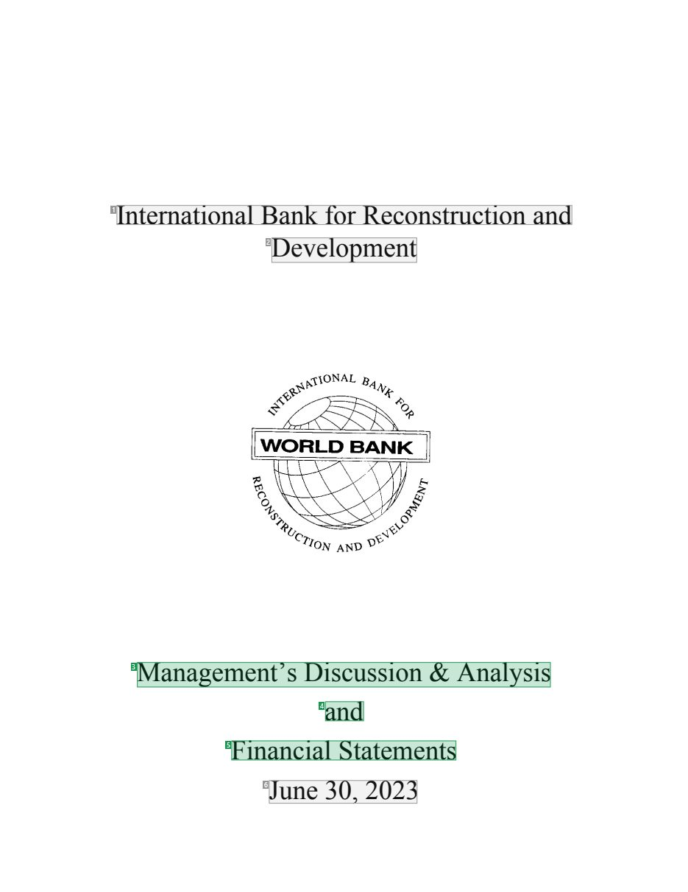
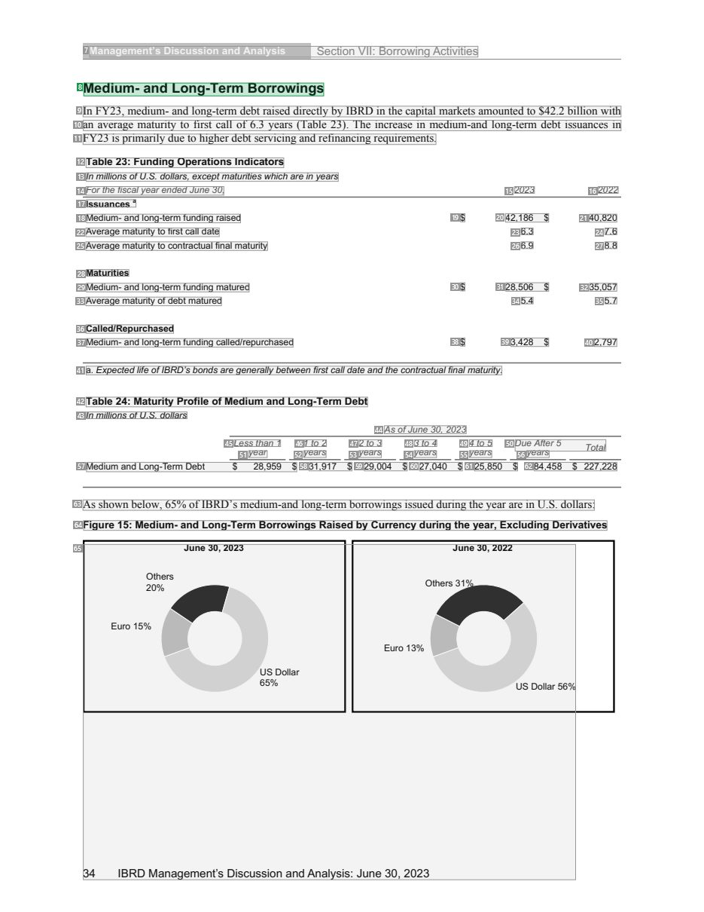
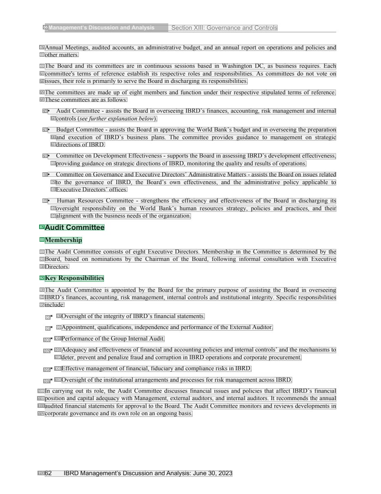
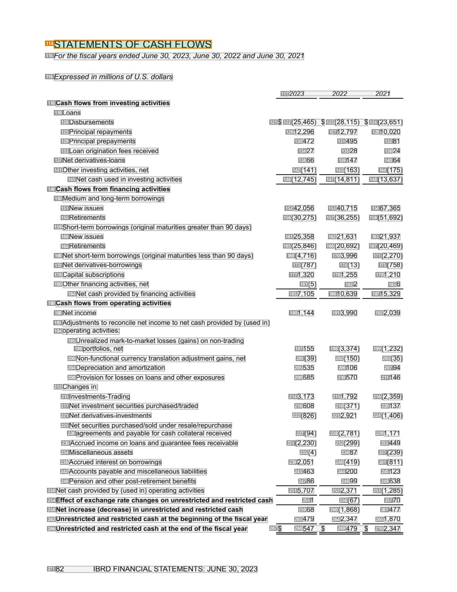

# 045 — `todo10_8/heading_corpus_100/03_tai_chinh_ke_toan/045_IBRD_Financial_Statements_June_2023.pdf`

Draft `P7_F1Q_HELDOUT_GOLD_DRAFT_V2`, status `DRAFT_REVIEWER_A_NOT_APPROVED`, draft sha256 `e47c34e5cf5073e61446c1a1f985f576a0ea8cad9c83b07e7292855dd701a774`. Source sha256 `7ed6e6d9e1ac3b174b8ed3dc7be2a28bbf48be52df276c2546919b20c682fda6`. [Back to index](README.md)

Approve or correct with `review-apply` lines: `APPROVE 045 by <reviewer> [because <note>]`, `045 <alias> -> E|R|O because <reason>`.

## Page 1 (FIRST)

| # | alias | text | font | draft | flag | rationale |
|---:|---|---|---|---|---|---|
| 1 | L0000:S0 | International Bank forReconstruction and | 24 | **OTHER** |  | Issuer name on the cover |
| 2 | L0001:S0 | Development | 24 | **OTHER** |  | Issuer name continuation |
| 3 | L0002:S0 | Management’s Discussion &amp; Analysis | 24 | **ESTABLISHES** |  | Report title &quot;Management&#39;s Discussion &amp; Analysis&quot; (24pt) |
| 4 | L0003:S0 | and | 24 | **ESTABLISHES** |  | Report title continuation &quot;and&quot; |
| 5 | L0004:S0 | Financial Statements | 24 | **ESTABLISHES** |  | Report title continuation &quot;Financial Statements&quot; |
| 6 | L0005:S0 | June 30, 2023 | 24 | **OTHER** |  | Reporting date &quot;June 30, 2023&quot; |

**OTHER rows to check for a missed heading on page 1** (body size 24pt; bold or ≥ body+1pt, ≤ 12 words): none.

## Page 36 (TARGETED_STRUCTURE)

| # | alias | text | font | draft | flag | rationale |
|---:|---|---|---|---|---|---|
| 7 | L1095:S0 | Management’s Discussion and Analysis Section VII: Borrowing Activities | 9 B | **OTHER** |  | Running header &quot;Management&#39;s Discussion and Analysis Section VII: Borrowing Activities&quot; |
| 8 | L1096:S0 | Medium- and Long-Term Borrowings | 12 B | **ESTABLISHES** |  | MD&amp;A sub-section heading &quot;Medium- and Long-Term Borrowings&quot; (12pt bold) |
| 9 | L1097:S0 | In FY23, medium- and long-term debtraised directlyby IBRD in the capital markets amounted to $42.2 billion with | 10 | **OTHER** |  | Default: body text, list item, table cell, page number or other non-heading content on this page |
| 10 | L1098:S0 | an average maturity to first call of 6.3 years (Table 23). The increase in medium-and long-term debt issuances in | 10 | **OTHER** |  | Default: body text, list item, table cell, page number or other non-heading content on this page |
| 11 | L1099:S0 | FY23 is primarily due to higher debt servicing andrefinancing requirements. | 10 | **OTHER** |  | Default: body text, list item, table cell, page number or other non-heading content on this page |
| 12 | L1100:S0 | Table 23: Funding Operations Indicators | 9 B | **OTHER** |  | Table caption &quot;Table 23: Funding Operations Indicators&quot; |
| 13 | L1101:S0 | In millions ofU.S. dollars, exceptmaturities which are in years | 8 I | **OTHER** |  | Default: body text, list item, table cell, page number or other non-heading content on this page |
| 14 | L1102:S0 | Forthe fiscalyearendedJune 30, | 8 I | **OTHER** |  | Default: body text, list item, table cell, page number or other non-heading content on this page |
| 15 | L1102:S1 | 2023 | 8 I | **OTHER** |  | Default: body text, list item, table cell, page number or other non-heading content on this page |
| 16 | L1102:S2 | 2022 | 8 I | **OTHER** |  | Default: body text, list item, table cell, page number or other non-heading content on this page |
| 17 | L1103:S0 | Issuances a | 8 B | **OTHER** |  | Table group label &quot;Issuances&quot; (bold, inside the table) |
| 18 | L1104:S0 | Medium- and long-term funding raised | 8 | **OTHER** |  | Default: body text, list item, table cell, page number or other non-heading content on this page |
| 19 | L1104:S1 | $ | 8 | **OTHER** |  | Default: body text, list item, table cell, page number or other non-heading content on this page |
| 20 | L1104:S2 | 42,186 $ | 8 | **OTHER** |  | Default: body text, list item, table cell, page number or other non-heading content on this page |
| 21 | L1104:S3 | 40,820 | 8 | **OTHER** |  | Default: body text, list item, table cell, page number or other non-heading content on this page |
| 22 | L1105:S0 | Average maturity to first call date | 8 | **OTHER** |  | Default: body text, list item, table cell, page number or other non-heading content on this page |
| 23 | L1105:S1 | 6.3 | 8 | **OTHER** |  | Default: body text, list item, table cell, page number or other non-heading content on this page |
| 24 | L1105:S2 | 7.6 | 8 | **OTHER** |  | Default: body text, list item, table cell, page number or other non-heading content on this page |
| 25 | L1106:S0 | Average maturity to contractual final maturity | 8 | **OTHER** |  | Default: body text, list item, table cell, page number or other non-heading content on this page |
| 26 | L1106:S1 | 6.9 | 8 | **OTHER** |  | Default: body text, list item, table cell, page number or other non-heading content on this page |
| 27 | L1106:S2 | 8.8 | 8 | **OTHER** |  | Default: body text, list item, table cell, page number or other non-heading content on this page |
| 28 | L1107:S0 | Maturities | 8 B | **OTHER** |  | Table group label &quot;Maturities&quot; |
| 29 | L1108:S0 | Medium- and long-term funding matured | 8 | **OTHER** |  | Default: body text, list item, table cell, page number or other non-heading content on this page |
| 30 | L1108:S1 | $ | 8 | **OTHER** |  | Default: body text, list item, table cell, page number or other non-heading content on this page |
| 31 | L1108:S2 | 28,506 $ | 8 | **OTHER** |  | Default: body text, list item, table cell, page number or other non-heading content on this page |
| 32 | L1108:S3 | 35,057 | 8 | **OTHER** |  | Default: body text, list item, table cell, page number or other non-heading content on this page |
| 33 | L1109:S0 | Average maturity of debt matured | 8 | **OTHER** |  | Default: body text, list item, table cell, page number or other non-heading content on this page |
| 34 | L1109:S1 | 5.4 | 8 | **OTHER** |  | Default: body text, list item, table cell, page number or other non-heading content on this page |
| 35 | L1109:S2 | 5.7 | 8 | **OTHER** |  | Default: body text, list item, table cell, page number or other non-heading content on this page |
| 36 | L1110:S0 | Called/Repurchased | 8 B | **OTHER** |  | Table group label &quot;Called/Repurchased&quot; |
| 37 | L1111:S0 | Medium- and long-term funding called/repurchased | 8 | **OTHER** |  | Default: body text, list item, table cell, page number or other non-heading content on this page |
| 38 | L1111:S1 | $ | 8 | **OTHER** |  | Default: body text, list item, table cell, page number or other non-heading content on this page |
| 39 | L1111:S2 | 3,428 $ | 8 | **OTHER** |  | Default: body text, list item, table cell, page number or other non-heading content on this page |
| 40 | L1111:S3 | 2,797 | 8 | **OTHER** |  | Default: body text, list item, table cell, page number or other non-heading content on this page |
| 41 | L1112:S0 | a. Expectedlife ofIBRD’s bonds are generallybetween first call date and the contractual finalmaturity. | 8 I | **OTHER** |  | Default: body text, list item, table cell, page number or other non-heading content on this page |
| 42 | L1113:S0 | Table 24: Maturity Profile of Medium and Long-Term Debt | 9 B | **OTHER** |  | Table caption &quot;Table 24: Maturity Profile of Medium and Long-Term Debt&quot; |
| 43 | L1114:S0 | In millions ofU.S. dollars | 8 I | **OTHER** |  | Default: body text, list item, table cell, page number or other non-heading content on this page |
| 44 | L1115:S0 | As ofJune 30, 2023 | 8 I | **OTHER** |  | Default: body text, list item, table cell, page number or other non-heading content on this page |
| 45 | L1116:S0 | Less than 1 | 8 I | **OTHER** |  | Default: body text, list item, table cell, page number or other non-heading content on this page |
| 46 | L1116:S1 | 1 to 2 | 8 I | **OTHER** |  | Default: body text, list item, table cell, page number or other non-heading content on this page |
| 47 | L1116:S2 | 2 to 3 | 8 I | **OTHER** |  | Default: body text, list item, table cell, page number or other non-heading content on this page |
| 48 | L1116:S3 | 3 to 4 | 8 I | **OTHER** |  | Default: body text, list item, table cell, page number or other non-heading content on this page |
| 49 | L1116:S4 | 4 to 5 | 8 I | **OTHER** |  | Default: body text, list item, table cell, page number or other non-heading content on this page |
| 50 | L1116:S5 | Due After5 Total | 8 I | **OTHER** |  | Default: body text, list item, table cell, page number or other non-heading content on this page |
| 51 | L1117:S0 | year | 8 I | **OTHER** |  | Default: body text, list item, table cell, page number or other non-heading content on this page |
| 52 | L1117:S1 | years | 8 I | **OTHER** |  | Default: body text, list item, table cell, page number or other non-heading content on this page |
| 53 | L1117:S2 | years | 8 I | **OTHER** |  | Default: body text, list item, table cell, page number or other non-heading content on this page |
| 54 | L1117:S3 | years | 8 I | **OTHER** |  | Default: body text, list item, table cell, page number or other non-heading content on this page |
| 55 | L1117:S4 | years | 8 I | **OTHER** |  | Default: body text, list item, table cell, page number or other non-heading content on this page |
| 56 | L1117:S5 | years | 8 I | **OTHER** |  | Default: body text, list item, table cell, page number or other non-heading content on this page |
| 57 | L1118:S0 | Medium and Long-Term Debt $ 28,959 $ | 8 | **OTHER** |  | Default: body text, list item, table cell, page number or other non-heading content on this page |
| 58 | L1118:S1 | 31,917 $ | 8 | **OTHER** |  | Default: body text, list item, table cell, page number or other non-heading content on this page |
| 59 | L1118:S2 | 29,004 $ | 8 | **OTHER** |  | Default: body text, list item, table cell, page number or other non-heading content on this page |
| 60 | L1118:S3 | 27,040 $ | 8 | **OTHER** |  | Default: body text, list item, table cell, page number or other non-heading content on this page |
| 61 | L1118:S4 | 25,850 $ | 8 | **OTHER** |  | Default: body text, list item, table cell, page number or other non-heading content on this page |
| 62 | L1118:S5 | 84,458 $ 227,228 | 8 | **OTHER** |  | Default: body text, list item, table cell, page number or other non-heading content on this page |
| 63 | L1119:S0 | As shownbelow, 65% ofIBRD’s medium-and long-termborrowings issued during the year are inU.S. dollars: | 10 | **OTHER** |  | Default: body text, list item, table cell, page number or other non-heading content on this page |
| 64 | L1120:S0 | Figure 15: Medium- and Long-Term Borrowings Raised by Currency during the year, Excluding Derivatives | 9 B | **OTHER** |  | Figure caption &quot;Figure 15: ...&quot; |
| 65 | L1121:S0 | 34 EuIBroR1D5%2OM0th%aenrsageJumneen3t0’s,2D02is3cus6Us5Sio%Dnoallanrd Analysis: June E3u0r,o2103%23OthersJ3u1n%e30,2022… | 8 | **OTHER** |  | Running footer interleaved with chart labels (garbled) |

**OTHER rows to check for a missed heading on page 36** (body size 8pt; bold or ≥ body+1pt, ≤ 12 words): #7 `L1095:S0` Management’s Discussion and Analysis Section VII: Borrowing … (9 B), #11 `L1099:S0` FY23 is primarily due to higher debt servicing andrefinancin… (10), #12 `L1100:S0` Table 23: Funding Operations Indicators (9 B), #17 `L1103:S0` Issuances a (8 B), #28 `L1107:S0` Maturities (8 B), #36 `L1110:S0` Called/Repurchased (8 B), #42 `L1113:S0` Table 24: Maturity Profile of Medium and Long-Term Debt (9 B).

## Page 64 (SEEDED_INTERIOR)

| # | alias | text | font | draft | flag | rationale |
|---:|---|---|---|---|---|---|
| 66 | L2111:S0 | Management’s Discussion and Analysis Section XIII: Governance and Controls | 9 B | **OTHER** |  | Running header &quot;Management&#39;s Discussion and Analysis Section XIII: Governance and Controls&quot; |
| 67 | L2112:S0 | Annual Meetings, audited accounts, an administrative budget, and an annual report on operations and policies and | 10 | **OTHER** |  | Default: body text, list item, table cell, page number or other non-heading content on this page |
| 68 | L2113:S0 | othermatters. | 10 | **OTHER** |  | Default: body text, list item, table cell, page number or other non-heading content on this page |
| 69 | L2114:S0 | The Board and its committees are in continuous sessions based in Washington DC, as business requires. Each | 10 | **OTHER** |  | Default: body text, list item, table cell, page number or other non-heading content on this page |
| 70 | L2115:S0 | committee&#39;s terms of reference establish its respective roles and responsibilities. As committees do not vote on | 10 | **OTHER** |  | Default: body text, list item, table cell, page number or other non-heading content on this page |
| 71 | L2116:S0 | issues, theirrole is primarilyto serve the Board in discharging its responsibilities. | 10 | **OTHER** |  | Default: body text, list item, table cell, page number or other non-heading content on this page |
| 72 | L2117:S0 | The committees are made up of eight members and function under their respective stipulated terms of reference. | 10 | **OTHER** |  | Default: body text, list item, table cell, page number or other non-heading content on this page |
| 73 | L2118:S0 | These committees are as follows: | 10 | **OTHER** |  | Default: body text, list item, table cell, page number or other non-heading content on this page |
| 74 | L2119:S0 | • Audit Committee - assists the Board in overseeing IBRD’s finances, accounting, risk management and internal | 10 | **OTHER** |  | Default: body text, list item, table cell, page number or other non-heading content on this page |
| 75 | L2120:S0 | controls (seefurtherexplanation below). | 10 I | **OTHER** |  | Default: body text, list item, table cell, page number or other non-heading content on this page |
| 76 | L2121:S0 | • Budget Committee - assists the Board in approving the World Bank’s budget and in overseeing the preparation | 10 | **OTHER** |  | Default: body text, list item, table cell, page number or other non-heading content on this page |
| 77 | L2122:S0 | and execution of IBRD’s business plans. The committee provides guidance to management on strategic | 10 | **OTHER** |  | Default: body text, list item, table cell, page number or other non-heading content on this page |
| 78 | L2123:S0 | directions ofIBRD. | 10 | **OTHER** |  | Default: body text, list item, table cell, page number or other non-heading content on this page |
| 79 | L2124:S0 | • Committee on Development Effectiveness - supports the Board in assessing IBRD’s development effectiveness, | 10 | **OTHER** |  | Default: body text, list item, table cell, page number or other non-heading content on this page |
| 80 | L2125:S0 | providing guidance on strategic directions ofIBRD, monitoring the quality andresults ofoperations. | 10 | **OTHER** |  | Default: body text, list item, table cell, page number or other non-heading content on this page |
| 81 | L2126:S0 | • Committee on Governance and Executive Directors’ Administrative Matters - assists the Board on issues related | 10 | **OTHER** |  | Default: body text, list item, table cell, page number or other non-heading content on this page |
| 82 | L2127:S0 | to the governance of IBRD, the Board’s own effectiveness, and the administrative policy applicable to | 10 | **OTHER** |  | Default: body text, list item, table cell, page number or other non-heading content on this page |
| 83 | L2128:S0 | Executive Directors’ offices. | 10 | **OTHER** |  | Default: body text, list item, table cell, page number or other non-heading content on this page |
| 84 | L2129:S0 | • Human Resources Committee - strengthens the efficiency and effectiveness of the Board in discharging its | 10 | **OTHER** |  | Default: body text, list item, table cell, page number or other non-heading content on this page |
| 85 | L2130:S0 | oversight responsibility on the World Bank’s human resources strategy, policies and practices, and their | 10 | **OTHER** |  | Default: body text, list item, table cell, page number or other non-heading content on this page |
| 86 | L2131:S0 | alignmentwiththe business needs ofthe organization. | 10 | **OTHER** |  | Default: body text, list item, table cell, page number or other non-heading content on this page |
| 87 | L2132:S0 | Audit Committee | 12 B | **ESTABLISHES** |  | Sub-section heading &quot;Audit Committee&quot; (12pt bold) |
| 88 | L2133:S0 | Membership | 11 B | **ESTABLISHES** |  | Sub-section heading &quot;Membership&quot; (11pt bold) |
| 89 | L2134:S0 | The Audit Committee consists of eight Executive Directors. Membership in the Committee is determined by the | 10 | **OTHER** |  | Default: body text, list item, table cell, page number or other non-heading content on this page |
| 90 | L2135:S0 | Board, based on nominations by the Chairman of the Board, following informal consultation with Executive | 10 | **OTHER** |  | Default: body text, list item, table cell, page number or other non-heading content on this page |
| 91 | L2136:S0 | Directors. | 10 | **OTHER** |  | Default: body text, list item, table cell, page number or other non-heading content on this page |
| 92 | L2137:S0 | Key Responsibilities | 11 B | **ESTABLISHES** |  | Sub-section heading &quot;Key Responsibilities&quot; (11pt bold) |
| 93 | L2138:S0 | The Audit Committee is appointed by the Board for the primary purpose of assisting the Board in overseeing | 10 | **OTHER** |  | Default: body text, list item, table cell, page number or other non-heading content on this page |
| 94 | L2139:S0 | IBRD’s finances, accounting, risk management, internal controls and institutional integrity. Specific responsibilities | 10 | **OTHER** |  | Default: body text, list item, table cell, page number or other non-heading content on this page |
| 95 | L2140:S0 | include: | 10 | **OTHER** |  | Default: body text, list item, table cell, page number or other non-heading content on this page |
| 96 | L2141:S0 | • | 10 | **OTHER** |  | Default: body text, list item, table cell, page number or other non-heading content on this page |
| 97 | L2141:S1 | Oversight ofthe integrity ofIBRD’s financial statements. | 10 | **OTHER** |  | Default: body text, list item, table cell, page number or other non-heading content on this page |
| 98 | L2142:S0 | • | 10 | **OTHER** |  | Default: body text, list item, table cell, page number or other non-heading content on this page |
| 99 | L2142:S1 | Appointment, qualifications, independence andperformance ofthe External Auditor. | 10 | **OTHER** |  | Default: body text, list item, table cell, page number or other non-heading content on this page |
| 100 | L2143:S0 | • | 10 | **OTHER** |  | Default: body text, list item, table cell, page number or other non-heading content on this page |
| 101 | L2143:S1 | Performance ofthe Group Internal Audit. | 10 | **OTHER** |  | Default: body text, list item, table cell, page number or other non-heading content on this page |
| 102 | L2144:S0 | • | 10 | **OTHER** |  | Default: body text, list item, table cell, page number or other non-heading content on this page |
| 103 | L2144:S1 | Adequacy and effectiveness offinancial and accounting policies and internal controls’ and the mechanisms to | 10 | **OTHER** |  | Default: body text, list item, table cell, page number or other non-heading content on this page |
| 104 | L2145:S0 | deter, prevent andpenalize fraud and corruption in IBRD operations and corporate procurement. | 10 | **OTHER** |  | Default: body text, list item, table cell, page number or other non-heading content on this page |
| 105 | L2146:S0 | • | 10 | **OTHER** |  | Default: body text, list item, table cell, page number or other non-heading content on this page |
| 106 | L2146:S1 | Effective management offinancial, fiduciary and compliance risks in IBRD. | 10 | **OTHER** |  | Default: body text, list item, table cell, page number or other non-heading content on this page |
| 107 | L2147:S0 | • | 10 | **OTHER** |  | Default: body text, list item, table cell, page number or other non-heading content on this page |
| 108 | L2147:S1 | Oversight ofthe institutional arrangements andprocesses forriskmanagement across IBRD. | 10 | **OTHER** |  | Default: body text, list item, table cell, page number or other non-heading content on this page |
| 109 | L2148:S0 | In carrying out its role, the Audit Committee discusses financial issues and policies that affect IBRD’s financial | 10 | **OTHER** |  | Default: body text, list item, table cell, page number or other non-heading content on this page |
| 110 | L2149:S0 | position and capital adequacy with Management, external auditors, and internal auditors. It recommends the annual | 10 | **OTHER** |  | Default: body text, list item, table cell, page number or other non-heading content on this page |
| 111 | L2150:S0 | audited financial statements for approval to the Board. The Audit Committee monitors and reviews developments in | 10 | **OTHER** |  | Default: body text, list item, table cell, page number or other non-heading content on this page |
| 112 | L2151:S0 | corporate governance and its ownrole on an ongoingbasis. | 10 | **OTHER** |  | Default: body text, list item, table cell, page number or other non-heading content on this page |
| 113 | L2152:S0 | 62 IBRD Management’s Discussion and Analysis: June 30, 2023 | 10 | **OTHER** |  | Running footer |

**OTHER rows to check for a missed heading on page 64** (body size 10pt; bold or ≥ body+1pt, ≤ 12 words): #66 `L2111:S0` Management’s Discussion and Analysis Section XIII: Governanc… (9 B).

## Page 84 (SEEDED_INTERIOR)

| # | alias | text | font | draft | flag | rationale |
|---:|---|---|---|---|---|---|
| 114 | L2628:S0 | STATEMENTS OF CASH FLOWS | 14 | **ESTABLISHES** | REVIEW_FOCUS | Financial statement title &quot;STATEMENTS OF CASH FLOWS&quot; (14pt, heads the statement page) |
| 115 | L2629:S0 | Forthe fiscalyears endedJune 30, 2023, June 30, 2022 andJune 30, 2021 | 10 I | **OTHER** |  | Statement period subtitle &quot;For the fiscal years ended ...&quot; (metadata) |
| 116 | L2630:S0 | Expressedin millions ofU.S. dollars | 10 I | **OTHER** |  | Unit note &quot;Expressed in millions of U.S. dollars&quot; |
| 117 | L2631:S0 | 2023 2022 2021 | 9 I | **OTHER** |  | Default: body text, list item, table cell, page number or other non-heading content on this page |
| 118 | L2632:S0 | Cash flows from investing activities | 9 B | **OTHER** |  | Statement group label &quot;Cash flows from investing activities&quot; (bold, table row) |
| 119 | L2633:S0 | Loans | 9 | **OTHER** |  | Default: body text, list item, table cell, page number or other non-heading content on this page |
| 120 | L2634:S0 | Disbursements | 9 | **OTHER** |  | Default: body text, list item, table cell, page number or other non-heading content on this page |
| 121 | L2634:S1 | $ | 9 | **OTHER** |  | Default: body text, list item, table cell, page number or other non-heading content on this page |
| 122 | L2634:S2 | (25,465) $ | 9 | **OTHER** |  | Default: body text, list item, table cell, page number or other non-heading content on this page |
| 123 | L2634:S3 | (28,1 15) $ | 9 | **OTHER** |  | Default: body text, list item, table cell, page number or other non-heading content on this page |
| 124 | L2634:S4 | (23,651) | 9 | **OTHER** |  | Default: body text, list item, table cell, page number or other non-heading content on this page |
| 125 | L2635:S0 | Principal repayments | 9 | **OTHER** |  | Default: body text, list item, table cell, page number or other non-heading content on this page |
| 126 | L2635:S1 | 12,296 | 9 | **OTHER** |  | Default: body text, list item, table cell, page number or other non-heading content on this page |
| 127 | L2635:S2 | 12,797 | 9 | **OTHER** |  | Default: body text, list item, table cell, page number or other non-heading content on this page |
| 128 | L2635:S3 | 10,020 | 9 | **OTHER** |  | Default: body text, list item, table cell, page number or other non-heading content on this page |
| 129 | L2636:S0 | Principal prepayments | 9 | **OTHER** |  | Default: body text, list item, table cell, page number or other non-heading content on this page |
| 130 | L2636:S1 | 472 | 9 | **OTHER** |  | Default: body text, list item, table cell, page number or other non-heading content on this page |
| 131 | L2636:S2 | 495 | 9 | **OTHER** |  | Default: body text, list item, table cell, page number or other non-heading content on this page |
| 132 | L2636:S3 | 81 | 9 | **OTHER** |  | Default: body text, list item, table cell, page number or other non-heading content on this page |
| 133 | L2637:S0 | Loan origination fees received | 9 | **OTHER** |  | Default: body text, list item, table cell, page number or other non-heading content on this page |
| 134 | L2637:S1 | 27 | 9 | **OTHER** |  | Default: body text, list item, table cell, page number or other non-heading content on this page |
| 135 | L2637:S2 | 28 | 9 | **OTHER** |  | Default: body text, list item, table cell, page number or other non-heading content on this page |
| 136 | L2637:S3 | 24 | 9 | **OTHER** |  | Default: body text, list item, table cell, page number or other non-heading content on this page |
| 137 | L2638:S0 | Net derivatives-loans | 9 | **OTHER** |  | Default: body text, list item, table cell, page number or other non-heading content on this page |
| 138 | L2638:S1 | 66 | 9 | **OTHER** |  | Default: body text, list item, table cell, page number or other non-heading content on this page |
| 139 | L2638:S2 | 147 | 9 | **OTHER** |  | Default: body text, list item, table cell, page number or other non-heading content on this page |
| 140 | L2638:S3 | 64 | 9 | **OTHER** |  | Default: body text, list item, table cell, page number or other non-heading content on this page |
| 141 | L2639:S0 | Other investing activities, net | 9 | **OTHER** |  | Default: body text, list item, table cell, page number or other non-heading content on this page |
| 142 | L2639:S1 | (141) | 9 | **OTHER** |  | Default: body text, list item, table cell, page number or other non-heading content on this page |
| 143 | L2639:S2 | (163) | 9 | **OTHER** |  | Default: body text, list item, table cell, page number or other non-heading content on this page |
| 144 | L2639:S3 | (175) | 9 | **OTHER** |  | Default: body text, list item, table cell, page number or other non-heading content on this page |
| 145 | L2640:S0 | Net cash used in investing activities | 9 | **OTHER** |  | Default: body text, list item, table cell, page number or other non-heading content on this page |
| 146 | L2640:S1 | (12,745) | 9 | **OTHER** |  | Default: body text, list item, table cell, page number or other non-heading content on this page |
| 147 | L2640:S2 | (14,81 1) | 9 | **OTHER** |  | Default: body text, list item, table cell, page number or other non-heading content on this page |
| 148 | L2640:S3 | (13,637) | 9 | **OTHER** |  | Default: body text, list item, table cell, page number or other non-heading content on this page |
| 149 | L2641:S0 | Cash flows from financing activities | 9 B | **OTHER** |  | Statement group label &quot;Cash flows from financing activities&quot; |
| 150 | L2642:S0 | Medium and long-term borrowings | 9 | **OTHER** |  | Default: body text, list item, table cell, page number or other non-heading content on this page |
| 151 | L2643:S0 | New issues | 9 | **OTHER** |  | Default: body text, list item, table cell, page number or other non-heading content on this page |
| 152 | L2643:S1 | 42,056 | 9 | **OTHER** |  | Default: body text, list item, table cell, page number or other non-heading content on this page |
| 153 | L2643:S2 | 40,715 | 9 | **OTHER** |  | Default: body text, list item, table cell, page number or other non-heading content on this page |
| 154 | L2643:S3 | 67,365 | 9 | **OTHER** |  | Default: body text, list item, table cell, page number or other non-heading content on this page |
| 155 | L2644:S0 | Retirements | 9 | **OTHER** |  | Default: body text, list item, table cell, page number or other non-heading content on this page |
| 156 | L2644:S1 | (30,275) | 9 | **OTHER** |  | Default: body text, list item, table cell, page number or other non-heading content on this page |
| 157 | L2644:S2 | (36,255) | 9 | **OTHER** |  | Default: body text, list item, table cell, page number or other non-heading content on this page |
| 158 | L2644:S3 | (51,692) | 9 | **OTHER** |  | Default: body text, list item, table cell, page number or other non-heading content on this page |
| 159 | L2645:S0 | Short-term borrowings (original maturities greater than 90 days) | 9 | **OTHER** |  | Default: body text, list item, table cell, page number or other non-heading content on this page |
| 160 | L2646:S0 | New issues | 9 | **OTHER** |  | Default: body text, list item, table cell, page number or other non-heading content on this page |
| 161 | L2646:S1 | 25,358 | 9 | **OTHER** |  | Default: body text, list item, table cell, page number or other non-heading content on this page |
| 162 | L2646:S2 | 21,631 | 9 | **OTHER** |  | Default: body text, list item, table cell, page number or other non-heading content on this page |
| 163 | L2646:S3 | 21,937 | 9 | **OTHER** |  | Default: body text, list item, table cell, page number or other non-heading content on this page |
| 164 | L2647:S0 | Retirements | 9 | **OTHER** |  | Default: body text, list item, table cell, page number or other non-heading content on this page |
| 165 | L2647:S1 | (25,846) | 9 | **OTHER** |  | Default: body text, list item, table cell, page number or other non-heading content on this page |
| 166 | L2647:S2 | (20,692) | 9 | **OTHER** |  | Default: body text, list item, table cell, page number or other non-heading content on this page |
| 167 | L2647:S3 | (20,469) | 9 | **OTHER** |  | Default: body text, list item, table cell, page number or other non-heading content on this page |
| 168 | L2648:S0 | Net short-term borrowings (original maturities less than 90 days) | 9 | **OTHER** |  | Default: body text, list item, table cell, page number or other non-heading content on this page |
| 169 | L2648:S1 | (4,716) | 9 | **OTHER** |  | Default: body text, list item, table cell, page number or other non-heading content on this page |
| 170 | L2648:S2 | 3,996 | 9 | **OTHER** |  | Default: body text, list item, table cell, page number or other non-heading content on this page |
| 171 | L2648:S3 | (2,270) | 9 | **OTHER** |  | Default: body text, list item, table cell, page number or other non-heading content on this page |
| 172 | L2649:S0 | Net derivatives-borrowings | 9 | **OTHER** |  | Default: body text, list item, table cell, page number or other non-heading content on this page |
| 173 | L2649:S1 | (787) | 9 | **OTHER** |  | Default: body text, list item, table cell, page number or other non-heading content on this page |
| 174 | L2649:S2 | (13) | 9 | **OTHER** |  | Default: body text, list item, table cell, page number or other non-heading content on this page |
| 175 | L2649:S3 | (758) | 9 | **OTHER** |  | Default: body text, list item, table cell, page number or other non-heading content on this page |
| 176 | L2650:S0 | Capital subscriptions | 9 | **OTHER** |  | Default: body text, list item, table cell, page number or other non-heading content on this page |
| 177 | L2650:S1 | 1,320 | 9 | **OTHER** |  | Default: body text, list item, table cell, page number or other non-heading content on this page |
| 178 | L2650:S2 | 1,255 | 9 | **OTHER** |  | Default: body text, list item, table cell, page number or other non-heading content on this page |
| 179 | L2650:S3 | 1,210 | 9 | **OTHER** |  | Default: body text, list item, table cell, page number or other non-heading content on this page |
| 180 | L2651:S0 | Other financing activities, net | 9 | **OTHER** |  | Default: body text, list item, table cell, page number or other non-heading content on this page |
| 181 | L2651:S1 | (5) | 9 | **OTHER** |  | Default: body text, list item, table cell, page number or other non-heading content on this page |
| 182 | L2651:S2 | 2 | 9 | **OTHER** |  | Default: body text, list item, table cell, page number or other non-heading content on this page |
| 183 | L2651:S3 | 6 | 9 | **OTHER** |  | Default: body text, list item, table cell, page number or other non-heading content on this page |
| 184 | L2652:S0 | Net cash provided by financing activities | 9 | **OTHER** |  | Default: body text, list item, table cell, page number or other non-heading content on this page |
| 185 | L2652:S1 | 7,105 | 9 | **OTHER** |  | Default: body text, list item, table cell, page number or other non-heading content on this page |
| 186 | L2652:S2 | 10,639 | 9 | **OTHER** |  | Default: body text, list item, table cell, page number or other non-heading content on this page |
| 187 | L2652:S3 | 15,329 | 9 | **OTHER** |  | Default: body text, list item, table cell, page number or other non-heading content on this page |
| 188 | L2653:S0 | Cash flows from operating activities | 9 B | **OTHER** |  | Statement group label &quot;Cash flows from operating activities&quot; |
| 189 | L2654:S0 | Net income | 9 | **OTHER** |  | Default: body text, list item, table cell, page number or other non-heading content on this page |
| 190 | L2654:S1 | 1,144 | 9 | **OTHER** |  | Default: body text, list item, table cell, page number or other non-heading content on this page |
| 191 | L2654:S2 | 3,990 | 9 | **OTHER** |  | Default: body text, list item, table cell, page number or other non-heading content on this page |
| 192 | L2654:S3 | 2,039 | 9 | **OTHER** |  | Default: body text, list item, table cell, page number or other non-heading content on this page |
| 193 | L2655:S0 | Adjustments to reconcile net income to net cash provided by (used in) | 9 | **OTHER** |  | Default: body text, list item, table cell, page number or other non-heading content on this page |
| 194 | L2656:S0 | operating activities: | 9 | **OTHER** |  | Default: body text, list item, table cell, page number or other non-heading content on this page |
| 195 | L2657:S0 | Unrealized mark-to-market losses (gains) on non-trading | 9 | **OTHER** |  | Default: body text, list item, table cell, page number or other non-heading content on this page |
| 196 | L2658:S0 | portfolios, net | 9 | **OTHER** |  | Default: body text, list item, table cell, page number or other non-heading content on this page |
| 197 | L2658:S1 | 155 | 9 | **OTHER** |  | Default: body text, list item, table cell, page number or other non-heading content on this page |
| 198 | L2658:S2 | (3,374) | 9 | **OTHER** |  | Default: body text, list item, table cell, page number or other non-heading content on this page |
| 199 | L2658:S3 | (1,232) | 9 | **OTHER** |  | Default: body text, list item, table cell, page number or other non-heading content on this page |
| 200 | L2659:S0 | Non-functional currency translation adjustment gains, net | 9 | **OTHER** |  | Default: body text, list item, table cell, page number or other non-heading content on this page |
| 201 | L2659:S1 | (39) | 9 | **OTHER** |  | Default: body text, list item, table cell, page number or other non-heading content on this page |
| 202 | L2659:S2 | (150) | 9 | **OTHER** |  | Default: body text, list item, table cell, page number or other non-heading content on this page |
| 203 | L2659:S3 | (35) | 9 | **OTHER** |  | Default: body text, list item, table cell, page number or other non-heading content on this page |
| 204 | L2660:S0 | Depreciation and amortization | 9 | **OTHER** |  | Default: body text, list item, table cell, page number or other non-heading content on this page |
| 205 | L2660:S1 | 535 | 9 | **OTHER** |  | Default: body text, list item, table cell, page number or other non-heading content on this page |
| 206 | L2660:S2 | 106 | 9 | **OTHER** |  | Default: body text, list item, table cell, page number or other non-heading content on this page |
| 207 | L2660:S3 | 94 | 9 | **OTHER** |  | Default: body text, list item, table cell, page number or other non-heading content on this page |
| 208 | L2661:S0 | Provision for losses on loans and other exposures | 9 | **OTHER** |  | Default: body text, list item, table cell, page number or other non-heading content on this page |
| 209 | L2661:S1 | 685 | 9 | **OTHER** |  | Default: body text, list item, table cell, page number or other non-heading content on this page |
| 210 | L2661:S2 | 570 | 9 | **OTHER** |  | Default: body text, list item, table cell, page number or other non-heading content on this page |
| 211 | L2661:S3 | 146 | 9 | **OTHER** |  | Default: body text, list item, table cell, page number or other non-heading content on this page |
| 212 | L2662:S0 | Changes in: | 9 | **OTHER** |  | Default: body text, list item, table cell, page number or other non-heading content on this page |
| 213 | L2663:S0 | Investments-Trading | 9 | **OTHER** |  | Default: body text, list item, table cell, page number or other non-heading content on this page |
| 214 | L2663:S1 | 3,173 | 9 | **OTHER** |  | Default: body text, list item, table cell, page number or other non-heading content on this page |
| 215 | L2663:S2 | 1,792 | 9 | **OTHER** |  | Default: body text, list item, table cell, page number or other non-heading content on this page |
| 216 | L2663:S3 | (2,359) | 9 | **OTHER** |  | Default: body text, list item, table cell, page number or other non-heading content on this page |
| 217 | L2664:S0 | Net investment securities purchased/traded | 9 | **OTHER** |  | Default: body text, list item, table cell, page number or other non-heading content on this page |
| 218 | L2664:S1 | 608 | 9 | **OTHER** |  | Default: body text, list item, table cell, page number or other non-heading content on this page |
| 219 | L2664:S2 | (371) | 9 | **OTHER** |  | Default: body text, list item, table cell, page number or other non-heading content on this page |
| 220 | L2664:S3 | 137 | 9 | **OTHER** |  | Default: body text, list item, table cell, page number or other non-heading content on this page |
| 221 | L2665:S0 | Net derivatives-investments | 9 | **OTHER** |  | Default: body text, list item, table cell, page number or other non-heading content on this page |
| 222 | L2665:S1 | (826) | 9 | **OTHER** |  | Default: body text, list item, table cell, page number or other non-heading content on this page |
| 223 | L2665:S2 | 2,921 | 9 | **OTHER** |  | Default: body text, list item, table cell, page number or other non-heading content on this page |
| 224 | L2665:S3 | (1,406) | 9 | **OTHER** |  | Default: body text, list item, table cell, page number or other non-heading content on this page |
| 225 | L2666:S0 | Net securities purchased/sold under resale/repurchase | 9 | **OTHER** |  | Default: body text, list item, table cell, page number or other non-heading content on this page |
| 226 | L2667:S0 | agreements and payable for cash collateral received | 9 | **OTHER** |  | Default: body text, list item, table cell, page number or other non-heading content on this page |
| 227 | L2667:S1 | (94) | 9 | **OTHER** |  | Default: body text, list item, table cell, page number or other non-heading content on this page |
| 228 | L2667:S2 | (2,781) | 9 | **OTHER** |  | Default: body text, list item, table cell, page number or other non-heading content on this page |
| 229 | L2667:S3 | 1,171 | 9 | **OTHER** |  | Default: body text, list item, table cell, page number or other non-heading content on this page |
| 230 | L2668:S0 | Accrued income on loans and guarantee fees receivable | 9 | **OTHER** |  | Default: body text, list item, table cell, page number or other non-heading content on this page |
| 231 | L2668:S1 | (2,230) | 9 | **OTHER** |  | Default: body text, list item, table cell, page number or other non-heading content on this page |
| 232 | L2668:S2 | (299) | 9 | **OTHER** |  | Default: body text, list item, table cell, page number or other non-heading content on this page |
| 233 | L2668:S3 | 449 | 9 | **OTHER** |  | Default: body text, list item, table cell, page number or other non-heading content on this page |
| 234 | L2669:S0 | Miscellaneous assets | 9 | **OTHER** |  | Default: body text, list item, table cell, page number or other non-heading content on this page |
| 235 | L2669:S1 | (4) | 9 | **OTHER** |  | Default: body text, list item, table cell, page number or other non-heading content on this page |
| 236 | L2669:S2 | 87 | 9 | **OTHER** |  | Default: body text, list item, table cell, page number or other non-heading content on this page |
| 237 | L2669:S3 | (239) | 9 | **OTHER** |  | Default: body text, list item, table cell, page number or other non-heading content on this page |
| 238 | L2670:S0 | Accrued interest on borrowings | 9 | **OTHER** |  | Default: body text, list item, table cell, page number or other non-heading content on this page |
| 239 | L2670:S1 | 2,051 | 9 | **OTHER** |  | Default: body text, list item, table cell, page number or other non-heading content on this page |
| 240 | L2670:S2 | (419) | 9 | **OTHER** |  | Default: body text, list item, table cell, page number or other non-heading content on this page |
| 241 | L2670:S3 | (81 1) | 9 | **OTHER** |  | Default: body text, list item, table cell, page number or other non-heading content on this page |
| 242 | L2671:S0 | Accounts payable and miscellaneous liabilities | 9 | **OTHER** |  | Default: body text, list item, table cell, page number or other non-heading content on this page |
| 243 | L2671:S1 | 463 | 9 | **OTHER** |  | Default: body text, list item, table cell, page number or other non-heading content on this page |
| 244 | L2671:S2 | 200 | 9 | **OTHER** |  | Default: body text, list item, table cell, page number or other non-heading content on this page |
| 245 | L2671:S3 | 123 | 9 | **OTHER** |  | Default: body text, list item, table cell, page number or other non-heading content on this page |
| 246 | L2672:S0 | Pension and other post-retirement benefits | 9 | **OTHER** |  | Default: body text, list item, table cell, page number or other non-heading content on this page |
| 247 | L2672:S1 | 86 | 9 | **OTHER** |  | Default: body text, list item, table cell, page number or other non-heading content on this page |
| 248 | L2672:S2 | 99 | 9 | **OTHER** |  | Default: body text, list item, table cell, page number or other non-heading content on this page |
| 249 | L2672:S3 | 638 | 9 | **OTHER** |  | Default: body text, list item, table cell, page number or other non-heading content on this page |
| 250 | L2673:S0 | Net cash provided by (used in) operating activities | 9 | **OTHER** |  | Default: body text, list item, table cell, page number or other non-heading content on this page |
| 251 | L2673:S1 | 5,707 | 9 | **OTHER** |  | Default: body text, list item, table cell, page number or other non-heading content on this page |
| 252 | L2673:S2 | 2,371 | 9 | **OTHER** |  | Default: body text, list item, table cell, page number or other non-heading content on this page |
| 253 | L2673:S3 | (1,285) | 9 | **OTHER** |  | Default: body text, list item, table cell, page number or other non-heading content on this page |
| 254 | L2674:S0 | Effect of exchange rate changes on unrestricted and restricted cash | 9 B | **OTHER** |  | Statement total row (bold) |
| 255 | L2674:S1 | 1 | 9 | **OTHER** |  | Default: body text, list item, table cell, page number or other non-heading content on this page |
| 256 | L2674:S2 | (67) | 9 | **OTHER** |  | Default: body text, list item, table cell, page number or other non-heading content on this page |
| 257 | L2674:S3 | 70 | 9 | **OTHER** |  | Default: body text, list item, table cell, page number or other non-heading content on this page |
| 258 | L2675:S0 | Net increase (decrease) in unrestricted and restricted cash | 9 B | **OTHER** |  | Statement total row (bold) |
| 259 | L2675:S1 | 68 | 9 | **OTHER** |  | Default: body text, list item, table cell, page number or other non-heading content on this page |
| 260 | L2675:S2 | (1,868) | 9 | **OTHER** |  | Default: body text, list item, table cell, page number or other non-heading content on this page |
| 261 | L2675:S3 | 477 | 9 | **OTHER** |  | Default: body text, list item, table cell, page number or other non-heading content on this page |
| 262 | L2676:S0 | Unrestricted and restricted cash at the beginning ofthe fiscal year | 9 B | **OTHER** |  | Statement total row (bold) |
| 263 | L2676:S1 | 479 | 9 | **OTHER** |  | Default: body text, list item, table cell, page number or other non-heading content on this page |
| 264 | L2676:S2 | 2,347 | 9 | **OTHER** |  | Default: body text, list item, table cell, page number or other non-heading content on this page |
| 265 | L2676:S3 | 1,870 | 9 | **OTHER** |  | Default: body text, list item, table cell, page number or other non-heading content on this page |
| 266 | L2677:S0 | Unrestricted and restricted cash at the end ofthe fiscal year | 9 B | **OTHER** |  | Statement total row (bold) |
| 267 | L2677:S1 | $ | 9 | **OTHER** |  | Default: body text, list item, table cell, page number or other non-heading content on this page |
| 268 | L2677:S2 | 547 $ | 9 | **OTHER** |  | Default: body text, list item, table cell, page number or other non-heading content on this page |
| 269 | L2677:S3 | 479 $ | 9 | **OTHER** |  | Default: body text, list item, table cell, page number or other non-heading content on this page |
| 270 | L2677:S4 | 2,347 | 9 | **OTHER** |  | Default: body text, list item, table cell, page number or other non-heading content on this page |
| 271 | L2678:S0 | 82 IBRD FINANCIAL STATEMENTS: JUNE 30, 2023 | 10 | **OTHER** |  | Default: body text, list item, table cell, page number or other non-heading content on this page |

**OTHER rows to check for a missed heading on page 84** (body size 9pt; bold or ≥ body+1pt, ≤ 12 words): #115 `L2629:S0` Forthe fiscalyears endedJune 30, 2023, June 30, 2022 andJune… (10 I), #116 `L2630:S0` Expressedin millions ofU.S. dollars (10 I), #118 `L2632:S0` Cash flows from investing activities (9 B), #149 `L2641:S0` Cash flows from financing activities (9 B), #188 `L2653:S0` Cash flows from operating activities (9 B), #254 `L2674:S0` Effect of exchange rate changes on unrestricted and restrict… (9 B), #258 `L2675:S0` Net increase (decrease) in unrestricted and restricted cash (9 B), #262 `L2676:S0` Unrestricted and restricted cash at the beginning ofthe fisc… (9 B), #266 `L2677:S0` Unrestricted and restricted cash at the end ofthe fiscal yea… (9 B), #271 `L2678:S0` 82 IBRD FINANCIAL STATEMENTS: JUNE 30, 2023 (10).
