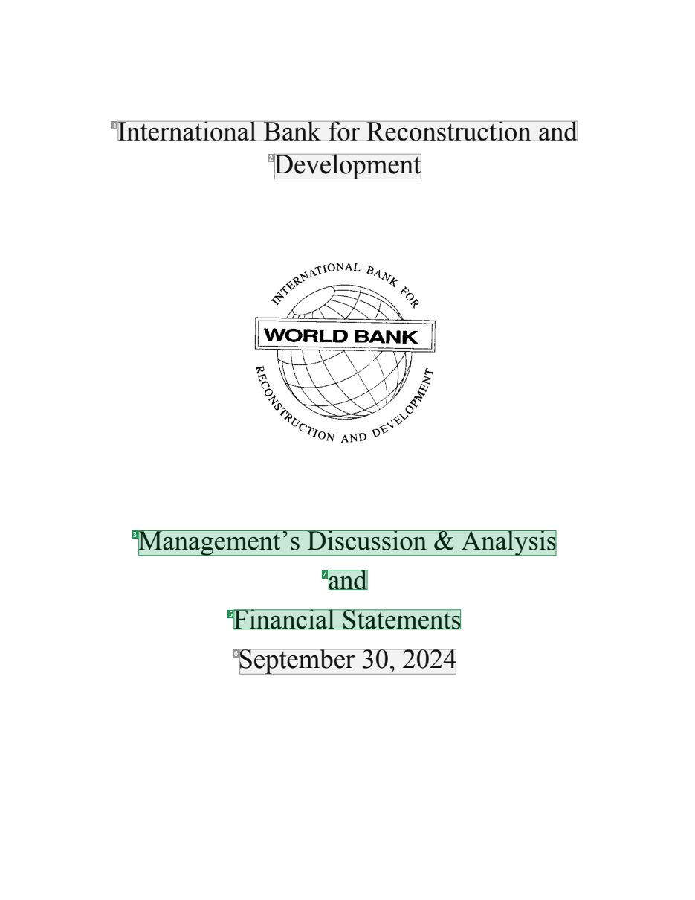
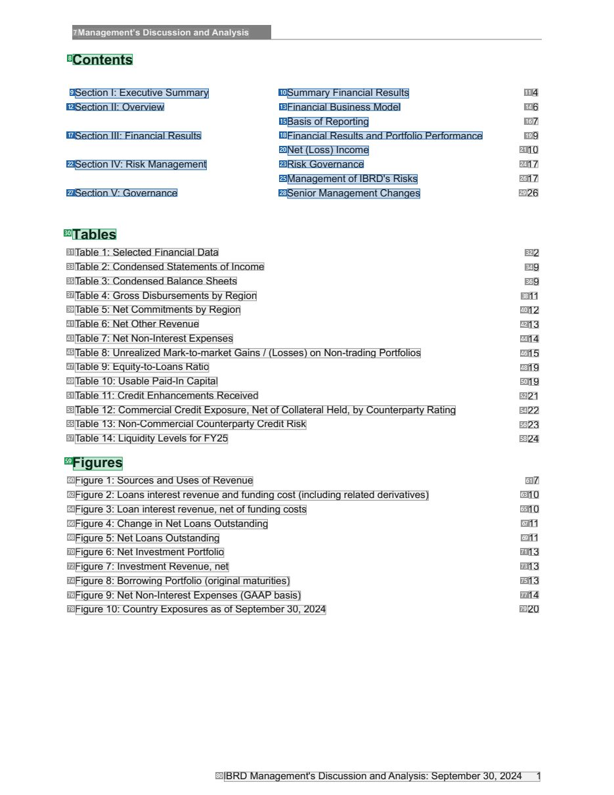
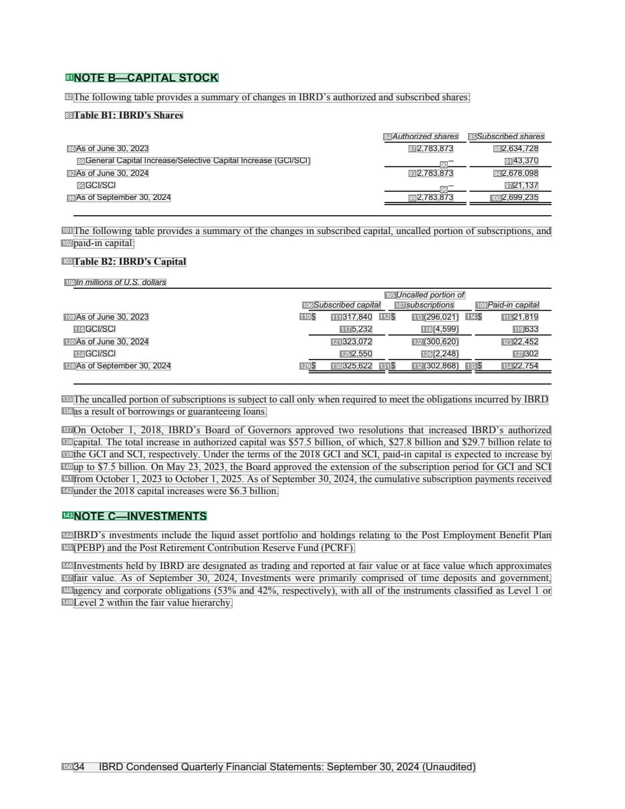
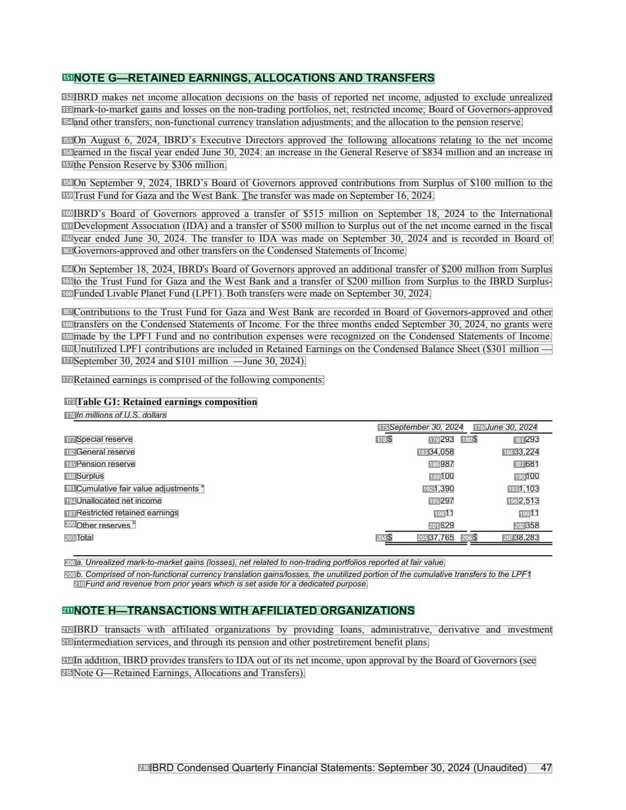

# 046 — `todo10_8/heading_corpus_100/03_tai_chinh_ke_toan/046_IBRD_Financial_Statements_September_2024.pdf`

Draft `P7_F1Q_HELDOUT_GOLD_DRAFT_V2`, status `DRAFT_REVIEWER_A_NOT_APPROVED`, draft sha256 `f99fb0ee89556cb9b01df624e8bac65044a5a99f41e6658f0ff6fe2d9a27361f`. Source sha256 `82de685967f40fcda7ed172b989a2f504f94e74ccd723bce6954fa23983dae0c`. [Back to index](README.md)

Approve or correct with `review-apply` lines: `APPROVE 046 by <reviewer> [because <note>]`, `046 <alias> -> E|R|O because <reason>`.

## Page 1 (FIRST)

| # | alias | text | font | draft | flag | rationale |
|---:|---|---|---|---|---|---|
| 1 | L0000:S0 | International Bank forReconstruction and | 24 | **OTHER** |  | Issuer name on the cover (044/049 decision) |
| 2 | L0001:S0 | Development | 24 | **OTHER** |  | Issuer name continuation |
| 3 | L0002:S0 | Management’s Discussion &amp; Analysis | 24 | **ESTABLISHES** |  | Report title &quot;Management&#39;s Discussion &amp; Analysis&quot; (24pt) |
| 4 | L0003:S0 | and | 24 | **ESTABLISHES** |  | Report title continuation &quot;and&quot; |
| 5 | L0004:S0 | Financial Statements | 24 | **ESTABLISHES** |  | Report title continuation &quot;Financial Statements&quot; |
| 6 | L0005:S0 | September 30, 2024 | 24 | **OTHER** |  | Reporting date &quot;September 30, 2024&quot; |

**OTHER rows to check for a missed heading on page 1** (body size 24pt; bold or ≥ body+1pt, ≤ 12 words): none.

## Page 3 (SEEDED_INTERIOR)

| # | alias | text | font | draft | flag | rationale |
|---:|---|---|---|---|---|---|
| 7 | L0006:S0 | Management’s Discussion and Analysis | 9 B | **OTHER** |  | Running header &quot;Management&#39;s Discussion and Analysis&quot; |
| 8 | L0007:S0 | Contents | 14 B | **ESTABLISHES** |  | Contents heading &quot;Contents&quot; (14pt bold) |
| 9 | L0008:S0 | Section I: Executive Summary | 10 | **REPRESENTS** |  | Contents entry &quot;Section I: Executive Summary&quot; |
| 10 | L0008:S1 | Summary Financial Results | 10 | **REPRESENTS** |  | Contents entry &quot;Summary Financial Results&quot; |
| 11 | L0008:S2 | 4 | 10 | **OTHER** |  | Default: body text, list item, table cell, page number or other non-heading content on this page |
| 12 | L0009:S0 | Section II: Overview | 10 | **REPRESENTS** |  | Contents entry &quot;Section II: Overview&quot; |
| 13 | L0009:S1 | Financial Business Model | 10 | **REPRESENTS** |  | Contents entry &quot;Financial Business Model&quot; |
| 14 | L0009:S2 | 6 | 10 | **OTHER** |  | Default: body text, list item, table cell, page number or other non-heading content on this page |
| 15 | L0010:S0 | Basis of Reporting | 10 | **REPRESENTS** |  | Contents entry &quot;Basis of Reporting&quot; |
| 16 | L0010:S1 | 7 | 10 | **OTHER** |  | Default: body text, list item, table cell, page number or other non-heading content on this page |
| 17 | L0011:S0 | Section III: Financial Results | 10 | **REPRESENTS** |  | Contents entry &quot;Section III: Financial Results&quot; |
| 18 | L0011:S1 | Financial Results and Portfolio Performance | 10 | **REPRESENTS** |  | Contents entry &quot;Financial Results and Portfolio Performance&quot; |
| 19 | L0011:S2 | 9 | 10 | **OTHER** |  | Default: body text, list item, table cell, page number or other non-heading content on this page |
| 20 | L0012:S0 | Net (Loss) Income | 10 | **REPRESENTS** |  | Contents entry &quot;Net (Loss) Income&quot; |
| 21 | L0012:S1 | 10 | 10 | **OTHER** |  | Default: body text, list item, table cell, page number or other non-heading content on this page |
| 22 | L0013:S0 | Section IV: Risk Management | 10 | **REPRESENTS** |  | Contents entry &quot;Section IV: Risk Management&quot; |
| 23 | L0013:S1 | Risk Governance | 10 | **REPRESENTS** |  | Contents entry &quot;Risk Governance&quot; |
| 24 | L0013:S2 | 17 | 10 | **OTHER** |  | Default: body text, list item, table cell, page number or other non-heading content on this page |
| 25 | L0014:S0 | Management of IBRD&#39;s Risks | 10 | **REPRESENTS** |  | Contents entry &quot;Management of IBRD&#39;s Risks&quot; |
| 26 | L0014:S1 | 17 | 10 | **OTHER** |  | Default: body text, list item, table cell, page number or other non-heading content on this page |
| 27 | L0015:S0 | Section V: Governance | 10 | **REPRESENTS** |  | Contents entry &quot;Section V: Governance&quot; |
| 28 | L0015:S1 | Senior Management Changes | 10 | **REPRESENTS** |  | Contents entry &quot;Senior Management Changes&quot; |
| 29 | L0015:S2 | 26 | 10 | **OTHER** |  | Default: body text, list item, table cell, page number or other non-heading content on this page |
| 30 | L0016:S0 | Tables | 14 B | **ESTABLISHES** |  | List heading &quot;Tables&quot; (14pt bold; 044 decision) |
| 31 | L0017:S0 | Table 1 : Selected Financial Data | 10 | **OTHER** |  | Default: body text, list item, table cell, page number or other non-heading content on this page |
| 32 | L0017:S1 | 2 | 10 | **OTHER** |  | Default: body text, list item, table cell, page number or other non-heading content on this page |
| 33 | L0018:S0 | Table 2: Condensed Statements of Income | 10 | **OTHER** |  | Default: body text, list item, table cell, page number or other non-heading content on this page |
| 34 | L0018:S1 | 9 | 10 | **OTHER** |  | Default: body text, list item, table cell, page number or other non-heading content on this page |
| 35 | L0019:S0 | Table 3: Condensed Balance Sheets | 10 | **OTHER** |  | Default: body text, list item, table cell, page number or other non-heading content on this page |
| 36 | L0019:S1 | 9 | 10 | **OTHER** |  | Default: body text, list item, table cell, page number or other non-heading content on this page |
| 37 | L0020:S0 | Table 4: Gross Disbursements by Region | 10 | **OTHER** |  | Default: body text, list item, table cell, page number or other non-heading content on this page |
| 38 | L0020:S1 | 11 | 10 | **OTHER** |  | Default: body text, list item, table cell, page number or other non-heading content on this page |
| 39 | L0021:S0 | Table 5: Net Commitments by Region | 10 | **OTHER** |  | Default: body text, list item, table cell, page number or other non-heading content on this page |
| 40 | L0021:S1 | 12 | 10 | **OTHER** |  | Default: body text, list item, table cell, page number or other non-heading content on this page |
| 41 | L0022:S0 | Table 6: Net Other Revenue | 10 | **OTHER** |  | Default: body text, list item, table cell, page number or other non-heading content on this page |
| 42 | L0022:S1 | 13 | 10 | **OTHER** |  | Default: body text, list item, table cell, page number or other non-heading content on this page |
| 43 | L0023:S0 | Table 7: Net Non-Interest Expenses | 10 | **OTHER** |  | Default: body text, list item, table cell, page number or other non-heading content on this page |
| 44 | L0023:S1 | 14 | 10 | **OTHER** |  | Default: body text, list item, table cell, page number or other non-heading content on this page |
| 45 | L0024:S0 | Table 8: Unrealized Mark-to-market Gains / (Losses) on Non-trading Portfolios | 10 | **OTHER** |  | Default: body text, list item, table cell, page number or other non-heading content on this page |
| 46 | L0024:S1 | 15 | 10 | **OTHER** |  | Default: body text, list item, table cell, page number or other non-heading content on this page |
| 47 | L0025:S0 | Table 9: Equity-to-Loans Ratio | 10 | **OTHER** |  | Default: body text, list item, table cell, page number or other non-heading content on this page |
| 48 | L0025:S1 | 19 | 10 | **OTHER** |  | Default: body text, list item, table cell, page number or other non-heading content on this page |
| 49 | L0026:S0 | Table 10: Usable Paid-In Capital | 10 | **OTHER** |  | Default: body text, list item, table cell, page number or other non-heading content on this page |
| 50 | L0026:S1 | 19 | 10 | **OTHER** |  | Default: body text, list item, table cell, page number or other non-heading content on this page |
| 51 | L0027:S0 | Table 11 : Credit Enhancements Received | 10 | **OTHER** |  | Default: body text, list item, table cell, page number or other non-heading content on this page |
| 52 | L0027:S1 | 21 | 10 | **OTHER** |  | Default: body text, list item, table cell, page number or other non-heading content on this page |
| 53 | L0028:S0 | Table 12: Commercial Credit Exposure, Net of Collateral Held, by Counterparty Rating | 10 | **OTHER** |  | Default: body text, list item, table cell, page number or other non-heading content on this page |
| 54 | L0028:S1 | 22 | 10 | **OTHER** |  | Default: body text, list item, table cell, page number or other non-heading content on this page |
| 55 | L0029:S0 | Table 13: Non-Commercial Counterparty Credit Risk | 10 | **OTHER** |  | Default: body text, list item, table cell, page number or other non-heading content on this page |
| 56 | L0029:S1 | 23 | 10 | **OTHER** |  | Default: body text, list item, table cell, page number or other non-heading content on this page |
| 57 | L0030:S0 | Table 14: Liquidity Levels for FY25 | 10 | **OTHER** |  | Default: body text, list item, table cell, page number or other non-heading content on this page |
| 58 | L0030:S1 | 24 | 10 | **OTHER** |  | Default: body text, list item, table cell, page number or other non-heading content on this page |
| 59 | L0031:S0 | Figures | 14 B | **ESTABLISHES** |  | List heading &quot;Figures&quot; (14pt bold; 044 decision) |
| 60 | L0032:S0 | Figure 1 : Sources and Uses of Revenue | 10 | **OTHER** |  | Default: body text, list item, table cell, page number or other non-heading content on this page |
| 61 | L0032:S1 | 7 | 10 | **OTHER** |  | Default: body text, list item, table cell, page number or other non-heading content on this page |
| 62 | L0033:S0 | Figure 2: Loans interest revenue and funding cost (including related derivatives) | 10 | **OTHER** |  | Default: body text, list item, table cell, page number or other non-heading content on this page |
| 63 | L0033:S1 | 10 | 10 | **OTHER** |  | Default: body text, list item, table cell, page number or other non-heading content on this page |
| 64 | L0034:S0 | Figure 3: Loan interest revenue, net offunding costs | 10 | **OTHER** |  | Default: body text, list item, table cell, page number or other non-heading content on this page |
| 65 | L0034:S1 | 10 | 10 | **OTHER** |  | Default: body text, list item, table cell, page number or other non-heading content on this page |
| 66 | L0035:S0 | Figure 4: Change in Net Loans Outstanding | 10 | **OTHER** |  | Default: body text, list item, table cell, page number or other non-heading content on this page |
| 67 | L0035:S1 | 11 | 10 | **OTHER** |  | Default: body text, list item, table cell, page number or other non-heading content on this page |
| 68 | L0036:S0 | Figure 5: Net Loans Outstanding | 10 | **OTHER** |  | Default: body text, list item, table cell, page number or other non-heading content on this page |
| 69 | L0036:S1 | 11 | 10 | **OTHER** |  | Default: body text, list item, table cell, page number or other non-heading content on this page |
| 70 | L0037:S0 | Figure 6: Net Investment Portfolio | 10 | **OTHER** |  | Default: body text, list item, table cell, page number or other non-heading content on this page |
| 71 | L0037:S1 | 13 | 10 | **OTHER** |  | Default: body text, list item, table cell, page number or other non-heading content on this page |
| 72 | L0038:S0 | Figure 7: Investment Revenue, net | 10 | **OTHER** |  | Default: body text, list item, table cell, page number or other non-heading content on this page |
| 73 | L0038:S1 | 13 | 10 | **OTHER** |  | Default: body text, list item, table cell, page number or other non-heading content on this page |
| 74 | L0039:S0 | Figure 8: Borrowing Portfolio (original maturities) | 10 | **OTHER** |  | Default: body text, list item, table cell, page number or other non-heading content on this page |
| 75 | L0039:S1 | 13 | 10 | **OTHER** |  | Default: body text, list item, table cell, page number or other non-heading content on this page |
| 76 | L0040:S0 | Figure 9: Net Non-Interest Expenses (GAAP basis) | 10 | **OTHER** |  | Default: body text, list item, table cell, page number or other non-heading content on this page |
| 77 | L0040:S1 | 14 | 10 | **OTHER** |  | Default: body text, list item, table cell, page number or other non-heading content on this page |
| 78 | L0041:S0 | Figure 10: Country Exposures as of September 30, 2024 | 10 | **OTHER** |  | Default: body text, list item, table cell, page number or other non-heading content on this page |
| 79 | L0041:S1 | 20 | 10 | **OTHER** |  | Default: body text, list item, table cell, page number or other non-heading content on this page |
| 80 | L0042:S0 | IBRD Management&#39;s Discussion and Analysis: September 30, 2024 1 | 10 | **OTHER** |  | Running footer |

**OTHER rows to check for a missed heading on page 3** (body size 10pt; bold or ≥ body+1pt, ≤ 12 words): #7 `L0006:S0` Management’s Discussion and Analysis (9 B).

## Page 36 (TARGETED_STRUCTURE)

| # | alias | text | font | draft | flag | rationale |
|---:|---|---|---|---|---|---|
| 81 | L1227:S0 | NOTE B—CAPITAL STOCK | 11 B | **ESTABLISHES** |  | Note heading &quot;NOTE B—CAPITAL STOCK&quot; (11pt bold) |
| 82 | L1228:S0 | The following table provides a summary ofchanges in IBRD’s authorized and subscribed shares: | 10 | **OTHER** |  | Default: body text, list item, table cell, page number or other non-heading content on this page |
| 83 | L1229:S0 | Table B1: IBRD&#39;s Shares | 10 B | **OTHER** |  | Table caption &quot;Table B1: IBRD&#39;s Shares&quot; |
| 84 | L1230:S0 | Authorized shares | 8 I | **OTHER** |  | Default: body text, list item, table cell, page number or other non-heading content on this page |
| 85 | L1230:S1 | Subscribed shares | 8 I | **OTHER** |  | Default: body text, list item, table cell, page number or other non-heading content on this page |
| 86 | L1231:S0 | As of June 30, 2023 | 8 | **OTHER** |  | Default: body text, list item, table cell, page number or other non-heading content on this page |
| 87 | L1231:S1 | 2,783,873 | 8 | **OTHER** |  | Default: body text, list item, table cell, page number or other non-heading content on this page |
| 88 | L1231:S2 | 2,634,728 | 8 | **OTHER** |  | Default: body text, list item, table cell, page number or other non-heading content on this page |
| 89 | L1232:S0 | General Capital Increase/Selective Capital Increase (GCI/SCI) | 8 | **OTHER** |  | Default: body text, list item, table cell, page number or other non-heading content on this page |
| 90 | L1232:S1 | – | 8 | **OTHER** |  | Default: body text, list item, table cell, page number or other non-heading content on this page |
| 91 | L1232:S2 | 43,370 | 8 | **OTHER** |  | Default: body text, list item, table cell, page number or other non-heading content on this page |
| 92 | L1233:S0 | As of June 30, 2024 | 8 | **OTHER** |  | Default: body text, list item, table cell, page number or other non-heading content on this page |
| 93 | L1233:S1 | 2,783,873 | 8 | **OTHER** |  | Default: body text, list item, table cell, page number or other non-heading content on this page |
| 94 | L1233:S2 | 2,678,098 | 8 | **OTHER** |  | Default: body text, list item, table cell, page number or other non-heading content on this page |
| 95 | L1234:S0 | GCI/SCI | 8 | **OTHER** |  | Default: body text, list item, table cell, page number or other non-heading content on this page |
| 96 | L1234:S1 | – | 8 | **OTHER** |  | Default: body text, list item, table cell, page number or other non-heading content on this page |
| 97 | L1234:S2 | 21,137 | 8 | **OTHER** |  | Default: body text, list item, table cell, page number or other non-heading content on this page |
| 98 | L1235:S0 | As of September 30, 2024 | 8 | **OTHER** |  | Default: body text, list item, table cell, page number or other non-heading content on this page |
| 99 | L1235:S1 | 2,783,873 | 8 | **OTHER** |  | Default: body text, list item, table cell, page number or other non-heading content on this page |
| 100 | L1235:S2 | 2,699,235 | 8 | **OTHER** |  | Default: body text, list item, table cell, page number or other non-heading content on this page |
| 101 | L1236:S0 | The following table provides a summary ofthe changes in subscribed capital, uncalled portion ofsubscriptions, and | 10 | **OTHER** |  | Default: body text, list item, table cell, page number or other non-heading content on this page |
| 102 | L1237:S0 | paid-in capital: | 10 | **OTHER** |  | Default: body text, list item, table cell, page number or other non-heading content on this page |
| 103 | L1238:S0 | Table B2: IBRD&#39;s Capital | 10 B | **OTHER** |  | Table caption &quot;Table B2: IBRD&#39;s Capital&quot; |
| 104 | L1239:S0 | In millions ofU.S. dollars | 8 I | **OTHER** |  | Default: body text, list item, table cell, page number or other non-heading content on this page |
| 105 | L1240:S0 | Uncalledportion of | 8 I | **OTHER** |  | Default: body text, list item, table cell, page number or other non-heading content on this page |
| 106 | L1241:S0 | Subscribed capital | 8 I | **OTHER** |  | Default: body text, list item, table cell, page number or other non-heading content on this page |
| 107 | L1241:S1 | subscriptions | 8 I | **OTHER** |  | Default: body text, list item, table cell, page number or other non-heading content on this page |
| 108 | L1241:S2 | Paid-in capital | 8 I | **OTHER** |  | Default: body text, list item, table cell, page number or other non-heading content on this page |
| 109 | L1242:S0 | As of June 30, 2023 | 8 | **OTHER** |  | Default: body text, list item, table cell, page number or other non-heading content on this page |
| 110 | L1242:S1 | $ | 8 | **OTHER** |  | Default: body text, list item, table cell, page number or other non-heading content on this page |
| 111 | L1242:S2 | 317,840 | 8 | **OTHER** |  | Default: body text, list item, table cell, page number or other non-heading content on this page |
| 112 | L1242:S3 | $ | 8 | **OTHER** |  | Default: body text, list item, table cell, page number or other non-heading content on this page |
| 113 | L1242:S4 | (296,021) | 8 | **OTHER** |  | Default: body text, list item, table cell, page number or other non-heading content on this page |
| 114 | L1242:S5 | $ | 8 | **OTHER** |  | Default: body text, list item, table cell, page number or other non-heading content on this page |
| 115 | L1242:S6 | 21,819 | 8 | **OTHER** |  | Default: body text, list item, table cell, page number or other non-heading content on this page |
| 116 | L1243:S0 | GCI/SCI | 8 | **OTHER** |  | Default: body text, list item, table cell, page number or other non-heading content on this page |
| 117 | L1243:S1 | 5,232 | 8 | **OTHER** |  | Default: body text, list item, table cell, page number or other non-heading content on this page |
| 118 | L1243:S2 | (4,599) | 8 | **OTHER** |  | Default: body text, list item, table cell, page number or other non-heading content on this page |
| 119 | L1243:S3 | 633 | 8 | **OTHER** |  | Default: body text, list item, table cell, page number or other non-heading content on this page |
| 120 | L1244:S0 | As of June 30, 2024 | 8 | **OTHER** |  | Default: body text, list item, table cell, page number or other non-heading content on this page |
| 121 | L1244:S1 | 323,072 | 8 | **OTHER** |  | Default: body text, list item, table cell, page number or other non-heading content on this page |
| 122 | L1244:S2 | (300,620) | 8 | **OTHER** |  | Default: body text, list item, table cell, page number or other non-heading content on this page |
| 123 | L1244:S3 | 22,452 | 8 | **OTHER** |  | Default: body text, list item, table cell, page number or other non-heading content on this page |
| 124 | L1245:S0 | GCI/SCI | 8 | **OTHER** |  | Default: body text, list item, table cell, page number or other non-heading content on this page |
| 125 | L1245:S1 | 2,550 | 8 | **OTHER** |  | Default: body text, list item, table cell, page number or other non-heading content on this page |
| 126 | L1245:S2 | (2,248) | 8 | **OTHER** |  | Default: body text, list item, table cell, page number or other non-heading content on this page |
| 127 | L1245:S3 | 302 | 8 | **OTHER** |  | Default: body text, list item, table cell, page number or other non-heading content on this page |
| 128 | L1246:S0 | As of September 30, 2024 | 8 | **OTHER** |  | Default: body text, list item, table cell, page number or other non-heading content on this page |
| 129 | L1246:S1 | $ | 8 | **OTHER** |  | Default: body text, list item, table cell, page number or other non-heading content on this page |
| 130 | L1246:S2 | 325,622 | 8 | **OTHER** |  | Default: body text, list item, table cell, page number or other non-heading content on this page |
| 131 | L1246:S3 | $ | 8 | **OTHER** |  | Default: body text, list item, table cell, page number or other non-heading content on this page |
| 132 | L1246:S4 | (302,868) | 8 | **OTHER** |  | Default: body text, list item, table cell, page number or other non-heading content on this page |
| 133 | L1246:S5 | $ | 8 | **OTHER** |  | Default: body text, list item, table cell, page number or other non-heading content on this page |
| 134 | L1246:S6 | 22,754 | 8 | **OTHER** |  | Default: body text, list item, table cell, page number or other non-heading content on this page |
| 135 | L1247:S0 | The uncalledportion ofsubscriptions is subjectto call onlywhenrequiredto meetthe obligations incurredby IBRD | 10 | **OTHER** |  | Default: body text, list item, table cell, page number or other non-heading content on this page |
| 136 | L1248:S0 | as aresult ofborrowings or guaranteeing loans. | 10 | **OTHER** |  | Default: body text, list item, table cell, page number or other non-heading content on this page |
| 137 | L1249:S0 | On October 1, 2018, IBRD’s Board of Governors approved two resolutions that increased IBRD’s authorized | 10 | **OTHER** |  | Default: body text, list item, table cell, page number or other non-heading content on this page |
| 138 | L1250:S0 | capital. The total increase in authorized capital was $57.5 billion, ofwhich, $27.8 billion and $29.7 billion relate to | 10 | **OTHER** |  | Default: body text, list item, table cell, page number or other non-heading content on this page |
| 139 | L1251:S0 | the GCI and SCI, respectively. Under the terms ofthe 2018 GCI and SCI, paid-in capital is expected to increase by | 10 | **OTHER** |  | Default: body text, list item, table cell, page number or other non-heading content on this page |
| 140 | L1252:S0 | up to $7.5 billion. On May 23, 2023, the Board approved the extension ofthe subscription period for GCI and SCI | 10 | **OTHER** |  | Default: body text, list item, table cell, page number or other non-heading content on this page |
| 141 | L1253:S0 | from October 1, 2023 to October 1, 2025. As ofSeptember 30, 2024, the cumulative subscriptionpayments received | 10 | **OTHER** |  | Default: body text, list item, table cell, page number or other non-heading content on this page |
| 142 | L1254:S0 | underthe 2018 capital increases were $6.3 billion. | 10 | **OTHER** |  | Default: body text, list item, table cell, page number or other non-heading content on this page |
| 143 | L1255:S0 | NOTE C—INVESTMENTS | 11 B | **ESTABLISHES** |  | Note heading &quot;NOTE C—INVESTMENTS&quot; (11pt bold) |
| 144 | L1256:S0 | IBRD’s investments include the liquid asset portfolio and holdings relating to the Post Employment Benefit Plan | 10 | **OTHER** |  | Default: body text, list item, table cell, page number or other non-heading content on this page |
| 145 | L1257:S0 | (PEBP) andthe PostRetirement Contribution Reserve Fund (PCRF). | 10 | **OTHER** |  | Default: body text, list item, table cell, page number or other non-heading content on this page |
| 146 | L1258:S0 | Investments held by IBRD are designated as trading and reported at fair value or at face value which approximates | 10 | **OTHER** |  | Default: body text, list item, table cell, page number or other non-heading content on this page |
| 147 | L1259:S0 | fair value. As of September 30, 2024, Investments were primarily comprised of time deposits and government, | 10 | **OTHER** |  | Default: body text, list item, table cell, page number or other non-heading content on this page |
| 148 | L1260:S0 | agency and corporate obligations (53% and 42%, respectively), with all ofthe instruments classified as Level 1 or | 10 | **OTHER** |  | Default: body text, list item, table cell, page number or other non-heading content on this page |
| 149 | L1261:S0 | Level 2 withinthe fairvalue hierarchy. | 10 | **OTHER** |  | Default: body text, list item, table cell, page number or other non-heading content on this page |
| 150 | L1262:S0 | 34 IBRD Condensed Quarterly Financial Statements: September 30, 2024 (Unaudited) | 10 | **OTHER** |  | Running footer |

**OTHER rows to check for a missed heading on page 36** (body size 8pt; bold or ≥ body+1pt, ≤ 12 words): #83 `L1229:S0` Table B1: IBRD&#39;s Shares (10 B), #102 `L1237:S0` paid-in capital: (10), #103 `L1238:S0` Table B2: IBRD&#39;s Capital (10 B), #135 `L1247:S0` The uncalledportion ofsubscriptions is subjectto call onlywh… (10), #136 `L1248:S0` as aresult ofborrowings or guaranteeing loans. (10), #142 `L1254:S0` underthe 2018 capital increases were $6.3 billion. (10), #145 `L1257:S0` (PEBP) andthe PostRetirement Contribution Reserve Fund (PCRF… (10), #149 `L1261:S0` Level 2 withinthe fairvalue hierarchy. (10), #150 `L1262:S0` 34 IBRD Condensed Quarterly Financial Statements: September … (10).

## Page 49 (SEEDED_INTERIOR)

| # | alias | text | font | draft | flag | rationale |
|---:|---|---|---|---|---|---|
| 151 | L1782:S0 | NOTE G—RETAINED EARNINGS, ALLOCATIONS AND TRANSFERS | 11 B | **ESTABLISHES** |  | Note heading &quot;NOTE G—RETAINED EARNINGS, ALLOCATIONS AND TRANSFERS&quot; (11pt bold) |
| 152 | L1783:S0 | IBRD makes net income allocation decisions on the basis of reported net income, adjusted to exclude unrealized | 10 | **OTHER** |  | Default: body text, list item, table cell, page number or other non-heading content on this page |
| 153 | L1784:S0 | mark-to-market gains and losses on the non-trading portfolios, net; restricted income; Board ofGovernors-approved | 10 | **OTHER** |  | Default: body text, list item, table cell, page number or other non-heading content on this page |
| 154 | L1785:S0 | and othertransfers; non-functional currencytranslation adjustments; andthe allocationto the pensionreserve. | 10 | **OTHER** |  | Default: body text, list item, table cell, page number or other non-heading content on this page |
| 155 | L1786:S0 | On August 6, 2024, IBRD’s Executive Directors approved the following allocations relating to the net income | 10 | **OTHER** |  | Default: body text, list item, table cell, page number or other non-heading content on this page |
| 156 | L1787:S0 | earned in the fiscal year ended June 30, 2024: an increase in the General Reserve of$834 million and an increase in | 10 | **OTHER** |  | Default: body text, list item, table cell, page number or other non-heading content on this page |
| 157 | L1788:S0 | the Pension Reserve by $306 million. | 10 | **OTHER** |  | Default: body text, list item, table cell, page number or other non-heading content on this page |
| 158 | L1789:S0 | On September 9, 2024, IBRD’s Board of Governors approved contributions from Surplus of $100 million to the | 10 | **OTHER** |  | Default: body text, list item, table cell, page number or other non-heading content on this page |
| 159 | L1790:S0 | TrustFund for Gaza andthe WestBank. The transferwas made on September 16, 2024. | 10 | **OTHER** |  | Default: body text, list item, table cell, page number or other non-heading content on this page |
| 160 | L1791:S0 | IBRD’s Board of Governors approved a transfer of $515 million on September 18, 2024 to the International | 10 | **OTHER** |  | Default: body text, list item, table cell, page number or other non-heading content on this page |
| 161 | L1792:S0 | Development Association (IDA) and a transfer of$500 million to Surplus out ofthe net income earned in the fiscal | 10 | **OTHER** |  | Default: body text, list item, table cell, page number or other non-heading content on this page |
| 162 | L1793:S0 | year ended June 30, 2024. The transfer to IDA was made on September 30, 2024 and is recorded in Board of | 10 | **OTHER** |  | Default: body text, list item, table cell, page number or other non-heading content on this page |
| 163 | L1794:S0 | Governors-approved and othertransfers onthe Condensed Statements ofIncome. | 10 | **OTHER** |  | Default: body text, list item, table cell, page number or other non-heading content on this page |
| 164 | L1795:S0 | On September 18, 2024, IBRD&#39;s Board ofGovernors approved an additional transfer of$200 million from Surplus | 10 | **OTHER** |  | Default: body text, list item, table cell, page number or other non-heading content on this page |
| 165 | L1796:S0 | to the Trust Fund for Gaza and the West Bank and a transfer of $200 million from Surplus to the IBRD Surplus- | 10 | **OTHER** |  | Default: body text, list item, table cell, page number or other non-heading content on this page |
| 166 | L1797:S0 | FundedLivable PlanetFund (LPF1). Bothtransfers were made on September 30, 2024. | 10 | **OTHER** |  | Default: body text, list item, table cell, page number or other non-heading content on this page |
| 167 | L1798:S0 | Contributions to the Trust Fund for Gaza and West Bank are recorded in Board of Governors-approved and other | 10 | **OTHER** |  | Default: body text, list item, table cell, page number or other non-heading content on this page |
| 168 | L1799:S0 | transfers on the Condensed Statements ofIncome. For the three months ended September 30, 2024, no grants were | 10 | **OTHER** |  | Default: body text, list item, table cell, page number or other non-heading content on this page |
| 169 | L1800:S0 | made by the LPF1 Fund and no contribution expenses were recognized on the Condensed Statements of Income. | 10 | **OTHER** |  | Default: body text, list item, table cell, page number or other non-heading content on this page |
| 170 | L1801:S0 | Unutilized LPF1 contributions are included in Retained Earnings on the Condensed Balance Sheet ($301 million — | 10 | **OTHER** |  | Default: body text, list item, table cell, page number or other non-heading content on this page |
| 171 | L1802:S0 | September 30, 2024 and $101 million —June 30, 2024). | 10 | **OTHER** |  | Default: body text, list item, table cell, page number or other non-heading content on this page |
| 172 | L1803:S0 | Retained earnings is comprised ofthe following components: | 10 | **OTHER** |  | Default: body text, list item, table cell, page number or other non-heading content on this page |
| 173 | L1804:S0 | Table G1: Retained earnings composition | 10 B | **OTHER** |  | Table caption &quot;Table G1: Retained earnings composition&quot; |
| 174 | L1805:S0 | In millions ofU.S. dollars | 8 I | **OTHER** |  | Default: body text, list item, table cell, page number or other non-heading content on this page |
| 175 | L1806:S0 | September30, 2024 | 8 I | **OTHER** |  | Default: body text, list item, table cell, page number or other non-heading content on this page |
| 176 | L1806:S1 | June 30, 2024 | 8 I | **OTHER** |  | Default: body text, list item, table cell, page number or other non-heading content on this page |
| 177 | L1807:S0 | Special reserve | 8 | **OTHER** |  | Default: body text, list item, table cell, page number or other non-heading content on this page |
| 178 | L1807:S1 | $ | 8 | **OTHER** |  | Default: body text, list item, table cell, page number or other non-heading content on this page |
| 179 | L1807:S2 | 293 | 8 | **OTHER** |  | Default: body text, list item, table cell, page number or other non-heading content on this page |
| 180 | L1807:S3 | $ | 8 | **OTHER** |  | Default: body text, list item, table cell, page number or other non-heading content on this page |
| 181 | L1807:S4 | 293 | 8 | **OTHER** |  | Default: body text, list item, table cell, page number or other non-heading content on this page |
| 182 | L1808:S0 | General reserve | 8 | **OTHER** |  | Default: body text, list item, table cell, page number or other non-heading content on this page |
| 183 | L1808:S1 | 34,058 | 8 | **OTHER** |  | Default: body text, list item, table cell, page number or other non-heading content on this page |
| 184 | L1808:S2 | 33,224 | 8 | **OTHER** |  | Default: body text, list item, table cell, page number or other non-heading content on this page |
| 185 | L1809:S0 | Pension reserve | 8 | **OTHER** |  | Default: body text, list item, table cell, page number or other non-heading content on this page |
| 186 | L1809:S1 | 987 | 8 | **OTHER** |  | Default: body text, list item, table cell, page number or other non-heading content on this page |
| 187 | L1809:S2 | 681 | 8 | **OTHER** |  | Default: body text, list item, table cell, page number or other non-heading content on this page |
| 188 | L1810:S0 | Surplus | 8 | **OTHER** |  | Default: body text, list item, table cell, page number or other non-heading content on this page |
| 189 | L1810:S1 | 100 | 8 | **OTHER** |  | Default: body text, list item, table cell, page number or other non-heading content on this page |
| 190 | L1810:S2 | 100 | 8 | **OTHER** |  | Default: body text, list item, table cell, page number or other non-heading content on this page |
| 191 | L1811:S0 | Cumulative fair value adjustments a | 8 | **OTHER** |  | Default: body text, list item, table cell, page number or other non-heading content on this page |
| 192 | L1811:S1 | 1,390 | 8 | **OTHER** |  | Default: body text, list item, table cell, page number or other non-heading content on this page |
| 193 | L1811:S2 | 1,103 | 8 | **OTHER** |  | Default: body text, list item, table cell, page number or other non-heading content on this page |
| 194 | L1812:S0 | Unallocated net income | 8 | **OTHER** |  | Default: body text, list item, table cell, page number or other non-heading content on this page |
| 195 | L1812:S1 | 297 | 8 | **OTHER** |  | Default: body text, list item, table cell, page number or other non-heading content on this page |
| 196 | L1812:S2 | 2,513 | 8 | **OTHER** |  | Default: body text, list item, table cell, page number or other non-heading content on this page |
| 197 | L1813:S0 | Restricted retained earnings | 8 | **OTHER** |  | Default: body text, list item, table cell, page number or other non-heading content on this page |
| 198 | L1813:S1 | 1 1 | 8 | **OTHER** |  | Default: body text, list item, table cell, page number or other non-heading content on this page |
| 199 | L1813:S2 | 1 1 | 8 | **OTHER** |  | Default: body text, list item, table cell, page number or other non-heading content on this page |
| 200 | L1814:S0 | Other reserves b | 8 | **OTHER** |  | Default: body text, list item, table cell, page number or other non-heading content on this page |
| 201 | L1814:S1 | 629 | 8 | **OTHER** |  | Default: body text, list item, table cell, page number or other non-heading content on this page |
| 202 | L1814:S2 | 358 | 8 | **OTHER** |  | Default: body text, list item, table cell, page number or other non-heading content on this page |
| 203 | L1815:S0 | Total | 8 | **OTHER** |  | Default: body text, list item, table cell, page number or other non-heading content on this page |
| 204 | L1815:S1 | $ | 8 | **OTHER** |  | Default: body text, list item, table cell, page number or other non-heading content on this page |
| 205 | L1815:S2 | 37,765 | 8 | **OTHER** |  | Default: body text, list item, table cell, page number or other non-heading content on this page |
| 206 | L1815:S3 | $ | 8 | **OTHER** |  | Default: body text, list item, table cell, page number or other non-heading content on this page |
| 207 | L1815:S4 | 38,283 | 8 | **OTHER** |  | Default: body text, list item, table cell, page number or other non-heading content on this page |
| 208 | L1816:S0 | a. Unrealizedmark-to-marketgains (losses), netrelated to non-tradingportfolios reported at fair value. | 8 I | **OTHER** |  | Default: body text, list item, table cell, page number or other non-heading content on this page |
| 209 | L1817:S0 | b. Comprised ofnon-functional currency translation gains/losses, the unutilizedportion ofthe cumulative transfers to the… | 8 I | **OTHER** |  | Default: body text, list item, table cell, page number or other non-heading content on this page |
| 210 | L1818:S0 | Fund andrevenue from prioryears which is set aside fora dedicatedpurpose. | 8 I | **OTHER** |  | Default: body text, list item, table cell, page number or other non-heading content on this page |
| 211 | L1819:S0 | NOTE H—TRANSACTIONS WITH AFFILIATED ORGANIZATIONS | 11 B | **ESTABLISHES** |  | Note heading &quot;NOTE H—TRANSACTIONS WITH AFFILIATED ORGANIZATIONS&quot; (11pt bold) |
| 212 | L1820:S0 | IBRD transacts with affiliated organizations by providing loans, administrative, derivative and investment | 10 | **OTHER** |  | Default: body text, list item, table cell, page number or other non-heading content on this page |
| 213 | L1821:S0 | intermediation services, andthrough its pension and otherpostretirementbenefitplans. | 10 | **OTHER** |  | Default: body text, list item, table cell, page number or other non-heading content on this page |
| 214 | L1822:S0 | In addition, IBRD provides transfers to IDA out ofits net income, upon approvalbythe Board ofGovernors (see | 10 | **OTHER** |  | Default: body text, list item, table cell, page number or other non-heading content on this page |
| 215 | L1823:S0 | Note G—RetainedEarnings, Allocations and Transfers). | 10 | **OTHER** |  | Default: body text, list item, table cell, page number or other non-heading content on this page |
| 216 | L1824:S0 | IBRD Condensed Quarterly Financial Statements: September 30, 2024 (Unaudited) 47 | 10 | **OTHER** |  | Running footer |

**OTHER rows to check for a missed heading on page 49** (body size 8pt; bold or ≥ body+1pt, ≤ 12 words): #154 `L1785:S0` and othertransfers; non-functional currencytranslation adjus… (10), #157 `L1788:S0` the Pension Reserve by $306 million. (10), #159 `L1790:S0` TrustFund for Gaza andthe WestBank. The transferwas made on … (10), #163 `L1794:S0` Governors-approved and othertransfers onthe Condensed Statem… (10), #166 `L1797:S0` FundedLivable PlanetFund (LPF1). Bothtransfers were made on … (10), #171 `L1802:S0` September 30, 2024 and $101 million —June 30, 2024). (10), #172 `L1803:S0` Retained earnings is comprised ofthe following components: (10), #173 `L1804:S0` Table G1: Retained earnings composition (10 B), #212 `L1820:S0` IBRD transacts with affiliated organizations by providing lo… (10), #213 `L1821:S0` intermediation services, andthrough its pension and otherpos… (10), #215 `L1823:S0` Note G—RetainedEarnings, Allocations and Transfers). (10), #216 `L1824:S0` IBRD Condensed Quarterly Financial Statements: September 30,… (10).
