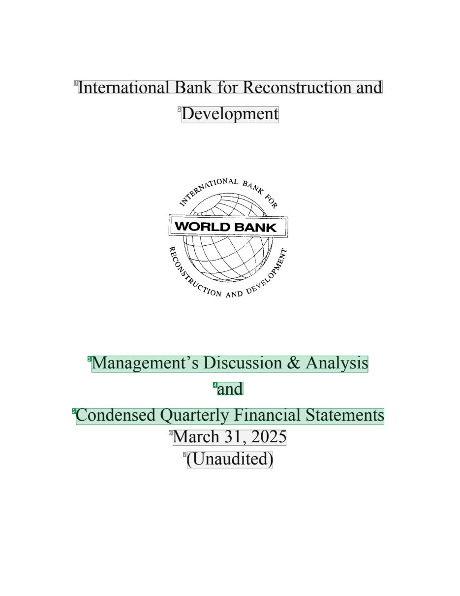
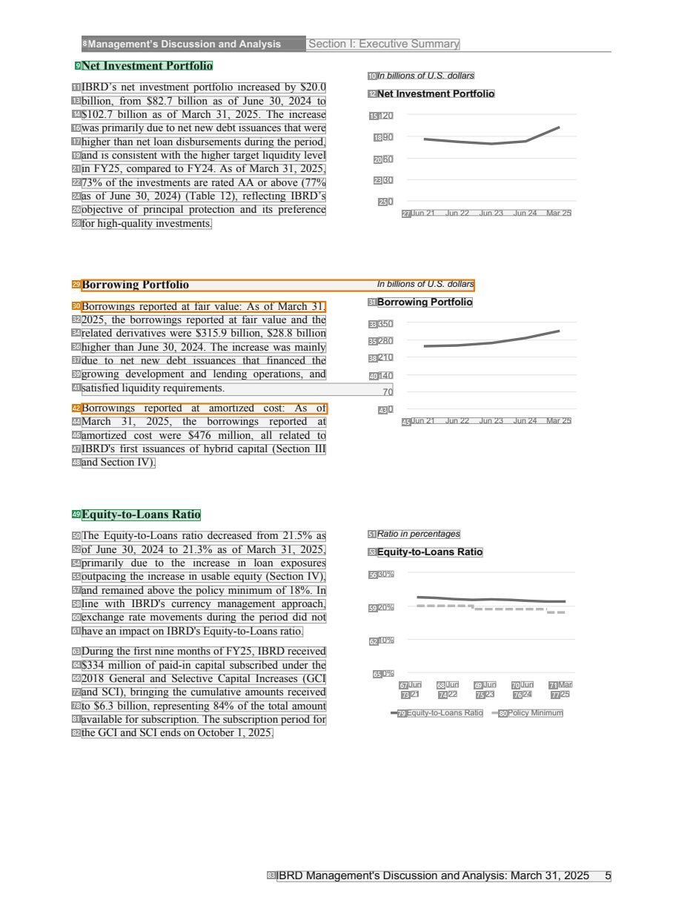
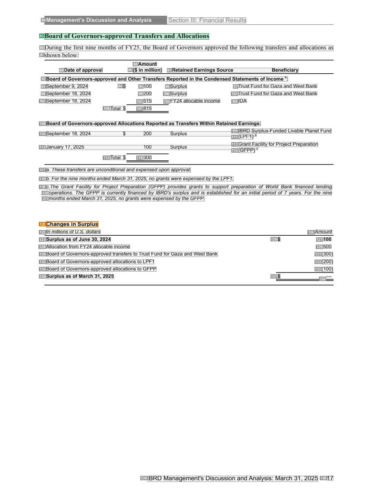
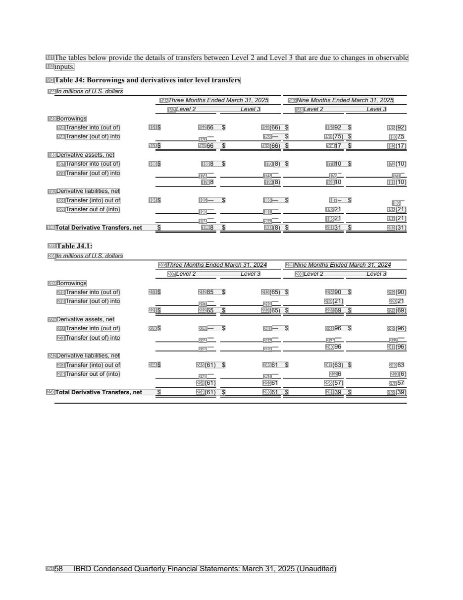

# 048 — `todo10_8/heading_corpus_100/03_tai_chinh_ke_toan/048_IBRD_Financial_Statements_March_2025.pdf`

Draft `P7_F1Q_HELDOUT_GOLD_DRAFT_V2`, status `DRAFT_REVIEWER_A_NOT_APPROVED`, draft sha256 `f4b58a72ec5976875755dd7769cd9f1ea7fa632b1fb3b9bb3de4add8a43945e6`. Source sha256 `08af1ba4ddb0adab18a838cb63a5daddf70d2dbf8f731b7b78ba1049bfc3ba12`. [Back to index](README.md)

Approve or correct with `review-apply` lines: `APPROVE 048 by <reviewer> [because <note>]`, `048 <alias> -> E|R|O because <reason>`.

## Page 1 (FIRST)

| # | alias | text | font | draft | flag | rationale |
|---:|---|---|---|---|---|---|
| 1 | L0000:S0 | International Bank forReconstruction and | 24 | **OTHER** |  | Issuer name &quot;International Bank for Reconstruction and&quot; on the cover (044/049 decision: issuer OTHER) |
| 2 | L0001:S0 | Development | 24 | **OTHER** |  | Issuer name continuation &quot;Development&quot; |
| 3 | L0002:S0 | Management’s Discussion &amp; Analysis | 24 | **ESTABLISHES** |  | Report title &quot;Management&#39;s Discussion &amp; Analysis&quot; (24pt cover title) |
| 4 | L0003:S0 | and | 24 | **ESTABLISHES** |  | Report title continuation &quot;and&quot; |
| 5 | L0004:S0 | Condensed Quarterly Financial Statements | 24 | **ESTABLISHES** |  | Report title continuation &quot;Condensed Quarterly Financial Statements&quot; |
| 6 | L0005:S0 | March 31, 2025 | 24 | **OTHER** |  | Reporting date &quot;March 31, 2025&quot; (metadata) |
| 7 | L0006:S0 | (Unaudited) | 24 | **OTHER** |  | Audit status &quot;(Unaudited)&quot; (metadata, 049 decision) |

**OTHER rows to check for a missed heading on page 1** (body size 24pt; bold or ≥ body+1pt, ≤ 12 words): none.

## Page 7 (SEEDED_INTERIOR)

| # | alias | text | font | draft | flag | rationale |
|---:|---|---|---|---|---|---|
| 8 | L0151:S0 | Management’s Discussion and Analysis Section I: Executive Summary | 9 B | **OTHER** |  | Running header &quot;Management&#39;s Discussion and Analysis Section I: Executive Summary&quot; |
| 9 | L0152:S0 | Net Investment Portfolio | 11 B | **ESTABLISHES** |  | MD&amp;A sub-section heading &quot;Net Investment Portfolio&quot; (11pt bold, own line in the body column) |
| 10 | L0153:S0 | In billions ofU.S. dollars | 8 I | **OTHER** |  | Chart unit note &quot;In billions of U.S. dollars&quot; |
| 11 | L0154:S0 | IBRD’s net investment portfolio increased by $20.0 | 10 | **OTHER** |  | Default: body text, list item, table cell, page number or other non-heading content on this page |
| 12 | L0154:S1 | Net Investment Portfolio | 9 B | **OTHER** |  | Chart title &quot;Net Investment Portfolio&quot; (9pt bold in the chart panel) |
| 13 | L0155:S0 | billion, from $82.7 billion as of June 30, 2024 to | 10 | **OTHER** |  | Default: body text, list item, table cell, page number or other non-heading content on this page |
| 14 | L0156:S0 | $102.7 billion as of March 31, 2025. The increase | 10 | **OTHER** |  | Default: body text, list item, table cell, page number or other non-heading content on this page |
| 15 | L0156:S1 | 120 | 8 | **OTHER** |  | Default: body text, list item, table cell, page number or other non-heading content on this page |
| 16 | L0157:S0 | was primarily due to netnew debt issuances thatwere | 10 | **OTHER** |  | Default: body text, list item, table cell, page number or other non-heading content on this page |
| 17 | L0158:S0 | higher than net loan disbursements during the period, | 10 | **OTHER** |  | Default: body text, list item, table cell, page number or other non-heading content on this page |
| 18 | L0158:S1 | 90 | 8 | **OTHER** |  | Default: body text, list item, table cell, page number or other non-heading content on this page |
| 19 | L0159:S0 | and is consistent with the higher target liquidity level | 10 | **OTHER** |  | Default: body text, list item, table cell, page number or other non-heading content on this page |
| 20 | L0159:S1 | 60 | 8 | **OTHER** |  | Default: body text, list item, table cell, page number or other non-heading content on this page |
| 21 | L0160:S0 | in FY25, compared to FY24. As ofMarch 31, 2025, | 10 | **OTHER** |  | Default: body text, list item, table cell, page number or other non-heading content on this page |
| 22 | L0161:S0 | 73% ofthe investments are rated AA or above (77% | 10 | **OTHER** |  | Default: body text, list item, table cell, page number or other non-heading content on this page |
| 23 | L0161:S1 | 30 | 8 | **OTHER** |  | Default: body text, list item, table cell, page number or other non-heading content on this page |
| 24 | L0162:S0 | as of June 30, 2024) (Table 12), reflecting IBRD’s | 10 | **OTHER** |  | Default: body text, list item, table cell, page number or other non-heading content on this page |
| 25 | L0162:S1 | 0 | 8 | **OTHER** |  | Default: body text, list item, table cell, page number or other non-heading content on this page |
| 26 | L0163:S0 | objective of principal protection and its preference | 10 | **OTHER** |  | Default: body text, list item, table cell, page number or other non-heading content on this page |
| 27 | L0163:S1 | Jun 21 Jun 22 Jun 23 Jun 24 Mar25 | 7 | **OTHER** |  | Default: body text, list item, table cell, page number or other non-heading content on this page |
| 28 | L0164:S0 | forhigh-quality investments. | 10 | **OTHER** |  | Default: body text, list item, table cell, page number or other non-heading content on this page |
| 29 | L0165:S0 | Borrowing Portfolio In billions ofU.S. dollars | 8 I | **OTHER** | REVIEW_FOCUS | Chart title/unit &quot;Borrowing Portfolio In billions of U.S. dollars&quot; (italic chart caption) |
| 30 | L0166:S0 | Borrowings reported at fair value: As of March 31, | 10 | **OTHER** | REVIEW_FOCUS | Run-in label &quot;Borrowings reported at fair value:&quot; starting a body paragraph |
| 31 | L0166:S1 | Borrowing Portfolio | 9 B | **OTHER** |  | Chart title &quot;Borrowing Portfolio&quot; |
| 32 | L0167:S0 | 2025, the borrowings reported at fair value and the | 10 | **OTHER** |  | Default: body text, list item, table cell, page number or other non-heading content on this page |
| 33 | L0167:S1 | 350 | 8 | **OTHER** |  | Default: body text, list item, table cell, page number or other non-heading content on this page |
| 34 | L0168:S0 | related derivatives were $315.9 billion, $28.8 billion | 10 | **OTHER** |  | Default: body text, list item, table cell, page number or other non-heading content on this page |
| 35 | L0168:S1 | 280 | 8 | **OTHER** |  | Default: body text, list item, table cell, page number or other non-heading content on this page |
| 36 | L0169:S0 | higher than June 30, 2024. The increase was mainly | 10 | **OTHER** |  | Default: body text, list item, table cell, page number or other non-heading content on this page |
| 37 | L0170:S0 | due to net new debt issuances that financed the | 10 | **OTHER** |  | Default: body text, list item, table cell, page number or other non-heading content on this page |
| 38 | L0170:S1 | 210 | 8 | **OTHER** |  | Default: body text, list item, table cell, page number or other non-heading content on this page |
| 39 | L0171:S0 | growing development and lending operations, and | 10 | **OTHER** |  | Default: body text, list item, table cell, page number or other non-heading content on this page |
| 40 | L0171:S1 | 140 | 8 | **OTHER** |  | Default: body text, list item, table cell, page number or other non-heading content on this page |
| 41 | L0172:S0 | satisfied liquidityrequirements. 70 | 10 | **OTHER** |  | Default: body text, list item, table cell, page number or other non-heading content on this page |
| 42 | L0173:S0 | Borrowings reported at amortized cost: As of | 10 | **OTHER** | REVIEW_FOCUS | Run-in label &quot;Borrowings reported at amortized cost:&quot; starting a body paragraph |
| 43 | L0173:S1 | 0 | 8 | **OTHER** |  | Default: body text, list item, table cell, page number or other non-heading content on this page |
| 44 | L0174:S0 | March 31, 2025, the borrowings reported at | 10 | **OTHER** |  | Default: body text, list item, table cell, page number or other non-heading content on this page |
| 45 | L0174:S1 | Jun 21 Jun 22 Jun 23 Jun 24 Mar25 | 7 | **OTHER** |  | Default: body text, list item, table cell, page number or other non-heading content on this page |
| 46 | L0175:S0 | amortized cost were $476 million, all related to | 10 | **OTHER** |  | Default: body text, list item, table cell, page number or other non-heading content on this page |
| 47 | L0176:S0 | IBRD&#39;s first issuances of hybrid capital (Section III | 10 | **OTHER** |  | Default: body text, list item, table cell, page number or other non-heading content on this page |
| 48 | L0177:S0 | and Section IV). | 10 | **OTHER** |  | Default: body text, list item, table cell, page number or other non-heading content on this page |
| 49 | L0178:S0 | Equity-to-Loans Ratio | 11 B | **ESTABLISHES** |  | MD&amp;A sub-section heading &quot;Equity-to-Loans Ratio&quot; (11pt bold, own line) |
| 50 | L0179:S0 | The Equity-to-Loans ratio decreased from 21.5% as | 10 | **OTHER** |  | Default: body text, list item, table cell, page number or other non-heading content on this page |
| 51 | L0179:S1 | Ratio in percentages | 8 I | **OTHER** |  | Default: body text, list item, table cell, page number or other non-heading content on this page |
| 52 | L0180:S0 | of June 30, 2024 to 21.3% as of March 31, 2025, | 10 | **OTHER** |  | Default: body text, list item, table cell, page number or other non-heading content on this page |
| 53 | L0180:S1 | Equity-to-Loans Ratio | 9 B | **OTHER** |  | Chart title &quot;Equity-to-Loans Ratio&quot; |
| 54 | L0181:S0 | primarily due to the increase in loan exposures | 10 | **OTHER** |  | Default: body text, list item, table cell, page number or other non-heading content on this page |
| 55 | L0182:S0 | outpacing the increase in usable equity (Section IV), | 10 | **OTHER** |  | Default: body text, list item, table cell, page number or other non-heading content on this page |
| 56 | L0182:S1 | 30% | 7 | **OTHER** |  | Default: body text, list item, table cell, page number or other non-heading content on this page |
| 57 | L0183:S0 | and remained above the policy minimum of 18%. In | 10 | **OTHER** |  | Default: body text, list item, table cell, page number or other non-heading content on this page |
| 58 | L0184:S0 | line with IBRD&#39;s currency management approach, | 10 | **OTHER** |  | Default: body text, list item, table cell, page number or other non-heading content on this page |
| 59 | L0184:S1 | 20% | 7 | **OTHER** |  | Default: body text, list item, table cell, page number or other non-heading content on this page |
| 60 | L0185:S0 | exchange rate movements during the period did not | 10 | **OTHER** |  | Default: body text, list item, table cell, page number or other non-heading content on this page |
| 61 | L0186:S0 | have an impact on IBRD&#39;s Equity-to-Loans ratio. | 10 | **OTHER** |  | Default: body text, list item, table cell, page number or other non-heading content on this page |
| 62 | L0187:S0 | 10% | 7 | **OTHER** |  | Default: body text, list item, table cell, page number or other non-heading content on this page |
| 63 | L0188:S0 | During the first nine months ofFY25, IBRD received | 10 | **OTHER** |  | Default: body text, list item, table cell, page number or other non-heading content on this page |
| 64 | L0189:S0 | $334 million ofpaid-in capital subscribed under the | 10 | **OTHER** |  | Default: body text, list item, table cell, page number or other non-heading content on this page |
| 65 | L0189:S1 | 0% | 7 | **OTHER** |  | Default: body text, list item, table cell, page number or other non-heading content on this page |
| 66 | L0190:S0 | 2018 General and Selective Capital Increases (GCI | 10 | **OTHER** |  | Default: body text, list item, table cell, page number or other non-heading content on this page |
| 67 | L0190:S1 | Jun | 7 | **OTHER** |  | Default: body text, list item, table cell, page number or other non-heading content on this page |
| 68 | L0190:S2 | Jun | 7 | **OTHER** |  | Default: body text, list item, table cell, page number or other non-heading content on this page |
| 69 | L0190:S3 | Jun | 7 | **OTHER** |  | Default: body text, list item, table cell, page number or other non-heading content on this page |
| 70 | L0190:S4 | Jun | 7 | **OTHER** |  | Default: body text, list item, table cell, page number or other non-heading content on this page |
| 71 | L0190:S5 | Mar | 7 | **OTHER** |  | Default: body text, list item, table cell, page number or other non-heading content on this page |
| 72 | L0191:S0 | and SCI), bringing the cumulative amounts received | 10 | **OTHER** |  | Default: body text, list item, table cell, page number or other non-heading content on this page |
| 73 | L0191:S1 | 21 | 7 | **OTHER** |  | Default: body text, list item, table cell, page number or other non-heading content on this page |
| 74 | L0191:S2 | 22 | 7 | **OTHER** |  | Default: body text, list item, table cell, page number or other non-heading content on this page |
| 75 | L0191:S3 | 23 | 7 | **OTHER** |  | Default: body text, list item, table cell, page number or other non-heading content on this page |
| 76 | L0191:S4 | 24 | 7 | **OTHER** |  | Default: body text, list item, table cell, page number or other non-heading content on this page |
| 77 | L0191:S5 | 25 | 7 | **OTHER** |  | Default: body text, list item, table cell, page number or other non-heading content on this page |
| 78 | L0192:S0 | to $6.3 billion, representing 84% ofthe total amount | 10 | **OTHER** |  | Default: body text, list item, table cell, page number or other non-heading content on this page |
| 79 | L0192:S1 | Equity-to-Loans Ratio | 7 | **OTHER** |  | Default: body text, list item, table cell, page number or other non-heading content on this page |
| 80 | L0192:S2 | Policy Minimum | 7 | **OTHER** |  | Default: body text, list item, table cell, page number or other non-heading content on this page |
| 81 | L0193:S0 | available for subscription. The subscriptionperiod for | 10 | **OTHER** |  | Default: body text, list item, table cell, page number or other non-heading content on this page |
| 82 | L0194:S0 | the GCI and SCI ends on October 1, 2025. | 10 | **OTHER** |  | Default: body text, list item, table cell, page number or other non-heading content on this page |
| 83 | L0195:S0 | IBRD Management&#39;s Discussion and Analysis: March 31, 2025 5 | 10 | **OTHER** |  | Running footer |

**OTHER rows to check for a missed heading on page 7** (body size 10pt; bold or ≥ body+1pt, ≤ 12 words): #8 `L0151:S0` Management’s Discussion and Analysis Section I: Executive Su… (9 B), #12 `L0154:S1` Net Investment Portfolio (9 B), #31 `L0166:S1` Borrowing Portfolio (9 B), #53 `L0180:S1` Equity-to-Loans Ratio (9 B).

## Page 19 (TARGETED_STRUCTURE)

| # | alias | text | font | draft | flag | rationale |
|---:|---|---|---|---|---|---|
| 84 | L0631:S0 | Management’s Discussion and Analysis Section III: Financial Results | 9 B | **OTHER** |  | Running header &quot;Management&#39;s Discussion and Analysis Section III: Financial Results&quot; |
| 85 | L0632:S0 | Board ofGovernors-approved Transfers and Allocations | 11 B | **ESTABLISHES** |  | MD&amp;A sub-section heading &quot;Board of Governors-approved Transfers and Allocations&quot; (11pt bold) |
| 86 | L0633:S0 | During the first nine months ofFY25, the Board ofGovernors approved the following transfers and allocations as | 10 | **OTHER** |  | Default: body text, list item, table cell, page number or other non-heading content on this page |
| 87 | L0634:S0 | shownbelow: | 10 | **OTHER** |  | Default: body text, list item, table cell, page number or other non-heading content on this page |
| 88 | L0635:S0 | Amount | 8 B | **OTHER** |  | Default: body text, list item, table cell, page number or other non-heading content on this page |
| 89 | L0636:S0 | Date of approval | 8 B | **OTHER** |  | Default: body text, list item, table cell, page number or other non-heading content on this page |
| 90 | L0636:S1 | ($ in million) | 8 B | **OTHER** |  | Default: body text, list item, table cell, page number or other non-heading content on this page |
| 91 | L0636:S2 | Retained Earnings Source Beneficiary | 8 B | **OTHER** |  | Default: body text, list item, table cell, page number or other non-heading content on this page |
| 92 | L0637:S0 | Board of Governors-approved and Other Transfers Reported in the Condensed Statements of Income a: | 8 B | **OTHER** |  | Table group label (bold, inside the transfers table) |
| 93 | L0638:S0 | September 9, 2024 | 8 | **OTHER** |  | Default: body text, list item, table cell, page number or other non-heading content on this page |
| 94 | L0638:S1 | $ | 8 | **OTHER** |  | Default: body text, list item, table cell, page number or other non-heading content on this page |
| 95 | L0638:S2 | 100 | 8 | **OTHER** |  | Default: body text, list item, table cell, page number or other non-heading content on this page |
| 96 | L0638:S3 | Surplus | 8 | **OTHER** |  | Default: body text, list item, table cell, page number or other non-heading content on this page |
| 97 | L0638:S4 | Trust Fund for Gaza and West Bank | 8 | **OTHER** |  | Default: body text, list item, table cell, page number or other non-heading content on this page |
| 98 | L0639:S0 | September 18, 2024 | 8 | **OTHER** |  | Default: body text, list item, table cell, page number or other non-heading content on this page |
| 99 | L0639:S1 | 200 | 8 | **OTHER** |  | Default: body text, list item, table cell, page number or other non-heading content on this page |
| 100 | L0639:S2 | Surplus | 8 | **OTHER** |  | Default: body text, list item, table cell, page number or other non-heading content on this page |
| 101 | L0639:S3 | Trust Fund for Gaza and West Bank | 8 | **OTHER** |  | Default: body text, list item, table cell, page number or other non-heading content on this page |
| 102 | L0640:S0 | September 18, 2024 | 8 | **OTHER** |  | Default: body text, list item, table cell, page number or other non-heading content on this page |
| 103 | L0640:S1 | 515 | 8 | **OTHER** |  | Default: body text, list item, table cell, page number or other non-heading content on this page |
| 104 | L0640:S2 | FY24 allocable income | 8 | **OTHER** |  | Default: body text, list item, table cell, page number or other non-heading content on this page |
| 105 | L0640:S3 | IDA | 8 | **OTHER** |  | Default: body text, list item, table cell, page number or other non-heading content on this page |
| 106 | L0641:S0 | Total $ | 8 | **OTHER** |  | Default: body text, list item, table cell, page number or other non-heading content on this page |
| 107 | L0641:S1 | 815 | 8 | **OTHER** |  | Default: body text, list item, table cell, page number or other non-heading content on this page |
| 108 | L0642:S0 | Board of Governors-approved Allocations Reported as Transfers Within Retained Earnings: | 8 B | **OTHER** |  | Table group label (bold, inside the transfers table) |
| 109 | L0643:S0 | IBRD Surplus-Funded Livable Planet Fund | 8 | **OTHER** |  | Default: body text, list item, table cell, page number or other non-heading content on this page |
| 110 | L0644:S0 | September 18, 2024 $ 200 Surplus b | 8 | **OTHER** |  | Default: body text, list item, table cell, page number or other non-heading content on this page |
| 111 | L0645:S0 | (LPF1) | 8 | **OTHER** |  | Default: body text, list item, table cell, page number or other non-heading content on this page |
| 112 | L0646:S0 | Grant Facility for Project Preparation | 8 | **OTHER** |  | Default: body text, list item, table cell, page number or other non-heading content on this page |
| 113 | L0647:S0 | January 17, 2025 100 Surplus c | 8 | **OTHER** |  | Default: body text, list item, table cell, page number or other non-heading content on this page |
| 114 | L0648:S0 | (GFPP) | 8 | **OTHER** |  | Default: body text, list item, table cell, page number or other non-heading content on this page |
| 115 | L0649:S0 | Total $ | 8 | **OTHER** |  | Default: body text, list item, table cell, page number or other non-heading content on this page |
| 116 | L0649:S1 | 300 | 8 | **OTHER** |  | Default: body text, list item, table cell, page number or other non-heading content on this page |
| 117 | L0650:S0 | a. These transfers are unconditional and expensed upon approval. | 8 I | **OTHER** |  | Default: body text, list item, table cell, page number or other non-heading content on this page |
| 118 | L0651:S0 | b. Forthe nine months ended March 31, 2025, no grants were expensedby the LPF1. | 8 I | **OTHER** |  | Default: body text, list item, table cell, page number or other non-heading content on this page |
| 119 | L0652:S0 | c.The Grant Facility for Project Preparation (GFPP) provides grants to support preparation of World Bank financed lendin… | 8 I | **OTHER** |  | Default: body text, list item, table cell, page number or other non-heading content on this page |
| 120 | L0653:S0 | operations. The GFPP is currently financed by IBRD&#39;s surplus and is established for an initial period of 7 years. Fo… | 8 I | **OTHER** |  | Default: body text, list item, table cell, page number or other non-heading content on this page |
| 121 | L0654:S0 | months ended March 31, 2025, no grants were expensedby the GFPP. | 8 I | **OTHER** |  | Default: body text, list item, table cell, page number or other non-heading content on this page |
| 122 | L0655:S0 | Changes in Surplus | 9 B | **OTHER** | REVIEW_FOCUS | Small table title &quot;Changes in Surplus&quot; (9pt bold above the table: caption-like) |
| 123 | L0656:S0 | In millions ofU.S. dollars | 8 I | **OTHER** |  | Default: body text, list item, table cell, page number or other non-heading content on this page |
| 124 | L0656:S1 | Amount | 8 I | **OTHER** |  | Default: body text, list item, table cell, page number or other non-heading content on this page |
| 125 | L0657:S0 | Surplus as ofJune 30, 2024 | 8 B | **OTHER** |  | Default: body text, list item, table cell, page number or other non-heading content on this page |
| 126 | L0657:S1 | $ | 8 B | **OTHER** |  | Default: body text, list item, table cell, page number or other non-heading content on this page |
| 127 | L0657:S2 | 100 | 8 B | **OTHER** |  | Default: body text, list item, table cell, page number or other non-heading content on this page |
| 128 | L0658:S0 | Allocation from FY24 allocable income | 8 | **OTHER** |  | Default: body text, list item, table cell, page number or other non-heading content on this page |
| 129 | L0658:S1 | 500 | 8 | **OTHER** |  | Default: body text, list item, table cell, page number or other non-heading content on this page |
| 130 | L0659:S0 | Board of Governors-approved transfers to Trust Fund for Gaza and West Bank | 8 | **OTHER** |  | Default: body text, list item, table cell, page number or other non-heading content on this page |
| 131 | L0659:S1 | (300) | 8 | **OTHER** |  | Default: body text, list item, table cell, page number or other non-heading content on this page |
| 132 | L0660:S0 | Board of Governors-approved allocations to LPF1 | 8 | **OTHER** |  | Default: body text, list item, table cell, page number or other non-heading content on this page |
| 133 | L0660:S1 | (200) | 8 | **OTHER** |  | Default: body text, list item, table cell, page number or other non-heading content on this page |
| 134 | L0661:S0 | Board of Governors-approved allocations to GFPP | 8 | **OTHER** |  | Default: body text, list item, table cell, page number or other non-heading content on this page |
| 135 | L0661:S1 | (100) | 8 | **OTHER** |  | Default: body text, list item, table cell, page number or other non-heading content on this page |
| 136 | L0662:S0 | Surplus as of March 31, 2025 | 8 B | **OTHER** |  | Default: body text, list item, table cell, page number or other non-heading content on this page |
| 137 | L0662:S1 | $ | 8 B | **OTHER** |  | Default: body text, list item, table cell, page number or other non-heading content on this page |
| 138 | L0662:S2 | — | 8 B | **OTHER** |  | Default: body text, list item, table cell, page number or other non-heading content on this page |
| 139 | L0663:S0 | IBRD Management&#39;s Discussion and Analysis: March 31, 2025 | 10 | **OTHER** |  | Running footer |
| 140 | L0663:S1 | 17 | 10 | **OTHER** |  | Default: body text, list item, table cell, page number or other non-heading content on this page |

**OTHER rows to check for a missed heading on page 19** (body size 8pt; bold or ≥ body+1pt, ≤ 12 words): #84 `L0631:S0` Management’s Discussion and Analysis Section III: Financial … (9 B), #87 `L0634:S0` shownbelow: (10), #88 `L0635:S0` Amount (8 B), #89 `L0636:S0` Date of approval (8 B), #90 `L0636:S1` ($ in million) (8 B), #91 `L0636:S2` Retained Earnings Source Beneficiary (8 B), #108 `L0642:S0` Board of Governors-approved Allocations Reported as Transfer… (8 B), #122 `L0655:S0` Changes in Surplus (9 B), #125 `L0657:S0` Surplus as ofJune 30, 2024 (8 B), #126 `L0657:S1` $ (8 B), #127 `L0657:S2` 100 (8 B), #136 `L0662:S0` Surplus as of March 31, 2025 (8 B), #137 `L0662:S1` $ (8 B), #138 `L0662:S2` — (8 B), #139 `L0663:S0` IBRD Management&#39;s Discussion and Analysis: March 31, 202… (10), #140 `L0663:S1` 17 (10).

## Page 60 (SEEDED_INTERIOR)

| # | alias | text | font | draft | flag | rationale |
|---:|---|---|---|---|---|---|
| 141 | L2248:S0 | The tables below provide the details oftransfers between Level 2 and Level 3 that are due to changes in observable | 10 | **OTHER** |  | Default: body text, list item, table cell, page number or other non-heading content on this page |
| 142 | L2249:S0 | inputs. | 10 | **OTHER** |  | Default: body text, list item, table cell, page number or other non-heading content on this page |
| 143 | L2250:S0 | Table J4: Borrowings and derivatives inter level transfers | 10 B | **OTHER** |  | Table caption &quot;Table J4: Borrowings and derivatives inter level transfers&quot; |
| 144 | L2251:S0 | In millions ofU.S. dollars | 8 I | **OTHER** |  | Default: body text, list item, table cell, page number or other non-heading content on this page |
| 145 | L2252:S0 | Three Months Ended March 31, 2025 | 8 I | **OTHER** |  | Default: body text, list item, table cell, page number or other non-heading content on this page |
| 146 | L2252:S1 | Nine Months Ended March 31, 2025 | 8 I | **OTHER** |  | Default: body text, list item, table cell, page number or other non-heading content on this page |
| 147 | L2253:S0 | Level 2 Level 3 | 8 I | **OTHER** |  | Default: body text, list item, table cell, page number or other non-heading content on this page |
| 148 | L2253:S1 | Level 2 Level 3 | 8 I | **OTHER** |  | Default: body text, list item, table cell, page number or other non-heading content on this page |
| 149 | L2254:S0 | Borrowings | 8 | **OTHER** |  | Default: body text, list item, table cell, page number or other non-heading content on this page |
| 150 | L2255:S0 | Transfer into (out of) | 8 | **OTHER** |  | Default: body text, list item, table cell, page number or other non-heading content on this page |
| 151 | L2255:S1 | $ | 8 | **OTHER** |  | Default: body text, list item, table cell, page number or other non-heading content on this page |
| 152 | L2255:S2 | 66 $ | 8 | **OTHER** |  | Default: body text, list item, table cell, page number or other non-heading content on this page |
| 153 | L2255:S3 | (66) $ | 8 | **OTHER** |  | Default: body text, list item, table cell, page number or other non-heading content on this page |
| 154 | L2255:S4 | 92 $ | 8 | **OTHER** |  | Default: body text, list item, table cell, page number or other non-heading content on this page |
| 155 | L2255:S5 | (92) | 8 | **OTHER** |  | Default: body text, list item, table cell, page number or other non-heading content on this page |
| 156 | L2256:S0 | Transfer (out of) into | 8 | **OTHER** |  | Default: body text, list item, table cell, page number or other non-heading content on this page |
| 157 | L2256:S1 | — | 8 | **OTHER** |  | Default: body text, list item, table cell, page number or other non-heading content on this page |
| 158 | L2256:S2 | — $ | 8 | **OTHER** |  | Default: body text, list item, table cell, page number or other non-heading content on this page |
| 159 | L2256:S3 | (75) $ | 8 | **OTHER** |  | Default: body text, list item, table cell, page number or other non-heading content on this page |
| 160 | L2256:S4 | 75 | 8 | **OTHER** |  | Default: body text, list item, table cell, page number or other non-heading content on this page |
| 161 | L2257:S0 | $ | 8 | **OTHER** |  | Default: body text, list item, table cell, page number or other non-heading content on this page |
| 162 | L2257:S1 | 66 $ | 8 | **OTHER** |  | Default: body text, list item, table cell, page number or other non-heading content on this page |
| 163 | L2257:S2 | (66) $ | 8 | **OTHER** |  | Default: body text, list item, table cell, page number or other non-heading content on this page |
| 164 | L2257:S3 | 17 $ | 8 | **OTHER** |  | Default: body text, list item, table cell, page number or other non-heading content on this page |
| 165 | L2257:S4 | (17) | 8 | **OTHER** |  | Default: body text, list item, table cell, page number or other non-heading content on this page |
| 166 | L2258:S0 | Derivative assets, net | 8 | **OTHER** |  | Default: body text, list item, table cell, page number or other non-heading content on this page |
| 167 | L2259:S0 | Transfer into (out of) | 8 | **OTHER** |  | Default: body text, list item, table cell, page number or other non-heading content on this page |
| 168 | L2259:S1 | $ | 8 | **OTHER** |  | Default: body text, list item, table cell, page number or other non-heading content on this page |
| 169 | L2259:S2 | 8 $ | 8 | **OTHER** |  | Default: body text, list item, table cell, page number or other non-heading content on this page |
| 170 | L2259:S3 | (8) $ | 8 | **OTHER** |  | Default: body text, list item, table cell, page number or other non-heading content on this page |
| 171 | L2259:S4 | 10 $ | 8 | **OTHER** |  | Default: body text, list item, table cell, page number or other non-heading content on this page |
| 172 | L2259:S5 | (10) | 8 | **OTHER** |  | Default: body text, list item, table cell, page number or other non-heading content on this page |
| 173 | L2260:S0 | Transfer (out of) into | 8 | **OTHER** |  | Default: body text, list item, table cell, page number or other non-heading content on this page |
| 174 | L2260:S1 | — | 8 | **OTHER** |  | Default: body text, list item, table cell, page number or other non-heading content on this page |
| 175 | L2260:S2 | — | 8 | **OTHER** |  | Default: body text, list item, table cell, page number or other non-heading content on this page |
| 176 | L2260:S3 | – | 8 | **OTHER** |  | Default: body text, list item, table cell, page number or other non-heading content on this page |
| 177 | L2260:S4 | – | 8 | **OTHER** |  | Default: body text, list item, table cell, page number or other non-heading content on this page |
| 178 | L2261:S0 | 8 | 8 | **OTHER** |  | Default: body text, list item, table cell, page number or other non-heading content on this page |
| 179 | L2261:S1 | (8) | 8 | **OTHER** |  | Default: body text, list item, table cell, page number or other non-heading content on this page |
| 180 | L2261:S2 | 10 | 8 | **OTHER** |  | Default: body text, list item, table cell, page number or other non-heading content on this page |
| 181 | L2261:S3 | (10) | 8 | **OTHER** |  | Default: body text, list item, table cell, page number or other non-heading content on this page |
| 182 | L2262:S0 | Derivative liabilities, net | 8 | **OTHER** |  | Default: body text, list item, table cell, page number or other non-heading content on this page |
| 183 | L2263:S0 | Transfer (into) out of | 8 | **OTHER** |  | Default: body text, list item, table cell, page number or other non-heading content on this page |
| 184 | L2263:S1 | $ | 8 | **OTHER** |  | Default: body text, list item, table cell, page number or other non-heading content on this page |
| 185 | L2263:S2 | — $ | 8 | **OTHER** |  | Default: body text, list item, table cell, page number or other non-heading content on this page |
| 186 | L2263:S3 | — $ | 8 | **OTHER** |  | Default: body text, list item, table cell, page number or other non-heading content on this page |
| 187 | L2263:S4 | – $ | 8 | **OTHER** |  | Default: body text, list item, table cell, page number or other non-heading content on this page |
| 188 | L2263:S5 | – | 8 | **OTHER** |  | Default: body text, list item, table cell, page number or other non-heading content on this page |
| 189 | L2264:S0 | Transfer out of (into) | 8 | **OTHER** |  | Default: body text, list item, table cell, page number or other non-heading content on this page |
| 190 | L2264:S1 | — | 8 | **OTHER** |  | Default: body text, list item, table cell, page number or other non-heading content on this page |
| 191 | L2264:S2 | — | 8 | **OTHER** |  | Default: body text, list item, table cell, page number or other non-heading content on this page |
| 192 | L2264:S3 | 21 | 8 | **OTHER** |  | Default: body text, list item, table cell, page number or other non-heading content on this page |
| 193 | L2264:S4 | (21) | 8 | **OTHER** |  | Default: body text, list item, table cell, page number or other non-heading content on this page |
| 194 | L2265:S0 | — | 8 | **OTHER** |  | Default: body text, list item, table cell, page number or other non-heading content on this page |
| 195 | L2265:S1 | — | 8 | **OTHER** |  | Default: body text, list item, table cell, page number or other non-heading content on this page |
| 196 | L2265:S2 | 21 | 8 | **OTHER** |  | Default: body text, list item, table cell, page number or other non-heading content on this page |
| 197 | L2265:S3 | (21) | 8 | **OTHER** |  | Default: body text, list item, table cell, page number or other non-heading content on this page |
| 198 | L2266:S0 | Total Derivative Transfers, net $ | 8 B | **OTHER** |  | Default: body text, list item, table cell, page number or other non-heading content on this page |
| 199 | L2266:S1 | 8 $ | 8 | **OTHER** |  | Default: body text, list item, table cell, page number or other non-heading content on this page |
| 200 | L2266:S2 | (8) $ | 8 | **OTHER** |  | Default: body text, list item, table cell, page number or other non-heading content on this page |
| 201 | L2266:S3 | 31 $ | 8 | **OTHER** |  | Default: body text, list item, table cell, page number or other non-heading content on this page |
| 202 | L2266:S4 | (31) | 8 | **OTHER** |  | Default: body text, list item, table cell, page number or other non-heading content on this page |
| 203 | L2267:S0 | Table J4.1: | 10 B | **OTHER** |  | Table caption &quot;Table J4.1:&quot; |
| 204 | L2268:S0 | In millions ofU.S. dollars | 8 I | **OTHER** |  | Default: body text, list item, table cell, page number or other non-heading content on this page |
| 205 | L2269:S0 | Three Months Ended March 31, 2024 | 8 I | **OTHER** |  | Default: body text, list item, table cell, page number or other non-heading content on this page |
| 206 | L2269:S1 | Nine Months Ended March 31, 2024 | 8 I | **OTHER** |  | Default: body text, list item, table cell, page number or other non-heading content on this page |
| 207 | L2270:S0 | Level 2 Level 3 | 8 I | **OTHER** |  | Default: body text, list item, table cell, page number or other non-heading content on this page |
| 208 | L2270:S1 | Level 2 Level 3 | 8 I | **OTHER** |  | Default: body text, list item, table cell, page number or other non-heading content on this page |
| 209 | L2271:S0 | Borrowings | 8 | **OTHER** |  | Default: body text, list item, table cell, page number or other non-heading content on this page |
| 210 | L2272:S0 | Transfer into (out of) | 8 | **OTHER** |  | Default: body text, list item, table cell, page number or other non-heading content on this page |
| 211 | L2272:S1 | $ | 8 | **OTHER** |  | Default: body text, list item, table cell, page number or other non-heading content on this page |
| 212 | L2272:S2 | 65 $ | 8 | **OTHER** |  | Default: body text, list item, table cell, page number or other non-heading content on this page |
| 213 | L2272:S3 | (65) $ | 8 | **OTHER** |  | Default: body text, list item, table cell, page number or other non-heading content on this page |
| 214 | L2272:S4 | 90 $ | 8 | **OTHER** |  | Default: body text, list item, table cell, page number or other non-heading content on this page |
| 215 | L2272:S5 | (90) | 8 | **OTHER** |  | Default: body text, list item, table cell, page number or other non-heading content on this page |
| 216 | L2273:S0 | Transfer (out of) into | 8 | **OTHER** |  | Default: body text, list item, table cell, page number or other non-heading content on this page |
| 217 | L2273:S1 | — | 8 | **OTHER** |  | Default: body text, list item, table cell, page number or other non-heading content on this page |
| 218 | L2273:S2 | — | 8 | **OTHER** |  | Default: body text, list item, table cell, page number or other non-heading content on this page |
| 219 | L2273:S3 | (21) | 8 | **OTHER** |  | Default: body text, list item, table cell, page number or other non-heading content on this page |
| 220 | L2273:S4 | 21 | 8 | **OTHER** |  | Default: body text, list item, table cell, page number or other non-heading content on this page |
| 221 | L2274:S0 | $ | 8 | **OTHER** |  | Default: body text, list item, table cell, page number or other non-heading content on this page |
| 222 | L2274:S1 | 65 $ | 8 | **OTHER** |  | Default: body text, list item, table cell, page number or other non-heading content on this page |
| 223 | L2274:S2 | (65) $ | 8 | **OTHER** |  | Default: body text, list item, table cell, page number or other non-heading content on this page |
| 224 | L2274:S3 | 69 $ | 8 | **OTHER** |  | Default: body text, list item, table cell, page number or other non-heading content on this page |
| 225 | L2274:S4 | (69) | 8 | **OTHER** |  | Default: body text, list item, table cell, page number or other non-heading content on this page |
| 226 | L2275:S0 | Derivative assets, net | 8 | **OTHER** |  | Default: body text, list item, table cell, page number or other non-heading content on this page |
| 227 | L2276:S0 | Transfer into (out of) | 8 | **OTHER** |  | Default: body text, list item, table cell, page number or other non-heading content on this page |
| 228 | L2276:S1 | $ | 8 | **OTHER** |  | Default: body text, list item, table cell, page number or other non-heading content on this page |
| 229 | L2276:S2 | — $ | 8 | **OTHER** |  | Default: body text, list item, table cell, page number or other non-heading content on this page |
| 230 | L2276:S3 | — $ | 8 | **OTHER** |  | Default: body text, list item, table cell, page number or other non-heading content on this page |
| 231 | L2276:S4 | 96 $ | 8 | **OTHER** |  | Default: body text, list item, table cell, page number or other non-heading content on this page |
| 232 | L2276:S5 | (96) | 8 | **OTHER** |  | Default: body text, list item, table cell, page number or other non-heading content on this page |
| 233 | L2277:S0 | Transfer (out of) into | 8 | **OTHER** |  | Default: body text, list item, table cell, page number or other non-heading content on this page |
| 234 | L2277:S1 | — | 8 | **OTHER** |  | Default: body text, list item, table cell, page number or other non-heading content on this page |
| 235 | L2277:S2 | — | 8 | **OTHER** |  | Default: body text, list item, table cell, page number or other non-heading content on this page |
| 236 | L2277:S3 | — | 8 | **OTHER** |  | Default: body text, list item, table cell, page number or other non-heading content on this page |
| 237 | L2277:S4 | — | 8 | **OTHER** |  | Default: body text, list item, table cell, page number or other non-heading content on this page |
| 238 | L2278:S0 | — | 8 | **OTHER** |  | Default: body text, list item, table cell, page number or other non-heading content on this page |
| 239 | L2278:S1 | — | 8 | **OTHER** |  | Default: body text, list item, table cell, page number or other non-heading content on this page |
| 240 | L2278:S2 | 96 | 8 | **OTHER** |  | Default: body text, list item, table cell, page number or other non-heading content on this page |
| 241 | L2278:S3 | (96) | 8 | **OTHER** |  | Default: body text, list item, table cell, page number or other non-heading content on this page |
| 242 | L2279:S0 | Derivative liabilities, net | 8 | **OTHER** |  | Default: body text, list item, table cell, page number or other non-heading content on this page |
| 243 | L2280:S0 | Transfer (into) out of | 8 | **OTHER** |  | Default: body text, list item, table cell, page number or other non-heading content on this page |
| 244 | L2280:S1 | $ | 8 | **OTHER** |  | Default: body text, list item, table cell, page number or other non-heading content on this page |
| 245 | L2280:S2 | (61) $ | 8 | **OTHER** |  | Default: body text, list item, table cell, page number or other non-heading content on this page |
| 246 | L2280:S3 | 61 $ | 8 | **OTHER** |  | Default: body text, list item, table cell, page number or other non-heading content on this page |
| 247 | L2280:S4 | (63) $ | 8 | **OTHER** |  | Default: body text, list item, table cell, page number or other non-heading content on this page |
| 248 | L2280:S5 | 63 | 8 | **OTHER** |  | Default: body text, list item, table cell, page number or other non-heading content on this page |
| 249 | L2281:S0 | Transfer out of (into) | 8 | **OTHER** |  | Default: body text, list item, table cell, page number or other non-heading content on this page |
| 250 | L2281:S1 | — | 8 | **OTHER** |  | Default: body text, list item, table cell, page number or other non-heading content on this page |
| 251 | L2281:S2 | — | 8 | **OTHER** |  | Default: body text, list item, table cell, page number or other non-heading content on this page |
| 252 | L2281:S3 | 6 | 8 | **OTHER** |  | Default: body text, list item, table cell, page number or other non-heading content on this page |
| 253 | L2281:S4 | (6) | 8 | **OTHER** |  | Default: body text, list item, table cell, page number or other non-heading content on this page |
| 254 | L2282:S0 | (61) | 8 | **OTHER** |  | Default: body text, list item, table cell, page number or other non-heading content on this page |
| 255 | L2282:S1 | 61 | 8 | **OTHER** |  | Default: body text, list item, table cell, page number or other non-heading content on this page |
| 256 | L2282:S2 | (57) | 8 | **OTHER** |  | Default: body text, list item, table cell, page number or other non-heading content on this page |
| 257 | L2282:S3 | 57 | 8 | **OTHER** |  | Default: body text, list item, table cell, page number or other non-heading content on this page |
| 258 | L2283:S0 | Total Derivative Transfers, net $ | 8 B | **OTHER** |  | Default: body text, list item, table cell, page number or other non-heading content on this page |
| 259 | L2283:S1 | (61) $ | 8 | **OTHER** |  | Default: body text, list item, table cell, page number or other non-heading content on this page |
| 260 | L2283:S2 | 61 $ | 8 | **OTHER** |  | Default: body text, list item, table cell, page number or other non-heading content on this page |
| 261 | L2283:S3 | 39 $ | 8 | **OTHER** |  | Default: body text, list item, table cell, page number or other non-heading content on this page |
| 262 | L2283:S4 | (39) | 8 | **OTHER** |  | Default: body text, list item, table cell, page number or other non-heading content on this page |
| 263 | L2284:S0 | 58 IBRD Condensed Quarterly Financial Statements: March 31, 2025 (Unaudited) | 10 | **OTHER** |  | Running footer |

**OTHER rows to check for a missed heading on page 60** (body size 8pt; bold or ≥ body+1pt, ≤ 12 words): #142 `L2249:S0` inputs. (10), #143 `L2250:S0` Table J4: Borrowings and derivatives inter level transfers (10 B), #198 `L2266:S0` Total Derivative Transfers, net $ (8 B), #203 `L2267:S0` Table J4.1: (10 B), #258 `L2283:S0` Total Derivative Transfers, net $ (8 B), #263 `L2284:S0` 58 IBRD Condensed Quarterly Financial Statements: March 31, … (10).
