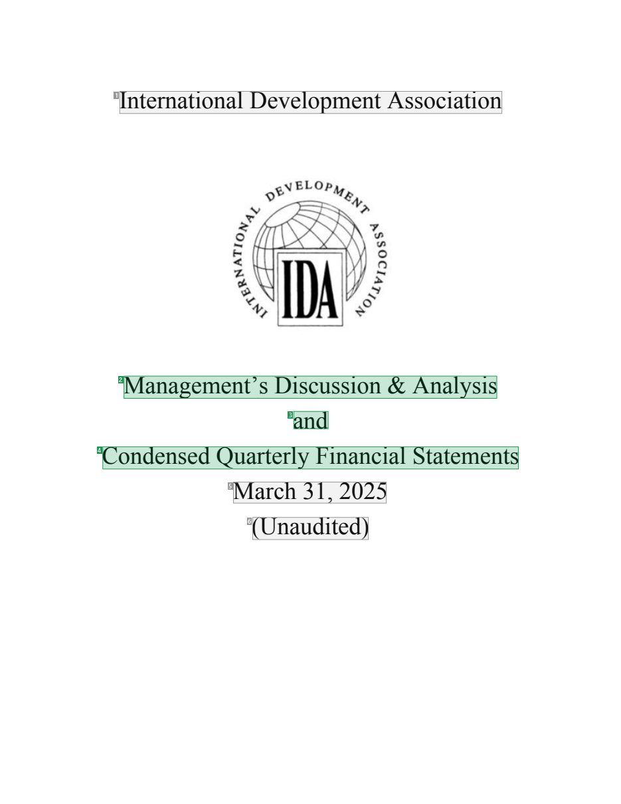
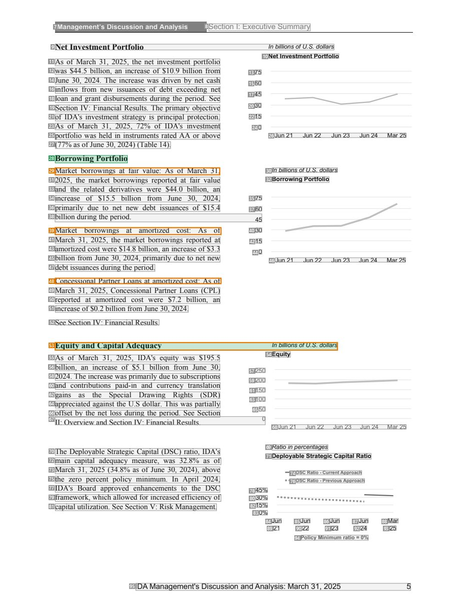
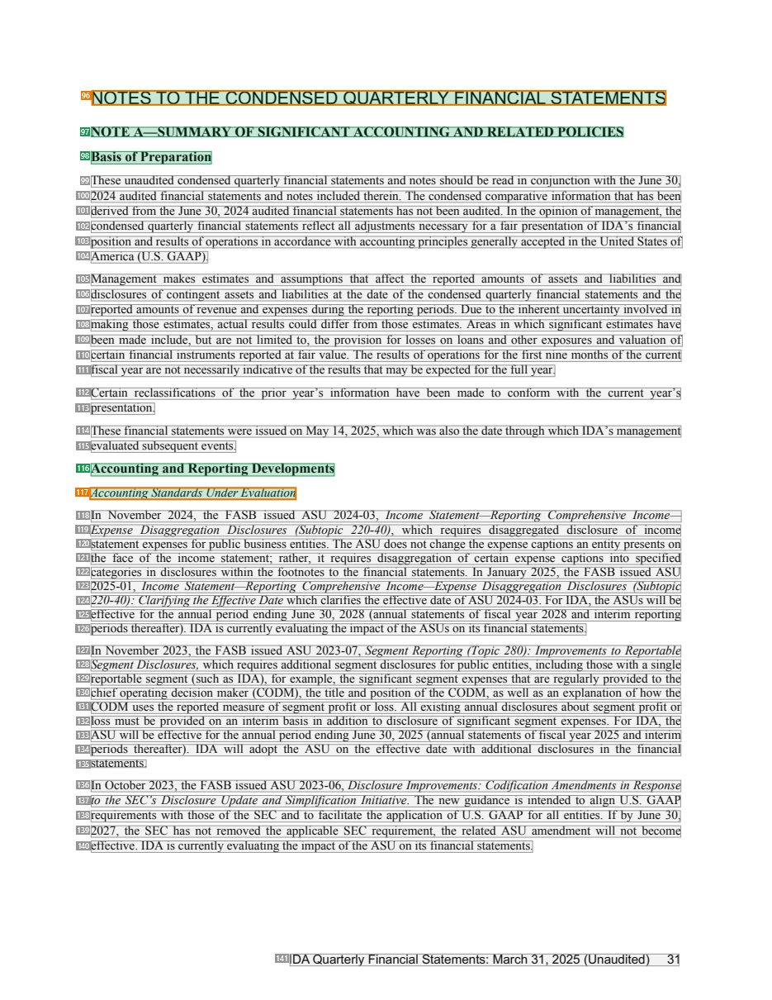
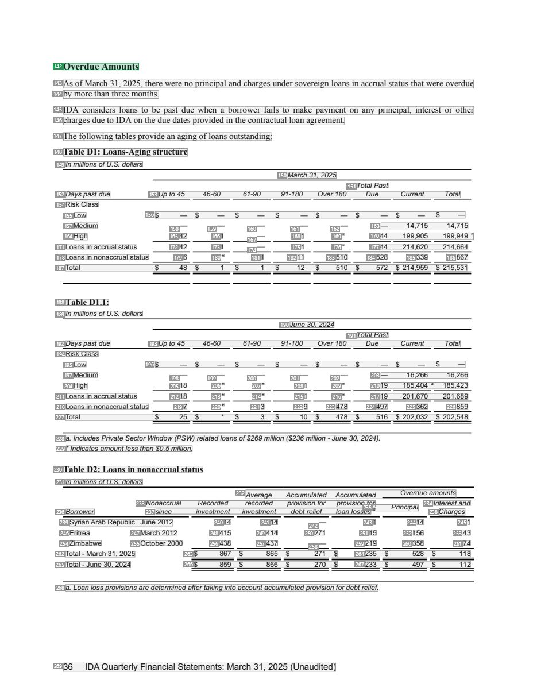

# 050 — `todo10_8/heading_corpus_100/03_tai_chinh_ke_toan/050_IDA_Financial_Statements_March_2025.pdf`

Draft `P7_F1Q_HELDOUT_GOLD_DRAFT_V2`, status `DRAFT_REVIEWER_A_NOT_APPROVED`, draft sha256 `ea2783874b82a3429c0ebde1382fa3ac9b0c0b71a85aa639986ca7138896c708`. Source sha256 `a07844b6665da03ef55abb7a0cb6e069d99f7135e5b459619525690f583749e8`. [Back to index](README.md)

Approve or correct with `review-apply` lines: `APPROVE 050 by <reviewer> [because <note>]`, `050 <alias> -> E|R|O because <reason>`.

## Page 1 (FIRST)

| # | alias | text | font | draft | flag | rationale |
|---:|---|---|---|---|---|---|
| 1 | L0000:S0 | International DevelopmentAssociation | 24 | **OTHER** |  | Issuer name &quot;International Development Association&quot; on the cover (044/049 decision) |
| 2 | L0001:S0 | Management’s Discussion &amp; Analysis | 24 | **ESTABLISHES** |  | Report title &quot;Management&#39;s Discussion &amp; Analysis&quot; (24pt) |
| 3 | L0002:S0 | and | 24 | **ESTABLISHES** |  | Report title continuation &quot;and&quot; |
| 4 | L0003:S0 | Condensed Quarterly Financial Statements | 24 | **ESTABLISHES** |  | Report title continuation &quot;Condensed Quarterly Financial Statements&quot; |
| 5 | L0004:S0 | March 31, 2025 | 24 | **OTHER** |  | Reporting date &quot;March 31, 2025&quot; |
| 6 | L0005:S0 | (Unaudited) | 24 | **OTHER** |  | Audit status &quot;(Unaudited)&quot; (049 decision) |

**OTHER rows to check for a missed heading on page 1** (body size 24pt; bold or ≥ body+1pt, ≤ 12 words): none.

## Page 7 (SEEDED_INTERIOR)

| # | alias | text | font | draft | flag | rationale |
|---:|---|---|---|---|---|---|
| 7 | L0157:S0 | Management’s Discussion and Analysis | 9 B | **OTHER** |  | Running header &quot;Management&#39;s Discussion and Analysis&quot; |
| 8 | L0157:S1 | Section I: Executive Summary | 10 | **OTHER** |  | Running header section part &quot;Section I: Executive Summary&quot; |
| 9 | L0158:S0 | Net Investment Portfolio In billions ofU.S. dollars | 8 B I | **OTHER** |  | Chart caption &quot;Net Investment Portfolio In billions of U.S. dollars&quot; |
| 10 | L0159:S0 | Net Investment Portfolio | 8 B | **OTHER** |  | Chart title &quot;Net Investment Portfolio&quot; (8pt bold in the chart panel) |
| 11 | L0160:S0 | As of March 31, 2025, the net investment portfolio | 10 | **OTHER** |  | Default: body text, list item, table cell, page number or other non-heading content on this page |
| 12 | L0161:S0 | was $44.5 billion, an increase of $10.9 billion from | 10 | **OTHER** |  | Default: body text, list item, table cell, page number or other non-heading content on this page |
| 13 | L0161:S1 | 75 | 8 | **OTHER** |  | Default: body text, list item, table cell, page number or other non-heading content on this page |
| 14 | L0162:S0 | June 30, 2024. The increase was driven by net cash | 10 | **OTHER** |  | Default: body text, list item, table cell, page number or other non-heading content on this page |
| 15 | L0162:S1 | 60 | 8 | **OTHER** |  | Default: body text, list item, table cell, page number or other non-heading content on this page |
| 16 | L0163:S0 | inflows from new issuances of debt exceeding net | 10 | **OTHER** |  | Default: body text, list item, table cell, page number or other non-heading content on this page |
| 17 | L0163:S1 | 45 | 8 | **OTHER** |  | Default: body text, list item, table cell, page number or other non-heading content on this page |
| 18 | L0164:S0 | loan and grant disbursements during the period. See | 10 | **OTHER** |  | Default: body text, list item, table cell, page number or other non-heading content on this page |
| 19 | L0165:S0 | Section IV: Financial Results. The primary objective | 10 | **OTHER** |  | Default: body text, list item, table cell, page number or other non-heading content on this page |
| 20 | L0165:S1 | 30 | 8 | **OTHER** |  | Default: body text, list item, table cell, page number or other non-heading content on this page |
| 21 | L0166:S0 | of IDA&#39;s investment strategy is principal protection. | 10 | **OTHER** |  | Default: body text, list item, table cell, page number or other non-heading content on this page |
| 22 | L0166:S1 | 15 | 8 | **OTHER** |  | Default: body text, list item, table cell, page number or other non-heading content on this page |
| 23 | L0167:S0 | As of March 31, 2025, 72% of IDA&#39;s investment | 10 | **OTHER** |  | Default: body text, list item, table cell, page number or other non-heading content on this page |
| 24 | L0167:S1 | 0 | 8 | **OTHER** |  | Default: body text, list item, table cell, page number or other non-heading content on this page |
| 25 | L0168:S0 | portfolio was held in instruments rated AA or above | 10 | **OTHER** |  | Default: body text, list item, table cell, page number or other non-heading content on this page |
| 26 | L0168:S1 | Jun 21 Jun 22 Jun 23 Jun 24 Mar25 | 8 | **OTHER** |  | Default: body text, list item, table cell, page number or other non-heading content on this page |
| 27 | L0169:S0 | (77% as ofJune 30, 2024) (Table 14). | 10 | **OTHER** |  | Default: body text, list item, table cell, page number or other non-heading content on this page |
| 28 | L0170:S0 | Borrowing Portfolio | 11 B | **ESTABLISHES** |  | MD&amp;A sub-section heading &quot;Borrowing Portfolio&quot; (11pt bold, body column) |
| 29 | L0171:S0 | Market borrowings at fair value: As of March 31, | 10 | **OTHER** | REVIEW_FOCUS | Run-in label &quot;Market borrowings at fair value:&quot; starting a paragraph |
| 30 | L0171:S1 | In billions ofU.S. dollars | 8 I | **OTHER** |  | Default: body text, list item, table cell, page number or other non-heading content on this page |
| 31 | L0172:S0 | 2025, the market borrowings reported at fair value | 10 | **OTHER** |  | Default: body text, list item, table cell, page number or other non-heading content on this page |
| 32 | L0172:S1 | Borrowing Portfolio | 8 B | **OTHER** |  | Chart title &quot;Borrowing Portfolio&quot; |
| 33 | L0173:S0 | and the related derivatives were $44.0 billion, an | 10 | **OTHER** |  | Default: body text, list item, table cell, page number or other non-heading content on this page |
| 34 | L0174:S0 | increase of $15.5 billion from June 30, 2024, | 10 | **OTHER** |  | Default: body text, list item, table cell, page number or other non-heading content on this page |
| 35 | L0174:S1 | 75 | 8 | **OTHER** |  | Default: body text, list item, table cell, page number or other non-heading content on this page |
| 36 | L0175:S0 | primarily due to net new debt issuances of $15.4 | 10 | **OTHER** |  | Default: body text, list item, table cell, page number or other non-heading content on this page |
| 37 | L0175:S1 | 60 | 8 | **OTHER** |  | Default: body text, list item, table cell, page number or other non-heading content on this page |
| 38 | L0176:S0 | billion during the period. 45 | 10 | **OTHER** |  | Default: body text, list item, table cell, page number or other non-heading content on this page |
| 39 | L0177:S0 | Market borrowings at amortized cost: As of | 10 | **OTHER** | REVIEW_FOCUS | Run-in label &quot;Market borrowings at amortized cost:&quot; starting a paragraph |
| 40 | L0177:S1 | 30 | 8 | **OTHER** |  | Default: body text, list item, table cell, page number or other non-heading content on this page |
| 41 | L0178:S0 | March 31, 2025, the market borrowings reported at | 10 | **OTHER** |  | Default: body text, list item, table cell, page number or other non-heading content on this page |
| 42 | L0178:S1 | 15 | 8 | **OTHER** |  | Default: body text, list item, table cell, page number or other non-heading content on this page |
| 43 | L0179:S0 | amortized cost were $14.8 billion, an increase of$3.3 | 10 | **OTHER** |  | Default: body text, list item, table cell, page number or other non-heading content on this page |
| 44 | L0179:S1 | 0 | 8 | **OTHER** |  | Default: body text, list item, table cell, page number or other non-heading content on this page |
| 45 | L0180:S0 | billion from June 30, 2024, primarily due to net new | 10 | **OTHER** |  | Default: body text, list item, table cell, page number or other non-heading content on this page |
| 46 | L0180:S1 | Jun 21 Jun 22 Jun 23 Jun 24 Mar25 | 8 | **OTHER** |  | Default: body text, list item, table cell, page number or other non-heading content on this page |
| 47 | L0181:S0 | debt issuances during the period. | 10 | **OTHER** |  | Default: body text, list item, table cell, page number or other non-heading content on this page |
| 48 | L0182:S0 | Concessional Partner Loans at amortized cost: As of | 10 | **OTHER** | REVIEW_FOCUS | Run-in label &quot;Concessional Partner Loans at amortized cost:&quot; starting a paragraph |
| 49 | L0183:S0 | March 31, 2025, Concessional Partner Loans (CPL) | 10 | **OTHER** |  | Default: body text, list item, table cell, page number or other non-heading content on this page |
| 50 | L0184:S0 | reported at amortized cost were $7.2 billion, an | 10 | **OTHER** |  | Default: body text, list item, table cell, page number or other non-heading content on this page |
| 51 | L0185:S0 | increase of$0.2 billion from June 30, 2024. | 10 | **OTHER** |  | Default: body text, list item, table cell, page number or other non-heading content on this page |
| 52 | L0186:S0 | See Section IV: Financial Results. | 10 | **OTHER** |  | Default: body text, list item, table cell, page number or other non-heading content on this page |
| 53 | L0187:S0 | Equity and CapitalAdequacy In billions ofU.S. dollars | 11 B I | **ESTABLISHES** | REVIEW_FOCUS | MD&amp;A sub-section heading &quot;Equity and Capital Adequacy&quot; (11pt bold italic) merged with the chart unit &quot;In billions of U.S.… |
| 54 | L0188:S0 | Equity | 8 B | **OTHER** |  | Chart title &quot;Equity&quot; |
| 55 | L0189:S0 | As of March 31, 2025, IDA&#39;s equity was $195.5 | 10 | **OTHER** |  | Default: body text, list item, table cell, page number or other non-heading content on this page |
| 56 | L0190:S0 | billion, an increase of $5.1 billion from June 30, | 10 | **OTHER** |  | Default: body text, list item, table cell, page number or other non-heading content on this page |
| 57 | L0190:S1 | 250 | 8 | **OTHER** |  | Default: body text, list item, table cell, page number or other non-heading content on this page |
| 58 | L0191:S0 | 2024. The increase was primarily due to subscriptions | 10 | **OTHER** |  | Default: body text, list item, table cell, page number or other non-heading content on this page |
| 59 | L0191:S1 | 200 | 8 | **OTHER** |  | Default: body text, list item, table cell, page number or other non-heading content on this page |
| 60 | L0192:S0 | and contributions paid-in and currency translation | 10 | **OTHER** |  | Default: body text, list item, table cell, page number or other non-heading content on this page |
| 61 | L0192:S1 | 150 | 8 | **OTHER** |  | Default: body text, list item, table cell, page number or other non-heading content on this page |
| 62 | L0193:S0 | gains as the Special Drawing Rights (SDR) | 10 | **OTHER** |  | Default: body text, list item, table cell, page number or other non-heading content on this page |
| 63 | L0193:S1 | 100 | 8 | **OTHER** |  | Default: body text, list item, table cell, page number or other non-heading content on this page |
| 64 | L0194:S0 | appreciated against the U.S dollar. This was partially | 10 | **OTHER** |  | Default: body text, list item, table cell, page number or other non-heading content on this page |
| 65 | L0194:S1 | 50 | 8 | **OTHER** |  | Default: body text, list item, table cell, page number or other non-heading content on this page |
| 66 | L0195:S0 | offset by the net loss during the period. See Section | 10 | **OTHER** |  | Default: body text, list item, table cell, page number or other non-heading content on this page |
| 67 | L0196:S0 | II: Overview and Section IV: Financial Results. 0 | 10 | **OTHER** |  | Default: body text, list item, table cell, page number or other non-heading content on this page |
| 68 | L0196:S1 | Jun 21 Jun 22 Jun 23 Jun 24 Mar25 | 8 | **OTHER** |  | Default: body text, list item, table cell, page number or other non-heading content on this page |
| 69 | L0197:S0 | Ratio in percentages | 8 I | **OTHER** |  | Default: body text, list item, table cell, page number or other non-heading content on this page |
| 70 | L0198:S0 | The Deployable Strategic Capital (DSC) ratio, IDA&#39;s | 10 | **OTHER** |  | Default: body text, list item, table cell, page number or other non-heading content on this page |
| 71 | L0198:S1 | Deployable Strategic Capital Ratio | 8 B | **OTHER** |  | Chart title &quot;Deployable Strategic Capital Ratio&quot; |
| 72 | L0199:S0 | main capital adequacy measure, was 32.8% as of | 10 | **OTHER** |  | Default: body text, list item, table cell, page number or other non-heading content on this page |
| 73 | L0200:S0 | March 31, 2025 (34.8% as ofJune 30, 2024), above | 10 | **OTHER** |  | Default: body text, list item, table cell, page number or other non-heading content on this page |
| 74 | L0200:S1 | DSC Ratio -CurrentApproach | 6 B | **OTHER** |  | Default: body text, list item, table cell, page number or other non-heading content on this page |
| 75 | L0201:S0 | the zero percent policy minimum. In April 2024, | 10 | **OTHER** |  | Default: body text, list item, table cell, page number or other non-heading content on this page |
| 76 | L0201:S1 | DSC Ratio -PreviousApproach | 6 B | **OTHER** |  | Default: body text, list item, table cell, page number or other non-heading content on this page |
| 77 | L0202:S0 | IDA&#39;s Board approved enhancements to the DSC | 10 | **OTHER** |  | Default: body text, list item, table cell, page number or other non-heading content on this page |
| 78 | L0202:S1 | 45% | 8 | **OTHER** |  | Default: body text, list item, table cell, page number or other non-heading content on this page |
| 79 | L0203:S0 | framework, which allowed for increased efficiency of | 10 | **OTHER** |  | Default: body text, list item, table cell, page number or other non-heading content on this page |
| 80 | L0203:S1 | 30% | 8 | **OTHER** |  | Default: body text, list item, table cell, page number or other non-heading content on this page |
| 81 | L0204:S0 | capital utilization. See SectionV: RiskManagement. | 10 | **OTHER** |  | Default: body text, list item, table cell, page number or other non-heading content on this page |
| 82 | L0204:S1 | 15% | 8 | **OTHER** |  | Default: body text, list item, table cell, page number or other non-heading content on this page |
| 83 | L0205:S0 | 0% | 8 | **OTHER** |  | Default: body text, list item, table cell, page number or other non-heading content on this page |
| 84 | L0206:S0 | Jun | 8 | **OTHER** |  | Default: body text, list item, table cell, page number or other non-heading content on this page |
| 85 | L0206:S1 | Jun | 8 | **OTHER** |  | Default: body text, list item, table cell, page number or other non-heading content on this page |
| 86 | L0206:S2 | Jun | 8 | **OTHER** |  | Default: body text, list item, table cell, page number or other non-heading content on this page |
| 87 | L0206:S3 | Jun | 8 | **OTHER** |  | Default: body text, list item, table cell, page number or other non-heading content on this page |
| 88 | L0206:S4 | Mar | 8 | **OTHER** |  | Default: body text, list item, table cell, page number or other non-heading content on this page |
| 89 | L0207:S0 | 21 | 8 | **OTHER** |  | Default: body text, list item, table cell, page number or other non-heading content on this page |
| 90 | L0207:S1 | 22 | 8 | **OTHER** |  | Default: body text, list item, table cell, page number or other non-heading content on this page |
| 91 | L0207:S2 | 23 | 8 | **OTHER** |  | Default: body text, list item, table cell, page number or other non-heading content on this page |
| 92 | L0207:S3 | 24 | 8 | **OTHER** |  | Default: body text, list item, table cell, page number or other non-heading content on this page |
| 93 | L0207:S4 | 25 | 8 | **OTHER** |  | Default: body text, list item, table cell, page number or other non-heading content on this page |
| 94 | L0208:S0 | Policy Minimum ratio= 0% | 7 B | **OTHER** |  | Default: body text, list item, table cell, page number or other non-heading content on this page |
| 95 | L0209:S0 | IDA Management&#39;s Discussion and Analysis: March 31, 2025 5 | 10 | **OTHER** |  | Running footer |

**OTHER rows to check for a missed heading on page 7** (body size 10pt; bold or ≥ body+1pt, ≤ 12 words): #7 `L0157:S0` Management’s Discussion and Analysis (9 B), #9 `L0158:S0` Net Investment Portfolio In billions ofU.S. dollars (8 B I), #10 `L0159:S0` Net Investment Portfolio (8 B), #32 `L0172:S1` Borrowing Portfolio (8 B), #54 `L0188:S0` Equity (8 B), #71 `L0198:S1` Deployable Strategic Capital Ratio (8 B), #74 `L0200:S1` DSC Ratio -CurrentApproach (6 B), #76 `L0201:S1` DSC Ratio -PreviousApproach (6 B), #94 `L0208:S0` Policy Minimum ratio= 0% (7 B).

## Page 33 (SEEDED_INTERIOR)

| # | alias | text | font | draft | flag | rationale |
|---:|---|---|---|---|---|---|
| 96 | L1123:S0 | NOTES TO THE CONDENSED QUARTERLY FINANCIAL STATEMENTS | 14 | **ESTABLISHES** | REVIEW_FOCUS | Statement-notes title &quot;NOTES TO THE CONDENSED QUARTERLY FINANCIAL STATEMENTS&quot; (14pt, heads the notes) |
| 97 | L1124:S0 | NOTE A—SUMMARY OF SIGNIFICANT ACCOUNTINGAND RELATED POLICIES | 11 B | **ESTABLISHES** |  | Note heading &quot;NOTE A—SUMMARY OF SIGNIFICANT ACCOUNTING AND RELATED POLICIES&quot; (11pt bold) |
| 98 | L1125:S0 | Basis ofPreparation | 11 B | **ESTABLISHES** |  | Sub-heading &quot;Basis of Preparation&quot; (11pt bold) |
| 99 | L1126:S0 | These unaudited condensed quarterly financial statements and notes should be read in conjunction with the June 30, | 10 | **OTHER** |  | Default: body text, list item, table cell, page number or other non-heading content on this page |
| 100 | L1127:S0 | 2024 audited financial statements and notes included therein. The condensed comparative information that has been | 10 | **OTHER** |  | Default: body text, list item, table cell, page number or other non-heading content on this page |
| 101 | L1128:S0 | derived from the June 30, 2024 audited financial statements has notbeen audited. In the opinion ofmanagement, the | 10 | **OTHER** |  | Default: body text, list item, table cell, page number or other non-heading content on this page |
| 102 | L1129:S0 | condensed quarterly financial statements reflect all adjustments necessary for a fair presentation ofIDA’s financial | 10 | **OTHER** |  | Default: body text, list item, table cell, page number or other non-heading content on this page |
| 103 | L1130:S0 | position andresults ofoperations in accordance with accountingprinciples generally accepted inthe United States of | 10 | **OTHER** |  | Default: body text, list item, table cell, page number or other non-heading content on this page |
| 104 | L1131:S0 | America (U.S. GAAP). | 10 | **OTHER** |  | Default: body text, list item, table cell, page number or other non-heading content on this page |
| 105 | L1132:S0 | Management makes estimates and assumptions that affect the reported amounts of assets and liabilities and | 10 | **OTHER** |  | Default: body text, list item, table cell, page number or other non-heading content on this page |
| 106 | L1133:S0 | disclosures of contingent assets and liabilities at the date of the condensed quarterly financial statements and the | 10 | **OTHER** |  | Default: body text, list item, table cell, page number or other non-heading content on this page |
| 107 | L1134:S0 | reported amounts ofrevenue and expenses during the reporting periods. Due to the inherent uncertainty involved in | 10 | **OTHER** |  | Default: body text, list item, table cell, page number or other non-heading content on this page |
| 108 | L1135:S0 | making those estimates, actual results could differ from those estimates. Areas in which significant estimates have | 10 | **OTHER** |  | Default: body text, list item, table cell, page number or other non-heading content on this page |
| 109 | L1136:S0 | been made include, but are not limited to, the provision for losses on loans and other exposures and valuation of | 10 | **OTHER** |  | Default: body text, list item, table cell, page number or other non-heading content on this page |
| 110 | L1137:S0 | certain financial instruments reported at fair value. The results ofoperations for the first nine months ofthe current | 10 | **OTHER** |  | Default: body text, list item, table cell, page number or other non-heading content on this page |
| 111 | L1138:S0 | fiscal year are notnecessarily indicative ofthe results thatmaybe expected forthe full year. | 10 | **OTHER** |  | Default: body text, list item, table cell, page number or other non-heading content on this page |
| 112 | L1139:S0 | Certain reclassifications of the prior year’s information have been made to conform with the current year’s | 10 | **OTHER** |  | Default: body text, list item, table cell, page number or other non-heading content on this page |
| 113 | L1140:S0 | presentation. | 10 | **OTHER** |  | Default: body text, list item, table cell, page number or other non-heading content on this page |
| 114 | L1141:S0 | These financial statements were issued on May 14, 2025, whichwas also the date throughwhich IDA’s management | 10 | **OTHER** |  | Default: body text, list item, table cell, page number or other non-heading content on this page |
| 115 | L1142:S0 | evaluated subsequent events. | 10 | **OTHER** |  | Default: body text, list item, table cell, page number or other non-heading content on this page |
| 116 | L1143:S0 | Accounting and Reporting Developments | 11 B | **ESTABLISHES** |  | Sub-heading &quot;Accounting and Reporting Developments&quot; (11pt bold) |
| 117 | L1144:S0 | AccountingStandards UnderEvaluation | 10 I | **ESTABLISHES** | REVIEW_FOCUS | Sub-heading &quot;Accounting Standards Under Evaluation&quot; (10pt italic, own line) |
| 118 | L1145:S0 | In November 2024, the FASB issued ASU 2024-03, Income Statement—Reporting Comprehensive Income— | 10 I | **OTHER** |  | Default: body text, list item, table cell, page number or other non-heading content on this page |
| 119 | L1146:S0 | Expense Disaggregation Disclosures (Subtopic 220-40), which requires disaggregated disclosure of income | 10 I | **OTHER** |  | Default: body text, list item, table cell, page number or other non-heading content on this page |
| 120 | L1147:S0 | statement expenses forpublic business entities. The ASU does not change the expense captions an entitypresents on | 10 | **OTHER** |  | Default: body text, list item, table cell, page number or other non-heading content on this page |
| 121 | L1148:S0 | the face of the income statement; rather, it requires disaggregation of certain expense captions into specified | 10 | **OTHER** |  | Default: body text, list item, table cell, page number or other non-heading content on this page |
| 122 | L1149:S0 | categories in disclosures within the footnotes to the financial statements. In January 2025, the FASB issued ASU | 10 | **OTHER** |  | Default: body text, list item, table cell, page number or other non-heading content on this page |
| 123 | L1150:S0 | 2025-01, Income Statement—Reporting Comprehensive Income—Expense Disaggregation Disclosures (Subtopic | 10 I | **OTHER** |  | Default: body text, list item, table cell, page number or other non-heading content on this page |
| 124 | L1151:S0 | 220-40): Clarifying theEffectiveDate which clarifies the effective date ofASU 2024-03. For IDA, the ASUs will be | 10 | **OTHER** |  | Default: body text, list item, table cell, page number or other non-heading content on this page |
| 125 | L1152:S0 | effective for the annual period ending June 30, 2028 (annual statements of fiscal year 2028 and interim reporting | 10 | **OTHER** |  | Default: body text, list item, table cell, page number or other non-heading content on this page |
| 126 | L1153:S0 | periods thereafter). IDA is currently evaluating the impact ofthe ASUs on its financial statements. | 10 | **OTHER** |  | Default: body text, list item, table cell, page number or other non-heading content on this page |
| 127 | L1154:S0 | In November 2023, the FASB issued ASU 2023-07, Segment Reporting (Topic 280): Improvements to Reportable | 10 I | **OTHER** |  | Default: body text, list item, table cell, page number or other non-heading content on this page |
| 128 | L1155:S0 | SegmentDisclosures, which requires additional segment disclosures forpublic entities, including those with a single | 10 | **OTHER** |  | Default: body text, list item, table cell, page number or other non-heading content on this page |
| 129 | L1156:S0 | reportable segment (such as IDA), for example, the significant segment expenses that are regularly provided to the | 10 | **OTHER** |  | Default: body text, list item, table cell, page number or other non-heading content on this page |
| 130 | L1157:S0 | chiefoperating decision maker (CODM), the title and position ofthe CODM, as well as an explanation ofhow the | 10 | **OTHER** |  | Default: body text, list item, table cell, page number or other non-heading content on this page |
| 131 | L1158:S0 | CODM uses the reported measure ofsegment profit or loss. All existing annual disclosures about segment profit or | 10 | **OTHER** |  | Default: body text, list item, table cell, page number or other non-heading content on this page |
| 132 | L1159:S0 | loss must be provided on an interim basis in addition to disclosure of significant segment expenses. For IDA, the | 10 | **OTHER** |  | Default: body text, list item, table cell, page number or other non-heading content on this page |
| 133 | L1160:S0 | ASU will be effective for the annual period ending June 30, 2025 (annual statements offiscal year 2025 and interim | 10 | **OTHER** |  | Default: body text, list item, table cell, page number or other non-heading content on this page |
| 134 | L1161:S0 | periods thereafter). IDA will adopt the ASU on the effective date with additional disclosures in the financial | 10 | **OTHER** |  | Default: body text, list item, table cell, page number or other non-heading content on this page |
| 135 | L1162:S0 | statements. | 10 | **OTHER** |  | Default: body text, list item, table cell, page number or other non-heading content on this page |
| 136 | L1163:S0 | In October 2023, the FASB issued ASU 2023-06, DisclosureImprovements: Codification Amendments in Response | 10 I | **OTHER** |  | Default: body text, list item, table cell, page number or other non-heading content on this page |
| 137 | L1164:S0 | to the SEC’s Disclosure Update and Simplification Initiative. The new guidance is intended to align U.S. GAAP | 10 I | **OTHER** |  | Default: body text, list item, table cell, page number or other non-heading content on this page |
| 138 | L1165:S0 | requirements with those ofthe SEC and to facilitate the application ofU.S. GAAP for all entities. Ifby June 30, | 10 | **OTHER** |  | Default: body text, list item, table cell, page number or other non-heading content on this page |
| 139 | L1166:S0 | 2027, the SEC has not removed the applicable SEC requirement, the related ASU amendment will not become | 10 | **OTHER** |  | Default: body text, list item, table cell, page number or other non-heading content on this page |
| 140 | L1167:S0 | effective. IDA is currently evaluating the impact ofthe ASU on its financial statements. | 10 | **OTHER** |  | Default: body text, list item, table cell, page number or other non-heading content on this page |
| 141 | L1168:S0 | IDAQuarterly Financial Statements: March 31, 2025 (Unaudited) 31 | 10 | **OTHER** |  | Running footer |

**OTHER rows to check for a missed heading on page 33** (body size 10pt; bold or ≥ body+1pt, ≤ 12 words): none.

## Page 38 (TARGETED_STRUCTURE)

| # | alias | text | font | draft | flag | rationale |
|---:|---|---|---|---|---|---|
| 142 | L1341:S0 | Overdue Amounts | 11 B | **ESTABLISHES** |  | Sub-heading &quot;Overdue Amounts&quot; (11pt bold) |
| 143 | L1342:S0 | As ofMarch 31, 2025, there were no principal and charges under sovereign loans in accrual status thatwere overdue | 10 | **OTHER** |  | Default: body text, list item, table cell, page number or other non-heading content on this page |
| 144 | L1343:S0 | bymore thanthree months. | 10 | **OTHER** |  | Default: body text, list item, table cell, page number or other non-heading content on this page |
| 145 | L1344:S0 | IDA considers loans to be past due when a borrower fails to make payment on any principal, interest or other | 10 | **OTHER** |  | Default: body text, list item, table cell, page number or other non-heading content on this page |
| 146 | L1345:S0 | charges due to IDA onthe due dates provided inthe contractual loan agreement. | 10 | **OTHER** |  | Default: body text, list item, table cell, page number or other non-heading content on this page |
| 147 | L1346:S0 | The following tables provide an aging ofloans outstanding: | 10 | **OTHER** |  | Default: body text, list item, table cell, page number or other non-heading content on this page |
| 148 | L1347:S0 | Table D1: Loans-Aging structure | 10 B | **OTHER** |  | Table caption &quot;Table D1: Loans-Aging structure&quot; |
| 149 | L1348:S0 | In millions ofU.S. dollars | 8 I | **OTHER** |  | Default: body text, list item, table cell, page number or other non-heading content on this page |
| 150 | L1349:S0 | March 31, 2025 | 8 I | **OTHER** |  | Default: body text, list item, table cell, page number or other non-heading content on this page |
| 151 | L1350:S0 | Total Past | 8 I | **OTHER** |  | Default: body text, list item, table cell, page number or other non-heading content on this page |
| 152 | L1351:S0 | Dayspast due | 8 I | **OTHER** |  | Default: body text, list item, table cell, page number or other non-heading content on this page |
| 153 | L1351:S1 | Up to 45 46-60 61-90 91-180 Over 180 Due Current Total | 8 I | **OTHER** |  | Default: body text, list item, table cell, page number or other non-heading content on this page |
| 154 | L1352:S0 | Risk Class | 8 | **OTHER** |  | Default: body text, list item, table cell, page number or other non-heading content on this page |
| 155 | L1353:S0 | Low | 8 | **OTHER** |  | Default: body text, list item, table cell, page number or other non-heading content on this page |
| 156 | L1353:S1 | $ — $ — $ — $ — $ — $ — $ — $ — | 8 | **OTHER** |  | Default: body text, list item, table cell, page number or other non-heading content on this page |
| 157 | L1354:S0 | Medium | 8 | **OTHER** |  | Default: body text, list item, table cell, page number or other non-heading content on this page |
| 158 | L1354:S1 | — | 8 | **OTHER** |  | Default: body text, list item, table cell, page number or other non-heading content on this page |
| 159 | L1354:S2 | — | 8 | **OTHER** |  | Default: body text, list item, table cell, page number or other non-heading content on this page |
| 160 | L1354:S3 | — | 8 | **OTHER** |  | Default: body text, list item, table cell, page number or other non-heading content on this page |
| 161 | L1354:S4 | — | 8 | **OTHER** |  | Default: body text, list item, table cell, page number or other non-heading content on this page |
| 162 | L1354:S5 | — | 8 | **OTHER** |  | Default: body text, list item, table cell, page number or other non-heading content on this page |
| 163 | L1354:S6 | — 14,715 14,715 | 8 | **OTHER** |  | Default: body text, list item, table cell, page number or other non-heading content on this page |
| 164 | L1355:S0 | High | 8 | **OTHER** |  | Default: body text, list item, table cell, page number or other non-heading content on this page |
| 165 | L1355:S1 | 42 | 8 | **OTHER** |  | Default: body text, list item, table cell, page number or other non-heading content on this page |
| 166 | L1355:S2 | 1 | 8 | **OTHER** |  | Default: body text, list item, table cell, page number or other non-heading content on this page |
| 167 | L1355:S3 | — | 8 | **OTHER** |  | Default: body text, list item, table cell, page number or other non-heading content on this page |
| 168 | L1355:S4 | 1 | 8 | **OTHER** |  | Default: body text, list item, table cell, page number or other non-heading content on this page |
| 169 | L1355:S5 | * | 8 | **OTHER** |  | Default: body text, list item, table cell, page number or other non-heading content on this page |
| 170 | L1355:S6 | 44 199,905 199,949 a | 8 | **OTHER** |  | Default: body text, list item, table cell, page number or other non-heading content on this page |
| 171 | L1356:S0 | Loans in accrual status | 8 | **OTHER** |  | Default: body text, list item, table cell, page number or other non-heading content on this page |
| 172 | L1356:S1 | 42 | 8 | **OTHER** |  | Default: body text, list item, table cell, page number or other non-heading content on this page |
| 173 | L1356:S2 | 1 | 8 | **OTHER** |  | Default: body text, list item, table cell, page number or other non-heading content on this page |
| 174 | L1356:S3 | — | 8 | **OTHER** |  | Default: body text, list item, table cell, page number or other non-heading content on this page |
| 175 | L1356:S4 | 1 | 8 | **OTHER** |  | Default: body text, list item, table cell, page number or other non-heading content on this page |
| 176 | L1356:S5 | * | 8 | **OTHER** |  | Default: body text, list item, table cell, page number or other non-heading content on this page |
| 177 | L1356:S6 | 44 214,620 214,664 | 8 | **OTHER** |  | Default: body text, list item, table cell, page number or other non-heading content on this page |
| 178 | L1357:S0 | Loans in nonaccrual status | 8 | **OTHER** |  | Default: body text, list item, table cell, page number or other non-heading content on this page |
| 179 | L1357:S1 | 6 | 8 | **OTHER** |  | Default: body text, list item, table cell, page number or other non-heading content on this page |
| 180 | L1357:S2 | * | 8 | **OTHER** |  | Default: body text, list item, table cell, page number or other non-heading content on this page |
| 181 | L1357:S3 | 1 | 8 | **OTHER** |  | Default: body text, list item, table cell, page number or other non-heading content on this page |
| 182 | L1357:S4 | 1 1 | 8 | **OTHER** |  | Default: body text, list item, table cell, page number or other non-heading content on this page |
| 183 | L1357:S5 | 510 | 8 | **OTHER** |  | Default: body text, list item, table cell, page number or other non-heading content on this page |
| 184 | L1357:S6 | 528 | 8 | **OTHER** |  | Default: body text, list item, table cell, page number or other non-heading content on this page |
| 185 | L1357:S7 | 339 | 8 | **OTHER** |  | Default: body text, list item, table cell, page number or other non-heading content on this page |
| 186 | L1357:S8 | 867 | 8 | **OTHER** |  | Default: body text, list item, table cell, page number or other non-heading content on this page |
| 187 | L1358:S0 | Total $ 48 $ 1 $ 1 $ 12 $ 510 $ 572 $ 214,959 $ 215,531 | 8 | **OTHER** |  | Default: body text, list item, table cell, page number or other non-heading content on this page |
| 188 | L1359:S0 | Table D1.1: | 10 B | **OTHER** |  | Table caption &quot;Table D1.1:&quot; |
| 189 | L1360:S0 | In millions ofU.S. dollars | 8 I | **OTHER** |  | Default: body text, list item, table cell, page number or other non-heading content on this page |
| 190 | L1361:S0 | June 30, 2024 | 8 I | **OTHER** |  | Default: body text, list item, table cell, page number or other non-heading content on this page |
| 191 | L1362:S0 | Total Past | 8 I | **OTHER** |  | Default: body text, list item, table cell, page number or other non-heading content on this page |
| 192 | L1363:S0 | Dayspast due | 8 I | **OTHER** |  | Default: body text, list item, table cell, page number or other non-heading content on this page |
| 193 | L1363:S1 | Up to 45 46-60 61-90 91-180 Over 180 Due Current Total | 8 I | **OTHER** |  | Default: body text, list item, table cell, page number or other non-heading content on this page |
| 194 | L1364:S0 | Risk Class | 8 | **OTHER** |  | Default: body text, list item, table cell, page number or other non-heading content on this page |
| 195 | L1365:S0 | Low | 8 | **OTHER** |  | Default: body text, list item, table cell, page number or other non-heading content on this page |
| 196 | L1365:S1 | $ — $ — $ — $ — $ — $ — $ — $ — | 8 | **OTHER** |  | Default: body text, list item, table cell, page number or other non-heading content on this page |
| 197 | L1366:S0 | Medium | 8 | **OTHER** |  | Default: body text, list item, table cell, page number or other non-heading content on this page |
| 198 | L1366:S1 | — | 8 | **OTHER** |  | Default: body text, list item, table cell, page number or other non-heading content on this page |
| 199 | L1366:S2 | — | 8 | **OTHER** |  | Default: body text, list item, table cell, page number or other non-heading content on this page |
| 200 | L1366:S3 | — | 8 | **OTHER** |  | Default: body text, list item, table cell, page number or other non-heading content on this page |
| 201 | L1366:S4 | — | 8 | **OTHER** |  | Default: body text, list item, table cell, page number or other non-heading content on this page |
| 202 | L1366:S5 | — | 8 | **OTHER** |  | Default: body text, list item, table cell, page number or other non-heading content on this page |
| 203 | L1366:S6 | — 16,266 16,266 | 8 | **OTHER** |  | Default: body text, list item, table cell, page number or other non-heading content on this page |
| 204 | L1367:S0 | High | 8 | **OTHER** |  | Default: body text, list item, table cell, page number or other non-heading content on this page |
| 205 | L1367:S1 | 18 | 8 | **OTHER** |  | Default: body text, list item, table cell, page number or other non-heading content on this page |
| 206 | L1367:S2 | * | 8 | **OTHER** |  | Default: body text, list item, table cell, page number or other non-heading content on this page |
| 207 | L1367:S3 | * | 8 | **OTHER** |  | Default: body text, list item, table cell, page number or other non-heading content on this page |
| 208 | L1367:S4 | 1 | 8 | **OTHER** |  | Default: body text, list item, table cell, page number or other non-heading content on this page |
| 209 | L1367:S5 | * | 8 | **OTHER** |  | Default: body text, list item, table cell, page number or other non-heading content on this page |
| 210 | L1367:S6 | 19 185,404 a 185,423 | 8 | **OTHER** |  | Default: body text, list item, table cell, page number or other non-heading content on this page |
| 211 | L1368:S0 | Loans in accrual status | 8 | **OTHER** |  | Default: body text, list item, table cell, page number or other non-heading content on this page |
| 212 | L1368:S1 | 18 | 8 | **OTHER** |  | Default: body text, list item, table cell, page number or other non-heading content on this page |
| 213 | L1368:S2 | * | 8 | **OTHER** |  | Default: body text, list item, table cell, page number or other non-heading content on this page |
| 214 | L1368:S3 | * | 8 | **OTHER** |  | Default: body text, list item, table cell, page number or other non-heading content on this page |
| 215 | L1368:S4 | 1 | 8 | **OTHER** |  | Default: body text, list item, table cell, page number or other non-heading content on this page |
| 216 | L1368:S5 | * | 8 | **OTHER** |  | Default: body text, list item, table cell, page number or other non-heading content on this page |
| 217 | L1368:S6 | 19 201,670 201,689 | 8 | **OTHER** |  | Default: body text, list item, table cell, page number or other non-heading content on this page |
| 218 | L1369:S0 | Loans in nonaccrual status | 8 | **OTHER** |  | Default: body text, list item, table cell, page number or other non-heading content on this page |
| 219 | L1369:S1 | 7 | 8 | **OTHER** |  | Default: body text, list item, table cell, page number or other non-heading content on this page |
| 220 | L1369:S2 | * | 8 | **OTHER** |  | Default: body text, list item, table cell, page number or other non-heading content on this page |
| 221 | L1369:S3 | 3 | 8 | **OTHER** |  | Default: body text, list item, table cell, page number or other non-heading content on this page |
| 222 | L1369:S4 | 9 | 8 | **OTHER** |  | Default: body text, list item, table cell, page number or other non-heading content on this page |
| 223 | L1369:S5 | 478 | 8 | **OTHER** |  | Default: body text, list item, table cell, page number or other non-heading content on this page |
| 224 | L1369:S6 | 497 | 8 | **OTHER** |  | Default: body text, list item, table cell, page number or other non-heading content on this page |
| 225 | L1369:S7 | 362 | 8 | **OTHER** |  | Default: body text, list item, table cell, page number or other non-heading content on this page |
| 226 | L1369:S8 | 859 | 8 | **OTHER** |  | Default: body text, list item, table cell, page number or other non-heading content on this page |
| 227 | L1370:S0 | Total $ 25 $ * $ 3 $ 10 $ 478 $ 516 $ 202,032 $ 202,548 | 8 | **OTHER** |  | Default: body text, list item, table cell, page number or other non-heading content on this page |
| 228 | L1371:S0 | a. Includes Private Sector Window (PSW) relatedloans of$269 million ($236 million - June 30, 2024). | 8 I | **OTHER** |  | Default: body text, list item, table cell, page number or other non-heading content on this page |
| 229 | L1372:S0 | * Indicates amountless than $0.5 million. | 8 I | **OTHER** |  | Default: body text, list item, table cell, page number or other non-heading content on this page |
| 230 | L1373:S0 | Table D2: Loans in nonaccrual status | 10 B | **OTHER** |  | Table caption &quot;Table D2: Loans in nonaccrual status&quot; (049 decision) |
| 231 | L1374:S0 | In millions ofU.S. dollars | 8 I | **OTHER** |  | Default: body text, list item, table cell, page number or other non-heading content on this page |
| 232 | L1375:S0 | Average Accumulated Accumulated Overdue amounts | 8 I | **OTHER** |  | Default: body text, list item, table cell, page number or other non-heading content on this page |
| 233 | L1376:S0 | Nonaccrual Recorded recorded provision for provision for | 8 I | **OTHER** |  | Default: body text, list item, table cell, page number or other non-heading content on this page |
| 234 | L1376:S1 | Interest and | 8 I | **OTHER** |  | Default: body text, list item, table cell, page number or other non-heading content on this page |
| 235 | L1377:S0 | a Principal | 8 I | **OTHER** |  | Default: body text, list item, table cell, page number or other non-heading content on this page |
| 236 | L1378:S0 | Borrower | 8 I | **OTHER** |  | Default: body text, list item, table cell, page number or other non-heading content on this page |
| 237 | L1378:S1 | since investment investment debtrelief loan losses | 8 I | **OTHER** |  | Default: body text, list item, table cell, page number or other non-heading content on this page |
| 238 | L1378:S2 | Charges | 8 I | **OTHER** |  | Default: body text, list item, table cell, page number or other non-heading content on this page |
| 239 | L1379:S0 | Syrian Arab Republic June 2012 | 8 | **OTHER** |  | Default: body text, list item, table cell, page number or other non-heading content on this page |
| 240 | L1379:S1 | 14 | 8 | **OTHER** |  | Default: body text, list item, table cell, page number or other non-heading content on this page |
| 241 | L1379:S2 | 14 | 8 | **OTHER** |  | Default: body text, list item, table cell, page number or other non-heading content on this page |
| 242 | L1379:S3 | — | 8 | **OTHER** |  | Default: body text, list item, table cell, page number or other non-heading content on this page |
| 243 | L1379:S4 | 1 | 8 | **OTHER** |  | Default: body text, list item, table cell, page number or other non-heading content on this page |
| 244 | L1379:S5 | 14 | 8 | **OTHER** |  | Default: body text, list item, table cell, page number or other non-heading content on this page |
| 245 | L1379:S6 | 1 | 8 | **OTHER** |  | Default: body text, list item, table cell, page number or other non-heading content on this page |
| 246 | L1380:S0 | Eritrea | 8 | **OTHER** |  | Default: body text, list item, table cell, page number or other non-heading content on this page |
| 247 | L1380:S1 | March 2012 | 8 | **OTHER** |  | Default: body text, list item, table cell, page number or other non-heading content on this page |
| 248 | L1380:S2 | 415 | 8 | **OTHER** |  | Default: body text, list item, table cell, page number or other non-heading content on this page |
| 249 | L1380:S3 | 414 | 8 | **OTHER** |  | Default: body text, list item, table cell, page number or other non-heading content on this page |
| 250 | L1380:S4 | 271 | 8 | **OTHER** |  | Default: body text, list item, table cell, page number or other non-heading content on this page |
| 251 | L1380:S5 | 15 | 8 | **OTHER** |  | Default: body text, list item, table cell, page number or other non-heading content on this page |
| 252 | L1380:S6 | 156 | 8 | **OTHER** |  | Default: body text, list item, table cell, page number or other non-heading content on this page |
| 253 | L1380:S7 | 43 | 8 | **OTHER** |  | Default: body text, list item, table cell, page number or other non-heading content on this page |
| 254 | L1381:S0 | Zimbabwe | 8 | **OTHER** |  | Default: body text, list item, table cell, page number or other non-heading content on this page |
| 255 | L1381:S1 | October 2000 | 8 | **OTHER** |  | Default: body text, list item, table cell, page number or other non-heading content on this page |
| 256 | L1381:S2 | 438 | 8 | **OTHER** |  | Default: body text, list item, table cell, page number or other non-heading content on this page |
| 257 | L1381:S3 | 437 | 8 | **OTHER** |  | Default: body text, list item, table cell, page number or other non-heading content on this page |
| 258 | L1381:S4 | — | 8 | **OTHER** |  | Default: body text, list item, table cell, page number or other non-heading content on this page |
| 259 | L1381:S5 | 219 | 8 | **OTHER** |  | Default: body text, list item, table cell, page number or other non-heading content on this page |
| 260 | L1381:S6 | 358 | 8 | **OTHER** |  | Default: body text, list item, table cell, page number or other non-heading content on this page |
| 261 | L1381:S7 | 74 | 8 | **OTHER** |  | Default: body text, list item, table cell, page number or other non-heading content on this page |
| 262 | L1382:S0 | Total - March 31, 2025 | 8 | **OTHER** |  | Default: body text, list item, table cell, page number or other non-heading content on this page |
| 263 | L1382:S1 | $ 867 $ 865 $ 271 $ | 8 | **OTHER** |  | Default: body text, list item, table cell, page number or other non-heading content on this page |
| 264 | L1382:S2 | 235 $ 528 $ 1 18 | 8 | **OTHER** |  | Default: body text, list item, table cell, page number or other non-heading content on this page |
| 265 | L1383:S0 | Total - June 30, 2024 | 8 | **OTHER** |  | Default: body text, list item, table cell, page number or other non-heading content on this page |
| 266 | L1383:S1 | $ 859 $ 866 $ 270 $ | 8 | **OTHER** |  | Default: body text, list item, table cell, page number or other non-heading content on this page |
| 267 | L1383:S2 | 233 $ 497 $ 1 12 | 8 | **OTHER** |  | Default: body text, list item, table cell, page number or other non-heading content on this page |
| 268 | L1384:S0 | a. Loan lossprovisions are determined aftertaking into account accumulatedprovision fordebtrelief. | 8 I | **OTHER** |  | Default: body text, list item, table cell, page number or other non-heading content on this page |
| 269 | L1385:S0 | 36 IDAQuarterly Financial Statements: March 31, 2025 (Unaudited) | 10 | **OTHER** |  | Running footer |

**OTHER rows to check for a missed heading on page 38** (body size 8pt; bold or ≥ body+1pt, ≤ 12 words): #144 `L1343:S0` bymore thanthree months. (10), #146 `L1345:S0` charges due to IDA onthe due dates provided inthe contractua… (10), #147 `L1346:S0` The following tables provide an aging ofloans outstanding: (10), #148 `L1347:S0` Table D1: Loans-Aging structure (10 B), #188 `L1359:S0` Table D1.1: (10 B), #230 `L1373:S0` Table D2: Loans in nonaccrual status (10 B), #269 `L1385:S0` 36 IDAQuarterly Financial Statements: March 31, 2025 (Unaudi… (10).
