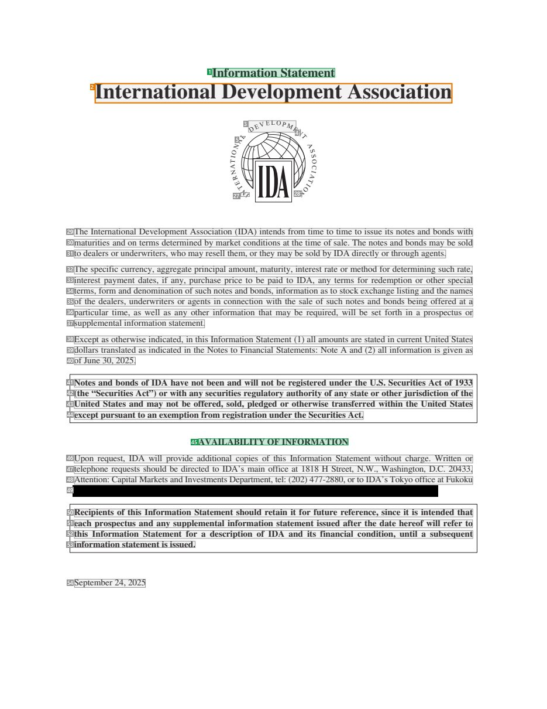
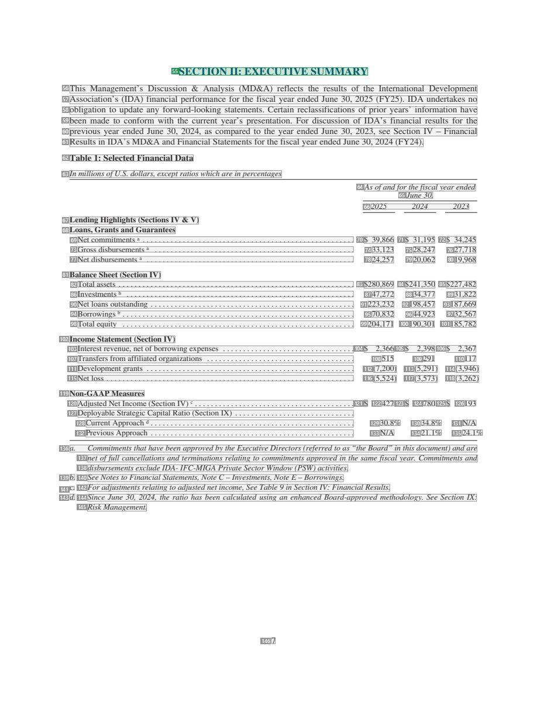
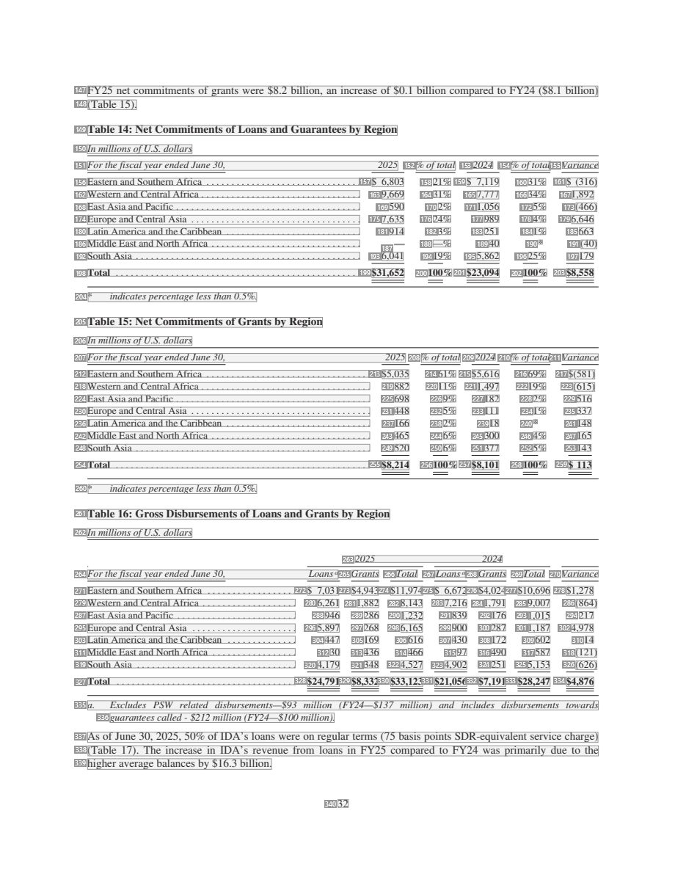
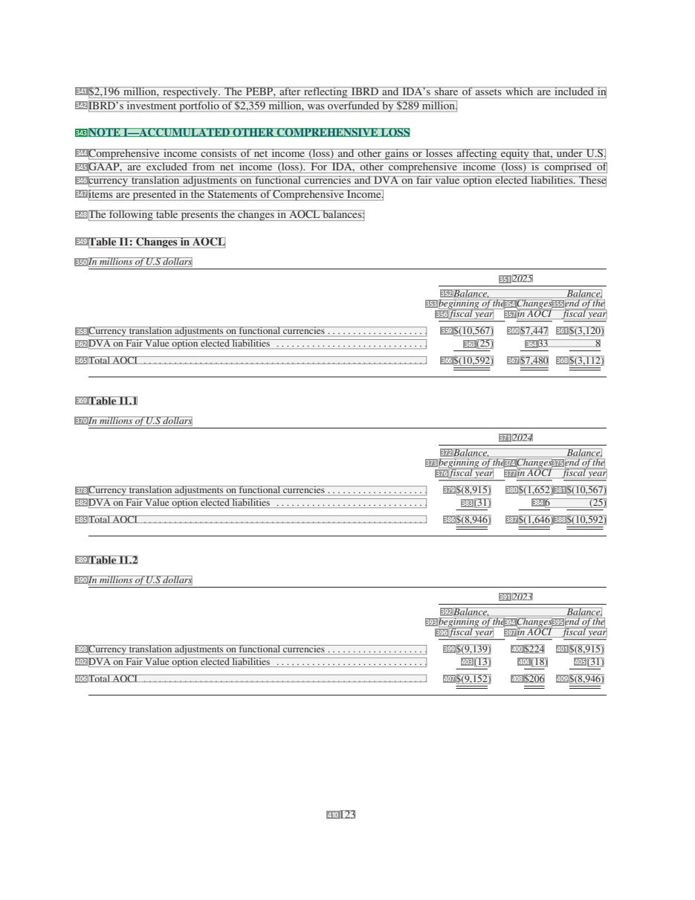

# 053 — `todo10_8/heading_corpus_100/03_tai_chinh_ke_toan/053_IDA_Information_Statement_FY25.pdf`

Draft `P7_F1Q_HELDOUT_GOLD_DRAFT_V2`, status `DRAFT_REVIEWER_A_NOT_APPROVED`, draft sha256 `58a11b4be26ac95a2a054643cab3b5a5a042d908052f501fb90ebd3770c04902`. Source sha256 `6d3cd46d6297031fd3fd4c2afd066f8d947f18d55ef1418a185e5ef9e0a344da`. [Back to index](README.md)

Approve or correct with `review-apply` lines: `APPROVE 053 by <reviewer> [because <note>]`, `053 <alias> -> E|R|O because <reason>`.

## Page 1 (FIRST)

| # | alias | text | font | draft | flag | rationale |
|---:|---|---|---|---|---|---|
| 1 | L0000:S0 | Information Statement | 14 B | **ESTABLISHES** |  | Document title &quot;Information Statement&quot; (14pt bold, cover) |
| 2 | L0001:S0 | International Development Association | 24 B | **OTHER** | REVIEW_FOCUS | Issuer name &quot;International Development Association&quot; (24pt bold on the cover; 044/049 decision: issuer OTHER - confirm here, where … |
| 3 | L0002:S0 | DEVEL O P M E | 7.3 | **OTHER** |  | Default: body text, list item, table cell, page number or other non-heading content on this page |
| 4 | L0002:S1 | N | 7.3 | **OTHER** |  | Default: body text, list item, table cell, page number or other non-heading content on this page |
| 5 | L0003:S0 | L | 7.3 | **OTHER** |  | Default: body text, list item, table cell, page number or other non-heading content on this page |
| 6 | L0003:S1 | T | 7.3 | **OTHER** |  | Default: body text, list item, table cell, page number or other non-heading content on this page |
| 7 | L0004:S0 | A | 7.3 | **OTHER** |  | Default: body text, list item, table cell, page number or other non-heading content on this page |
| 8 | L0005:S0 | A | 7.3 | **OTHER** |  | Default: body text, list item, table cell, page number or other non-heading content on this page |
| 9 | L0006:S0 | N | 7.3 | **OTHER** |  | Default: body text, list item, table cell, page number or other non-heading content on this page |
| 10 | L0007:S0 | S | 7.3 | **OTHER** |  | Default: body text, list item, table cell, page number or other non-heading content on this page |
| 11 | L0008:S0 | O | 7.3 | **OTHER** |  | Default: body text, list item, table cell, page number or other non-heading content on this page |
| 12 | L0009:S0 | S | 7.3 | **OTHER** |  | Default: body text, list item, table cell, page number or other non-heading content on this page |
| 13 | L0010:S0 | I | 7.3 | **OTHER** |  | Default: body text, list item, table cell, page number or other non-heading content on this page |
| 14 | L0011:S0 | O | 7.3 | **OTHER** |  | Default: body text, list item, table cell, page number or other non-heading content on this page |
| 15 | L0012:S0 | T | 7.3 | **OTHER** |  | Default: body text, list item, table cell, page number or other non-heading content on this page |
| 16 | L0013:S0 | C | 7.3 | **OTHER** |  | Default: body text, list item, table cell, page number or other non-heading content on this page |
| 17 | L0014:S0 | A | 7.3 | **OTHER** |  | Default: body text, list item, table cell, page number or other non-heading content on this page |
| 18 | L0015:S0 | I | 7.3 | **OTHER** |  | Default: body text, list item, table cell, page number or other non-heading content on this page |
| 19 | L0016:S0 | N | 7.3 | **OTHER** |  | Default: body text, list item, table cell, page number or other non-heading content on this page |
| 20 | L0017:S0 | A | 7.3 | **OTHER** |  | Default: body text, list item, table cell, page number or other non-heading content on this page |
| 21 | L0018:S0 | R | 7.3 | **OTHER** |  | Default: body text, list item, table cell, page number or other non-heading content on this page |
| 22 | L0019:S0 | T | 7.3 | **OTHER** |  | Default: body text, list item, table cell, page number or other non-heading content on this page |
| 23 | L0020:S0 | E | 7.3 | **OTHER** |  | Default: body text, list item, table cell, page number or other non-heading content on this page |
| 24 | L0021:S0 | I | 7.3 | **OTHER** |  | Default: body text, list item, table cell, page number or other non-heading content on this page |
| 25 | L0022:S0 | T | 7.3 | **OTHER** |  | Default: body text, list item, table cell, page number or other non-heading content on this page |
| 26 | L0022:S1 | O | 7.3 | **OTHER** |  | Default: body text, list item, table cell, page number or other non-heading content on this page |
| 27 | L0023:S0 | NI | 7.3 | **OTHER** |  | Default: body text, list item, table cell, page number or other non-heading content on this page |
| 28 | L0023:S1 | N | 7.3 | **OTHER** |  | Default: body text, list item, table cell, page number or other non-heading content on this page |
| 29 | L0024:S0 | The International Development Association (IDA) intends from time to time to issue its notes and bonds with | 10 | **OTHER** |  | Default: body text, list item, table cell, page number or other non-heading content on this page |
| 30 | L0025:S0 | maturities and on terms determined by market conditions at the time of sale. The notes and bonds may be sold | 10 | **OTHER** |  | Default: body text, list item, table cell, page number or other non-heading content on this page |
| 31 | L0026:S0 | to dealers or underwriters, who may resell them, or they may be sold by IDA directly or through agents. | 10 | **OTHER** |  | Default: body text, list item, table cell, page number or other non-heading content on this page |
| 32 | L0027:S0 | The specific currency, aggregate principal amount, maturity, interest rate or method for determining such rate, | 10 | **OTHER** |  | Default: body text, list item, table cell, page number or other non-heading content on this page |
| 33 | L0028:S0 | interest payment dates, if any, purchase price to be paid to IDA, any terms for redemption or other special | 10 | **OTHER** |  | Default: body text, list item, table cell, page number or other non-heading content on this page |
| 34 | L0029:S0 | terms, form and denomination of such notes and bonds, information as to stock exchange listing and the names | 10 | **OTHER** |  | Default: body text, list item, table cell, page number or other non-heading content on this page |
| 35 | L0030:S0 | of the dealers, underwriters or agents in connection with the sale of such notes and bonds being offered at a | 10 | **OTHER** |  | Default: body text, list item, table cell, page number or other non-heading content on this page |
| 36 | L0031:S0 | particular time, as well as any other information that may be required, will be set forth in a prospectus or | 10 | **OTHER** |  | Default: body text, list item, table cell, page number or other non-heading content on this page |
| 37 | L0032:S0 | supplemental information statement. | 10 | **OTHER** |  | Default: body text, list item, table cell, page number or other non-heading content on this page |
| 38 | L0033:S0 | Except as otherwise indicated, in this Information Statement (1) all amounts are stated in current United States | 10 | **OTHER** |  | Default: body text, list item, table cell, page number or other non-heading content on this page |
| 39 | L0034:S0 | dollars translated as indicated in the Notes to Financial Statements: Note A and (2) all information is given as | 10 | **OTHER** |  | Default: body text, list item, table cell, page number or other non-heading content on this page |
| 40 | L0035:S0 | of June 30, 2025. | 10 | **OTHER** |  | Default: body text, list item, table cell, page number or other non-heading content on this page |
| 41 | L0036:S0 | Notes and bonds of IDA have not been and will not be registered under the U.S. Securities Act of 1933 | 10 B | **OTHER** |  | Bold legal notice paragraph (body text) |
| 42 | L0037:S0 | (the “Securities Act”) or with any securities regulatory authority of any state or other jurisdiction of the | 10 B | **OTHER** |  | Bold legal notice paragraph (continuation) |
| 43 | L0038:S0 | United States and may not be offered, sold, pledged or otherwise transferred within the United States | 10 B | **OTHER** |  | Bold legal notice paragraph (continuation) |
| 44 | L0039:S0 | except pursuant to an exemption from registration under the Securities Act. | 10 B | **OTHER** |  | Bold legal notice paragraph (continuation) |
| 45 | L0040:S0 | AVAILABILITY OF INFORMATION | 10 B | **ESTABLISHES** |  | Section heading &quot;AVAILABILITY OF INFORMATION&quot; (bold caps, own line) |
| 46 | L0041:S0 | Upon request, IDA will provide additional copies of this Information Statement without charge. Written or | 10 | **OTHER** |  | Default: body text, list item, table cell, page number or other non-heading content on this page |
| 47 | L0042:S0 | telephone requests should be directed to IDA’s main office at 1818 H Street, N.W., Washington, D.C. 20433, | 10 | **OTHER** |  | Default: body text, list item, table cell, page number or other non-heading content on this page |
| 48 | L0043:S0 | Attention: Capital Markets and Investments Department, tel: (202) 477-2880, or to IDA’s Tokyo office at Fukoku | 10 | **OTHER** |  | Contact details with telephone number (business) |
| 49 | L0044:S0 | Seimei Building 14F, 2-2-2 Uchisaiwai-cho, Chiyoda-ku, Tokyo 100-001 1, Japan, tel: [REDACTED_PHONE]. | 10 | **OTHER** |  | Contact details with telephone number (business) |
| 50 | L0045:S0 | Recipients of this Information Statement should retain it for future reference, since it is intended that | 10 B | **OTHER** |  | Bold notice paragraph (body text) |
| 51 | L0046:S0 | each prospectus and any supplemental information statement issued after the date hereof will refer to | 10 B | **OTHER** |  | Default: body text, list item, table cell, page number or other non-heading content on this page |
| 52 | L0047:S0 | this Information Statement for a description of IDA and its financial condition, until a subsequent | 10 B | **OTHER** |  | Default: body text, list item, table cell, page number or other non-heading content on this page |
| 53 | L0048:S0 | information statement is issued. | 10 B | **OTHER** |  | Default: body text, list item, table cell, page number or other non-heading content on this page |
| 54 | L0049:S0 | September 24, 2025 | 10 | **OTHER** |  | Issue date &quot;September 24, 2025&quot; |

**OTHER rows to check for a missed heading on page 1** (body size 7.5pt; bold or ≥ body+1pt, ≤ 12 words): #2 `L0001:S0` International Development Association (24 B), #37 `L0032:S0` supplemental information statement. (10), #40 `L0035:S0` of June 30, 2025. (10), #44 `L0039:S0` except pursuant to an exemption from registration under the … (10 B), #49 `L0044:S0` Seimei Building 14F, 2-2-2 Uchisaiwai-cho, Chiyoda-ku, Tokyo… (10), #53 `L0048:S0` information statement is issued. (10 B), #54 `L0049:S0` September 24, 2025 (10).

## Page 7 (TARGETED_STRUCTURE)

| # | alias | text | font | draft | flag | rationale |
|---:|---|---|---|---|---|---|
| 55 | L0248:S0 | SECTION II: EXECUTIVE SUMMARY | 12 B | **ESTABLISHES** |  | Section heading &quot;SECTION II: EXECUTIVE SUMMARY&quot; (12pt bold) |
| 56 | L0249:S0 | This Management’s Discussion &amp; Analysis (MD&amp;A) reflects the results of the International Development | 10 | **OTHER** |  | Default: body text, list item, table cell, page number or other non-heading content on this page |
| 57 | L0250:S0 | Association’s (IDA) financial performance for the fiscal year ended June 30, 2025 (FY25). IDA undertakes no | 10 | **OTHER** |  | Default: body text, list item, table cell, page number or other non-heading content on this page |
| 58 | L0251:S0 | obligation to update any forward-looking statements. Certain reclassifications of prior years’ information have | 10 | **OTHER** |  | Default: body text, list item, table cell, page number or other non-heading content on this page |
| 59 | L0252:S0 | been made to conform with the current year’s presentation. For discussion of IDA’s financial results for the | 10 | **OTHER** |  | Default: body text, list item, table cell, page number or other non-heading content on this page |
| 60 | L0253:S0 | previous year ended June 30, 2024, as compared to the year ended June 30, 2023, see Section IV – Financial | 10 | **OTHER** |  | Default: body text, list item, table cell, page number or other non-heading content on this page |
| 61 | L0254:S0 | Results in IDA’s MD&amp;A and Financial Statements for the fiscal year ended June 30, 2024 (FY24). | 10 | **OTHER** |  | Default: body text, list item, table cell, page number or other non-heading content on this page |
| 62 | L0255:S0 | Table 1: Selected Financial Data | 10 B | **OTHER** |  | Table caption &quot;Table 1: Selected Financial Data&quot; |
| 63 | L0256:S0 | In millions ofU.S. dollars, except ratios which are in percentages | 9 I | **OTHER** |  | Default: body text, list item, table cell, page number or other non-heading content on this page |
| 64 | L0257:S0 | As ofandfor thefiscal year ended | 9 I | **OTHER** |  | Default: body text, list item, table cell, page number or other non-heading content on this page |
| 65 | L0258:S0 | June 30, | 9 I | **OTHER** |  | Default: body text, list item, table cell, page number or other non-heading content on this page |
| 66 | L0259:S0 | 2025 2024 2023 | 9 I | **OTHER** |  | Default: body text, list item, table cell, page number or other non-heading content on this page |
| 67 | L0260:S0 | Lending Highlights (Sections IV &amp; V) | 9 B | **OTHER** |  | Table group label &quot;Lending Highlights (Sections IV &amp; V)&quot; (bold, inside the table) |
| 68 | L0261:S0 | Loans, Grants and Guarantees | 9 B | **OTHER** |  | Table group label &quot;Loans, Grants and Guarantees&quot; |
| 69 | L0262:S0 | Net commitments a . . . . . . . . . . . . . . . . . . . . . . . . . . . . . . . . . . . . . . . . . . . . . . . . . . . … | 9 | **OTHER** |  | Default: body text, list item, table cell, page number or other non-heading content on this page |
| 70 | L0262:S1 | $ 39,866 | 9 | **OTHER** |  | Default: body text, list item, table cell, page number or other non-heading content on this page |
| 71 | L0262:S2 | $ 31,195 | 9 | **OTHER** |  | Default: body text, list item, table cell, page number or other non-heading content on this page |
| 72 | L0262:S3 | $ 34,245 | 9 | **OTHER** |  | Default: body text, list item, table cell, page number or other non-heading content on this page |
| 73 | L0263:S0 | Gross disbursements a . . . . . . . . . . . . . . . . . . . . . . . . . . . . . . . . . . . . . . . . . . . . . . . . . … | 9 | **OTHER** |  | Default: body text, list item, table cell, page number or other non-heading content on this page |
| 74 | L0263:S1 | 33,123 | 9 | **OTHER** |  | Default: body text, list item, table cell, page number or other non-heading content on this page |
| 75 | L0263:S2 | 28,247 | 9 | **OTHER** |  | Default: body text, list item, table cell, page number or other non-heading content on this page |
| 76 | L0263:S3 | 27,718 | 9 | **OTHER** |  | Default: body text, list item, table cell, page number or other non-heading content on this page |
| 77 | L0264:S0 | Net disbursements a . . . . . . . . . . . . . . . . . . . . . . . . . . . . . . . . . . . . . . . . . . . . . . . . . . … | 9 | **OTHER** |  | Default: body text, list item, table cell, page number or other non-heading content on this page |
| 78 | L0264:S1 | 24,257 | 9 | **OTHER** |  | Default: body text, list item, table cell, page number or other non-heading content on this page |
| 79 | L0264:S2 | 20,062 | 9 | **OTHER** |  | Default: body text, list item, table cell, page number or other non-heading content on this page |
| 80 | L0264:S3 | 19,968 | 9 | **OTHER** |  | Default: body text, list item, table cell, page number or other non-heading content on this page |
| 81 | L0265:S0 | Balance Sheet (Section IV) | 9 B | **OTHER** |  | Table group label &quot;Balance Sheet (Section IV)&quot; |
| 82 | L0266:S0 | Total assets . . . . . . . . . . . . . . . . . . . . . . . . . . . . . . . . . . . . . . . . . . . . . . . . . . . . . .… | 9 | **OTHER** |  | Default: body text, list item, table cell, page number or other non-heading content on this page |
| 83 | L0266:S1 | $280,869 | 9 | **OTHER** |  | Default: body text, list item, table cell, page number or other non-heading content on this page |
| 84 | L0266:S2 | $241,350 | 9 | **OTHER** |  | Default: body text, list item, table cell, page number or other non-heading content on this page |
| 85 | L0266:S3 | $227,482 | 9 | **OTHER** |  | Default: body text, list item, table cell, page number or other non-heading content on this page |
| 86 | L0267:S0 | Investments b . . . . . . . . . . . . . . . . . . . . . . . . . . . . . . . . . . . . . . . . . . . . . . . . . . . . . … | 9 | **OTHER** |  | Default: body text, list item, table cell, page number or other non-heading content on this page |
| 87 | L0267:S1 | 47,272 | 9 | **OTHER** |  | Default: body text, list item, table cell, page number or other non-heading content on this page |
| 88 | L0267:S2 | 34,377 | 9 | **OTHER** |  | Default: body text, list item, table cell, page number or other non-heading content on this page |
| 89 | L0267:S3 | 31,822 | 9 | **OTHER** |  | Default: body text, list item, table cell, page number or other non-heading content on this page |
| 90 | L0268:S0 | Net loans outstanding . . . . . . . . . . . . . . . . . . . . . . . . . . . . . . . . . . . . . . . . . . . . . . . . . … | 9 | **OTHER** |  | Default: body text, list item, table cell, page number or other non-heading content on this page |
| 91 | L0268:S1 | 223,232 | 9 | **OTHER** |  | Default: body text, list item, table cell, page number or other non-heading content on this page |
| 92 | L0268:S2 | 198,457 | 9 | **OTHER** |  | Default: body text, list item, table cell, page number or other non-heading content on this page |
| 93 | L0268:S3 | 187,669 | 9 | **OTHER** |  | Default: body text, list item, table cell, page number or other non-heading content on this page |
| 94 | L0269:S0 | Borrowings b . . . . . . . . . . . . . . . . . . . . . . . . . . . . . . . . . . . . . . . . . . . . . . . . . . . . . .… | 9 | **OTHER** |  | Default: body text, list item, table cell, page number or other non-heading content on this page |
| 95 | L0269:S1 | 70,832 | 9 | **OTHER** |  | Default: body text, list item, table cell, page number or other non-heading content on this page |
| 96 | L0269:S2 | 44,923 | 9 | **OTHER** |  | Default: body text, list item, table cell, page number or other non-heading content on this page |
| 97 | L0269:S3 | 32,567 | 9 | **OTHER** |  | Default: body text, list item, table cell, page number or other non-heading content on this page |
| 98 | L0270:S0 | Total equity . . . . . . . . . . . . . . . . . . . . . . . . . . . . . . . . . . . . . . . . . . . . . . . . . . . . . .… | 9 | **OTHER** |  | Default: body text, list item, table cell, page number or other non-heading content on this page |
| 99 | L0270:S1 | 204,171 | 9 | **OTHER** |  | Default: body text, list item, table cell, page number or other non-heading content on this page |
| 100 | L0270:S2 | 190,301 | 9 | **OTHER** |  | Default: body text, list item, table cell, page number or other non-heading content on this page |
| 101 | L0270:S3 | 185,782 | 9 | **OTHER** |  | Default: body text, list item, table cell, page number or other non-heading content on this page |
| 102 | L0271:S0 | Income Statement (Section IV) | 9 B | **OTHER** |  | Table group label &quot;Income Statement (Section IV)&quot; |
| 103 | L0272:S0 | Interest revenue, net of borrowing expenses . . . . . . . . . . . . . . . . . . . . . . . . . . . . . . . . . | 9 | **OTHER** |  | Default: body text, list item, table cell, page number or other non-heading content on this page |
| 104 | L0272:S1 | $ 2,366 | 9 | **OTHER** |  | Default: body text, list item, table cell, page number or other non-heading content on this page |
| 105 | L0272:S2 | $ 2,398 | 9 | **OTHER** |  | Default: body text, list item, table cell, page number or other non-heading content on this page |
| 106 | L0272:S3 | $ 2,367 | 9 | **OTHER** |  | Default: body text, list item, table cell, page number or other non-heading content on this page |
| 107 | L0273:S0 | Transfers from affiliated organizations . . . . . . . . . . . . . . . . . . . . . . . . . . . . . . . . . . . . . | 9 | **OTHER** |  | Default: body text, list item, table cell, page number or other non-heading content on this page |
| 108 | L0273:S1 | 515 | 9 | **OTHER** |  | Default: body text, list item, table cell, page number or other non-heading content on this page |
| 109 | L0273:S2 | 291 | 9 | **OTHER** |  | Default: body text, list item, table cell, page number or other non-heading content on this page |
| 110 | L0273:S3 | 1 17 | 9 | **OTHER** |  | Default: body text, list item, table cell, page number or other non-heading content on this page |
| 111 | L0274:S0 | Development grants . . . . . . . . . . . . . . . . . . . . . . . . . . . . . . . . . . . . . . . . . . . . . . . . . . .… | 9 | **OTHER** |  | Default: body text, list item, table cell, page number or other non-heading content on this page |
| 112 | L0274:S1 | (7,200) | 9 | **OTHER** |  | Default: body text, list item, table cell, page number or other non-heading content on this page |
| 113 | L0274:S2 | (5,291) | 9 | **OTHER** |  | Default: body text, list item, table cell, page number or other non-heading content on this page |
| 114 | L0274:S3 | (3,946) | 9 | **OTHER** |  | Default: body text, list item, table cell, page number or other non-heading content on this page |
| 115 | L0275:S0 | Net loss . . . . . . . . . . . . . . . . . . . . . . . . . . . . . . . . . . . . . . . . . . . . . . . . . . . . . . . .… | 9 | **OTHER** |  | Default: body text, list item, table cell, page number or other non-heading content on this page |
| 116 | L0275:S1 | (5,524) | 9 | **OTHER** |  | Default: body text, list item, table cell, page number or other non-heading content on this page |
| 117 | L0275:S2 | (3,573) | 9 | **OTHER** |  | Default: body text, list item, table cell, page number or other non-heading content on this page |
| 118 | L0275:S3 | (3,262) | 9 | **OTHER** |  | Default: body text, list item, table cell, page number or other non-heading content on this page |
| 119 | L0276:S0 | Non-GAAP Measures | 9 B | **OTHER** |  | Table group label &quot;Non-GAAP Measures&quot; |
| 120 | L0277:S0 | Adjusted Net Income (Section IV) c . . . . . . . . . . . . . . . . . . . . . . . . . . . . . . . . . . . . . . . . | 9 | **OTHER** |  | Default: body text, list item, table cell, page number or other non-heading content on this page |
| 121 | L0277:S1 | $ | 9 | **OTHER** |  | Default: body text, list item, table cell, page number or other non-heading content on this page |
| 122 | L0277:S2 | 427 | 9 | **OTHER** |  | Default: body text, list item, table cell, page number or other non-heading content on this page |
| 123 | L0277:S3 | $ | 9 | **OTHER** |  | Default: body text, list item, table cell, page number or other non-heading content on this page |
| 124 | L0277:S4 | 780 | 9 | **OTHER** |  | Default: body text, list item, table cell, page number or other non-heading content on this page |
| 125 | L0277:S5 | $ | 9 | **OTHER** |  | Default: body text, list item, table cell, page number or other non-heading content on this page |
| 126 | L0277:S6 | 193 | 9 | **OTHER** |  | Default: body text, list item, table cell, page number or other non-heading content on this page |
| 127 | L0278:S0 | Deployable Strategic Capital Ratio (Section IX) . . . . . . . . . . . . . . . . . . . . . . . . . . . . . . | 9 | **OTHER** |  | Default: body text, list item, table cell, page number or other non-heading content on this page |
| 128 | L0279:S0 | Current Approach d . . . . . . . . . . . . . . . . . . . . . . . . . . . . . . . . . . . . . . . . . . . . . . . . . . . | 9 | **OTHER** |  | Default: body text, list item, table cell, page number or other non-heading content on this page |
| 129 | L0279:S1 | 30.8% | 9 | **OTHER** |  | Default: body text, list item, table cell, page number or other non-heading content on this page |
| 130 | L0279:S2 | 34.8% | 9 | **OTHER** |  | Default: body text, list item, table cell, page number or other non-heading content on this page |
| 131 | L0279:S3 | N/A | 9 | **OTHER** |  | Default: body text, list item, table cell, page number or other non-heading content on this page |
| 132 | L0280:S0 | Previous Approach . . . . . . . . . . . . . . . . . . . . . . . . . . . . . . . . . . . . . . . . . . . . . . . . . . . | 9 | **OTHER** |  | Default: body text, list item, table cell, page number or other non-heading content on this page |
| 133 | L0280:S1 | N/A | 9 | **OTHER** |  | Default: body text, list item, table cell, page number or other non-heading content on this page |
| 134 | L0280:S2 | 21.1% | 9 | **OTHER** |  | Default: body text, list item, table cell, page number or other non-heading content on this page |
| 135 | L0280:S3 | 24.1% | 9 | **OTHER** |  | Default: body text, list item, table cell, page number or other non-heading content on this page |
| 136 | L0281:S0 | a. Commitments that have been approved by the Executive Directors (referred to as “the Board” in this document) and are | 9 I | **OTHER** |  | Default: body text, list item, table cell, page number or other non-heading content on this page |
| 137 | L0282:S0 | net offull cancellations and terminations relating to commitments approved in the samefiscal year. Commitments and | 9 I | **OTHER** |  | Default: body text, list item, table cell, page number or other non-heading content on this page |
| 138 | L0283:S0 | disbursements exclude IDA- IFC-MIGA Private Sector Window (PSW) activities. | 9 I | **OTHER** |  | Default: body text, list item, table cell, page number or other non-heading content on this page |
| 139 | L0284:S0 | b. | 9 I | **OTHER** |  | Default: body text, list item, table cell, page number or other non-heading content on this page |
| 140 | L0284:S1 | See Notes to Financial Statements, Note C – Investments, Note E – Borrowings. | 9 I | **OTHER** |  | Default: body text, list item, table cell, page number or other non-heading content on this page |
| 141 | L0285:S0 | c. | 9 I | **OTHER** |  | Default: body text, list item, table cell, page number or other non-heading content on this page |
| 142 | L0285:S1 | For adjustments relating to adjusted net income, See Table 9 in Section IV: Financial Results. | 9 I | **OTHER** |  | Default: body text, list item, table cell, page number or other non-heading content on this page |
| 143 | L0286:S0 | d. | 9 I | **OTHER** |  | Default: body text, list item, table cell, page number or other non-heading content on this page |
| 144 | L0286:S1 | Since June 30, 2024, the ratio has been calculated using an enhanced Board-approved methodology. See Section IX: | 9 I | **OTHER** |  | Default: body text, list item, table cell, page number or other non-heading content on this page |
| 145 | L0287:S0 | Risk Management. | 9 I | **OTHER** |  | Default: body text, list item, table cell, page number or other non-heading content on this page |
| 146 | L0288:S0 | 7 | 10 | **OTHER** |  | Default: body text, list item, table cell, page number or other non-heading content on this page |

**OTHER rows to check for a missed heading on page 7** (body size 9pt; bold or ≥ body+1pt, ≤ 12 words): #62 `L0255:S0` Table 1: Selected Financial Data (10 B), #67 `L0260:S0` Lending Highlights (Sections IV &amp; V) (9 B), #68 `L0261:S0` Loans, Grants and Guarantees (9 B), #81 `L0265:S0` Balance Sheet (Section IV) (9 B), #102 `L0271:S0` Income Statement (Section IV) (9 B), #119 `L0276:S0` Non-GAAP Measures (9 B), #146 `L0288:S0` 7 (10).

## Page 32 (SEEDED_INTERIOR)

| # | alias | text | font | draft | flag | rationale |
|---:|---|---|---|---|---|---|
| 147 | L1275:S0 | FY25 net commitments of grants were $8.2 billion, an increase of $0. 1 billion compared to FY24 ($8. 1 billion) | 10 | **OTHER** |  | Default: body text, list item, table cell, page number or other non-heading content on this page |
| 148 | L1276:S0 | (Table 15). | 10 | **OTHER** |  | Default: body text, list item, table cell, page number or other non-heading content on this page |
| 149 | L1277:S0 | Table 14: Net Commitments of Loans and Guarantees by Region | 10 B | **OTHER** |  | Table caption &quot;Table 14: ...&quot; |
| 150 | L1278:S0 | In millions ofU.S. dollars | 9 I | **OTHER** |  | Default: body text, list item, table cell, page number or other non-heading content on this page |
| 151 | L1279:S0 | For thefiscal year ended June 30, 2025 | 9 I | **OTHER** |  | Default: body text, list item, table cell, page number or other non-heading content on this page |
| 152 | L1279:S1 | % oftotal | 9 I | **OTHER** |  | Default: body text, list item, table cell, page number or other non-heading content on this page |
| 153 | L1279:S2 | 2024 | 9 I | **OTHER** |  | Default: body text, list item, table cell, page number or other non-heading content on this page |
| 154 | L1279:S3 | % oftotal | 9 I | **OTHER** |  | Default: body text, list item, table cell, page number or other non-heading content on this page |
| 155 | L1279:S4 | Variance | 9 I | **OTHER** |  | Default: body text, list item, table cell, page number or other non-heading content on this page |
| 156 | L1280:S0 | Eastern and Southern Africa . . . . . . . . . . . . . . . . . . . . . . . . . . . . . . . | 9 | **OTHER** |  | Default: body text, list item, table cell, page number or other non-heading content on this page |
| 157 | L1280:S1 | $ 6,803 | 9 | **OTHER** |  | Default: body text, list item, table cell, page number or other non-heading content on this page |
| 158 | L1280:S2 | 21% | 9 | **OTHER** |  | Default: body text, list item, table cell, page number or other non-heading content on this page |
| 159 | L1280:S3 | $ 7,1 19 | 9 | **OTHER** |  | Default: body text, list item, table cell, page number or other non-heading content on this page |
| 160 | L1280:S4 | 31% | 9 | **OTHER** |  | Default: body text, list item, table cell, page number or other non-heading content on this page |
| 161 | L1280:S5 | $ (316) | 9 | **OTHER** |  | Default: body text, list item, table cell, page number or other non-heading content on this page |
| 162 | L1281:S0 | Western and Central Africa . . . . . . . . . . . . . . . . . . . . . . . . . . . . . . . . | 9 | **OTHER** |  | Default: body text, list item, table cell, page number or other non-heading content on this page |
| 163 | L1281:S1 | 9,669 | 9 | **OTHER** |  | Default: body text, list item, table cell, page number or other non-heading content on this page |
| 164 | L1281:S2 | 31% | 9 | **OTHER** |  | Default: body text, list item, table cell, page number or other non-heading content on this page |
| 165 | L1281:S3 | 7,777 | 9 | **OTHER** |  | Default: body text, list item, table cell, page number or other non-heading content on this page |
| 166 | L1281:S4 | 34% | 9 | **OTHER** |  | Default: body text, list item, table cell, page number or other non-heading content on this page |
| 167 | L1281:S5 | 1,892 | 9 | **OTHER** |  | Default: body text, list item, table cell, page number or other non-heading content on this page |
| 168 | L1282:S0 | East Asia and Pacific . . . . . . . . . . . . . . . . . . . . . . . . . . . . . . . . . . . . . | 9 | **OTHER** |  | Default: body text, list item, table cell, page number or other non-heading content on this page |
| 169 | L1282:S1 | 590 | 9 | **OTHER** |  | Default: body text, list item, table cell, page number or other non-heading content on this page |
| 170 | L1282:S2 | 2% | 9 | **OTHER** |  | Default: body text, list item, table cell, page number or other non-heading content on this page |
| 171 | L1282:S3 | 1,056 | 9 | **OTHER** |  | Default: body text, list item, table cell, page number or other non-heading content on this page |
| 172 | L1282:S4 | 5% | 9 | **OTHER** |  | Default: body text, list item, table cell, page number or other non-heading content on this page |
| 173 | L1282:S5 | (466) | 9 | **OTHER** |  | Default: body text, list item, table cell, page number or other non-heading content on this page |
| 174 | L1283:S0 | Europe and Central Asia . . . . . . . . . . . . . . . . . . . . . . . . . . . . . . . . . . | 9 | **OTHER** |  | Default: body text, list item, table cell, page number or other non-heading content on this page |
| 175 | L1283:S1 | 7,635 | 9 | **OTHER** |  | Default: body text, list item, table cell, page number or other non-heading content on this page |
| 176 | L1283:S2 | 24% | 9 | **OTHER** |  | Default: body text, list item, table cell, page number or other non-heading content on this page |
| 177 | L1283:S3 | 989 | 9 | **OTHER** |  | Default: body text, list item, table cell, page number or other non-heading content on this page |
| 178 | L1283:S4 | 4% | 9 | **OTHER** |  | Default: body text, list item, table cell, page number or other non-heading content on this page |
| 179 | L1283:S5 | 6,646 | 9 | **OTHER** |  | Default: body text, list item, table cell, page number or other non-heading content on this page |
| 180 | L1284:S0 | Latin America and the Caribbean . . . . . . . . . . . . . . . . . . . . . . . . . . . | 9 | **OTHER** |  | Default: body text, list item, table cell, page number or other non-heading content on this page |
| 181 | L1284:S1 | 914 | 9 | **OTHER** |  | Default: body text, list item, table cell, page number or other non-heading content on this page |
| 182 | L1284:S2 | 3% | 9 | **OTHER** |  | Default: body text, list item, table cell, page number or other non-heading content on this page |
| 183 | L1284:S3 | 251 | 9 | **OTHER** |  | Default: body text, list item, table cell, page number or other non-heading content on this page |
| 184 | L1284:S4 | 1% | 9 | **OTHER** |  | Default: body text, list item, table cell, page number or other non-heading content on this page |
| 185 | L1284:S5 | 663 | 9 | **OTHER** |  | Default: body text, list item, table cell, page number or other non-heading content on this page |
| 186 | L1285:S0 | Middle East and North Africa . . . . . . . . . . . . . . . . . . . . . . . . . . . . . . | 9 | **OTHER** |  | Default: body text, list item, table cell, page number or other non-heading content on this page |
| 187 | L1285:S1 | — | 9 | **OTHER** |  | Default: body text, list item, table cell, page number or other non-heading content on this page |
| 188 | L1285:S2 | —% | 9 | **OTHER** |  | Default: body text, list item, table cell, page number or other non-heading content on this page |
| 189 | L1285:S3 | 40 | 9 | **OTHER** |  | Default: body text, list item, table cell, page number or other non-heading content on this page |
| 190 | L1285:S4 | * | 9 | **OTHER** |  | Default: body text, list item, table cell, page number or other non-heading content on this page |
| 191 | L1285:S5 | (40) | 9 | **OTHER** |  | Default: body text, list item, table cell, page number or other non-heading content on this page |
| 192 | L1286:S0 | South Asia . . . . . . . . . . . . . . . . . . . . . . . . . . . . . . . . . . . . . . . . . . . . . | 9 | **OTHER** |  | Default: body text, list item, table cell, page number or other non-heading content on this page |
| 193 | L1286:S1 | 6,041 | 9 | **OTHER** |  | Default: body text, list item, table cell, page number or other non-heading content on this page |
| 194 | L1286:S2 | 19% | 9 | **OTHER** |  | Default: body text, list item, table cell, page number or other non-heading content on this page |
| 195 | L1286:S3 | 5,862 | 9 | **OTHER** |  | Default: body text, list item, table cell, page number or other non-heading content on this page |
| 196 | L1286:S4 | 25% | 9 | **OTHER** |  | Default: body text, list item, table cell, page number or other non-heading content on this page |
| 197 | L1286:S5 | 179 | 9 | **OTHER** |  | Default: body text, list item, table cell, page number or other non-heading content on this page |
| 198 | L1287:S0 | Total . . . . . . . . . . . . . . . . . . . . . . . . . . . . . . . . . . . . . . . . . . . . . . . . . | 9 | **OTHER** |  | Default: body text, list item, table cell, page number or other non-heading content on this page |
| 199 | L1287:S1 | $31,652 | 9 B | **OTHER** |  | Default: body text, list item, table cell, page number or other non-heading content on this page |
| 200 | L1287:S2 | 100% | 9 B | **OTHER** |  | Default: body text, list item, table cell, page number or other non-heading content on this page |
| 201 | L1287:S3 | $23,094 | 9 B | **OTHER** |  | Default: body text, list item, table cell, page number or other non-heading content on this page |
| 202 | L1287:S4 | 100% | 9 B | **OTHER** |  | Default: body text, list item, table cell, page number or other non-heading content on this page |
| 203 | L1287:S5 | $8,558 | 9 B | **OTHER** |  | Default: body text, list item, table cell, page number or other non-heading content on this page |
| 204 | L1288:S0 | * indicatespercentage less than 0.5%. | 9 I | **OTHER** |  | Default: body text, list item, table cell, page number or other non-heading content on this page |
| 205 | L1289:S0 | Table 15: Net Commitments of Grants by Region | 10 B | **OTHER** |  | Table caption &quot;Table 15: ...&quot; |
| 206 | L1290:S0 | In millions ofU.S. dollars | 9 I | **OTHER** |  | Default: body text, list item, table cell, page number or other non-heading content on this page |
| 207 | L1291:S0 | For thefiscal year ended June 30, 2025 | 9 I | **OTHER** |  | Default: body text, list item, table cell, page number or other non-heading content on this page |
| 208 | L1291:S1 | % oftotal | 9 I | **OTHER** |  | Default: body text, list item, table cell, page number or other non-heading content on this page |
| 209 | L1291:S2 | 2024 | 9 I | **OTHER** |  | Default: body text, list item, table cell, page number or other non-heading content on this page |
| 210 | L1291:S3 | % oftotal | 9 I | **OTHER** |  | Default: body text, list item, table cell, page number or other non-heading content on this page |
| 211 | L1291:S4 | Variance | 9 I | **OTHER** |  | Default: body text, list item, table cell, page number or other non-heading content on this page |
| 212 | L1292:S0 | Eastern and Southern Africa . . . . . . . . . . . . . . . . . . . . . . . . . . . . . . . . . | 9 | **OTHER** |  | Default: body text, list item, table cell, page number or other non-heading content on this page |
| 213 | L1292:S1 | $5,035 | 9 | **OTHER** |  | Default: body text, list item, table cell, page number or other non-heading content on this page |
| 214 | L1292:S2 | 61% | 9 | **OTHER** |  | Default: body text, list item, table cell, page number or other non-heading content on this page |
| 215 | L1292:S3 | $5,616 | 9 | **OTHER** |  | Default: body text, list item, table cell, page number or other non-heading content on this page |
| 216 | L1292:S4 | 69% | 9 | **OTHER** |  | Default: body text, list item, table cell, page number or other non-heading content on this page |
| 217 | L1292:S5 | $(581) | 9 | **OTHER** |  | Default: body text, list item, table cell, page number or other non-heading content on this page |
| 218 | L1293:S0 | Western and Central Africa . . . . . . . . . . . . . . . . . . . . . . . . . . . . . . . . . . | 9 | **OTHER** |  | Default: body text, list item, table cell, page number or other non-heading content on this page |
| 219 | L1293:S1 | 882 | 9 | **OTHER** |  | Default: body text, list item, table cell, page number or other non-heading content on this page |
| 220 | L1293:S2 | 1 1% | 9 | **OTHER** |  | Default: body text, list item, table cell, page number or other non-heading content on this page |
| 221 | L1293:S3 | 1,497 | 9 | **OTHER** |  | Default: body text, list item, table cell, page number or other non-heading content on this page |
| 222 | L1293:S4 | 19% | 9 | **OTHER** |  | Default: body text, list item, table cell, page number or other non-heading content on this page |
| 223 | L1293:S5 | (615) | 9 | **OTHER** |  | Default: body text, list item, table cell, page number or other non-heading content on this page |
| 224 | L1294:S0 | East Asia and Pacific . . . . . . . . . . . . . . . . . . . . . . . . . . . . . . . . . . . . . . . | 9 | **OTHER** |  | Default: body text, list item, table cell, page number or other non-heading content on this page |
| 225 | L1294:S1 | 698 | 9 | **OTHER** |  | Default: body text, list item, table cell, page number or other non-heading content on this page |
| 226 | L1294:S2 | 9% | 9 | **OTHER** |  | Default: body text, list item, table cell, page number or other non-heading content on this page |
| 227 | L1294:S3 | 182 | 9 | **OTHER** |  | Default: body text, list item, table cell, page number or other non-heading content on this page |
| 228 | L1294:S4 | 2% | 9 | **OTHER** |  | Default: body text, list item, table cell, page number or other non-heading content on this page |
| 229 | L1294:S5 | 516 | 9 | **OTHER** |  | Default: body text, list item, table cell, page number or other non-heading content on this page |
| 230 | L1295:S0 | Europe and Central Asia . . . . . . . . . . . . . . . . . . . . . . . . . . . . . . . . . . . . | 9 | **OTHER** |  | Default: body text, list item, table cell, page number or other non-heading content on this page |
| 231 | L1295:S1 | 448 | 9 | **OTHER** |  | Default: body text, list item, table cell, page number or other non-heading content on this page |
| 232 | L1295:S2 | 5% | 9 | **OTHER** |  | Default: body text, list item, table cell, page number or other non-heading content on this page |
| 233 | L1295:S3 | 1 1 1 | 9 | **OTHER** |  | Default: body text, list item, table cell, page number or other non-heading content on this page |
| 234 | L1295:S4 | 1% | 9 | **OTHER** |  | Default: body text, list item, table cell, page number or other non-heading content on this page |
| 235 | L1295:S5 | 337 | 9 | **OTHER** |  | Default: body text, list item, table cell, page number or other non-heading content on this page |
| 236 | L1296:S0 | Latin America and the Caribbean . . . . . . . . . . . . . . . . . . . . . . . . . . . . . | 9 | **OTHER** |  | Default: body text, list item, table cell, page number or other non-heading content on this page |
| 237 | L1296:S1 | 166 | 9 | **OTHER** |  | Default: body text, list item, table cell, page number or other non-heading content on this page |
| 238 | L1296:S2 | 2% | 9 | **OTHER** |  | Default: body text, list item, table cell, page number or other non-heading content on this page |
| 239 | L1296:S3 | 18 | 9 | **OTHER** |  | Default: body text, list item, table cell, page number or other non-heading content on this page |
| 240 | L1296:S4 | * | 9 | **OTHER** |  | Default: body text, list item, table cell, page number or other non-heading content on this page |
| 241 | L1296:S5 | 148 | 9 | **OTHER** |  | Default: body text, list item, table cell, page number or other non-heading content on this page |
| 242 | L1297:S0 | Middle East and North Africa . . . . . . . . . . . . . . . . . . . . . . . . . . . . . . . . | 9 | **OTHER** |  | Default: body text, list item, table cell, page number or other non-heading content on this page |
| 243 | L1297:S1 | 465 | 9 | **OTHER** |  | Default: body text, list item, table cell, page number or other non-heading content on this page |
| 244 | L1297:S2 | 6% | 9 | **OTHER** |  | Default: body text, list item, table cell, page number or other non-heading content on this page |
| 245 | L1297:S3 | 300 | 9 | **OTHER** |  | Default: body text, list item, table cell, page number or other non-heading content on this page |
| 246 | L1297:S4 | 4% | 9 | **OTHER** |  | Default: body text, list item, table cell, page number or other non-heading content on this page |
| 247 | L1297:S5 | 165 | 9 | **OTHER** |  | Default: body text, list item, table cell, page number or other non-heading content on this page |
| 248 | L1298:S0 | South Asia . . . . . . . . . . . . . . . . . . . . . . . . . . . . . . . . . . . . . . . . . . . . . . . | 9 | **OTHER** |  | Default: body text, list item, table cell, page number or other non-heading content on this page |
| 249 | L1298:S1 | 520 | 9 | **OTHER** |  | Default: body text, list item, table cell, page number or other non-heading content on this page |
| 250 | L1298:S2 | 6% | 9 | **OTHER** |  | Default: body text, list item, table cell, page number or other non-heading content on this page |
| 251 | L1298:S3 | 377 | 9 | **OTHER** |  | Default: body text, list item, table cell, page number or other non-heading content on this page |
| 252 | L1298:S4 | 5% | 9 | **OTHER** |  | Default: body text, list item, table cell, page number or other non-heading content on this page |
| 253 | L1298:S5 | 143 | 9 | **OTHER** |  | Default: body text, list item, table cell, page number or other non-heading content on this page |
| 254 | L1299:S0 | Total . . . . . . . . . . . . . . . . . . . . . . . . . . . . . . . . . . . . . . . . . . . . . . . . . . . | 9 | **OTHER** |  | Default: body text, list item, table cell, page number or other non-heading content on this page |
| 255 | L1299:S1 | $8,214 | 9 B | **OTHER** |  | Default: body text, list item, table cell, page number or other non-heading content on this page |
| 256 | L1299:S2 | 100% | 9 B | **OTHER** |  | Default: body text, list item, table cell, page number or other non-heading content on this page |
| 257 | L1299:S3 | $8,101 | 9 B | **OTHER** |  | Default: body text, list item, table cell, page number or other non-heading content on this page |
| 258 | L1299:S4 | 100% | 9 B | **OTHER** |  | Default: body text, list item, table cell, page number or other non-heading content on this page |
| 259 | L1299:S5 | $ 113 | 9 B | **OTHER** |  | Default: body text, list item, table cell, page number or other non-heading content on this page |
| 260 | L1300:S0 | * indicatespercentage less than 0.5%. | 9 I | **OTHER** |  | Default: body text, list item, table cell, page number or other non-heading content on this page |
| 261 | L1301:S0 | Table 16: Gross Disbursements of Loans and Grants by Region | 10 B | **OTHER** |  | Table caption &quot;Table 16: ...&quot; |
| 262 | L1302:S0 | In millions ofU.S. dollars | 9 I | **OTHER** |  | Default: body text, list item, table cell, page number or other non-heading content on this page |
| 263 | L1303:S0 | 2025 2024 | 9 I | **OTHER** |  | Default: body text, list item, table cell, page number or other non-heading content on this page |
| 264 | L1304:S0 | For thefiscal year ended June 30, Loansa | 9 I | **OTHER** |  | Default: body text, list item, table cell, page number or other non-heading content on this page |
| 265 | L1304:S1 | Grants | 9 I | **OTHER** |  | Default: body text, list item, table cell, page number or other non-heading content on this page |
| 266 | L1304:S2 | Total | 9 I | **OTHER** |  | Default: body text, list item, table cell, page number or other non-heading content on this page |
| 267 | L1304:S3 | Loansa | 9 I | **OTHER** |  | Default: body text, list item, table cell, page number or other non-heading content on this page |
| 268 | L1304:S4 | Grants | 9 I | **OTHER** |  | Default: body text, list item, table cell, page number or other non-heading content on this page |
| 269 | L1304:S5 | Total | 9 I | **OTHER** |  | Default: body text, list item, table cell, page number or other non-heading content on this page |
| 270 | L1304:S6 | Variance | 9 I | **OTHER** |  | Default: body text, list item, table cell, page number or other non-heading content on this page |
| 271 | L1305:S0 | Eastern and Southern Africa . . . . . . . . . . . . . . . . . . | 9 | **OTHER** |  | Default: body text, list item, table cell, page number or other non-heading content on this page |
| 272 | L1305:S1 | $ 7,031 | 9 | **OTHER** |  | Default: body text, list item, table cell, page number or other non-heading content on this page |
| 273 | L1305:S2 | $4,943 | 9 | **OTHER** |  | Default: body text, list item, table cell, page number or other non-heading content on this page |
| 274 | L1305:S3 | $1 1,974 | 9 | **OTHER** |  | Default: body text, list item, table cell, page number or other non-heading content on this page |
| 275 | L1305:S4 | $ 6,672 | 9 | **OTHER** |  | Default: body text, list item, table cell, page number or other non-heading content on this page |
| 276 | L1305:S5 | $4,024 | 9 | **OTHER** |  | Default: body text, list item, table cell, page number or other non-heading content on this page |
| 277 | L1305:S6 | $10,696 | 9 | **OTHER** |  | Default: body text, list item, table cell, page number or other non-heading content on this page |
| 278 | L1305:S7 | $1,278 | 9 | **OTHER** |  | Default: body text, list item, table cell, page number or other non-heading content on this page |
| 279 | L1306:S0 | Western and Central Africa . . . . . . . . . . . . . . . . . . . | 9 | **OTHER** |  | Default: body text, list item, table cell, page number or other non-heading content on this page |
| 280 | L1306:S1 | 6,261 | 9 | **OTHER** |  | Default: body text, list item, table cell, page number or other non-heading content on this page |
| 281 | L1306:S2 | 1,882 | 9 | **OTHER** |  | Default: body text, list item, table cell, page number or other non-heading content on this page |
| 282 | L1306:S3 | 8,143 | 9 | **OTHER** |  | Default: body text, list item, table cell, page number or other non-heading content on this page |
| 283 | L1306:S4 | 7,216 | 9 | **OTHER** |  | Default: body text, list item, table cell, page number or other non-heading content on this page |
| 284 | L1306:S5 | 1,791 | 9 | **OTHER** |  | Default: body text, list item, table cell, page number or other non-heading content on this page |
| 285 | L1306:S6 | 9,007 | 9 | **OTHER** |  | Default: body text, list item, table cell, page number or other non-heading content on this page |
| 286 | L1306:S7 | (864) | 9 | **OTHER** |  | Default: body text, list item, table cell, page number or other non-heading content on this page |
| 287 | L1307:S0 | East Asia and Pacific . . . . . . . . . . . . . . . . . . . . . . . . | 9 | **OTHER** |  | Default: body text, list item, table cell, page number or other non-heading content on this page |
| 288 | L1307:S1 | 946 | 9 | **OTHER** |  | Default: body text, list item, table cell, page number or other non-heading content on this page |
| 289 | L1307:S2 | 286 | 9 | **OTHER** |  | Default: body text, list item, table cell, page number or other non-heading content on this page |
| 290 | L1307:S3 | 1,232 | 9 | **OTHER** |  | Default: body text, list item, table cell, page number or other non-heading content on this page |
| 291 | L1307:S4 | 839 | 9 | **OTHER** |  | Default: body text, list item, table cell, page number or other non-heading content on this page |
| 292 | L1307:S5 | 176 | 9 | **OTHER** |  | Default: body text, list item, table cell, page number or other non-heading content on this page |
| 293 | L1307:S6 | 1,015 | 9 | **OTHER** |  | Default: body text, list item, table cell, page number or other non-heading content on this page |
| 294 | L1307:S7 | 217 | 9 | **OTHER** |  | Default: body text, list item, table cell, page number or other non-heading content on this page |
| 295 | L1308:S0 | Europe and Central Asia . . . . . . . . . . . . . . . . . . . . . | 9 | **OTHER** |  | Default: body text, list item, table cell, page number or other non-heading content on this page |
| 296 | L1308:S1 | 5,897 | 9 | **OTHER** |  | Default: body text, list item, table cell, page number or other non-heading content on this page |
| 297 | L1308:S2 | 268 | 9 | **OTHER** |  | Default: body text, list item, table cell, page number or other non-heading content on this page |
| 298 | L1308:S3 | 6,165 | 9 | **OTHER** |  | Default: body text, list item, table cell, page number or other non-heading content on this page |
| 299 | L1308:S4 | 900 | 9 | **OTHER** |  | Default: body text, list item, table cell, page number or other non-heading content on this page |
| 300 | L1308:S5 | 287 | 9 | **OTHER** |  | Default: body text, list item, table cell, page number or other non-heading content on this page |
| 301 | L1308:S6 | 1,187 | 9 | **OTHER** |  | Default: body text, list item, table cell, page number or other non-heading content on this page |
| 302 | L1308:S7 | 4,978 | 9 | **OTHER** |  | Default: body text, list item, table cell, page number or other non-heading content on this page |
| 303 | L1309:S0 | Latin America and the Caribbean . . . . . . . . . . . . . . | 9 | **OTHER** |  | Default: body text, list item, table cell, page number or other non-heading content on this page |
| 304 | L1309:S1 | 447 | 9 | **OTHER** |  | Default: body text, list item, table cell, page number or other non-heading content on this page |
| 305 | L1309:S2 | 169 | 9 | **OTHER** |  | Default: body text, list item, table cell, page number or other non-heading content on this page |
| 306 | L1309:S3 | 616 | 9 | **OTHER** |  | Default: body text, list item, table cell, page number or other non-heading content on this page |
| 307 | L1309:S4 | 430 | 9 | **OTHER** |  | Default: body text, list item, table cell, page number or other non-heading content on this page |
| 308 | L1309:S5 | 172 | 9 | **OTHER** |  | Default: body text, list item, table cell, page number or other non-heading content on this page |
| 309 | L1309:S6 | 602 | 9 | **OTHER** |  | Default: body text, list item, table cell, page number or other non-heading content on this page |
| 310 | L1309:S7 | 14 | 9 | **OTHER** |  | Default: body text, list item, table cell, page number or other non-heading content on this page |
| 311 | L1310:S0 | Middle East and North Africa . . . . . . . . . . . . . . . . . | 9 | **OTHER** |  | Default: body text, list item, table cell, page number or other non-heading content on this page |
| 312 | L1310:S1 | 30 | 9 | **OTHER** |  | Default: body text, list item, table cell, page number or other non-heading content on this page |
| 313 | L1310:S2 | 436 | 9 | **OTHER** |  | Default: body text, list item, table cell, page number or other non-heading content on this page |
| 314 | L1310:S3 | 466 | 9 | **OTHER** |  | Default: body text, list item, table cell, page number or other non-heading content on this page |
| 315 | L1310:S4 | 97 | 9 | **OTHER** |  | Default: body text, list item, table cell, page number or other non-heading content on this page |
| 316 | L1310:S5 | 490 | 9 | **OTHER** |  | Default: body text, list item, table cell, page number or other non-heading content on this page |
| 317 | L1310:S6 | 587 | 9 | **OTHER** |  | Default: body text, list item, table cell, page number or other non-heading content on this page |
| 318 | L1310:S7 | (121) | 9 | **OTHER** |  | Default: body text, list item, table cell, page number or other non-heading content on this page |
| 319 | L1311:S0 | South Asia . . . . . . . . . . . . . . . . . . . . . . . . . . . . . . . . | 9 | **OTHER** |  | Default: body text, list item, table cell, page number or other non-heading content on this page |
| 320 | L1311:S1 | 4,179 | 9 | **OTHER** |  | Default: body text, list item, table cell, page number or other non-heading content on this page |
| 321 | L1311:S2 | 348 | 9 | **OTHER** |  | Default: body text, list item, table cell, page number or other non-heading content on this page |
| 322 | L1311:S3 | 4,527 | 9 | **OTHER** |  | Default: body text, list item, table cell, page number or other non-heading content on this page |
| 323 | L1311:S4 | 4,902 | 9 | **OTHER** |  | Default: body text, list item, table cell, page number or other non-heading content on this page |
| 324 | L1311:S5 | 251 | 9 | **OTHER** |  | Default: body text, list item, table cell, page number or other non-heading content on this page |
| 325 | L1311:S6 | 5,153 | 9 | **OTHER** |  | Default: body text, list item, table cell, page number or other non-heading content on this page |
| 326 | L1311:S7 | (626) | 9 | **OTHER** |  | Default: body text, list item, table cell, page number or other non-heading content on this page |
| 327 | L1312:S0 | Total . . . . . . . . . . . . . . . . . . . . . . . . . . . . . . . . . . . . | 9 | **OTHER** |  | Default: body text, list item, table cell, page number or other non-heading content on this page |
| 328 | L1312:S1 | $24,791 | 9 B | **OTHER** |  | Default: body text, list item, table cell, page number or other non-heading content on this page |
| 329 | L1312:S2 | $8,332 | 9 B | **OTHER** |  | Default: body text, list item, table cell, page number or other non-heading content on this page |
| 330 | L1312:S3 | $33,123 | 9 B | **OTHER** |  | Default: body text, list item, table cell, page number or other non-heading content on this page |
| 331 | L1312:S4 | $21,056 | 9 B | **OTHER** |  | Default: body text, list item, table cell, page number or other non-heading content on this page |
| 332 | L1312:S5 | $7,191 | 9 B | **OTHER** |  | Default: body text, list item, table cell, page number or other non-heading content on this page |
| 333 | L1312:S6 | $28,247 | 9 B | **OTHER** |  | Default: body text, list item, table cell, page number or other non-heading content on this page |
| 334 | L1312:S7 | $4,876 | 9 B | **OTHER** |  | Default: body text, list item, table cell, page number or other non-heading content on this page |
| 335 | L1313:S0 | a. Excludes PSW related disbursements—$93 million (FY24—$137 million) and includes disbursements towards | 9 I | **OTHER** |  | Default: body text, list item, table cell, page number or other non-heading content on this page |
| 336 | L1314:S0 | guarantees called - $212 million (FY24—$100 million). | 9 I | **OTHER** |  | Default: body text, list item, table cell, page number or other non-heading content on this page |
| 337 | L1315:S0 | As of June 30, 2025, 50% of IDA’s loans were on regular terms (75 basis points SDR-equivalent service charge) | 10 | **OTHER** |  | Default: body text, list item, table cell, page number or other non-heading content on this page |
| 338 | L1316:S0 | (Table 17). The increase in IDA’s revenue from loans in FY25 compared to FY24 was primarily due to the | 10 | **OTHER** |  | Default: body text, list item, table cell, page number or other non-heading content on this page |
| 339 | L1317:S0 | higher average balances by $16.3 billion. | 10 | **OTHER** |  | Default: body text, list item, table cell, page number or other non-heading content on this page |
| 340 | L1318:S0 | 32 | 10 | **OTHER** |  | Default: body text, list item, table cell, page number or other non-heading content on this page |

**OTHER rows to check for a missed heading on page 32** (body size 9pt; bold or ≥ body+1pt, ≤ 12 words): #148 `L1276:S0` (Table 15). (10), #149 `L1277:S0` Table 14: Net Commitments of Loans and Guarantees by Region (10 B), #199 `L1287:S1` $31,652 (9 B), #200 `L1287:S2` 100% (9 B), #201 `L1287:S3` $23,094 (9 B), #202 `L1287:S4` 100% (9 B), #203 `L1287:S5` $8,558 (9 B), #205 `L1289:S0` Table 15: Net Commitments of Grants by Region (10 B), #255 `L1299:S1` $8,214 (9 B), #256 `L1299:S2` 100% (9 B), #257 `L1299:S3` $8,101 (9 B), #258 `L1299:S4` 100% (9 B), #259 `L1299:S5` $ 113 (9 B), #261 `L1301:S0` Table 16: Gross Disbursements of Loans and Grants by Region (10 B), #328 `L1312:S1` $24,791 (9 B), #329 `L1312:S2` $8,332 (9 B), #330 `L1312:S3` $33,123 (9 B), #331 `L1312:S4` $21,056 (9 B), #332 `L1312:S5` $7,191 (9 B), #333 `L1312:S6` $28,247 (9 B), #334 `L1312:S7` $4,876 (9 B), #339 `L1317:S0` higher average balances by $16.3 billion. (10), #340 `L1318:S0` 32 (10).

## Page 123 (SEEDED_INTERIOR)

| # | alias | text | font | draft | flag | rationale |
|---:|---|---|---|---|---|---|
| 341 | L4853:S0 | $2,196 million, respectively. The PEBP, after reflecting IBRD and IDA’s share of assets which are included in | 10 | **OTHER** |  | Default: body text, list item, table cell, page number or other non-heading content on this page |
| 342 | L4854:S0 | IBRD’s investment portfolio of $2,359 million, was overfunded by $289 million. | 10 | **OTHER** |  | Default: body text, list item, table cell, page number or other non-heading content on this page |
| 343 | L4855:S0 | NOTE I—ACCUMULATED OTHER COMPREHENSIVE LOSS | 10 B | **ESTABLISHES** |  | Note heading &quot;NOTE I—ACCUMULATED OTHER COMPREHENSIVE LOSS&quot; (10pt bold) |
| 344 | L4856:S0 | Comprehensive income consists of net income (loss) and other gains or losses affecting equity that, under U.S. | 10 | **OTHER** |  | Default: body text, list item, table cell, page number or other non-heading content on this page |
| 345 | L4857:S0 | GAAP, are excluded from net income (loss). For IDA, other comprehensive income (loss) is comprised of | 10 | **OTHER** |  | Default: body text, list item, table cell, page number or other non-heading content on this page |
| 346 | L4858:S0 | currency translation adjustments on functional currencies and DVA on fair value option elected liabilities. These | 10 | **OTHER** |  | Default: body text, list item, table cell, page number or other non-heading content on this page |
| 347 | L4859:S0 | items are presented in the Statements of Comprehensive Income. | 10 | **OTHER** |  | Default: body text, list item, table cell, page number or other non-heading content on this page |
| 348 | L4860:S0 | The following table presents the changes in AOCL balances: | 10 | **OTHER** |  | Default: body text, list item, table cell, page number or other non-heading content on this page |
| 349 | L4861:S0 | Table I1: Changes in AOCL | 10 B | **OTHER** |  | Table caption &quot;Table I1: Changes in AOCL&quot; |
| 350 | L4862:S0 | In millions ofU.S dollars | 9 I | **OTHER** |  | Default: body text, list item, table cell, page number or other non-heading content on this page |
| 351 | L4863:S0 | 2025 | 9 I | **OTHER** |  | Default: body text, list item, table cell, page number or other non-heading content on this page |
| 352 | L4864:S0 | Balance, Balance, | 9 I | **OTHER** |  | Default: body text, list item, table cell, page number or other non-heading content on this page |
| 353 | L4865:S0 | beginning ofthe | 9 I | **OTHER** |  | Default: body text, list item, table cell, page number or other non-heading content on this page |
| 354 | L4865:S1 | Changes | 9 I | **OTHER** |  | Default: body text, list item, table cell, page number or other non-heading content on this page |
| 355 | L4865:S2 | end ofthe | 9 I | **OTHER** |  | Default: body text, list item, table cell, page number or other non-heading content on this page |
| 356 | L4866:S0 | fiscal year | 9 I | **OTHER** |  | Default: body text, list item, table cell, page number or other non-heading content on this page |
| 357 | L4866:S1 | in AOCI fiscal year | 9 I | **OTHER** |  | Default: body text, list item, table cell, page number or other non-heading content on this page |
| 358 | L4867:S0 | Currency translation adjustments on functional currencies . . . . . . . . . . . . . . . . . . . . | 9 | **OTHER** |  | Default: body text, list item, table cell, page number or other non-heading content on this page |
| 359 | L4867:S1 | $(10,567) | 9 | **OTHER** |  | Default: body text, list item, table cell, page number or other non-heading content on this page |
| 360 | L4867:S2 | $7,447 | 9 | **OTHER** |  | Default: body text, list item, table cell, page number or other non-heading content on this page |
| 361 | L4867:S3 | $(3,120) | 9 | **OTHER** |  | Default: body text, list item, table cell, page number or other non-heading content on this page |
| 362 | L4868:S0 | DVA on Fair Value option elected liabilities . . . . . . . . . . . . . . . . . . . . . . . . . . . . . . | 9 | **OTHER** |  | Default: body text, list item, table cell, page number or other non-heading content on this page |
| 363 | L4868:S1 | (25) | 9 | **OTHER** |  | Default: body text, list item, table cell, page number or other non-heading content on this page |
| 364 | L4868:S2 | 33 8 | 9 | **OTHER** |  | Default: body text, list item, table cell, page number or other non-heading content on this page |
| 365 | L4869:S0 | Total AOCI . . . . . . . . . . . . . . . . . . . . . . . . . . . . . . . . . . . . . . . . . . . . . . . . . . . . . . .… | 9 | **OTHER** |  | Default: body text, list item, table cell, page number or other non-heading content on this page |
| 366 | L4869:S1 | $(10,592) | 9 | **OTHER** |  | Default: body text, list item, table cell, page number or other non-heading content on this page |
| 367 | L4869:S2 | $7,480 | 9 | **OTHER** |  | Default: body text, list item, table cell, page number or other non-heading content on this page |
| 368 | L4869:S3 | $(3,1 12) | 9 | **OTHER** |  | Default: body text, list item, table cell, page number or other non-heading content on this page |
| 369 | L4870:S0 | Table I1.1 | 10 B | **OTHER** |  | Table caption &quot;Table I1.1&quot; |
| 370 | L4871:S0 | In millions ofU.S dollars | 9 I | **OTHER** |  | Default: body text, list item, table cell, page number or other non-heading content on this page |
| 371 | L4872:S0 | 2024 | 9 I | **OTHER** |  | Default: body text, list item, table cell, page number or other non-heading content on this page |
| 372 | L4873:S0 | Balance, Balance, | 9 I | **OTHER** |  | Default: body text, list item, table cell, page number or other non-heading content on this page |
| 373 | L4874:S0 | beginning ofthe | 9 I | **OTHER** |  | Default: body text, list item, table cell, page number or other non-heading content on this page |
| 374 | L4874:S1 | Changes | 9 I | **OTHER** |  | Default: body text, list item, table cell, page number or other non-heading content on this page |
| 375 | L4874:S2 | end ofthe | 9 I | **OTHER** |  | Default: body text, list item, table cell, page number or other non-heading content on this page |
| 376 | L4875:S0 | fiscal year | 9 I | **OTHER** |  | Default: body text, list item, table cell, page number or other non-heading content on this page |
| 377 | L4875:S1 | in AOCI fiscal year | 9 I | **OTHER** |  | Default: body text, list item, table cell, page number or other non-heading content on this page |
| 378 | L4876:S0 | Currency translation adjustments on functional currencies . . . . . . . . . . . . . . . . . . . . | 9 | **OTHER** |  | Default: body text, list item, table cell, page number or other non-heading content on this page |
| 379 | L4876:S1 | $(8,915) | 9 | **OTHER** |  | Default: body text, list item, table cell, page number or other non-heading content on this page |
| 380 | L4876:S2 | $(1,652) | 9 | **OTHER** |  | Default: body text, list item, table cell, page number or other non-heading content on this page |
| 381 | L4876:S3 | $(10,567) | 9 | **OTHER** |  | Default: body text, list item, table cell, page number or other non-heading content on this page |
| 382 | L4877:S0 | DVA on Fair Value option elected liabilities . . . . . . . . . . . . . . . . . . . . . . . . . . . . . . | 9 | **OTHER** |  | Default: body text, list item, table cell, page number or other non-heading content on this page |
| 383 | L4877:S1 | (31) | 9 | **OTHER** |  | Default: body text, list item, table cell, page number or other non-heading content on this page |
| 384 | L4877:S2 | 6 (25) | 9 | **OTHER** |  | Default: body text, list item, table cell, page number or other non-heading content on this page |
| 385 | L4878:S0 | Total AOCI . . . . . . . . . . . . . . . . . . . . . . . . . . . . . . . . . . . . . . . . . . . . . . . . . . . . . . .… | 9 | **OTHER** |  | Default: body text, list item, table cell, page number or other non-heading content on this page |
| 386 | L4878:S1 | $(8,946) | 9 | **OTHER** |  | Default: body text, list item, table cell, page number or other non-heading content on this page |
| 387 | L4878:S2 | $(1,646) | 9 | **OTHER** |  | Default: body text, list item, table cell, page number or other non-heading content on this page |
| 388 | L4878:S3 | $(10,592) | 9 | **OTHER** |  | Default: body text, list item, table cell, page number or other non-heading content on this page |
| 389 | L4879:S0 | Table I1.2 | 10 B | **OTHER** |  | Table caption &quot;Table I1.2&quot; |
| 390 | L4880:S0 | In millions ofU.S dollars | 9 I | **OTHER** |  | Default: body text, list item, table cell, page number or other non-heading content on this page |
| 391 | L4881:S0 | 2023 | 9 I | **OTHER** |  | Default: body text, list item, table cell, page number or other non-heading content on this page |
| 392 | L4882:S0 | Balance, Balance, | 9 I | **OTHER** |  | Default: body text, list item, table cell, page number or other non-heading content on this page |
| 393 | L4883:S0 | beginning ofthe | 9 I | **OTHER** |  | Default: body text, list item, table cell, page number or other non-heading content on this page |
| 394 | L4883:S1 | Changes | 9 I | **OTHER** |  | Default: body text, list item, table cell, page number or other non-heading content on this page |
| 395 | L4883:S2 | end ofthe | 9 I | **OTHER** |  | Default: body text, list item, table cell, page number or other non-heading content on this page |
| 396 | L4884:S0 | fiscal year | 9 I | **OTHER** |  | Default: body text, list item, table cell, page number or other non-heading content on this page |
| 397 | L4884:S1 | in AOCI fiscal year | 9 I | **OTHER** |  | Default: body text, list item, table cell, page number or other non-heading content on this page |
| 398 | L4885:S0 | Currency translation adjustments on functional currencies . . . . . . . . . . . . . . . . . . . . | 9 | **OTHER** |  | Default: body text, list item, table cell, page number or other non-heading content on this page |
| 399 | L4885:S1 | $(9,139) | 9 | **OTHER** |  | Default: body text, list item, table cell, page number or other non-heading content on this page |
| 400 | L4885:S2 | $224 | 9 | **OTHER** |  | Default: body text, list item, table cell, page number or other non-heading content on this page |
| 401 | L4885:S3 | $(8,915) | 9 | **OTHER** |  | Default: body text, list item, table cell, page number or other non-heading content on this page |
| 402 | L4886:S0 | DVA on Fair Value option elected liabilities . . . . . . . . . . . . . . . . . . . . . . . . . . . . . . | 9 | **OTHER** |  | Default: body text, list item, table cell, page number or other non-heading content on this page |
| 403 | L4886:S1 | (13) | 9 | **OTHER** |  | Default: body text, list item, table cell, page number or other non-heading content on this page |
| 404 | L4886:S2 | (18) | 9 | **OTHER** |  | Default: body text, list item, table cell, page number or other non-heading content on this page |
| 405 | L4886:S3 | (31) | 9 | **OTHER** |  | Default: body text, list item, table cell, page number or other non-heading content on this page |
| 406 | L4887:S0 | Total AOCI . . . . . . . . . . . . . . . . . . . . . . . . . . . . . . . . . . . . . . . . . . . . . . . . . . . . . . .… | 9 | **OTHER** |  | Default: body text, list item, table cell, page number or other non-heading content on this page |
| 407 | L4887:S1 | $(9,152) | 9 | **OTHER** |  | Default: body text, list item, table cell, page number or other non-heading content on this page |
| 408 | L4887:S2 | $206 | 9 | **OTHER** |  | Default: body text, list item, table cell, page number or other non-heading content on this page |
| 409 | L4887:S3 | $(8,946) | 9 | **OTHER** |  | Default: body text, list item, table cell, page number or other non-heading content on this page |
| 410 | L4888:S0 | 123 | 10 | **OTHER** |  | Default: body text, list item, table cell, page number or other non-heading content on this page |

**OTHER rows to check for a missed heading on page 123** (body size 9pt; bold or ≥ body+1pt, ≤ 12 words): #342 `L4854:S0` IBRD’s investment portfolio of $2,359 million, was overfunde… (10), #347 `L4859:S0` items are presented in the Statements of Comprehensive Incom… (10), #348 `L4860:S0` The following table presents the changes in AOCL balances: (10), #349 `L4861:S0` Table I1: Changes in AOCL (10 B), #369 `L4870:S0` Table I1.1 (10 B), #389 `L4879:S0` Table I1.2 (10 B), #410 `L4888:S0` 123 (10).
