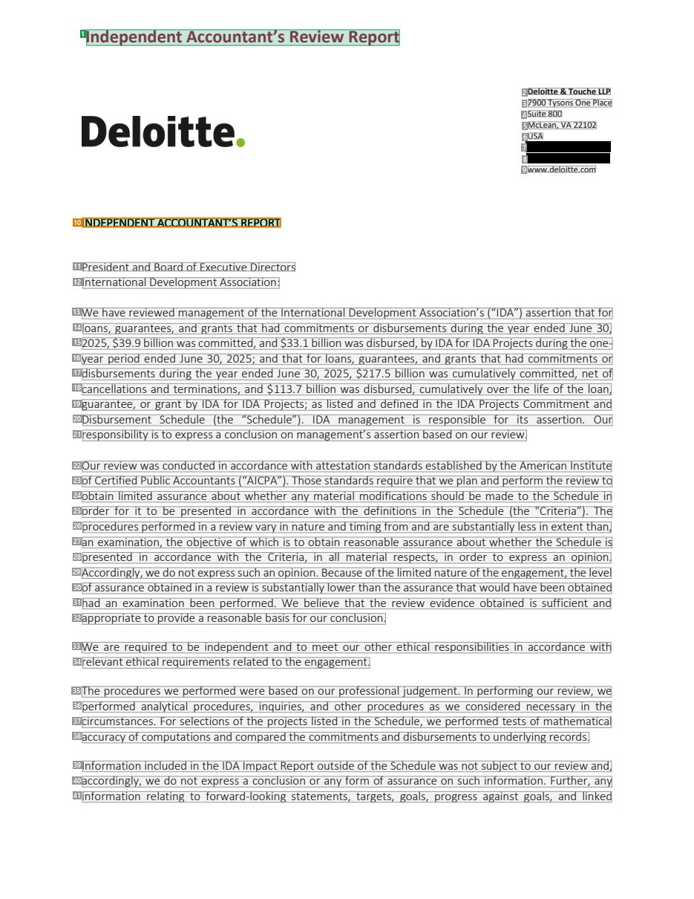
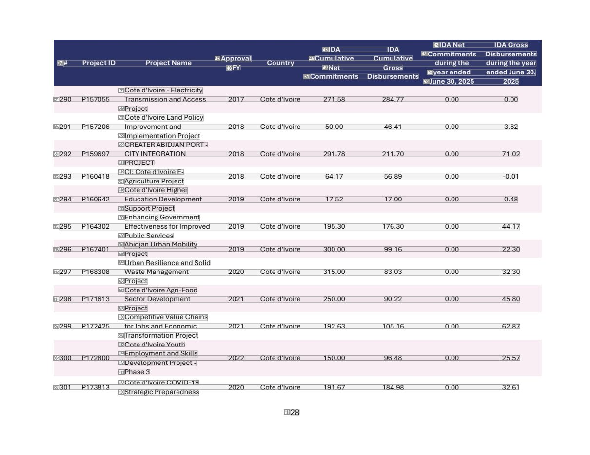
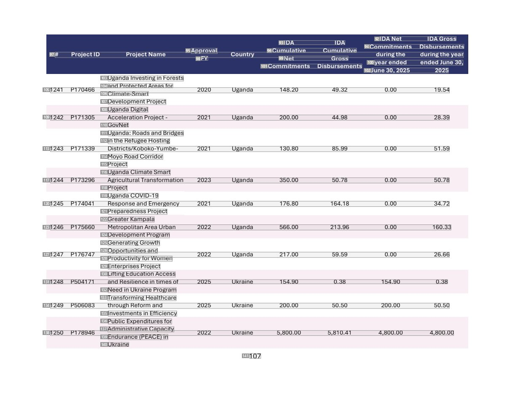
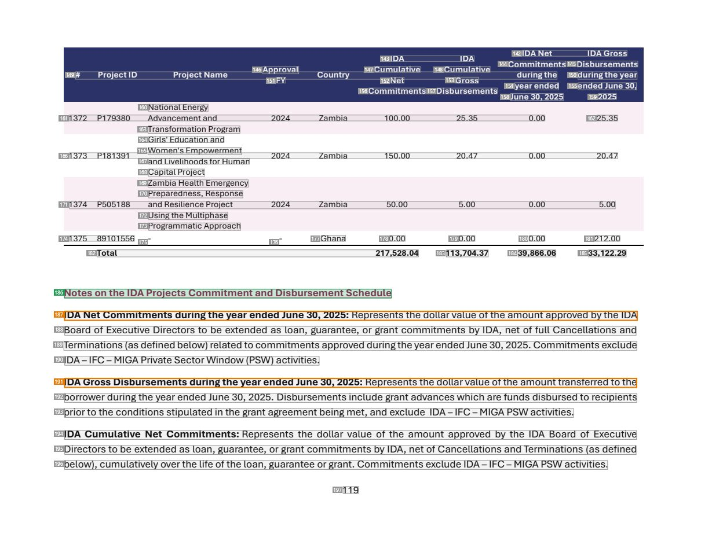

# 055 — `todo10_8/heading_corpus_100/03_tai_chinh_ke_toan/055_IDA_External_Review_FY25.pdf`

Draft `P7_F1Q_HELDOUT_GOLD_DRAFT_V2`, status `DRAFT_REVIEWER_A_NOT_APPROVED`, draft sha256 `a9b6e6d84b31573735e49e4eedfa445414f38eaa4893017dd62f921d10d6f672`. Source sha256 `3b9d4317f2e8ca32ff9288d5f7c653fefd7231d5656a5b8a996be656b1dee455`. [Back to index](README.md)

Approve or correct with `review-apply` lines: `APPROVE 055 by <reviewer> [because <note>]`, `055 <alias> -> E|R|O because <reason>`.

## Page 1 (FIRST)

| # | alias | text | font | draft | flag | rationale |
|---:|---|---|---|---|---|---|
| 1 | L0000:S0 | IndependentAccountant’s Review Report | 16 B | **ESTABLISHES** |  | Document title &quot;Independent Accountant&#39;s Review Report&quot; (16pt bold) |
| 2 | L0001:S0 | Deloitte&amp;Touche LLP | 8 B | **OTHER** |  | Firm name in the address block |
| 3 | L0002:S0 | 7900Tysons One Place | 8 | **OTHER** |  | Firm address |
| 4 | L0003:S0 | Suite 800 | 8 | **OTHER** |  | Firm address |
| 5 | L0004:S0 | McLean, VA 22102 | 8 | **OTHER** |  | Firm address |
| 6 | L0005:S0 | USA | 8 | **OTHER** |  | Firm address |
| 7 | L0006:S0 | Tel: [REDACTED_PHONE] | 8 | **OTHER** |  | Firm telephone number (business contact) |
| 8 | L0007:S0 | Fax: [REDACTED_PHONE] | 8 | **OTHER** |  | Firm fax number (business contact) |
| 9 | L0008:S0 | www.deloitte.com | 8 | **OTHER** |  | Firm website |
| 10 | L0009:S0 | INDEPENDENTACCOUNTANT’S REPORT | 11 | **ESTABLISHES** | REVIEW_FOCUS | Report heading &quot;INDEPENDENT ACCOUNTANT&#39;S REPORT&quot; (11pt caps, opens the report letter) |
| 11 | L0010:S0 | President and Board of Executive Directors | 11 | **OTHER** |  | Addressee line |
| 12 | L0011:S0 | International Development Association: | 11 | **OTHER** |  | Addressee line |
| 13 | L0012:S0 | We have reviewed management ofthe International Development Association’s (“IDA”) assertion that for | 11 | **OTHER** |  | Default: body text, list item, table cell, page number or other non-heading content on this page |
| 14 | L0013:S0 | loans, guarantees, and grants that had commitments or disbursements during the year ended June 30, | 11 | **OTHER** |  | Default: body text, list item, table cell, page number or other non-heading content on this page |
| 15 | L0014:S0 | 2025, $39.9 billion was committed, and $33.1 billion was disbursed, by IDAfor IDA Projects duringthe one- | 11 | **OTHER** |  | Default: body text, list item, table cell, page number or other non-heading content on this page |
| 16 | L0015:S0 | year period ended June 30, 2025; and that for loans, guarantees, and grants that had commitments or | 11 | **OTHER** |  | Default: body text, list item, table cell, page number or other non-heading content on this page |
| 17 | L0016:S0 | disbursements during the year ended June 30, 2025, $217.5 billion was cumulatively committed, net of | 11 | **OTHER** |  | Default: body text, list item, table cell, page number or other non-heading content on this page |
| 18 | L0017:S0 | cancellations and terminations, and $113.7 billion was disbursed, cumulatively over the life of the loan, | 11 | **OTHER** |  | Default: body text, list item, table cell, page number or other non-heading content on this page |
| 19 | L0018:S0 | guarantee, or grant by IDA for IDA Projects; as listed and defined in the IDA Projects Commitment and | 11 | **OTHER** |  | Default: body text, list item, table cell, page number or other non-heading content on this page |
| 20 | L0019:S0 | Disbursement Schedule (the “Schedule”). IDA management is responsible for its assertion. Our | 11 | **OTHER** |  | Default: body text, list item, table cell, page number or other non-heading content on this page |
| 21 | L0020:S0 | responsibility is to express a conclusion on management’s assertion based on our review. | 11 | **OTHER** |  | Default: body text, list item, table cell, page number or other non-heading content on this page |
| 22 | L0021:S0 | Our review was conducted in accordance with attestation standards established bythe American Institute | 11 | **OTHER** |  | Default: body text, list item, table cell, page number or other non-heading content on this page |
| 23 | L0022:S0 | ofCertified Public Accountants (“AICPA”). Those standards require that we plan and perform the reviewto | 11 | **OTHER** |  | Default: body text, list item, table cell, page number or other non-heading content on this page |
| 24 | L0023:S0 | obtain limited assurance about whether any material modifications should be made to the Schedule in | 11 | **OTHER** |  | Default: body text, list item, table cell, page number or other non-heading content on this page |
| 25 | L0024:S0 | order for it to be presented in accordance with the definitions in the Schedule (the &quot;Criteria”). The | 11 | **OTHER** |  | Default: body text, list item, table cell, page number or other non-heading content on this page |
| 26 | L0025:S0 | procedures performed in a reviewvary in nature and timing from and are substantially less in extent than, | 11 | **OTHER** |  | Default: body text, list item, table cell, page number or other non-heading content on this page |
| 27 | L0026:S0 | an examination, the objective of which is to obtain reasonable assurance about whether the Schedule is | 11 | **OTHER** |  | Default: body text, list item, table cell, page number or other non-heading content on this page |
| 28 | L0027:S0 | presented in accordance with the Criteria, in all material respects, in order to express an opinion. | 11 | **OTHER** |  | Default: body text, list item, table cell, page number or other non-heading content on this page |
| 29 | L0028:S0 | Accordingly, we do not express such an opinion. Because ofthe limited nature ofthe engagement, the level | 11 | **OTHER** |  | Default: body text, list item, table cell, page number or other non-heading content on this page |
| 30 | L0029:S0 | ofassurance obtained in a review is substantially lowerthan the assurance that would have been obtained | 11 | **OTHER** |  | Default: body text, list item, table cell, page number or other non-heading content on this page |
| 31 | L0030:S0 | had an examination been performed. We believe that the review evidence obtained is sufficient and | 11 | **OTHER** |  | Default: body text, list item, table cell, page number or other non-heading content on this page |
| 32 | L0031:S0 | appropriate to provide a reasonable basis for our conclusion. | 11 | **OTHER** |  | Default: body text, list item, table cell, page number or other non-heading content on this page |
| 33 | L0032:S0 | We are required to be independent and to meet our other ethical responsibilities in accordance with | 11 | **OTHER** |  | Default: body text, list item, table cell, page number or other non-heading content on this page |
| 34 | L0033:S0 | relevant ethical requirements related to the engagement. | 11 | **OTHER** |  | Default: body text, list item, table cell, page number or other non-heading content on this page |
| 35 | L0034:S0 | The procedures we performed were based on our professional judgement. In performing our review, we | 11 | **OTHER** |  | Default: body text, list item, table cell, page number or other non-heading content on this page |
| 36 | L0035:S0 | performed analytical procedures, inquiries, and other procedures as we considered necessary in the | 11 | **OTHER** |  | Default: body text, list item, table cell, page number or other non-heading content on this page |
| 37 | L0036:S0 | circumstances. For selections of the projects listed in the Schedule, we performed tests of mathematical | 11 | **OTHER** |  | Default: body text, list item, table cell, page number or other non-heading content on this page |
| 38 | L0037:S0 | accuracy ofcomputations and compared the commitments and disbursements to underlying records. | 11 | **OTHER** |  | Default: body text, list item, table cell, page number or other non-heading content on this page |
| 39 | L0038:S0 | Information included in the IDA Impact Report outside ofthe Schedule was not subject to our review and, | 11 | **OTHER** |  | Default: body text, list item, table cell, page number or other non-heading content on this page |
| 40 | L0039:S0 | accordingly, we do not express a conclusion or any form of assurance on such information. Further, any | 11 | **OTHER** |  | Default: body text, list item, table cell, page number or other non-heading content on this page |
| 41 | L0040:S0 | information relating to forward-looking statements, targets, goals, progress against goals, and linked | 11 | **OTHER** |  | Default: body text, list item, table cell, page number or other non-heading content on this page |

**OTHER rows to check for a missed heading on page 1** (body size 11pt; bold or ≥ body+1pt, ≤ 12 words): #2 `L0001:S0` Deloitte&amp;Touche LLP (8 B).

## Page 28 (SEEDED_INTERIOR)

| # | alias | text | font | draft | flag | rationale |
|---:|---|---|---|---|---|---|
| 42 | L1228:S0 | IDA Net IDAGross | 10 B | **OTHER** |  | Default: body text, list item, table cell, page number or other non-heading content on this page |
| 43 | L1229:S0 | IDA IDA | 10 B | **OTHER** |  | Default: body text, list item, table cell, page number or other non-heading content on this page |
| 44 | L1229:S1 | Commitments Disbursements | 10 B | **OTHER** |  | Default: body text, list item, table cell, page number or other non-heading content on this page |
| 45 | L1230:S0 | Approval | 10 B | **OTHER** |  | Default: body text, list item, table cell, page number or other non-heading content on this page |
| 46 | L1230:S1 | Cumulative Cumulative | 10 B | **OTHER** |  | Default: body text, list item, table cell, page number or other non-heading content on this page |
| 47 | L1231:S0 | # Project ID Project Name Country duringthe duringtheyear | 10 B | **OTHER** |  | Default: body text, list item, table cell, page number or other non-heading content on this page |
| 48 | L1232:S0 | FY | 10 B | **OTHER** |  | Default: body text, list item, table cell, page number or other non-heading content on this page |
| 49 | L1232:S1 | Net Gross | 10 B | **OTHER** |  | Default: body text, list item, table cell, page number or other non-heading content on this page |
| 50 | L1232:S2 | yearended ended June 30, | 10 B | **OTHER** |  | Default: body text, list item, table cell, page number or other non-heading content on this page |
| 51 | L1233:S0 | Commitments Disbursements | 10 B | **OTHER** |  | Default: body text, list item, table cell, page number or other non-heading content on this page |
| 52 | L1233:S1 | June 30, 2025 2025 | 10 B | **OTHER** |  | Default: body text, list item, table cell, page number or other non-heading content on this page |
| 53 | L1234:S0 | Cote d&#39;Ivoire - Electricity | 10 | **OTHER** |  | Default: body text, list item, table cell, page number or other non-heading content on this page |
| 54 | L1235:S0 | 290 P157055 Transmission and Access 2017 Cote d&#39;Ivoire 271.58 284.77 0.00 0.00 | 10 | **OTHER** |  | Default: body text, list item, table cell, page number or other non-heading content on this page |
| 55 | L1236:S0 | Project | 10 | **OTHER** |  | Default: body text, list item, table cell, page number or other non-heading content on this page |
| 56 | L1237:S0 | Cote d&#39;Ivoire Land Policy | 10 | **OTHER** |  | Default: body text, list item, table cell, page number or other non-heading content on this page |
| 57 | L1238:S0 | 291 P157206 Improvement and 2018 Cote d&#39;Ivoire 50.00 46.41 0.00 3.82 | 10 | **OTHER** |  | Default: body text, list item, table cell, page number or other non-heading content on this page |
| 58 | L1239:S0 | Implementation Project | 10 | **OTHER** |  | Default: body text, list item, table cell, page number or other non-heading content on this page |
| 59 | L1240:S0 | GREATERABIDJAN PORT - | 10 | **OTHER** |  | Default: body text, list item, table cell, page number or other non-heading content on this page |
| 60 | L1241:S0 | 292 P159697 CITY INTEGRATION 2018 Cote d&#39;Ivoire 291.78 21 1.70 0.00 71.02 | 10 | **OTHER** |  | Default: body text, list item, table cell, page number or other non-heading content on this page |
| 61 | L1242:S0 | PROJECT | 10 | **OTHER** |  | Default: body text, list item, table cell, page number or other non-heading content on this page |
| 62 | L1243:S0 | CI: Cote d&#39;Ivoire E- | 10 | **OTHER** |  | Default: body text, list item, table cell, page number or other non-heading content on this page |
| 63 | L1244:S0 | 293 P160418 2018 Cote d&#39;Ivoire 64.17 56.89 0.00 -0.01 | 10 | **OTHER** |  | Default: body text, list item, table cell, page number or other non-heading content on this page |
| 64 | L1245:S0 | Agriculture Project | 10 | **OTHER** |  | Default: body text, list item, table cell, page number or other non-heading content on this page |
| 65 | L1246:S0 | Cote d&#39;Ivoire Higher | 10 | **OTHER** |  | Default: body text, list item, table cell, page number or other non-heading content on this page |
| 66 | L1247:S0 | 294 P160642 Education Development 2019 Cote d&#39;Ivoire 17.52 17.00 0.00 0.48 | 10 | **OTHER** |  | Default: body text, list item, table cell, page number or other non-heading content on this page |
| 67 | L1248:S0 | Support Project | 10 | **OTHER** |  | Default: body text, list item, table cell, page number or other non-heading content on this page |
| 68 | L1249:S0 | EnhancingGovernment | 10 | **OTHER** |  | Default: body text, list item, table cell, page number or other non-heading content on this page |
| 69 | L1250:S0 | 295 P164302 Effectivenessfor Improved 2019 Cote d&#39;Ivoire 195.30 176.30 0.00 44.17 | 10 | **OTHER** |  | Default: body text, list item, table cell, page number or other non-heading content on this page |
| 70 | L1251:S0 | Public Services | 10 | **OTHER** |  | Default: body text, list item, table cell, page number or other non-heading content on this page |
| 71 | L1252:S0 | Abidjan Urban Mobility | 10 | **OTHER** |  | Default: body text, list item, table cell, page number or other non-heading content on this page |
| 72 | L1253:S0 | 296 P167401 2019 Cote d&#39;Ivoire 300.00 99.16 0.00 22.30 | 10 | **OTHER** |  | Default: body text, list item, table cell, page number or other non-heading content on this page |
| 73 | L1254:S0 | Project | 10 | **OTHER** |  | Default: body text, list item, table cell, page number or other non-heading content on this page |
| 74 | L1255:S0 | Urban Resilience and Solid | 10 | **OTHER** |  | Default: body text, list item, table cell, page number or other non-heading content on this page |
| 75 | L1256:S0 | 297 P168308 Waste Management 2020 Cote d&#39;Ivoire 315.00 83.03 0.00 32.30 | 10 | **OTHER** |  | Default: body text, list item, table cell, page number or other non-heading content on this page |
| 76 | L1257:S0 | Project | 10 | **OTHER** |  | Default: body text, list item, table cell, page number or other non-heading content on this page |
| 77 | L1258:S0 | Cote d&#39;IvoireAgri-Food | 10 | **OTHER** |  | Default: body text, list item, table cell, page number or other non-heading content on this page |
| 78 | L1259:S0 | 298 P171613 Sector Development 2021 Cote d&#39;Ivoire 250.00 90.22 0.00 45.80 | 10 | **OTHER** |  | Default: body text, list item, table cell, page number or other non-heading content on this page |
| 79 | L1260:S0 | Project | 10 | **OTHER** |  | Default: body text, list item, table cell, page number or other non-heading content on this page |
| 80 | L1261:S0 | CompetitiveValue Chains | 10 | **OTHER** |  | Default: body text, list item, table cell, page number or other non-heading content on this page |
| 81 | L1262:S0 | 299 P172425 forJobs and Economic 2021 Cote d&#39;Ivoire 192.63 105.16 0.00 62.87 | 10 | **OTHER** |  | Default: body text, list item, table cell, page number or other non-heading content on this page |
| 82 | L1263:S0 | Transformation Project | 10 | **OTHER** |  | Default: body text, list item, table cell, page number or other non-heading content on this page |
| 83 | L1264:S0 | Cote d&#39;IvoireYouth | 10 | **OTHER** |  | Default: body text, list item, table cell, page number or other non-heading content on this page |
| 84 | L1265:S0 | Employment and Skills | 10 | **OTHER** |  | Default: body text, list item, table cell, page number or other non-heading content on this page |
| 85 | L1266:S0 | 300 P172800 2022 Cote d&#39;Ivoire 150.00 96.48 0.00 25.57 | 10 | **OTHER** |  | Default: body text, list item, table cell, page number or other non-heading content on this page |
| 86 | L1267:S0 | Development Project - | 10 | **OTHER** |  | Default: body text, list item, table cell, page number or other non-heading content on this page |
| 87 | L1268:S0 | Phase 3 | 10 | **OTHER** |  | Default: body text, list item, table cell, page number or other non-heading content on this page |
| 88 | L1269:S0 | Cote d&#39;Ivoire COVID-19 | 10 | **OTHER** |  | Default: body text, list item, table cell, page number or other non-heading content on this page |
| 89 | L1270:S0 | 301 P173813 2020 Cote d&#39;Ivoire 191.67 184.98 0.00 32.61 | 10 | **OTHER** |  | Default: body text, list item, table cell, page number or other non-heading content on this page |
| 90 | L1271:S0 | Strategic Preparedness | 10 | **OTHER** |  | Default: body text, list item, table cell, page number or other non-heading content on this page |
| 91 | L1272:S0 | 28 | 12 | **OTHER** |  | Default: body text, list item, table cell, page number or other non-heading content on this page |

**OTHER rows to check for a missed heading on page 28** (body size 10pt; bold or ≥ body+1pt, ≤ 12 words): #42 `L1228:S0` IDA Net IDAGross (10 B), #43 `L1229:S0` IDA IDA (10 B), #44 `L1229:S1` Commitments Disbursements (10 B), #45 `L1230:S0` Approval (10 B), #46 `L1230:S1` Cumulative Cumulative (10 B), #47 `L1231:S0` # Project ID Project Name Country duringthe duringtheyear (10 B), #48 `L1232:S0` FY (10 B), #49 `L1232:S1` Net Gross (10 B), #50 `L1232:S2` yearended ended June 30, (10 B), #51 `L1233:S0` Commitments Disbursements (10 B), #52 `L1233:S1` June 30, 2025 2025 (10 B), #91 `L1272:S0` 28 (12).

## Page 107 (SEEDED_INTERIOR)

| # | alias | text | font | draft | flag | rationale |
|---:|---|---|---|---|---|---|
| 92 | L5005:S0 | IDA Net IDAGross | 10 B | **OTHER** |  | Default: body text, list item, table cell, page number or other non-heading content on this page |
| 93 | L5006:S0 | IDA IDA | 10 B | **OTHER** |  | Default: body text, list item, table cell, page number or other non-heading content on this page |
| 94 | L5006:S1 | Commitments Disbursements | 10 B | **OTHER** |  | Default: body text, list item, table cell, page number or other non-heading content on this page |
| 95 | L5007:S0 | Approval | 10 B | **OTHER** |  | Default: body text, list item, table cell, page number or other non-heading content on this page |
| 96 | L5007:S1 | Cumulative Cumulative | 10 B | **OTHER** |  | Default: body text, list item, table cell, page number or other non-heading content on this page |
| 97 | L5008:S0 | # Project ID Project Name Country duringthe duringtheyear | 10 B | **OTHER** |  | Default: body text, list item, table cell, page number or other non-heading content on this page |
| 98 | L5009:S0 | FY | 10 B | **OTHER** |  | Default: body text, list item, table cell, page number or other non-heading content on this page |
| 99 | L5009:S1 | Net Gross | 10 B | **OTHER** |  | Default: body text, list item, table cell, page number or other non-heading content on this page |
| 100 | L5009:S2 | yearended ended June 30, | 10 B | **OTHER** |  | Default: body text, list item, table cell, page number or other non-heading content on this page |
| 101 | L5010:S0 | Commitments Disbursements | 10 B | **OTHER** |  | Default: body text, list item, table cell, page number or other non-heading content on this page |
| 102 | L5010:S1 | June 30, 2025 2025 | 10 B | **OTHER** |  | Default: body text, list item, table cell, page number or other non-heading content on this page |
| 103 | L5011:S0 | Uganda Investing in Forests | 10 | **OTHER** |  | Default: body text, list item, table cell, page number or other non-heading content on this page |
| 104 | L5012:S0 | and Protected Areasfor | 10 | **OTHER** |  | Default: body text, list item, table cell, page number or other non-heading content on this page |
| 105 | L5013:S0 | 1241 P170466 2020 Uganda 148.20 49.32 0.00 19.54 | 10 | **OTHER** |  | Default: body text, list item, table cell, page number or other non-heading content on this page |
| 106 | L5014:S0 | Climate-Smart | 10 | **OTHER** |  | Default: body text, list item, table cell, page number or other non-heading content on this page |
| 107 | L5015:S0 | Development Project | 10 | **OTHER** |  | Default: body text, list item, table cell, page number or other non-heading content on this page |
| 108 | L5016:S0 | Uganda Digital | 10 | **OTHER** |  | Default: body text, list item, table cell, page number or other non-heading content on this page |
| 109 | L5017:S0 | 1242 P171305 Acceleration Project - 2021 Uganda 200.00 44.98 0.00 28.39 | 10 | **OTHER** |  | Default: body text, list item, table cell, page number or other non-heading content on this page |
| 110 | L5018:S0 | GovNet | 10 | **OTHER** |  | Default: body text, list item, table cell, page number or other non-heading content on this page |
| 111 | L5019:S0 | Uganda: Roads and Bridges | 10 | **OTHER** |  | Default: body text, list item, table cell, page number or other non-heading content on this page |
| 112 | L5020:S0 | in the Refugee Hosting | 10 | **OTHER** |  | Default: body text, list item, table cell, page number or other non-heading content on this page |
| 113 | L5021:S0 | 1243 P171339 Districts/Koboko-Yumbe- 2021 Uganda 130.80 85.99 0.00 51.59 | 10 | **OTHER** |  | Default: body text, list item, table cell, page number or other non-heading content on this page |
| 114 | L5022:S0 | Moyo Road Corridor | 10 | **OTHER** |  | Default: body text, list item, table cell, page number or other non-heading content on this page |
| 115 | L5023:S0 | Project | 10 | **OTHER** |  | Default: body text, list item, table cell, page number or other non-heading content on this page |
| 116 | L5024:S0 | Uganda Climate Smart | 10 | **OTHER** |  | Default: body text, list item, table cell, page number or other non-heading content on this page |
| 117 | L5025:S0 | 1244 P173296 AgriculturalTransformation 2023 Uganda 350.00 50.78 0.00 50.78 | 10 | **OTHER** |  | Default: body text, list item, table cell, page number or other non-heading content on this page |
| 118 | L5026:S0 | Project | 10 | **OTHER** |  | Default: body text, list item, table cell, page number or other non-heading content on this page |
| 119 | L5027:S0 | Uganda COVID-19 | 10 | **OTHER** |  | Default: body text, list item, table cell, page number or other non-heading content on this page |
| 120 | L5028:S0 | 1245 P174041 Response and Emergency 2021 Uganda 176.80 164.18 0.00 34.72 | 10 | **OTHER** |  | Default: body text, list item, table cell, page number or other non-heading content on this page |
| 121 | L5029:S0 | Preparedness Project | 10 | **OTHER** |  | Default: body text, list item, table cell, page number or other non-heading content on this page |
| 122 | L5030:S0 | Greater Kampala | 10 | **OTHER** |  | Default: body text, list item, table cell, page number or other non-heading content on this page |
| 123 | L5031:S0 | 1246 P175660 Metropolitan Area Urban 2022 Uganda 566.00 213.96 0.00 160.33 | 10 | **OTHER** |  | Default: body text, list item, table cell, page number or other non-heading content on this page |
| 124 | L5032:S0 | Development Program | 10 | **OTHER** |  | Default: body text, list item, table cell, page number or other non-heading content on this page |
| 125 | L5033:S0 | GeneratingGrowth | 10 | **OTHER** |  | Default: body text, list item, table cell, page number or other non-heading content on this page |
| 126 | L5034:S0 | Opportunities and | 10 | **OTHER** |  | Default: body text, list item, table cell, page number or other non-heading content on this page |
| 127 | L5035:S0 | 1247 P176747 2022 Uganda 217.00 59.59 0.00 26.66 | 10 | **OTHER** |  | Default: body text, list item, table cell, page number or other non-heading content on this page |
| 128 | L5036:S0 | ProductivityforWomen | 10 | **OTHER** |  | Default: body text, list item, table cell, page number or other non-heading content on this page |
| 129 | L5037:S0 | Enterprises Project | 10 | **OTHER** |  | Default: body text, list item, table cell, page number or other non-heading content on this page |
| 130 | L5038:S0 | Lifting Education Access | 10 | **OTHER** |  | Default: body text, list item, table cell, page number or other non-heading content on this page |
| 131 | L5039:S0 | 1248 P504171 and Resilience in times of 2025 Ukraine 154.90 0.38 154.90 0.38 | 10 | **OTHER** |  | Default: body text, list item, table cell, page number or other non-heading content on this page |
| 132 | L5040:S0 | Need in Ukraine Program | 10 | **OTHER** |  | Default: body text, list item, table cell, page number or other non-heading content on this page |
| 133 | L5041:S0 | Transforming Healthcare | 10 | **OTHER** |  | Default: body text, list item, table cell, page number or other non-heading content on this page |
| 134 | L5042:S0 | 1249 P506083 through Reform and 2025 Ukraine 200.00 50.50 200.00 50.50 | 10 | **OTHER** |  | Default: body text, list item, table cell, page number or other non-heading content on this page |
| 135 | L5043:S0 | Investments in Efficiency | 10 | **OTHER** |  | Default: body text, list item, table cell, page number or other non-heading content on this page |
| 136 | L5044:S0 | Public Expendituresfor | 10 | **OTHER** |  | Default: body text, list item, table cell, page number or other non-heading content on this page |
| 137 | L5045:S0 | Administrative Capacity | 10 | **OTHER** |  | Default: body text, list item, table cell, page number or other non-heading content on this page |
| 138 | L5046:S0 | 1250 P178946 2022 Ukraine 5,800.00 5,810.41 4,800.00 4,800.00 | 10 | **OTHER** |  | Default: body text, list item, table cell, page number or other non-heading content on this page |
| 139 | L5047:S0 | Endurance (PEACE) in | 10 | **OTHER** |  | Default: body text, list item, table cell, page number or other non-heading content on this page |
| 140 | L5048:S0 | Ukraine | 10 | **OTHER** |  | Default: body text, list item, table cell, page number or other non-heading content on this page |
| 141 | L5049:S0 | 107 | 12 | **OTHER** |  | Default: body text, list item, table cell, page number or other non-heading content on this page |

**OTHER rows to check for a missed heading on page 107** (body size 10pt; bold or ≥ body+1pt, ≤ 12 words): #92 `L5005:S0` IDA Net IDAGross (10 B), #93 `L5006:S0` IDA IDA (10 B), #94 `L5006:S1` Commitments Disbursements (10 B), #95 `L5007:S0` Approval (10 B), #96 `L5007:S1` Cumulative Cumulative (10 B), #97 `L5008:S0` # Project ID Project Name Country duringthe duringtheyear (10 B), #98 `L5009:S0` FY (10 B), #99 `L5009:S1` Net Gross (10 B), #100 `L5009:S2` yearended ended June 30, (10 B), #101 `L5010:S0` Commitments Disbursements (10 B), #102 `L5010:S1` June 30, 2025 2025 (10 B), #141 `L5049:S0` 107 (12).

## Page 119 (TARGETED_STRUCTURE)

| # | alias | text | font | draft | flag | rationale |
|---:|---|---|---|---|---|---|
| 142 | L5571:S0 | IDA Net IDAGross | 10 B | **OTHER** |  | Default: body text, list item, table cell, page number or other non-heading content on this page |
| 143 | L5572:S0 | IDA IDA | 10 B | **OTHER** |  | Default: body text, list item, table cell, page number or other non-heading content on this page |
| 144 | L5572:S1 | Commitments | 10 B | **OTHER** |  | Default: body text, list item, table cell, page number or other non-heading content on this page |
| 145 | L5572:S2 | Disbursements | 10 B | **OTHER** |  | Default: body text, list item, table cell, page number or other non-heading content on this page |
| 146 | L5573:S0 | Approval | 10 B | **OTHER** |  | Default: body text, list item, table cell, page number or other non-heading content on this page |
| 147 | L5573:S1 | Cumulative | 10 B | **OTHER** |  | Default: body text, list item, table cell, page number or other non-heading content on this page |
| 148 | L5573:S2 | Cumulative | 10 B | **OTHER** |  | Default: body text, list item, table cell, page number or other non-heading content on this page |
| 149 | L5574:S0 | # Project ID Project Name Country duringthe | 10 B | **OTHER** |  | Default: body text, list item, table cell, page number or other non-heading content on this page |
| 150 | L5574:S1 | duringtheyear | 10 B | **OTHER** |  | Default: body text, list item, table cell, page number or other non-heading content on this page |
| 151 | L5575:S0 | FY | 10 B | **OTHER** |  | Default: body text, list item, table cell, page number or other non-heading content on this page |
| 152 | L5575:S1 | Net | 10 B | **OTHER** |  | Default: body text, list item, table cell, page number or other non-heading content on this page |
| 153 | L5575:S2 | Gross | 10 B | **OTHER** |  | Default: body text, list item, table cell, page number or other non-heading content on this page |
| 154 | L5575:S3 | yearended | 10 B | **OTHER** |  | Default: body text, list item, table cell, page number or other non-heading content on this page |
| 155 | L5575:S4 | ended June 30, | 10 B | **OTHER** |  | Default: body text, list item, table cell, page number or other non-heading content on this page |
| 156 | L5576:S0 | Commitments | 10 B | **OTHER** |  | Default: body text, list item, table cell, page number or other non-heading content on this page |
| 157 | L5576:S1 | Disbursements | 10 B | **OTHER** |  | Default: body text, list item, table cell, page number or other non-heading content on this page |
| 158 | L5576:S2 | June 30, 2025 | 10 B | **OTHER** |  | Default: body text, list item, table cell, page number or other non-heading content on this page |
| 159 | L5576:S3 | 2025 | 10 B | **OTHER** |  | Default: body text, list item, table cell, page number or other non-heading content on this page |
| 160 | L5577:S0 | National Energy | 10 | **OTHER** |  | Default: body text, list item, table cell, page number or other non-heading content on this page |
| 161 | L5578:S0 | 1372 P179380 Advancement and 2024 Zambia 100.00 25.35 0.00 | 10 | **OTHER** |  | Default: body text, list item, table cell, page number or other non-heading content on this page |
| 162 | L5578:S1 | 25.35 | 10 | **OTHER** |  | Default: body text, list item, table cell, page number or other non-heading content on this page |
| 163 | L5579:S0 | Transformation Program | 10 | **OTHER** |  | Default: body text, list item, table cell, page number or other non-heading content on this page |
| 164 | L5580:S0 | Girls&#39; Education and | 10 | **OTHER** |  | Default: body text, list item, table cell, page number or other non-heading content on this page |
| 165 | L5581:S0 | Women&#39;s Empowerment | 10 | **OTHER** |  | Default: body text, list item, table cell, page number or other non-heading content on this page |
| 166 | L5582:S0 | 1373 P181391 2024 Zambia 150.00 20.47 0.00 20.47 | 10 | **OTHER** |  | Default: body text, list item, table cell, page number or other non-heading content on this page |
| 167 | L5583:S0 | and Livelihoodsfor Human | 10 | **OTHER** |  | Default: body text, list item, table cell, page number or other non-heading content on this page |
| 168 | L5584:S0 | Capital Project | 10 | **OTHER** |  | Default: body text, list item, table cell, page number or other non-heading content on this page |
| 169 | L5585:S0 | Zambia Health Emergency | 10 | **OTHER** |  | Default: body text, list item, table cell, page number or other non-heading content on this page |
| 170 | L5586:S0 | Preparedness, Response | 10 | **OTHER** |  | Default: body text, list item, table cell, page number or other non-heading content on this page |
| 171 | L5587:S0 | 1374 P505188 and Resilience Project 2024 Zambia 50.00 5.00 0.00 5.00 | 10 | **OTHER** |  | Default: body text, list item, table cell, page number or other non-heading content on this page |
| 172 | L5588:S0 | Usingthe Multiphase | 10 | **OTHER** |  | Default: body text, list item, table cell, page number or other non-heading content on this page |
| 173 | L5589:S0 | ProgrammaticApproach | 10 | **OTHER** |  | Default: body text, list item, table cell, page number or other non-heading content on this page |
| 174 | L5590:S0 | 1375 89101556 | 10 | **OTHER** |  | Default: body text, list item, table cell, page number or other non-heading content on this page |
| 175 | L5590:S1 | - | 10 | **OTHER** |  | Default: body text, list item, table cell, page number or other non-heading content on this page |
| 176 | L5590:S2 | - | 10 | **OTHER** |  | Default: body text, list item, table cell, page number or other non-heading content on this page |
| 177 | L5590:S3 | Ghana | 10 | **OTHER** |  | Default: body text, list item, table cell, page number or other non-heading content on this page |
| 178 | L5590:S4 | 0.00 | 10 | **OTHER** |  | Default: body text, list item, table cell, page number or other non-heading content on this page |
| 179 | L5590:S5 | 0.00 | 10 | **OTHER** |  | Default: body text, list item, table cell, page number or other non-heading content on this page |
| 180 | L5590:S6 | 0.00 | 10 | **OTHER** |  | Default: body text, list item, table cell, page number or other non-heading content on this page |
| 181 | L5590:S7 | 212.00 | 10 | **OTHER** |  | Default: body text, list item, table cell, page number or other non-heading content on this page |
| 182 | L5591:S0 | Total 217,528.04 | 10 B | **OTHER** |  | Table total row &quot;Total&quot; |
| 183 | L5591:S1 | 113,704.37 | 10 B | **OTHER** |  | Default: body text, list item, table cell, page number or other non-heading content on this page |
| 184 | L5591:S2 | 39,866.06 | 10 B | **OTHER** |  | Default: body text, list item, table cell, page number or other non-heading content on this page |
| 185 | L5591:S3 | 33,122.29 | 10 B | **OTHER** |  | Default: body text, list item, table cell, page number or other non-heading content on this page |
| 186 | L5592:S0 | Notes on the IDA Projects Commitment and Disbursement Schedule | 12 B | **ESTABLISHES** |  | Section heading &quot;Notes on the IDA Projects Commitment and Disbursement Schedule&quot; (12pt bold) |
| 187 | L5593:S0 | IDA Net Commitments duringtheyear ended June 30, 2025: Represents the dollarvalue ofthe amount approved bythe IDA | 12 B | **OTHER** | REVIEW_FOCUS | Bold run-in defined term &quot;IDA Net Commitments during the year ...:&quot; + definition (definition-list entry) |
| 188 | L5594:S0 | Board of Executive Directors to be extended as loan, guarantee, or grant commitments by IDA, net of full Cancellations a… | 12 | **OTHER** |  | Default: body text, list item, table cell, page number or other non-heading content on this page |
| 189 | L5595:S0 | Terminations (as defined below) related to commitments approved duringtheyearended June 30, 2025. Commitments exclude | 12 | **OTHER** |  | Default: body text, list item, table cell, page number or other non-heading content on this page |
| 190 | L5596:S0 | IDA– IFC– MIGA Private SectorWindow(PSW) activities. | 12 | **OTHER** |  | Default: body text, list item, table cell, page number or other non-heading content on this page |
| 191 | L5597:S0 | IDAGross Disbursements duringtheyearended June 30, 2025: Representsthe dollarvalue ofthe amounttransferred tothe | 12 B | **OTHER** | REVIEW_FOCUS | Bold run-in defined term &quot;IDA Gross Disbursements during the year ...:&quot; + definition (definition-list entry) |
| 192 | L5598:S0 | borrower duringthe year ended June 30, 2025. Disbursements include grant advanceswhich are funds disbursed to recipients | 12 | **OTHER** |  | Default: body text, list item, table cell, page number or other non-heading content on this page |
| 193 | L5599:S0 | priorto the conditions stipulated in the grant agreement being met, and exclude IDA– IFC– MIGA PSWactivities. | 12 | **OTHER** |  | Default: body text, list item, table cell, page number or other non-heading content on this page |
| 194 | L5600:S0 | IDA Cumulative Net Commitments: Represents the dollar value of the amount approved by the IDA Board of Executive | 12 | **OTHER** |  | Default: body text, list item, table cell, page number or other non-heading content on this page |
| 195 | L5601:S0 | Directors to be extended as loan, guarantee, or grant commitments by IDA, net of Cancellations and Terminations (as defi… | 12 | **OTHER** |  | Default: body text, list item, table cell, page number or other non-heading content on this page |
| 196 | L5602:S0 | below), cumulativelyoverthe life ofthe loan, guarantee orgrant. Commitments exclude IDA– IFC– MIGA PSWactivities. | 12 | **OTHER** |  | Default: body text, list item, table cell, page number or other non-heading content on this page |
| 197 | L5603:S0 | 1 19 | 12 | **OTHER** |  | Default: body text, list item, table cell, page number or other non-heading content on this page |

**OTHER rows to check for a missed heading on page 119** (body size 10pt; bold or ≥ body+1pt, ≤ 12 words): #142 `L5571:S0` IDA Net IDAGross (10 B), #143 `L5572:S0` IDA IDA (10 B), #144 `L5572:S1` Commitments (10 B), #145 `L5572:S2` Disbursements (10 B), #146 `L5573:S0` Approval (10 B), #147 `L5573:S1` Cumulative (10 B), #148 `L5573:S2` Cumulative (10 B), #149 `L5574:S0` # Project ID Project Name Country duringthe (10 B), #150 `L5574:S1` duringtheyear (10 B), #151 `L5575:S0` FY (10 B), #152 `L5575:S1` Net (10 B), #153 `L5575:S2` Gross (10 B), #154 `L5575:S3` yearended (10 B), #155 `L5575:S4` ended June 30, (10 B), #156 `L5576:S0` Commitments (10 B), #157 `L5576:S1` Disbursements (10 B), #158 `L5576:S2` June 30, 2025 (10 B), #159 `L5576:S3` 2025 (10 B), #182 `L5591:S0` Total 217,528.04 (10 B), #183 `L5591:S1` 113,704.37 (10 B), #184 `L5591:S2` 39,866.06 (10 B), #185 `L5591:S3` 33,122.29 (10 B), #190 `L5596:S0` IDA– IFC– MIGA Private SectorWindow(PSW) activities. (12), #191 `L5597:S0` IDAGross Disbursements duringtheyearended June 30, 2025: Rep… (12 B), #197 `L5603:S0` 1 19 (12).
