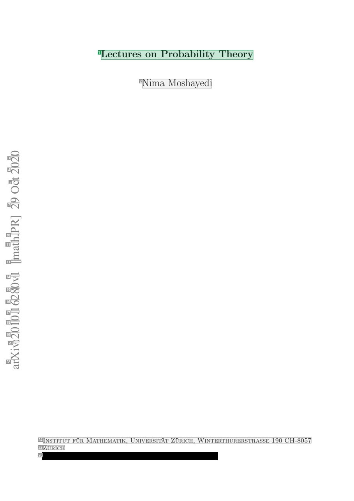
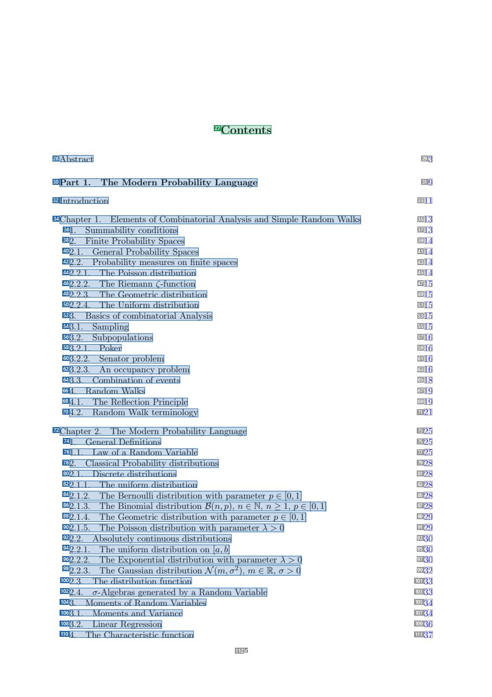
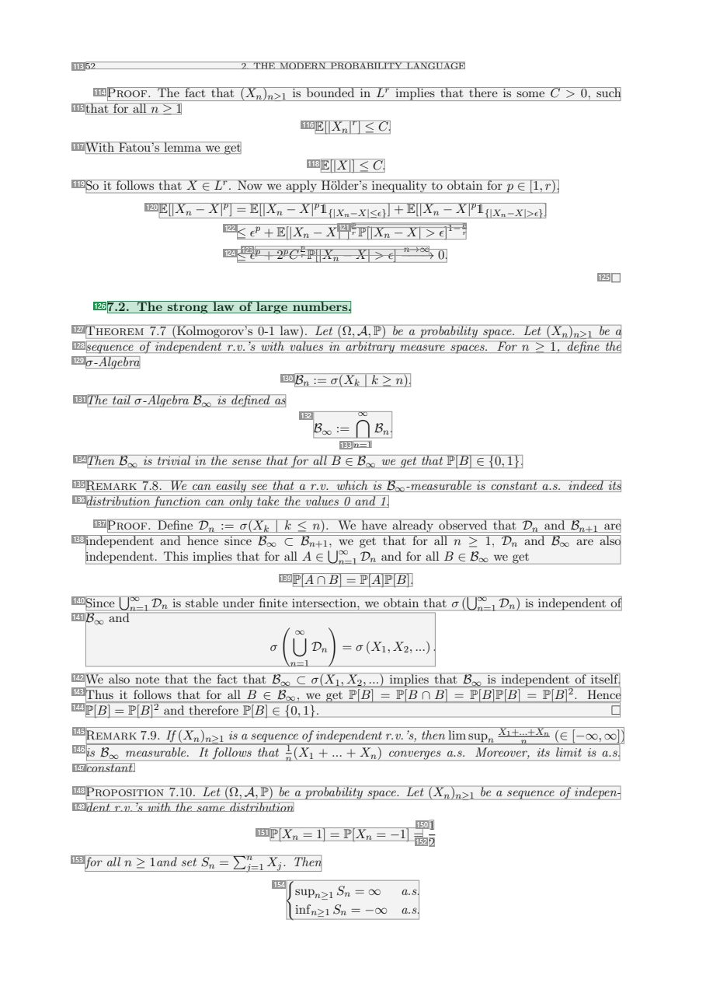
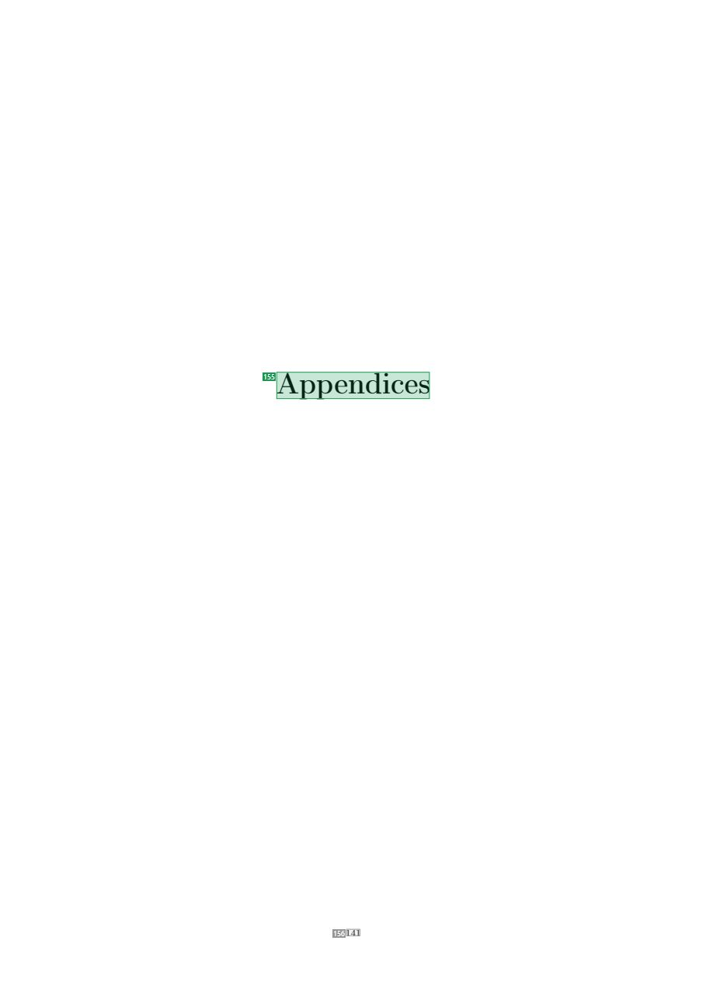

# 062 — `todo10_8/heading_corpus_100/04_giao_trinh/062_Lectures_on_Probability_Theory.pdf`

Draft `P7_F1Q_HELDOUT_GOLD_DRAFT_V2`, status `DRAFT_REVIEWER_A_NOT_APPROVED`, draft sha256 `6d2aee4d43762ed1183e6cc8d035b8b6a329d6f1edb7783943264f708b7cf94f`. Source sha256 `a4811a78083161a64930d6c9061fa0cb54fa7135d15f6fd3bfa443c875d77d8f`. [Back to index](README.md)

Approve or correct with `review-apply` lines: `APPROVE 062 by <reviewer> [because <note>]`, `062 <alias> -> E|R|O because <reason>`.

## Page 1 (FIRST)

| # | alias | text | font | draft | flag | rationale |
|---:|---|---|---|---|---|---|
| 1 | L0000:S0 | Lectures on Probability Theory | 17.2 | **ESTABLISHES** |  | Document title &quot;Lectures on Probability Theory&quot; (17.2pt) |
| 2 | L0001:S0 | Nima Moshayedi | 17.2 | **OTHER** |  | Author name |
| 3 | L0002:S0 | 02 | 20 | **OTHER** |  | Default: body text, list item, table cell, page number or other non-heading content on this page |
| 4 | L0003:S0 | 02 | 20 | **OTHER** |  | Default: body text, list item, table cell, page number or other non-heading content on this page |
| 5 | L0004:S0 | tc | 20 | **OTHER** |  | Default: body text, list item, table cell, page number or other non-heading content on this page |
| 6 | L0005:S0 | O | 20 | **OTHER** |  | Default: body text, list item, table cell, page number or other non-heading content on this page |
| 7 | L0006:S0 | 92 | 20 | **OTHER** |  | Default: body text, list item, table cell, page number or other non-heading content on this page |
| 8 | L0007:S0 | ] | 20 | **OTHER** |  | Default: body text, list item, table cell, page number or other non-heading content on this page |
| 9 | L0008:S0 | R | 20 | **OTHER** |  | Default: body text, list item, table cell, page number or other non-heading content on this page |
| 10 | L0009:S0 | P. | 20 | **OTHER** |  | Default: body text, list item, table cell, page number or other non-heading content on this page |
| 11 | L0010:S0 | ht | 20 | **OTHER** |  | Default: body text, list item, table cell, page number or other non-heading content on this page |
| 12 | L0011:S0 | a | 20 | **OTHER** |  | Default: body text, list item, table cell, page number or other non-heading content on this page |
| 13 | L0012:S0 | [m | 20 | **OTHER** |  | Default: body text, list item, table cell, page number or other non-heading content on this page |
| 14 | L0013:S0 | 1v | 20 | **OTHER** |  | Default: body text, list item, table cell, page number or other non-heading content on this page |
| 15 | L0014:S0 | 08 | 20 | **OTHER** |  | Default: body text, list item, table cell, page number or other non-heading content on this page |
| 16 | L0015:S0 | 62 | 20 | **OTHER** |  | Default: body text, list item, table cell, page number or other non-heading content on this page |
| 17 | L0016:S0 | 1. | 20 | **OTHER** |  | Default: body text, list item, table cell, page number or other non-heading content on this page |
| 18 | L0017:S0 | 01 | 20 | **OTHER** |  | Default: body text, list item, table cell, page number or other non-heading content on this page |
| 19 | L0018:S0 | 02 | 20 | **OTHER** |  | Default: body text, list item, table cell, page number or other non-heading content on this page |
| 20 | L0019:S0 | :v | 20 | **OTHER** |  | Default: body text, list item, table cell, page number or other non-heading content on this page |
| 21 | L0020:S0 | i | 20 | **OTHER** |  | Default: body text, list item, table cell, page number or other non-heading content on this page |
| 22 | L0021:S0 | Xr | 20 | **OTHER** |  | Default: body text, list item, table cell, page number or other non-heading content on this page |
| 23 | L0022:S0 | a | 20 | **OTHER** |  | Default: body text, list item, table cell, page number or other non-heading content on this page |
| 24 | L0023:S0 | Institut f&#252;r Mathematik, Universit&#228;t Z&#252;rich, Winterthurerstrasse 190 CH-8057 | 10.9 | **OTHER** |  | Author affiliation |
| 25 | L0024:S0 | Z&#252;rich | 10.9 | **OTHER** |  | Author affiliation continuation |
| 26 | L0025:S0 | Email address, N. Moshayedi: [REDACTED_EMAIL] ch | 10.9 | **OTHER** |  | Author email (personal data; redact for publication) |

**OTHER rows to check for a missed heading on page 1** (body size 20pt; bold or ≥ body+1pt, ≤ 12 words): none.

## Page 5 (TARGETED_STRUCTURE)

| # | alias | text | font | draft | flag | rationale |
|---:|---|---|---|---|---|---|
| 27 | L0039:S0 | Contents | 14.4 | **ESTABLISHES** |  | Table-of-contents heading &quot;Contents&quot; (14.4pt) |
| 28 | L0040:S0 | Abstract | 10.9 | **REPRESENTS** |  | Table-of-contents entry (navigates to a section elsewhere) |
| 29 | L0040:S1 | 3 | 10.9 | **OTHER** |  | Default: body text, list item, table cell, page number or other non-heading content on this page |
| 30 | L0041:S0 | Part 1. The Modern Probability Language | 10.9 | **REPRESENTS** |  | Table-of-contents entry (navigates to a section elsewhere) |
| 31 | L0041:S1 | 9 | 10.9 | **OTHER** |  | Default: body text, list item, table cell, page number or other non-heading content on this page |
| 32 | L0042:S0 | Introduction | 10.9 | **REPRESENTS** |  | Table-of-contents entry (navigates to a section elsewhere) |
| 33 | L0042:S1 | 11 | 10.9 | **OTHER** |  | Default: body text, list item, table cell, page number or other non-heading content on this page |
| 34 | L0043:S0 | Chapter 1. Elements of Combinatorial Analysis and Simple Random Walks | 10.9 | **REPRESENTS** |  | Table-of-contents entry (navigates to a section elsewhere) |
| 35 | L0043:S1 | 13 | 10.9 | **OTHER** |  | Default: body text, list item, table cell, page number or other non-heading content on this page |
| 36 | L0044:S0 | 1. Summability conditions | 10.9 | **REPRESENTS** |  | Table-of-contents entry (navigates to a section elsewhere) |
| 37 | L0044:S1 | 13 | 10.9 | **OTHER** |  | Default: body text, list item, table cell, page number or other non-heading content on this page |
| 38 | L0045:S0 | 2. Finite Probability Spaces | 10.9 | **REPRESENTS** |  | Table-of-contents entry (navigates to a section elsewhere) |
| 39 | L0045:S1 | 14 | 10.9 | **OTHER** |  | Default: body text, list item, table cell, page number or other non-heading content on this page |
| 40 | L0046:S0 | 2.1. General Probability Spaces | 10.9 | **REPRESENTS** |  | Table-of-contents entry (navigates to a section elsewhere) |
| 41 | L0046:S1 | 14 | 10.9 | **OTHER** |  | Default: body text, list item, table cell, page number or other non-heading content on this page |
| 42 | L0047:S0 | 2.2. Probability measures on finite spaces | 10.9 | **REPRESENTS** |  | Table-of-contents entry (navigates to a section elsewhere) |
| 43 | L0047:S1 | 14 | 10.9 | **OTHER** |  | Default: body text, list item, table cell, page number or other non-heading content on this page |
| 44 | L0048:S0 | 2.2.1. The Poisson distribution | 10.9 | **REPRESENTS** |  | Table-of-contents entry (navigates to a section elsewhere) |
| 45 | L0048:S1 | 14 | 10.9 | **OTHER** |  | Default: body text, list item, table cell, page number or other non-heading content on this page |
| 46 | L0049:S0 | 2.2.2. The Riemann ζ-function | 10.9 | **REPRESENTS** |  | Table-of-contents entry (navigates to a section elsewhere) |
| 47 | L0049:S1 | 15 | 10.9 | **OTHER** |  | Default: body text, list item, table cell, page number or other non-heading content on this page |
| 48 | L0050:S0 | 2.2.3. The Geometric distribution | 10.9 | **REPRESENTS** |  | Table-of-contents entry (navigates to a section elsewhere) |
| 49 | L0050:S1 | 15 | 10.9 | **OTHER** |  | Default: body text, list item, table cell, page number or other non-heading content on this page |
| 50 | L0051:S0 | 2.2.4. The Uniform distribution | 10.9 | **REPRESENTS** |  | Table-of-contents entry (navigates to a section elsewhere) |
| 51 | L0051:S1 | 15 | 10.9 | **OTHER** |  | Default: body text, list item, table cell, page number or other non-heading content on this page |
| 52 | L0052:S0 | 3. Basics of combinatorial Analysis | 10.9 | **REPRESENTS** |  | Table-of-contents entry (navigates to a section elsewhere) |
| 53 | L0052:S1 | 15 | 10.9 | **OTHER** |  | Default: body text, list item, table cell, page number or other non-heading content on this page |
| 54 | L0053:S0 | 3.1. Sampling | 10.9 | **REPRESENTS** |  | Table-of-contents entry (navigates to a section elsewhere) |
| 55 | L0053:S1 | 15 | 10.9 | **OTHER** |  | Default: body text, list item, table cell, page number or other non-heading content on this page |
| 56 | L0054:S0 | 3.2. Subpopulations | 10.9 | **REPRESENTS** |  | Table-of-contents entry (navigates to a section elsewhere) |
| 57 | L0054:S1 | 16 | 10.9 | **OTHER** |  | Default: body text, list item, table cell, page number or other non-heading content on this page |
| 58 | L0055:S0 | 3.2.1. Poker | 10.9 | **REPRESENTS** |  | Table-of-contents entry (navigates to a section elsewhere) |
| 59 | L0055:S1 | 16 | 10.9 | **OTHER** |  | Default: body text, list item, table cell, page number or other non-heading content on this page |
| 60 | L0056:S0 | 3.2.2. Senator problem | 10.9 | **REPRESENTS** |  | Table-of-contents entry (navigates to a section elsewhere) |
| 61 | L0056:S1 | 16 | 10.9 | **OTHER** |  | Default: body text, list item, table cell, page number or other non-heading content on this page |
| 62 | L0057:S0 | 3.2.3. An occupancy problem | 10.9 | **REPRESENTS** |  | Table-of-contents entry (navigates to a section elsewhere) |
| 63 | L0057:S1 | 16 | 10.9 | **OTHER** |  | Default: body text, list item, table cell, page number or other non-heading content on this page |
| 64 | L0058:S0 | 3.3. Combination of events | 10.9 | **REPRESENTS** |  | Table-of-contents entry (navigates to a section elsewhere) |
| 65 | L0058:S1 | 18 | 10.9 | **OTHER** |  | Default: body text, list item, table cell, page number or other non-heading content on this page |
| 66 | L0059:S0 | 4. Random Walks | 10.9 | **REPRESENTS** |  | Table-of-contents entry (navigates to a section elsewhere) |
| 67 | L0059:S1 | 19 | 10.9 | **OTHER** |  | Default: body text, list item, table cell, page number or other non-heading content on this page |
| 68 | L0060:S0 | 4.1. The Reflection Principle | 10.9 | **REPRESENTS** |  | Table-of-contents entry (navigates to a section elsewhere) |
| 69 | L0060:S1 | 19 | 10.9 | **OTHER** |  | Default: body text, list item, table cell, page number or other non-heading content on this page |
| 70 | L0061:S0 | 4.2. Random Walk terminology | 10.9 | **REPRESENTS** |  | Table-of-contents entry (navigates to a section elsewhere) |
| 71 | L0061:S1 | 21 | 10.9 | **OTHER** |  | Default: body text, list item, table cell, page number or other non-heading content on this page |
| 72 | L0062:S0 | Chapter 2. The Modern Probability Language | 10.9 | **REPRESENTS** |  | Table-of-contents entry (navigates to a section elsewhere) |
| 73 | L0062:S1 | 25 | 10.9 | **OTHER** |  | Default: body text, list item, table cell, page number or other non-heading content on this page |
| 74 | L0063:S0 | 1. General Definitions | 10.9 | **REPRESENTS** |  | Table-of-contents entry (navigates to a section elsewhere) |
| 75 | L0063:S1 | 25 | 10.9 | **OTHER** |  | Default: body text, list item, table cell, page number or other non-heading content on this page |
| 76 | L0064:S0 | 1.1. Law of a Random Variable | 10.9 | **REPRESENTS** |  | Table-of-contents entry (navigates to a section elsewhere) |
| 77 | L0064:S1 | 25 | 10.9 | **OTHER** |  | Default: body text, list item, table cell, page number or other non-heading content on this page |
| 78 | L0065:S0 | 2. Classical Probability distributions | 10.9 | **REPRESENTS** |  | Table-of-contents entry (navigates to a section elsewhere) |
| 79 | L0065:S1 | 28 | 10.9 | **OTHER** |  | Default: body text, list item, table cell, page number or other non-heading content on this page |
| 80 | L0066:S0 | 2.1. Discrete distributions | 10.9 | **REPRESENTS** |  | Table-of-contents entry (navigates to a section elsewhere) |
| 81 | L0066:S1 | 28 | 10.9 | **OTHER** |  | Default: body text, list item, table cell, page number or other non-heading content on this page |
| 82 | L0067:S0 | 2.1.1. The uniform distribution | 10.9 | **REPRESENTS** |  | Table-of-contents entry (navigates to a section elsewhere) |
| 83 | L0067:S1 | 28 | 10.9 | **OTHER** |  | Default: body text, list item, table cell, page number or other non-heading content on this page |
| 84 | L0068:S0 | 2.1.2. The Bernoulli distribution with parameter p ∈ [0, 1] | 10.9 | **REPRESENTS** |  | Table-of-contents entry (navigates to a section elsewhere) |
| 85 | L0068:S1 | 28 | 10.9 | **OTHER** |  | Default: body text, list item, table cell, page number or other non-heading content on this page |
| 86 | L0069:S0 | 2.1.3. The Binomial distribution B(n,p), n ∈ N, n ≥ 1, p ∈ [0, 1] | 10.9 | **REPRESENTS** |  | Table-of-contents entry (navigates to a section elsewhere) |
| 87 | L0069:S1 | 28 | 10.9 | **OTHER** |  | Default: body text, list item, table cell, page number or other non-heading content on this page |
| 88 | L0070:S0 | 2.1.4. The Geometric distribution with parameter p ∈ [0, 1] | 10.9 | **REPRESENTS** |  | Table-of-contents entry (navigates to a section elsewhere) |
| 89 | L0070:S1 | 29 | 10.9 | **OTHER** |  | Default: body text, list item, table cell, page number or other non-heading content on this page |
| 90 | L0071:S0 | 2.1.5. The Poisson distribution with parameter λ &gt; 0 | 10.9 | **REPRESENTS** |  | Table-of-contents entry (navigates to a section elsewhere) |
| 91 | L0071:S1 | 29 | 10.9 | **OTHER** |  | Default: body text, list item, table cell, page number or other non-heading content on this page |
| 92 | L0072:S0 | 2.2. Absolutely continuous distributions | 10.9 | **REPRESENTS** |  | Table-of-contents entry (navigates to a section elsewhere) |
| 93 | L0072:S1 | 30 | 10.9 | **OTHER** |  | Default: body text, list item, table cell, page number or other non-heading content on this page |
| 94 | L0073:S0 | 2.2.1. The uniform distribution on [a, b] | 10.9 | **REPRESENTS** |  | Table-of-contents entry (navigates to a section elsewhere) |
| 95 | L0073:S1 | 30 | 10.9 | **OTHER** |  | Default: body text, list item, table cell, page number or other non-heading content on this page |
| 96 | L0074:S0 | 2.2.2. The Exponential distribution with parameter λ &gt; 0 | 10.9 | **REPRESENTS** |  | Table-of-contents entry (navigates to a section elsewhere) |
| 97 | L0074:S1 | 30 | 10.9 | **OTHER** |  | Default: body text, list item, table cell, page number or other non-heading content on this page |
| 98 | L0075:S0 | 2.2.3. The Gaussian distribution N(m, σ2), m ∈ R, σ &gt; 0 | 10.9 | **REPRESENTS** |  | Table-of-contents entry (navigates to a section elsewhere) |
| 99 | L0075:S1 | 32 | 10.9 | **OTHER** |  | Default: body text, list item, table cell, page number or other non-heading content on this page |
| 100 | L0076:S0 | 2.3. The distribution function | 10.9 | **REPRESENTS** |  | Table-of-contents entry (navigates to a section elsewhere) |
| 101 | L0076:S1 | 33 | 10.9 | **OTHER** |  | Default: body text, list item, table cell, page number or other non-heading content on this page |
| 102 | L0077:S0 | 2.4. σ-Algebras generated by a Random Variable | 10.9 | **REPRESENTS** |  | Table-of-contents entry (navigates to a section elsewhere) |
| 103 | L0077:S1 | 33 | 10.9 | **OTHER** |  | Default: body text, list item, table cell, page number or other non-heading content on this page |
| 104 | L0078:S0 | 3. Moments of Random Variables | 10.9 | **REPRESENTS** |  | Table-of-contents entry (navigates to a section elsewhere) |
| 105 | L0078:S1 | 34 | 10.9 | **OTHER** |  | Default: body text, list item, table cell, page number or other non-heading content on this page |
| 106 | L0079:S0 | 3.1. Moments and Variance | 10.9 | **REPRESENTS** |  | Table-of-contents entry (navigates to a section elsewhere) |
| 107 | L0079:S1 | 34 | 10.9 | **OTHER** |  | Default: body text, list item, table cell, page number or other non-heading content on this page |
| 108 | L0080:S0 | 3.2. Linear Regression | 10.9 | **REPRESENTS** |  | Table-of-contents entry (navigates to a section elsewhere) |
| 109 | L0080:S1 | 36 | 10.9 | **OTHER** |  | Default: body text, list item, table cell, page number or other non-heading content on this page |
| 110 | L0081:S0 | 4. The Characteristic function | 10.9 | **REPRESENTS** |  | Table-of-contents entry (navigates to a section elsewhere) |
| 111 | L0081:S1 | 37 | 10.9 | **OTHER** |  | Default: body text, list item, table cell, page number or other non-heading content on this page |
| 112 | L0082:S0 | 5 | 8 | **OTHER** |  | Page number |

**OTHER rows to check for a missed heading on page 5** (body size 11pt; bold or ≥ body+1pt, ≤ 12 words): none.

## Page 52 (SEEDED_INTERIOR)

| # | alias | text | font | draft | flag | rationale |
|---:|---|---|---|---|---|---|
| 113 | L1861:S0 | 52 2. THE MODERN PROBABILITY LANGUAGE | 8 | **OTHER** |  | Running header &quot;52 2. THE MODERN PROBABILITY LANGUAGE&quot; |
| 114 | L1862:S0 | Proof. The fact that (Xn)n≥1 is bounded in Lr implies that there is some C &gt; 0, such | 10.9 | **OTHER** |  | Default: body text, list item, table cell, page number or other non-heading content on this page |
| 115 | L1863:S0 | that for all n ≥ 1 | 10.9 | **OTHER** |  | Default: body text, list item, table cell, page number or other non-heading content on this page |
| 116 | L1864:S0 | E[\|Xn\|r] ≤ C. | 10.9 I | **OTHER** |  | Default: body text, list item, table cell, page number or other non-heading content on this page |
| 117 | L1865:S0 | With Fatou’s lemma we get | 10.9 | **OTHER** |  | Default: body text, list item, table cell, page number or other non-heading content on this page |
| 118 | L1866:S0 | E[\|X\|] ≤ C. | 10.9 I | **OTHER** |  | Default: body text, list item, table cell, page number or other non-heading content on this page |
| 119 | L1867:S0 | So it follows that X ∈ Lr. Now we apply H&#246;lder’s inequality to obtain for p ∈ [1, r), | 10.9 | **OTHER** |  | Default: body text, list item, table cell, page number or other non-heading content on this page |
| 120 | L1868:S0 | E[\|Xn − X\|p] = E[\|Xn − X\|p1{\|Xn−X\|≤ε}] + E[\|Xn − X\|p1{\|Xn−X\|&gt;ε}] | 10.9 I | **OTHER** |  | Default: body text, list item, table cell, page number or other non-heading content on this page |
| 121 | L1869:S0 | p p | 6 I | **OTHER** |  | Default: body text, list item, table cell, page number or other non-heading content on this page |
| 122 | L1870:S0 | ≤ εp + E[\|Xn − X\|r] r P[\|Xn − X\| &gt; ε]1− r | 10.9 I | **OTHER** |  | Default: body text, list item, table cell, page number or other non-heading content on this page |
| 123 | L1871:S0 | p p p n→∞ | 8 I | **OTHER** |  | Default: body text, list item, table cell, page number or other non-heading content on this page |
| 124 | L1872:S0 | ≤ ε + 2 Cr P[\|Xn − X\| &gt; ε] −−−→ 0. | 10.9 I | **OTHER** |  | Default: body text, list item, table cell, page number or other non-heading content on this page |
| 125 | L1873:S0 |  | 10.9 | **OTHER** |  | Default: body text, list item, table cell, page number or other non-heading content on this page |
| 126 | L1874:S0 | 7.2. The strong law of large numbers. | 10.9 | **ESTABLISHES** |  | Subsection heading &quot;7.2. The strong law of large numbers.&quot; (own line) |
| 127 | L1875:S0 | Theorem 7.7 (Kolmogorov’s 0-1 law). Let (Ω,A,P) be a probability space. Let (Xn)n≥1 be a | 10.9 I | **OTHER** |  | Theorem lead-in &quot;Theorem 7.7 (Kolmogorov&#39;s 0-1 law). ...&quot; (statement text) |
| 128 | L1876:S0 | sequence of independent r.v. ’s with values in arbitrary measure spaces. For n ≥ 1, define the | 10.9 I | **OTHER** |  | Default: body text, list item, table cell, page number or other non-heading content on this page |
| 129 | L1877:S0 | σ-Algebra | 10.9 I | **OTHER** |  | Default: body text, list item, table cell, page number or other non-heading content on this page |
| 130 | L1878:S0 | Bn := σ(Xk \| k ≥ n). | 10.9 I | **OTHER** |  | Default: body text, list item, table cell, page number or other non-heading content on this page |
| 131 | L1879:S0 | The tail σ-Algebra B∞ is defined as | 10.9 I | **OTHER** |  | Default: body text, list item, table cell, page number or other non-heading content on this page |
| 132 | L1880:S0 | B∞ := ⋂∞ Bn. | 10.9 I | **OTHER** |  | Default: body text, list item, table cell, page number or other non-heading content on this page |
| 133 | L1881:S0 | n=1 | 8 | **OTHER** |  | Default: body text, list item, table cell, page number or other non-heading content on this page |
| 134 | L1882:S0 | Then B∞ is trivial in the sense that for all B ∈ B∞ we get that P[B] ∈ {0, 1}. | 10.9 I | **OTHER** |  | Default: body text, list item, table cell, page number or other non-heading content on this page |
| 135 | L1883:S0 | Remark 7.8. We can easily see that a r.v. which is B∞-measurable is constant a.s. indeed its | 10.9 I | **OTHER** |  | Remark lead-in (statement text) |
| 136 | L1884:S0 | distribution function can only take the values 0 and 1. | 10.9 I | **OTHER** |  | Default: body text, list item, table cell, page number or other non-heading content on this page |
| 137 | L1885:S0 | Proof. Define Dn := σ(Xk \| k ≤ n). We have already observed that Dn and Bn+1 are | 10.9 | **OTHER** |  | Default: body text, list item, table cell, page number or other non-heading content on this page |
| 138 | L1886:S0 | iinnddeeppeennddeenntt. aTnhdishiemnpceliessintcheatBf∞or a⊂ll BAn+∈1⋃, n∞w=e1 gDent atnhdatfofroralallBl n∈ ≥B∞1,wDe ng… | 10.9 | **OTHER** |  | Default: body text, list item, table cell, page number or other non-heading content on this page |
| 139 | L1887:S0 | P[A ∩ B] = P[A]P[B]. | 10.9 | **OTHER** |  | Default: body text, list item, table cell, page number or other non-heading content on this page |
| 140 | L1888:S0 | Since ⋃n∞=1 Dn is stable under finite intersection, we obtain that σ (⋃n∞=1 Dn) is independent of | 10.9 | **OTHER** |  | Default: body text, list item, table cell, page number or other non-heading content on this page |
| 141 | L1889:S0 | B∞ and σ (n⋃∞=1 Dn)= σ (X1,X2, ...) . | 10.9 I | **OTHER** |  | Default: body text, list item, table cell, page number or other non-heading content on this page |
| 142 | L1890:S0 | We also note that the fact that B∞ ⊂ σ(X1,X2, ...) implies that B∞ is independent of itself. | 10.9 | **OTHER** |  | Default: body text, list item, table cell, page number or other non-heading content on this page |
| 143 | L1891:S0 | Thus it follows that for all B ∈ B∞, we get P[B] = P[B ∩ B] = P[B]P[B] = P[B]2. Hence | 10.9 | **OTHER** |  | Default: body text, list item, table cell, page number or other non-heading content on this page |
| 144 | L1892:S0 | P[B] = P[B]2 and therefore P[B] ∈ {0, 1}.  | 10.9 | **OTHER** |  | Default: body text, list item, table cell, page number or other non-heading content on this page |
| 145 | L1893:S0 | Remark 7.9. If(Xn)n≥1 is a sequence ofindependent r.v. ’s, thenlimsupn X1+.n..+Xn (∈ [−∞, ∞]) | 10.9 I | **OTHER** |  | Remark lead-in (statement text) |
| 146 | L1894:S0 | is B∞ measurable. It follows that n1 (X1 + ... + Xn) converges a.s. Moreover, its limit is a.s. | 10.9 I | **OTHER** |  | Default: body text, list item, table cell, page number or other non-heading content on this page |
| 147 | L1895:S0 | constant. | 10.9 I | **OTHER** |  | Default: body text, list item, table cell, page number or other non-heading content on this page |
| 148 | L1896:S0 | Proposition 7.10. Let (Ω,A,P) be a probability space. Let (Xn)n≥1 be a sequence of indepen- | 10.9 I | **OTHER** |  | Proposition lead-in (statement text) |
| 149 | L1897:S0 | dent r.v. ’s with the same distribution | 10.9 I | **OTHER** |  | Default: body text, list item, table cell, page number or other non-heading content on this page |
| 150 | L1898:S0 | 1 | 10.9 | **OTHER** |  | Default: body text, list item, table cell, page number or other non-heading content on this page |
| 151 | L1899:S0 | P[Xn = 1] = P[Xn = −1] = | 10.9 | **OTHER** |  | Default: body text, list item, table cell, page number or other non-heading content on this page |
| 152 | L1899:S1 | 2 | 10.9 | **OTHER** |  | Default: body text, list item, table cell, page number or other non-heading content on this page |
| 153 | L1900:S0 | for all n ≥ 1and set Sn = ∑jn=1 Xj . Then | 10.9 I | **OTHER** |  | Default: body text, list item, table cell, page number or other non-heading content on this page |
| 154 | L1901:S0 | {isnufpnn≥≥11SSnn==−∞∞ aa..ss.. | 10.9 I | **OTHER** |  | Default: body text, list item, table cell, page number or other non-heading content on this page |

**OTHER rows to check for a missed heading on page 52** (body size 11pt; bold or ≥ body+1pt, ≤ 12 words): none.

## Page 141 (SEEDED_INTERIOR)

| # | alias | text | font | draft | flag | rationale |
|---:|---|---|---|---|---|---|
| 155 | L5458:S0 | Appendices | 24.8 | **ESTABLISHES** |  | Part heading &quot;Appendices&quot; (24.8pt, alone on the page) |
| 156 | L5459:S0 | 141 | 8 | **OTHER** |  | Page number |

**OTHER rows to check for a missed heading on page 141** (body size 8pt; bold or ≥ body+1pt, ≤ 12 words): none.
