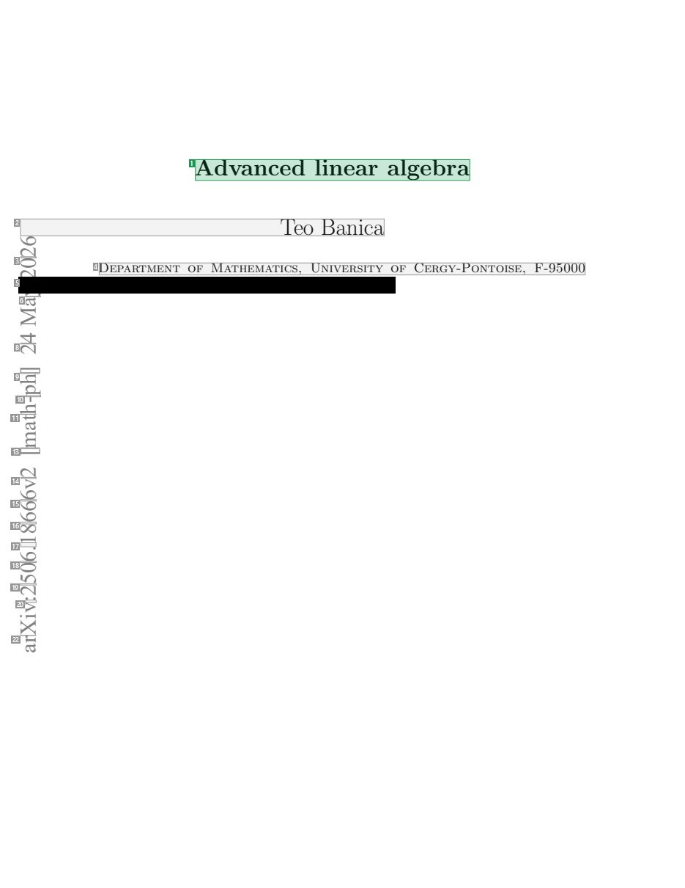
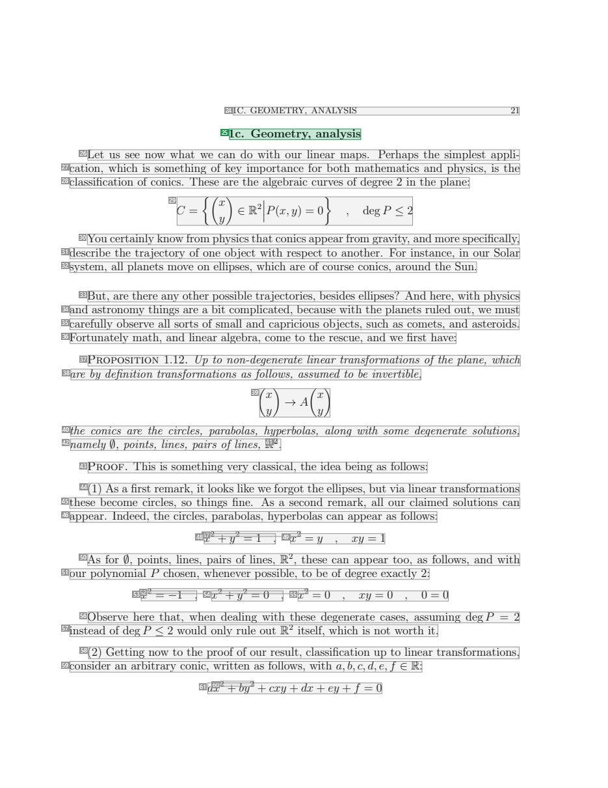
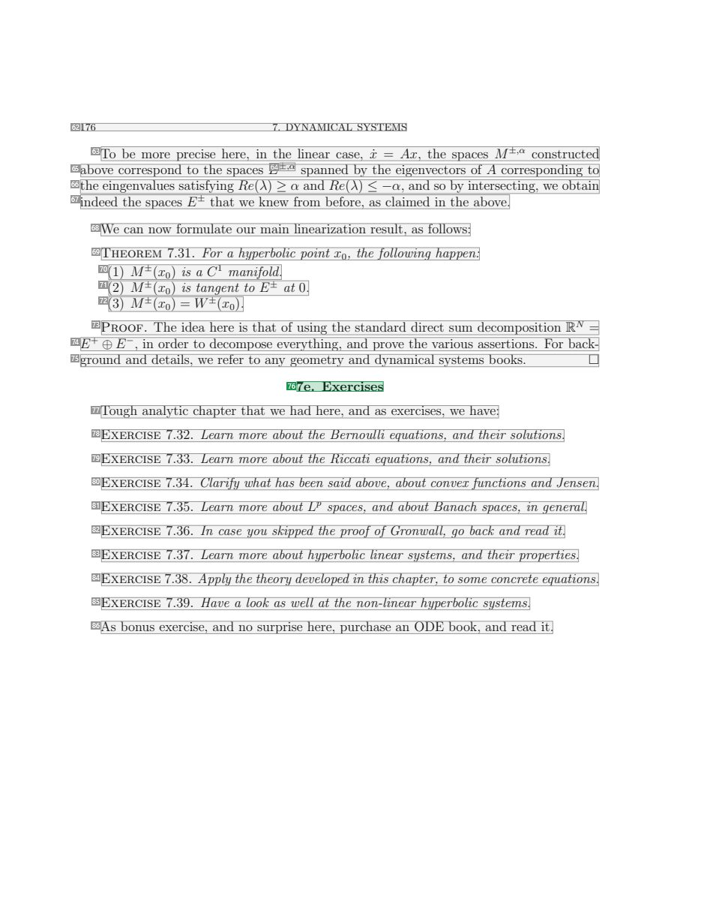
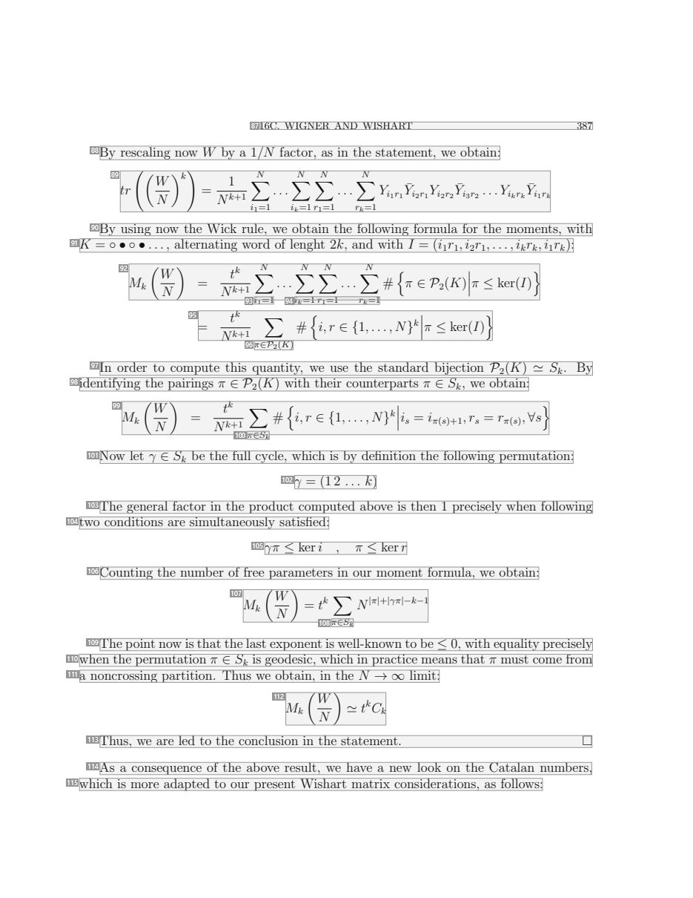

# 063 — `todo10_8/heading_corpus_100/04_giao_trinh/063_Advanced_Linear_Algebra.pdf`

Draft `P7_F1Q_HELDOUT_GOLD_DRAFT_V2`, status `DRAFT_REVIEWER_A_NOT_APPROVED`, draft sha256 `77cf8353dc8ced42bee364517c5527ac0a389ff72ce7409075f829d3c715436d`. Source sha256 `063078807adcaab114c0e521d2e937231f7537ee90b61e37eadb7f1e4e5d56ac`. [Back to index](README.md)

Approve or correct with `review-apply` lines: `APPROVE 063 by <reviewer> [because <note>]`, `063 <alias> -> E|R|O because <reason>`.

## Page 1 (FIRST)

| # | alias | text | font | draft | flag | rationale |
|---:|---|---|---|---|---|---|
| 1 | L0000:S0 | Advanced linear algebra | 20.7 | **ESTABLISHES** |  | Document title &quot;Advanced linear algebra&quot; (20.7pt, title position) |
| 2 | L0001:S0 | 6 Teo Banica | 20.7 | **OTHER** |  | Author name &quot;Teo Banica&quot; (with sidebar fragment) |
| 3 | L0002:S0 | 20 | 20 | **OTHER** |  | Default: body text, list item, table cell, page number or other non-heading content on this page |
| 4 | L0003:S0 | Department of Mathematics, University of Cergy-Pontoise, F-95000 | 12 | **OTHER** |  | Author affiliation |
| 5 | L0004:S0 | 2 Cergy-Pontoise, France. [REDACTED_EMAIL] com | 12 | **OTHER** |  | Author affiliation and email (personal data; redact for publication) |
| 6 | L0005:S0 | ay | 20 | **OTHER** |  | Default: body text, list item, table cell, page number or other non-heading content on this page |
| 7 | L0006:S0 | M | 20 | **OTHER** |  | Default: body text, list item, table cell, page number or other non-heading content on this page |
| 8 | L0007:S0 | 42 | 20 | **OTHER** |  | Default: body text, list item, table cell, page number or other non-heading content on this page |
| 9 | L0008:S0 | h] | 20 | **OTHER** |  | Default: body text, list item, table cell, page number or other non-heading content on this page |
| 10 | L0009:S0 | p- | 20 | **OTHER** |  | Default: body text, list item, table cell, page number or other non-heading content on this page |
| 11 | L0010:S0 | ht | 20 | **OTHER** |  | Default: body text, list item, table cell, page number or other non-heading content on this page |
| 12 | L0011:S0 | a | 20 | **OTHER** |  | Default: body text, list item, table cell, page number or other non-heading content on this page |
| 13 | L0012:S0 | [m | 20 | **OTHER** |  | Default: body text, list item, table cell, page number or other non-heading content on this page |
| 14 | L0013:S0 | 2v | 20 | **OTHER** |  | Default: body text, list item, table cell, page number or other non-heading content on this page |
| 15 | L0014:S0 | 66 | 20 | **OTHER** |  | Default: body text, list item, table cell, page number or other non-heading content on this page |
| 16 | L0015:S0 | 68 | 20 | **OTHER** |  | Default: body text, list item, table cell, page number or other non-heading content on this page |
| 17 | L0016:S0 | 1. | 20 | **OTHER** |  | Default: body text, list item, table cell, page number or other non-heading content on this page |
| 18 | L0017:S0 | 60 | 20 | **OTHER** |  | Default: body text, list item, table cell, page number or other non-heading content on this page |
| 19 | L0018:S0 | 52 | 20 | **OTHER** |  | Default: body text, list item, table cell, page number or other non-heading content on this page |
| 20 | L0019:S0 | :v | 20 | **OTHER** |  | Default: body text, list item, table cell, page number or other non-heading content on this page |
| 21 | L0020:S0 | i | 20 | **OTHER** |  | Default: body text, list item, table cell, page number or other non-heading content on this page |
| 22 | L0021:S0 | Xr | 20 | **OTHER** |  | Default: body text, list item, table cell, page number or other non-heading content on this page |
| 23 | L0022:S0 | a | 20 | **OTHER** |  | Default: body text, list item, table cell, page number or other non-heading content on this page |

**OTHER rows to check for a missed heading on page 1** (body size 20pt; bold or ≥ body+1pt, ≤ 12 words): none.

## Page 21 (TARGETED_STRUCTURE)

| # | alias | text | font | draft | flag | rationale |
|---:|---|---|---|---|---|---|
| 24 | L0533:S0 | 1C. GEOMETRY, ANALYSIS 21 | 9 | **OTHER** |  | Running header &quot;1C. GEOMETRY, ANALYSIS 21&quot; |
| 25 | L0534:S0 | 1c. Geometry, analysis | 12 | **ESTABLISHES** |  | Section heading &quot;1c. Geometry, analysis&quot; (own line, opens the section) |
| 26 | L0535:S0 | Let us see now what we can do with our linear maps. Perhaps the simplest appli- | 12 | **OTHER** |  | Default: body text, list item, table cell, page number or other non-heading content on this page |
| 27 | L0536:S0 | cation, which is something of key importance for both mathematics and physics, is the | 12 | **OTHER** |  | Default: body text, list item, table cell, page number or other non-heading content on this page |
| 28 | L0537:S0 | classification of conics. These are the algebraic curves of degree 2 in the plane: | 12 | **OTHER** |  | Default: body text, list item, table cell, page number or other non-heading content on this page |
| 29 | L0538:S0 | C = {(xy)∈ R2 ∣∣∣P(x, y) = 0} , degP ≤ 2 | 12 | **OTHER** |  | Default: body text, list item, table cell, page number or other non-heading content on this page |
| 30 | L0539:S0 | You certainly know from physics that conics appear from gravity, and more specifically, | 12 | **OTHER** |  | Default: body text, list item, table cell, page number or other non-heading content on this page |
| 31 | L0540:S0 | describe the trajectory of one object with respect to another. For instance, in our Solar | 12 | **OTHER** |  | Default: body text, list item, table cell, page number or other non-heading content on this page |
| 32 | L0541:S0 | system, all planets move on ellipses, which are of course conics, around the Sun. | 12 | **OTHER** |  | Default: body text, list item, table cell, page number or other non-heading content on this page |
| 33 | L0542:S0 | But, are there any other possible trajectories, besides ellipses? And here, with physics | 12 | **OTHER** |  | Default: body text, list item, table cell, page number or other non-heading content on this page |
| 34 | L0543:S0 | and astronomy things are a bit complicated, because with the planets ruled out, we must | 12 | **OTHER** |  | Default: body text, list item, table cell, page number or other non-heading content on this page |
| 35 | L0544:S0 | carefully observe all sorts of small and capricious objects, such as comets, and asteroids. | 12 | **OTHER** |  | Default: body text, list item, table cell, page number or other non-heading content on this page |
| 36 | L0545:S0 | Fortunately math, and linear algebra, come to the rescue, and we first have: | 12 | **OTHER** |  | Default: body text, list item, table cell, page number or other non-heading content on this page |
| 37 | L0546:S0 | Proposition 1.12. Up to non-degenerate linear transformations of the plane, which | 12 I | **OTHER** |  | Proposition lead-in &quot;Proposition 1.12. Up to non-degenerate ...&quot; (statement text) |
| 38 | L0547:S0 | are by definition transformations as follows, assumed to be invertible, | 12 I | **OTHER** |  | Default: body text, list item, table cell, page number or other non-heading content on this page |
| 39 | L0548:S0 | (xy)→ A(xy) | 12 I | **OTHER** |  | Default: body text, list item, table cell, page number or other non-heading content on this page |
| 40 | L0549:S0 | the conics are the circles, parabolas, hyperbolas, along with some degenerate solutions, | 12 I | **OTHER** |  | Default: body text, list item, table cell, page number or other non-heading content on this page |
| 41 | L0550:S0 | 2 | 8 | **OTHER** |  | Default: body text, list item, table cell, page number or other non-heading content on this page |
| 42 | L0551:S0 | namely ∅, points, lines, pairs of lines, R . | 12 I | **OTHER** |  | Default: body text, list item, table cell, page number or other non-heading content on this page |
| 43 | L0552:S0 | Proof. This is something very classical, the idea being as follows: | 12 | **OTHER** |  | Default: body text, list item, table cell, page number or other non-heading content on this page |
| 44 | L0553:S0 | (1) As a first remark, it looks like we forgot the ellipses, but via linear transformations | 12 | **OTHER** |  | Default: body text, list item, table cell, page number or other non-heading content on this page |
| 45 | L0554:S0 | these become circles, so things fine. As a second remark, all our claimed solutions can | 12 | **OTHER** |  | Default: body text, list item, table cell, page number or other non-heading content on this page |
| 46 | L0555:S0 | appear. Indeed, the circles, parabolas, hyperbolas can appear as follows: | 12 | **OTHER** |  | Default: body text, list item, table cell, page number or other non-heading content on this page |
| 47 | L0556:S0 | 2 2 2 | 8 | **OTHER** |  | Default: body text, list item, table cell, page number or other non-heading content on this page |
| 48 | L0557:S0 | x + y = 1 , | 12 I | **OTHER** |  | Default: body text, list item, table cell, page number or other non-heading content on this page |
| 49 | L0557:S1 | x = y , xy = 1 | 12 I | **OTHER** |  | Default: body text, list item, table cell, page number or other non-heading content on this page |
| 50 | L0558:S0 | As for ∅, points, lines, pairs of lines, R2, these can appear too, as follows, and with | 12 | **OTHER** |  | Default: body text, list item, table cell, page number or other non-heading content on this page |
| 51 | L0559:S0 | our polynomial P chosen, whenever possible, to be of degree exactly 2: | 12 | **OTHER** |  | Default: body text, list item, table cell, page number or other non-heading content on this page |
| 52 | L0560:S0 | 2 2 2 2 | 8 | **OTHER** |  | Default: body text, list item, table cell, page number or other non-heading content on this page |
| 53 | L0561:S0 | x = −1 , | 12 I | **OTHER** |  | Default: body text, list item, table cell, page number or other non-heading content on this page |
| 54 | L0561:S1 | x + y = 0 , | 12 I | **OTHER** |  | Default: body text, list item, table cell, page number or other non-heading content on this page |
| 55 | L0561:S2 | x = 0 , xy = 0 , 0 = 0 | 12 | **OTHER** |  | Default: body text, list item, table cell, page number or other non-heading content on this page |
| 56 | L0562:S0 | Observe here that, when dealing with these degenerate cases, assuming degP = 2 | 12 | **OTHER** |  | Default: body text, list item, table cell, page number or other non-heading content on this page |
| 57 | L0563:S0 | instead of degP ≤ 2 would only rule out R2 itself, which is not worth it. | 12 | **OTHER** |  | Default: body text, list item, table cell, page number or other non-heading content on this page |
| 58 | L0564:S0 | (2) Getting now to the proof of our result, classification up to linear transformations, | 12 | **OTHER** |  | Default: body text, list item, table cell, page number or other non-heading content on this page |
| 59 | L0565:S0 | consider an arbitrary conic, written as follows, with a, b, c, d, e, f ∈ R: | 12 | **OTHER** |  | Default: body text, list item, table cell, page number or other non-heading content on this page |
| 60 | L0566:S0 | 2 2 | 8 | **OTHER** |  | Default: body text, list item, table cell, page number or other non-heading content on this page |
| 61 | L0567:S0 | ax + by + cxy + dx + ey + f = 0 | 12 I | **OTHER** |  | Default: body text, list item, table cell, page number or other non-heading content on this page |

**OTHER rows to check for a missed heading on page 21** (body size 12pt; bold or ≥ body+1pt, ≤ 12 words): none.

## Page 176 (SEEDED_INTERIOR)

| # | alias | text | font | draft | flag | rationale |
|---:|---|---|---|---|---|---|
| 62 | L5743:S0 | 176 7. DYNAMICAL SYSTEMS | 9 | **OTHER** |  | Running header &quot;176 7. DYNAMICAL SYSTEMS&quot; |
| 63 | L5744:S0 | To be more precise here, in the linear case, x˙ = Ax, the spaces M&#177;,α constructed | 12 | **OTHER** |  | Default: body text, list item, table cell, page number or other non-heading content on this page |
| 64 | L5745:S0 | &#177;,α | 8 I | **OTHER** |  | Default: body text, list item, table cell, page number or other non-heading content on this page |
| 65 | L5746:S0 | above correspond to the spaces E spanned by the eigenvectors of A corresponding to | 12 | **OTHER** |  | Default: body text, list item, table cell, page number or other non-heading content on this page |
| 66 | L5747:S0 | the eingenvalues satisfying Re(λ) ≥ α and Re(λ) ≤ −α, and so by intersecting, we obtain | 12 | **OTHER** |  | Default: body text, list item, table cell, page number or other non-heading content on this page |
| 67 | L5748:S0 | indeed the spaces E&#177; that we knew from before, as claimed in the above. | 12 | **OTHER** |  | Default: body text, list item, table cell, page number or other non-heading content on this page |
| 68 | L5749:S0 | We can now formulate our main linearization result, as follows: | 12 | **OTHER** |  | Default: body text, list item, table cell, page number or other non-heading content on this page |
| 69 | L5750:S0 | Theorem 7.31. For a hyperbolic point x0, the following happen: | 12 I | **OTHER** |  | Theorem lead-in &quot;Theorem 7.31. ...&quot; (statement text) |
| 70 | L5751:S0 | (1) M&#177;(x0) is a C1 manifold. | 12 I | **OTHER** |  | Default: body text, list item, table cell, page number or other non-heading content on this page |
| 71 | L5752:S0 | (2) M&#177;(x0) is tangent to E&#177; at 0. | 12 I | **OTHER** |  | Default: body text, list item, table cell, page number or other non-heading content on this page |
| 72 | L5753:S0 | (3) M&#177;(x0) = W&#177;(x0). | 12 | **OTHER** |  | Default: body text, list item, table cell, page number or other non-heading content on this page |
| 73 | L5754:S0 | Proof. The idea here is that of using the standard direct sum decomposition RN = | 12 | **OTHER** |  | Default: body text, list item, table cell, page number or other non-heading content on this page |
| 74 | L5755:S0 | E+ ⊕ E− , in order to decompose everything, and prove the various assertions. For back- | 12 | **OTHER** |  | Default: body text, list item, table cell, page number or other non-heading content on this page |
| 75 | L5756:S0 | ground and details, we refer to any geometry and dynamical systems books. □ | 12 | **OTHER** |  | Default: body text, list item, table cell, page number or other non-heading content on this page |
| 76 | L5757:S0 | 7e. Exercises | 12 | **ESTABLISHES** |  | Section heading &quot;7e. Exercises&quot; (own line, opens the exercises section) |
| 77 | L5758:S0 | Tough analytic chapter that we had here, and as exercises, we have: | 12 | **OTHER** |  | Default: body text, list item, table cell, page number or other non-heading content on this page |
| 78 | L5759:S0 | Exercise 7.32. Learn more about the Bernoulli equations, and their solutions. | 12 I | **OTHER** |  | Default: body text, list item, table cell, page number or other non-heading content on this page |
| 79 | L5760:S0 | Exercise 7.33. Learn more about the Riccati equations, and their solutions. | 12 I | **OTHER** |  | Default: body text, list item, table cell, page number or other non-heading content on this page |
| 80 | L5761:S0 | Exercise 7.34. Clarify what has been said above, about convexfunctions and Jensen. | 12 I | **OTHER** |  | Default: body text, list item, table cell, page number or other non-heading content on this page |
| 81 | L5762:S0 | Exercise 7.35. Learn more about Lp spaces, and about Banach spaces, in general. | 12 I | **OTHER** |  | Default: body text, list item, table cell, page number or other non-heading content on this page |
| 82 | L5763:S0 | Exercise 7.36. In case you skipped the proof of Gronwall, go back and read it. | 12 I | **OTHER** |  | Default: body text, list item, table cell, page number or other non-heading content on this page |
| 83 | L5764:S0 | Exercise 7.37. Learn more about hyperbolic linear systems, and their properties. | 12 I | **OTHER** |  | Default: body text, list item, table cell, page number or other non-heading content on this page |
| 84 | L5765:S0 | Exercise 7.38. Apply the theory developed in this chapter, to some concrete equations. | 12 I | **OTHER** |  | Default: body text, list item, table cell, page number or other non-heading content on this page |
| 85 | L5766:S0 | Exercise 7.39. Have a look as well at the non-linear hyperbolic systems. | 12 I | **OTHER** |  | Default: body text, list item, table cell, page number or other non-heading content on this page |
| 86 | L5767:S0 | As bonus exercise, and no surprise here, purchase an ODE book, and read it. | 12 | **OTHER** |  | Default: body text, list item, table cell, page number or other non-heading content on this page |

**OTHER rows to check for a missed heading on page 176** (body size 12pt; bold or ≥ body+1pt, ≤ 12 words): none.

## Page 387 (SEEDED_INTERIOR)

| # | alias | text | font | draft | flag | rationale |
|---:|---|---|---|---|---|---|
| 87 | L12540:S0 | 16C. WIGNER AND WISHART 387 | 9 | **OTHER** |  | Running header &quot;16C. WIGNER AND WISHART 387&quot; |
| 88 | L12541:S0 | By rescaling now W by a 1/N factor, as in the statement, we obtain: | 12 | **OTHER** |  | Default: body text, list item, table cell, page number or other non-heading content on this page |
| 89 | L12542:S0 | tr ((WN)k)= Nk1+1 i∑1N=1 . . . i∑kN=1 r∑1N=1 . . . r∑kN=1 Yi1r1 Y&#175;i2r1 Yi2r2 Y&#175;i3r2 . . . Yikrk Y&#175;i1rk | 12 I | **OTHER** |  | Default: body text, list item, table cell, page number or other non-heading content on this page |
| 90 | L12543:S0 | By using now the Wick rule, we obtain the following formula for the moments, with | 12 | **OTHER** |  | Default: body text, list item, table cell, page number or other non-heading content on this page |
| 91 | L12544:S0 | K = ◦ • ◦ • . . . , alternating word of lenght 2k, and with I = (i1r1 , i2r1 , . . . , ikrk, i1rk): | 12 | **OTHER** |  | Default: body text, list item, table cell, page number or other non-heading content on this page |
| 92 | L12545:S0 | Mk (WN) = Ntkk+1 ∑N . . . ∑N ∑N . . . ∑N # {π ∈ P2(K)∣∣∣π ≤ ker(I)} | 12 I | **OTHER** |  | Default: body text, list item, table cell, page number or other non-heading content on this page |
| 93 | L12546:S0 | i1=1 | 8 | **OTHER** |  | Default: body text, list item, table cell, page number or other non-heading content on this page |
| 94 | L12546:S1 | ik=1 r1=1 rk=1 | 8 | **OTHER** |  | Default: body text, list item, table cell, page number or other non-heading content on this page |
| 95 | L12547:S0 | = Ntkk+1 ∑ # {i, r ∈ {1, . . . , N}k ∣∣∣π ≤ ker(I)} | 12 I | **OTHER** |  | Default: body text, list item, table cell, page number or other non-heading content on this page |
| 96 | L12548:S0 | π∈P2(K) | 8 I | **OTHER** |  | Default: body text, list item, table cell, page number or other non-heading content on this page |
| 97 | L12549:S0 | In order to compute this quantity, we use the standard bijection P2(K) ≃ Sk. By | 12 | **OTHER** |  | Default: body text, list item, table cell, page number or other non-heading content on this page |
| 98 | L12550:S0 | identifying the pairings π ∈ P2(K) with their counterparts π ∈ Sk, we obtain: | 12 | **OTHER** |  | Default: body text, list item, table cell, page number or other non-heading content on this page |
| 99 | L12551:S0 | Mk (WN) = Ntkk+1 ∑ # {i, r ∈ {1, . . . , N}k ∣∣∣is = iπ(s)+1 , rs = rπ(s) ,∀s} | 12 I | **OTHER** |  | Default: body text, list item, table cell, page number or other non-heading content on this page |
| 100 | L12552:S0 | π∈Sk | 8 I | **OTHER** |  | Default: body text, list item, table cell, page number or other non-heading content on this page |
| 101 | L12553:S0 | Now let γ ∈ Sk be the full cycle, which is by definition the following permutation: | 12 | **OTHER** |  | Default: body text, list item, table cell, page number or other non-heading content on this page |
| 102 | L12554:S0 | γ = (1 2 . . . k) | 12 I | **OTHER** |  | Default: body text, list item, table cell, page number or other non-heading content on this page |
| 103 | L12555:S0 | The general factor in the product computed above is then 1 precisely when following | 12 | **OTHER** |  | Default: body text, list item, table cell, page number or other non-heading content on this page |
| 104 | L12556:S0 | two conditions are simultaneously satisfied: | 12 | **OTHER** |  | Default: body text, list item, table cell, page number or other non-heading content on this page |
| 105 | L12557:S0 | γπ ≤ keri , π ≤ kerr | 12 I | **OTHER** |  | Default: body text, list item, table cell, page number or other non-heading content on this page |
| 106 | L12558:S0 | Counting the number of free parameters in our moment formula, we obtain: | 12 | **OTHER** |  | Default: body text, list item, table cell, page number or other non-heading content on this page |
| 107 | L12559:S0 | Mk (WN)= tk ∑ N\|π\|+\|γπ\|−k−1 | 8 I | **OTHER** |  | Default: body text, list item, table cell, page number or other non-heading content on this page |
| 108 | L12560:S0 | π∈Sk | 8 I | **OTHER** |  | Default: body text, list item, table cell, page number or other non-heading content on this page |
| 109 | L12561:S0 | The point now is that the last exponent is well-known to be ≤ 0, with equality precisely | 12 | **OTHER** |  | Default: body text, list item, table cell, page number or other non-heading content on this page |
| 110 | L12562:S0 | when the permutation π ∈ Sk is geodesic, which in practice means that π must come from | 12 | **OTHER** |  | Default: body text, list item, table cell, page number or other non-heading content on this page |
| 111 | L12563:S0 | a noncrossing partition. Thus we obtain, in the N → ∞ limit: | 12 | **OTHER** |  | Default: body text, list item, table cell, page number or other non-heading content on this page |
| 112 | L12564:S0 | Mk (WN)≃ tkCk | 12 I | **OTHER** |  | Default: body text, list item, table cell, page number or other non-heading content on this page |
| 113 | L12565:S0 | Thus, we are led to the conclusion in the statement. □ | 12 | **OTHER** |  | Default: body text, list item, table cell, page number or other non-heading content on this page |
| 114 | L12566:S0 | As a consequence of the above result, we have a new look on the Catalan numbers, | 12 | **OTHER** |  | Default: body text, list item, table cell, page number or other non-heading content on this page |
| 115 | L12567:S0 | which is more adapted to our present Wishart matrix considerations, as follows: | 12 | **OTHER** |  | Default: body text, list item, table cell, page number or other non-heading content on this page |

**OTHER rows to check for a missed heading on page 387** (body size 12pt; bold or ≥ body+1pt, ≤ 12 words): none.
