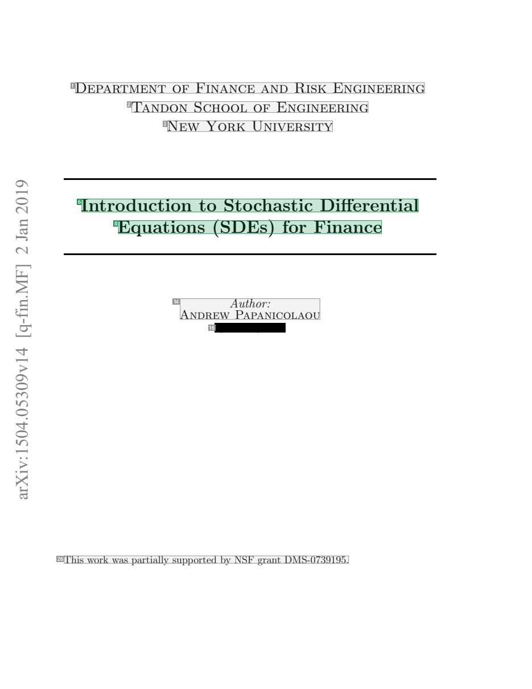
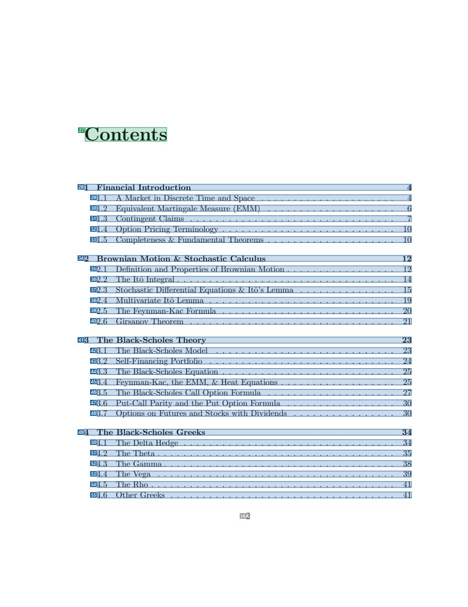
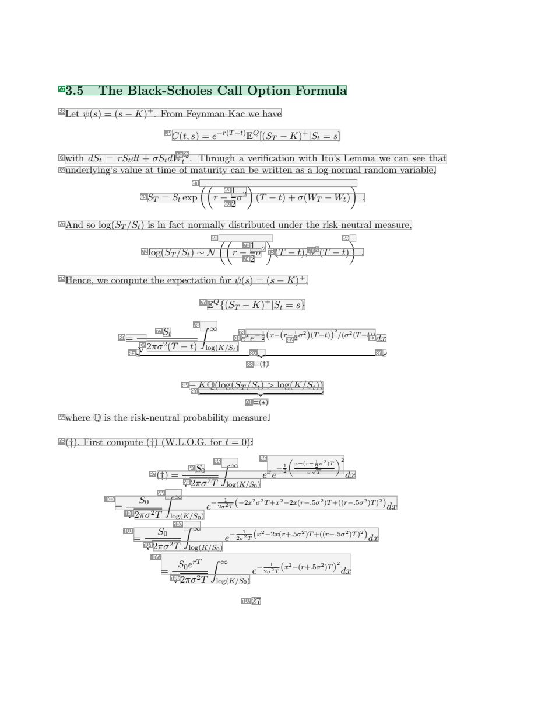
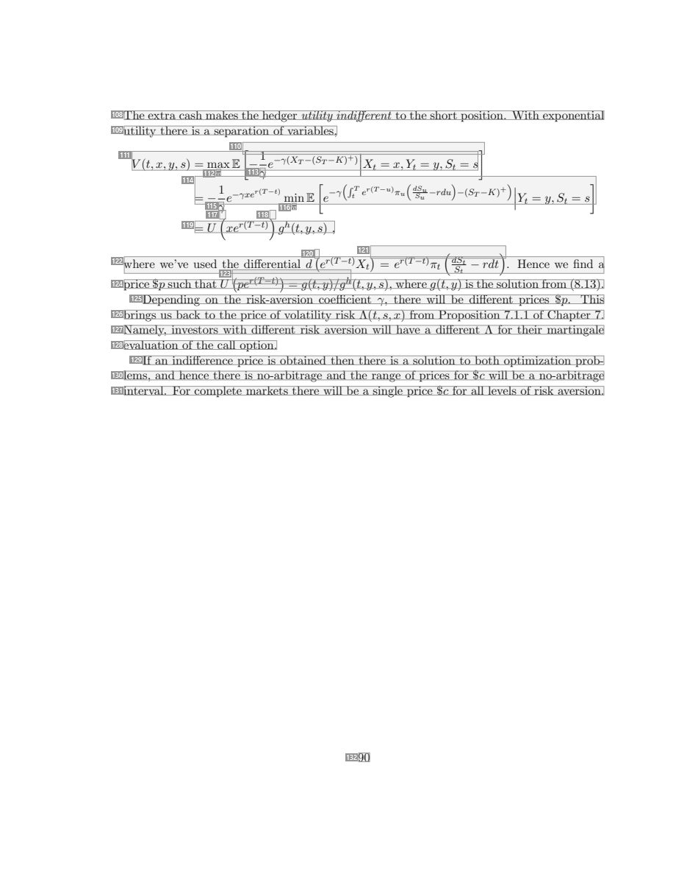

# 068 — `todo10_8/heading_corpus_100/04_giao_trinh/068_SDEs_for_Finance_Course_Notes.pdf`

Draft `P7_F1Q_HELDOUT_GOLD_DRAFT_V2`, status `DRAFT_REVIEWER_A_NOT_APPROVED`, draft sha256 `535d273a7158d97e3d75ebc73c74f98e41d297d47bbdacfce059df2a9f84f942`. Source sha256 `f598bef9d41c5401a9248f806c4dc36e0e20dec51d99ed280fd8a9e4a74a8839`. [Back to index](README.md)

Approve or correct with `review-apply` lines: `APPROVE 068 by <reviewer> [because <note>]`, `068 <alias> -> E|R|O because <reason>`.

## Page 1 (FIRST)

| # | alias | text | font | draft | flag | rationale |
|---:|---|---|---|---|---|---|
| 1 | L0000:S0 | Department of Finance and Risk Engineering | 17.2 | **OTHER** |  | Institution line &quot;Department of Finance and Risk Engineering&quot; (17.2pt, affiliation block) |
| 2 | L0001:S0 | Tandon School of Engineering | 17.2 | **OTHER** |  | Institution line &quot;Tandon School of Engineering&quot; |
| 3 | L0002:S0 | New York University | 17.2 | **OTHER** |  | Institution line &quot;New York University&quot; |
| 4 | L0003:S0 | 91 | 20 | **OTHER** |  | Default: body text, list item, table cell, page number or other non-heading content on this page |
| 5 | L0004:S0 | 02 | 20 | **OTHER** |  | Default: body text, list item, table cell, page number or other non-heading content on this page |
| 6 | L0004:S1 | Introduction to Stochastic Differential | 20.7 | **ESTABLISHES** |  | Document title line 1 &quot;Introduction to Stochastic Differential&quot; (20.7pt) |
| 7 | L0005:S0 | naJ | 20 | **OTHER** |  | Default: body text, list item, table cell, page number or other non-heading content on this page |
| 8 | L0005:S1 | Equations (SDEs) for Finance | 20.7 | **ESTABLISHES** |  | Document title line 2 &quot;Equations (SDEs) for Finance&quot; (20.7pt) |
| 9 | L0006:S0 | 2 | 20 | **OTHER** |  | Default: body text, list item, table cell, page number or other non-heading content on this page |
| 10 | L0007:S0 | ] | 20 | **OTHER** |  | Default: body text, list item, table cell, page number or other non-heading content on this page |
| 11 | L0008:S0 | F | 20 | **OTHER** |  | Default: body text, list item, table cell, page number or other non-heading content on this page |
| 12 | L0009:S0 | M. | 20 | **OTHER** |  | Default: body text, list item, table cell, page number or other non-heading content on this page |
| 13 | L0010:S0 | nif- | 20 | **OTHER** |  | Default: body text, list item, table cell, page number or other non-heading content on this page |
| 14 | L0010:S1 | AndrewAPuathpoarn:icolaou | 14.4 | **OTHER** |  | Author name (interleaved with &quot;Author:&quot; label) |
| 15 | L0011:S0 | q[ | 20 | **OTHER** |  | Default: body text, list item, table cell, page number or other non-heading content on this page |
| 16 | L0011:S1 | [REDACTED_EMAIL] | 10.9 | **OTHER** |  | Author email (personal data; redact for publication) |
| 17 | L0012:S0 | 41 | 20 | **OTHER** |  | Default: body text, list item, table cell, page number or other non-heading content on this page |
| 18 | L0013:S0 | v9 | 20 | **OTHER** |  | Default: body text, list item, table cell, page number or other non-heading content on this page |
| 19 | L0014:S0 | 03 | 20 | **OTHER** |  | Default: body text, list item, table cell, page number or other non-heading content on this page |
| 20 | L0015:S0 | 50. | 20 | **OTHER** |  | Default: body text, list item, table cell, page number or other non-heading content on this page |
| 21 | L0016:S0 | 40 | 20 | **OTHER** |  | Default: body text, list item, table cell, page number or other non-heading content on this page |
| 22 | L0017:S0 | 51: | 20 | **OTHER** |  | Default: body text, list item, table cell, page number or other non-heading content on this page |
| 23 | L0018:S0 | vi | 20 | **OTHER** |  | Default: body text, list item, table cell, page number or other non-heading content on this page |
| 24 | L0019:S0 | Xr | 20 | **OTHER** |  | Default: body text, list item, table cell, page number or other non-heading content on this page |
| 25 | L0020:S0 | a | 20 | **OTHER** |  | Default: body text, list item, table cell, page number or other non-heading content on this page |
| 26 | L0021:S0 | This work was partially supported by NSF grant DMS-0739195. | 12 | **OTHER** |  | Funding note |

**OTHER rows to check for a missed heading on page 1** (body size 20pt; bold or ≥ body+1pt, ≤ 12 words): none.

## Page 2 (TARGETED_STRUCTURE)

| # | alias | text | font | draft | flag | rationale |
|---:|---|---|---|---|---|---|
| 27 | L0022:S0 | Contents | 24.8 | **ESTABLISHES** |  | Table-of-contents heading &quot;Contents&quot; (24.8pt) |
| 28 | L0023:S0 | 1 Financial Introduction 4 | 10.9 | **REPRESENTS** |  | Table-of-contents entry (navigates to a section elsewhere) |
| 29 | L0024:S0 | 1.1 A Market in Discrete Time and Space . . . . . . . . . . . . . . . . . . . . . 4 | 10.9 | **REPRESENTS** |  | Table-of-contents entry (navigates to a section elsewhere) |
| 30 | L0025:S0 | 1.2 Equivalent Martingale Measure (EMM) . . . . . . . . . . . . . . . . . . . . 6 | 10.9 | **REPRESENTS** |  | Table-of-contents entry (navigates to a section elsewhere) |
| 31 | L0026:S0 | 1.3 Contingent Claims . . . . . . . . . . . . . . . . . . . . . . . . . . . . . . . . 7 | 10.9 | **REPRESENTS** |  | Table-of-contents entry (navigates to a section elsewhere) |
| 32 | L0027:S0 | 1.4 Option Pricing Terminology . . . . . . . . . . . . . . . . . . . . . . . . . . . 10 | 10.9 | **REPRESENTS** |  | Table-of-contents entry (navigates to a section elsewhere) |
| 33 | L0028:S0 | 1.5 Completeness &amp; Fundamental Theorems . . . . . . . . . . . . . . . . . . . . 10 | 10.9 | **REPRESENTS** |  | Table-of-contents entry (navigates to a section elsewhere) |
| 34 | L0029:S0 | 2 Brownian Motion &amp; Stochastic Calculus 12 | 10.9 | **REPRESENTS** |  | Table-of-contents entry (navigates to a section elsewhere) |
| 35 | L0030:S0 | 2.1 Definition and Properties of Brownian Motion . . . . . . . . . . . . . . . . . 12 | 10.9 | **REPRESENTS** |  | Table-of-contents entry (navigates to a section elsewhere) |
| 36 | L0031:S0 | 2.2 The Itoˆ Integral . . . . . . . . . . . . . . . . . . . . . . . . . . . . . . . . . . 14 | 10.9 | **REPRESENTS** |  | Table-of-contents entry (navigates to a section elsewhere) |
| 37 | L0032:S0 | 2.3 Stochastic Differential Equations &amp; Itoˆ’s Lemma . . . . . . . . . . . . . . . 15 | 10.9 | **REPRESENTS** |  | Table-of-contents entry (navigates to a section elsewhere) |
| 38 | L0033:S0 | 2.4 Multivariate Itoˆ Lemma . . . . . . . . . . . . . . . . . . . . . . . . . . . . . 19 | 10.9 | **REPRESENTS** |  | Table-of-contents entry (navigates to a section elsewhere) |
| 39 | L0034:S0 | 2.5 The Feynman-Kac Formula . . . . . . . . . . . . . . . . . . . . . . . . . . . 20 | 10.9 | **REPRESENTS** |  | Table-of-contents entry (navigates to a section elsewhere) |
| 40 | L0035:S0 | 2.6 Girsanov Theorem . . . . . . . . . . . . . . . . . . . . . . . . . . . . . . . . 21 | 10.9 | **REPRESENTS** |  | Table-of-contents entry (navigates to a section elsewhere) |
| 41 | L0036:S0 | 3 The Black-Scholes Theory 23 | 10.9 | **REPRESENTS** |  | Table-of-contents entry (navigates to a section elsewhere) |
| 42 | L0037:S0 | 3.1 The Black-Scholes Model . . . . . . . . . . . . . . . . . . . . . . . . . . . . 23 | 10.9 | **REPRESENTS** |  | Table-of-contents entry (navigates to a section elsewhere) |
| 43 | L0038:S0 | 3.2 Self-Financing Portfolio . . . . . . . . . . . . . . . . . . . . . . . . . . . . . 24 | 10.9 | **REPRESENTS** |  | Table-of-contents entry (navigates to a section elsewhere) |
| 44 | L0039:S0 | 3.3 The Black-Scholes Equation . . . . . . . . . . . . . . . . . . . . . . . . . . . 25 | 10.9 | **REPRESENTS** |  | Table-of-contents entry (navigates to a section elsewhere) |
| 45 | L0040:S0 | 3.4 Feynman-Kac, the EMM, &amp; Heat Equations . . . . . . . . . . . . . . . . . . 25 | 10.9 | **REPRESENTS** |  | Table-of-contents entry (navigates to a section elsewhere) |
| 46 | L0041:S0 | 3.5 The Black-Scholes Call Option Formula . . . . . . . . . . . . . . . . . . . . 27 | 10.9 | **REPRESENTS** |  | Table-of-contents entry (navigates to a section elsewhere) |
| 47 | L0042:S0 | 3.6 Put-Call Parity and the Put Option Formula . . . . . . . . . . . . . . . . . 30 | 10.9 | **REPRESENTS** |  | Table-of-contents entry (navigates to a section elsewhere) |
| 48 | L0043:S0 | 3.7 Options on Futures and Stocks with Dividends . . . . . . . . . . . . . . . . 30 | 10.9 | **REPRESENTS** |  | Table-of-contents entry (navigates to a section elsewhere) |
| 49 | L0044:S0 | 4 The Black-Scholes Greeks 34 | 10.9 | **REPRESENTS** |  | Table-of-contents entry (navigates to a section elsewhere) |
| 50 | L0045:S0 | 4.1 The Delta Hedge . . . . . . . . . . . . . . . . . . . . . . . . . . . . . . . . . 34 | 10.9 | **REPRESENTS** |  | Table-of-contents entry (navigates to a section elsewhere) |
| 51 | L0046:S0 | 4.2 The Theta . . . . . . . . . . . . . . . . . . . . . . . . . . . . . . . . . . . . . 35 | 10.9 | **REPRESENTS** |  | Table-of-contents entry (navigates to a section elsewhere) |
| 52 | L0047:S0 | 4.3 The Gamma . . . . . . . . . . . . . . . . . . . . . . . . . . . . . . . . . . . . 38 | 10.9 | **REPRESENTS** |  | Table-of-contents entry (navigates to a section elsewhere) |
| 53 | L0048:S0 | 4.4 The Vega . . . . . . . . . . . . . . . . . . . . . . . . . . . . . . . . . . . . . 39 | 10.9 | **REPRESENTS** |  | Table-of-contents entry (navigates to a section elsewhere) |
| 54 | L0049:S0 | 4.5 The Rho . . . . . . . . . . . . . . . . . . . . . . . . . . . . . . . . . . . . . . 41 | 10.9 | **REPRESENTS** |  | Table-of-contents entry (navigates to a section elsewhere) |
| 55 | L0050:S0 | 4.6 Other Greeks . . . . . . . . . . . . . . . . . . . . . . . . . . . . . . . . . . . 41 | 10.9 | **REPRESENTS** |  | Table-of-contents entry (navigates to a section elsewhere) |
| 56 | L0051:S0 | 2 | 10.9 | **OTHER** |  | Page number |

**OTHER rows to check for a missed heading on page 2** (body size 11pt; bold or ≥ body+1pt, ≤ 12 words): none.

## Page 27 (SEEDED_INTERIOR)

| # | alias | text | font | draft | flag | rationale |
|---:|---|---|---|---|---|---|
| 57 | L0805:S0 | 3.5 The Black-Scholes Call Option Formula | 14.4 | **ESTABLISHES** |  | Section heading &quot;3.5 The Black-Scholes Call Option Formula&quot; (14.4pt) |
| 58 | L0806:S0 | Let ψ(s) = (s − K)+. From Feynman-Kac we have | 10.9 | **OTHER** |  | Default: body text, list item, table cell, page number or other non-heading content on this page |
| 59 | L0807:S0 | C(t,s) = e−r(T−t)EQ[(ST − K)+\|St = s] | 10.9 I | **OTHER** |  | Default: body text, list item, table cell, page number or other non-heading content on this page |
| 60 | L0808:S0 | Q | 8 I | **OTHER** |  | Default: body text, list item, table cell, page number or other non-heading content on this page |
| 61 | L0809:S0 | with dSt = rStdt + σStdWt . Through a verification with Itoˆ’s Lemma we can see that | 10.9 | **OTHER** |  | Default: body text, list item, table cell, page number or other non-heading content on this page |
| 62 | L0810:S0 | underlying’s value at time of maturity can be written as a log-normal random variable, | 10.9 | **OTHER** |  | Default: body text, list item, table cell, page number or other non-heading content on this page |
| 63 | L0811:S0 | (( ) ) | 10.9 | **OTHER** |  | Default: body text, list item, table cell, page number or other non-heading content on this page |
| 64 | L0812:S0 | 1 2 | 8 | **OTHER** |  | Default: body text, list item, table cell, page number or other non-heading content on this page |
| 65 | L0813:S0 | ST = St exp r − σ (T − t) + σ(WT − Wt) . | 10.9 I | **OTHER** |  | Default: body text, list item, table cell, page number or other non-heading content on this page |
| 66 | L0814:S0 | 2 | 10.9 | **OTHER** |  | Default: body text, list item, table cell, page number or other non-heading content on this page |
| 67 | L0815:S0 | And so log(ST /St) is in fact normally distributed under the risk-neutral measure, | 10.9 | **OTHER** |  | Default: body text, list item, table cell, page number or other non-heading content on this page |
| 68 | L0816:S0 | (( ) | 10.9 | **OTHER** |  | Default: body text, list item, table cell, page number or other non-heading content on this page |
| 69 | L0816:S1 | ) | 10.9 | **OTHER** |  | Default: body text, list item, table cell, page number or other non-heading content on this page |
| 70 | L0817:S0 | 1 2 | 8 | **OTHER** |  | Default: body text, list item, table cell, page number or other non-heading content on this page |
| 71 | L0817:S1 | 2 | 8 | **OTHER** |  | Default: body text, list item, table cell, page number or other non-heading content on this page |
| 72 | L0818:S0 | log(ST /St) ∼ N r − σ | 10.9 I | **OTHER** |  | Default: body text, list item, table cell, page number or other non-heading content on this page |
| 73 | L0818:S1 | (T − t),σ (T − t) . | 10.9 I | **OTHER** |  | Default: body text, list item, table cell, page number or other non-heading content on this page |
| 74 | L0819:S0 | 2 | 10.9 | **OTHER** |  | Default: body text, list item, table cell, page number or other non-heading content on this page |
| 75 | L0820:S0 | Hence, we compute the expectation for ψ(s) = (s − K)+, | 10.9 | **OTHER** |  | Default: body text, list item, table cell, page number or other non-heading content on this page |
| 76 | L0821:S0 | EQ{(ST − K)+\|St = s} | 10.9 I | **OTHER** |  | Default: body text, list item, table cell, page number or other non-heading content on this page |
| 77 | L0822:S0 | St | 8 I | **OTHER** |  | Default: body text, list item, table cell, page number or other non-heading content on this page |
| 78 | L0822:S1 | ∫ ∞ | 8 | **OTHER** |  | Default: body text, list item, table cell, page number or other non-heading content on this page |
| 79 | L0822:S2 | x −1 (x−(r−1 σ2)(T−t))2/(σ2(T−t)) | 8 I | **OTHER** |  | Default: body text, list item, table cell, page number or other non-heading content on this page |
| 80 | L0823:S0 | = √ | 10.9 | **OTHER** |  | Default: body text, list item, table cell, page number or other non-heading content on this page |
| 81 | L0823:S1 | e e 2 | 10.9 I | **OTHER** |  | Default: body text, list item, table cell, page number or other non-heading content on this page |
| 82 | L0823:S2 | 2 | 6 | **OTHER** |  | Default: body text, list item, table cell, page number or other non-heading content on this page |
| 83 | L0823:S3 | dx | 10.9 I | **OTHER** |  | Default: body text, list item, table cell, page number or other non-heading content on this page |
| 84 | L0824:S0 | 2πσ2(T − t) log(K/St) | 8 I | **OTHER** |  | Default: body text, list item, table cell, page number or other non-heading content on this page |
| 85 | L0825:S0 | ︸ | 10.9 | **OTHER** |  | Default: body text, list item, table cell, page number or other non-heading content on this page |
| 86 | L0825:S1 | ︷︷ | 10.9 | **OTHER** |  | Default: body text, list item, table cell, page number or other non-heading content on this page |
| 87 | L0825:S2 | ︸ | 10.9 | **OTHER** |  | Default: body text, list item, table cell, page number or other non-heading content on this page |
| 88 | L0826:S0 | =(†) | 8 | **OTHER** |  | Default: body text, list item, table cell, page number or other non-heading content on this page |
| 89 | L0827:S0 | −KQ(log(ST /St) &gt; log(K/St)) | 10.9 I | **OTHER** |  | Default: body text, list item, table cell, page number or other non-heading content on this page |
| 90 | L0828:S0 | ︸ ︷︷ ︸ | 10.9 | **OTHER** |  | Default: body text, list item, table cell, page number or other non-heading content on this page |
| 91 | L0829:S0 | =(?) | 8 | **OTHER** |  | Default: body text, list item, table cell, page number or other non-heading content on this page |
| 92 | L0830:S0 | where Q is the risk-neutral probability measure. | 10.9 | **OTHER** |  | Default: body text, list item, table cell, page number or other non-heading content on this page |
| 93 | L0831:S0 | (†). First compute (†) (W.L.O.G. for t = 0): | 10.9 | **OTHER** |  | Default: body text, list item, table cell, page number or other non-heading content on this page |
| 94 | L0832:S0 | S0 | 8 I | **OTHER** |  | Default: body text, list item, table cell, page number or other non-heading content on this page |
| 95 | L0832:S1 | ∫ ∞ | 8 | **OTHER** |  | Default: body text, list item, table cell, page number or other non-heading content on this page |
| 96 | L0832:S2 | x −12 (x−(rσ−√12Tσ2)T )2 | 6 I | **OTHER** |  | Default: body text, list item, table cell, page number or other non-heading content on this page |
| 97 | L0833:S0 | (†) = √ e e dx | 10.9 I | **OTHER** |  | Default: body text, list item, table cell, page number or other non-heading content on this page |
| 98 | L0834:S0 | 2πσ2T log(K/S0) | 8 | **OTHER** |  | Default: body text, list item, table cell, page number or other non-heading content on this page |
| 99 | L0835:S0 | ∫ ∞ | 8 | **OTHER** |  | Default: body text, list item, table cell, page number or other non-heading content on this page |
| 100 | L0836:S0 | = √ S0 e−2σ12T (−2x2σ2T+x2−2x(r−.5σ2)T+((r−.5σ2)T)2)dx | 8 I | **OTHER** |  | Default: body text, list item, table cell, page number or other non-heading content on this page |
| 101 | L0837:S0 | 2πσ2T log(K/S0) | 8 | **OTHER** |  | Default: body text, list item, table cell, page number or other non-heading content on this page |
| 102 | L0838:S0 | ∫ ∞ | 8 | **OTHER** |  | Default: body text, list item, table cell, page number or other non-heading content on this page |
| 103 | L0839:S0 | = √ S0 e−2σ12T (x2−2x(r+.5σ2)T+((r−.5σ2)T)2)dx | 8 I | **OTHER** |  | Default: body text, list item, table cell, page number or other non-heading content on this page |
| 104 | L0840:S0 | 2πσ2T log(K/S0) | 8 | **OTHER** |  | Default: body text, list item, table cell, page number or other non-heading content on this page |
| 105 | L0841:S0 | = √S0erT ∫ ∞ e−2σ12T (x2−(r+.5σ2)T)2 dx | 8 I | **OTHER** |  | Default: body text, list item, table cell, page number or other non-heading content on this page |
| 106 | L0842:S0 | 2πσ2T log(K/S0) | 8 | **OTHER** |  | Default: body text, list item, table cell, page number or other non-heading content on this page |
| 107 | L0843:S0 | 27 | 10.9 | **OTHER** |  | Page number |

**OTHER rows to check for a missed heading on page 27** (body size 11pt; bold or ≥ body+1pt, ≤ 12 words): none.

## Page 90 (SEEDED_INTERIOR)

| # | alias | text | font | draft | flag | rationale |
|---:|---|---|---|---|---|---|
| 108 | L2704:S0 | The extra cash makes the hedger utility indifferent to the short position. With exponential | 10.9 | **OTHER** |  | Default: body text, list item, table cell, page number or other non-heading content on this page |
| 109 | L2705:S0 | utility there is a separation of variables, | 10.9 | **OTHER** |  | Default: body text, list item, table cell, page number or other non-heading content on this page |
| 110 | L2706:S0 | [ ∣ ] | 10.9 | **OTHER** |  | Default: body text, list item, table cell, page number or other non-heading content on this page |
| 111 | L2707:S0 | V (t,x,y,s) = maxE −1e−γ(XT −(ST −K)+)∣∣Xt = x,Yt = y,St = s | 10.9 I | **OTHER** |  | Default: body text, list item, table cell, page number or other non-heading content on this page |
| 112 | L2708:S0 | π | 8 I | **OTHER** |  | Default: body text, list item, table cell, page number or other non-heading content on this page |
| 113 | L2708:S1 | γ | 10.9 I | **OTHER** |  | Default: body text, list item, table cell, page number or other non-heading content on this page |
| 114 | L2709:S0 | = −1e−γxer(T−t) minE[e−γ(∫tT er(T−u)πu(dSSuu −rdu)−(ST −K)+)∣∣∣Yt = y,St = s] | 8 I | **OTHER** |  | Default: body text, list item, table cell, page number or other non-heading content on this page |
| 115 | L2710:S0 | γ | 10.9 I | **OTHER** |  | Default: body text, list item, table cell, page number or other non-heading content on this page |
| 116 | L2710:S1 | π | 8 I | **OTHER** |  | Default: body text, list item, table cell, page number or other non-heading content on this page |
| 117 | L2711:S0 | ( | 10.9 | **OTHER** |  | Default: body text, list item, table cell, page number or other non-heading content on this page |
| 118 | L2711:S1 | ) | 10.9 | **OTHER** |  | Default: body text, list item, table cell, page number or other non-heading content on this page |
| 119 | L2712:S0 | = U xer(T−t) gh(t,y,s) , | 10.9 I | **OTHER** |  | Default: body text, list item, table cell, page number or other non-heading content on this page |
| 120 | L2713:S0 | ( | 10.9 | **OTHER** |  | Default: body text, list item, table cell, page number or other non-heading content on this page |
| 121 | L2713:S1 | ) ( ) | 10.9 | **OTHER** |  | Default: body text, list item, table cell, page number or other non-heading content on this page |
| 122 | L2714:S0 | where we’ve used the differential d er(T−t)Xt = er(T−t)πt dSStt − rdt . Hence we find a | 10.9 | **OTHER** |  | Default: body text, list item, table cell, page number or other non-heading content on this page |
| 123 | L2715:S0 | ( r(T−t)) h | 8 I | **OTHER** |  | Default: body text, list item, table cell, page number or other non-heading content on this page |
| 124 | L2716:S0 | price $p such that U pe = g(t,y)/g (t,y,s), where g(t,y) is the solution from (8.13). | 10.9 | **OTHER** |  | Default: body text, list item, table cell, page number or other non-heading content on this page |
| 125 | L2717:S0 | Depending on the risk-aversion coefficient γ, there will be different prices $p. This | 10.9 | **OTHER** |  | Default: body text, list item, table cell, page number or other non-heading content on this page |
| 126 | L2718:S0 | brings us back to the price of volatility risk Λ(t,s,x) from Proposition 7.1.1 of Chapter 7. | 10.9 | **OTHER** |  | Default: body text, list item, table cell, page number or other non-heading content on this page |
| 127 | L2719:S0 | Namely, investors with different risk aversion will have a different Λ for their martingale | 10.9 | **OTHER** |  | Default: body text, list item, table cell, page number or other non-heading content on this page |
| 128 | L2720:S0 | evaluation of the call option. | 10.9 | **OTHER** |  | Default: body text, list item, table cell, page number or other non-heading content on this page |
| 129 | L2721:S0 | If an indifference price is obtained then there is a solution to both optimization prob- | 10.9 | **OTHER** |  | Default: body text, list item, table cell, page number or other non-heading content on this page |
| 130 | L2722:S0 | lems, and hence there is no-arbitrage and the range of prices for $c will be a no-arbitrage | 10.9 | **OTHER** |  | Default: body text, list item, table cell, page number or other non-heading content on this page |
| 131 | L2723:S0 | interval. For complete markets there will be a single price $c for all levels of risk aversion. | 10.9 | **OTHER** |  | Default: body text, list item, table cell, page number or other non-heading content on this page |
| 132 | L2724:S0 | 90 | 10.9 | **OTHER** |  | Page number |

**OTHER rows to check for a missed heading on page 90** (body size 11pt; bold or ≥ body+1pt, ≤ 12 words): none.
