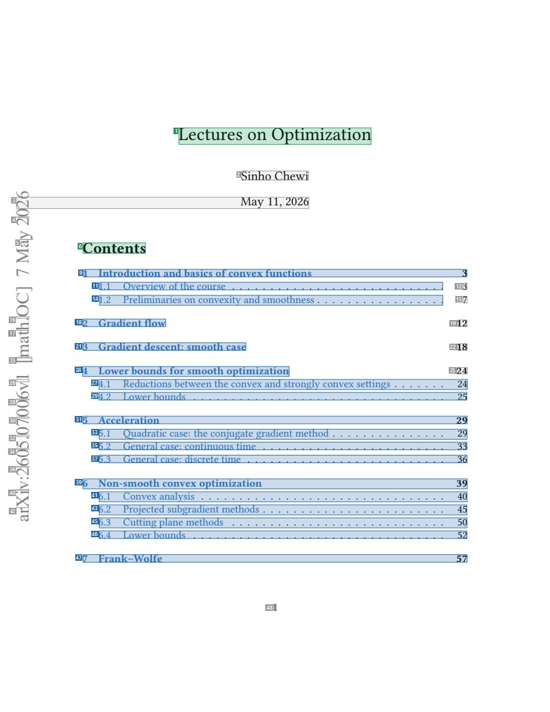
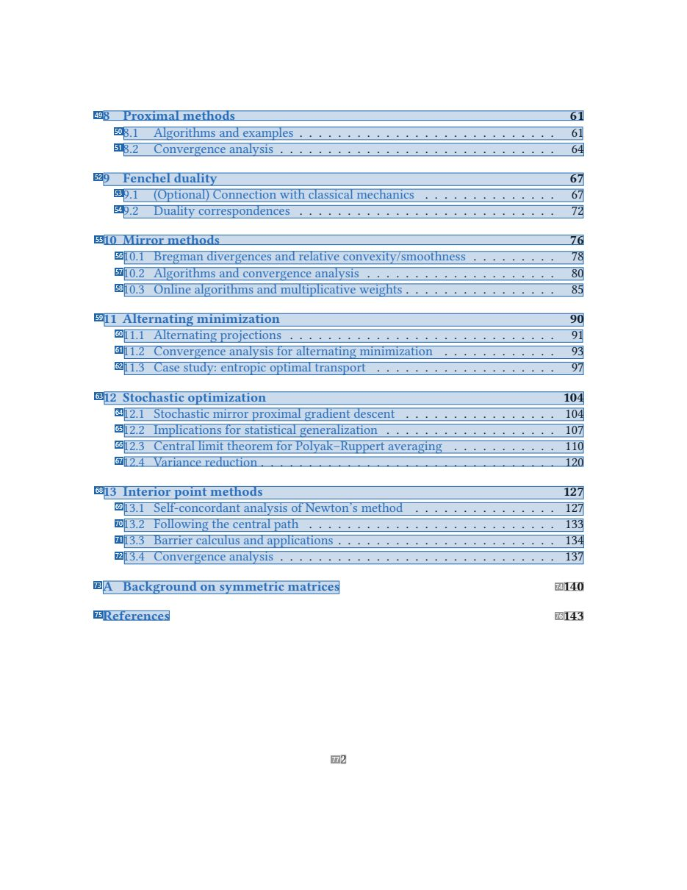
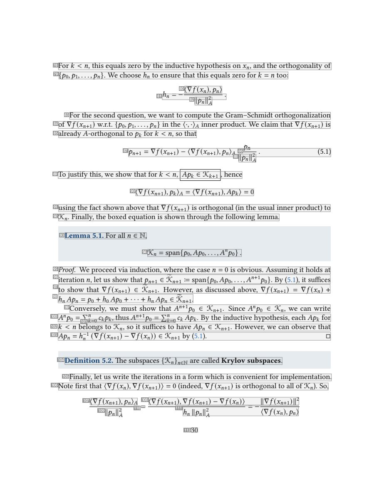
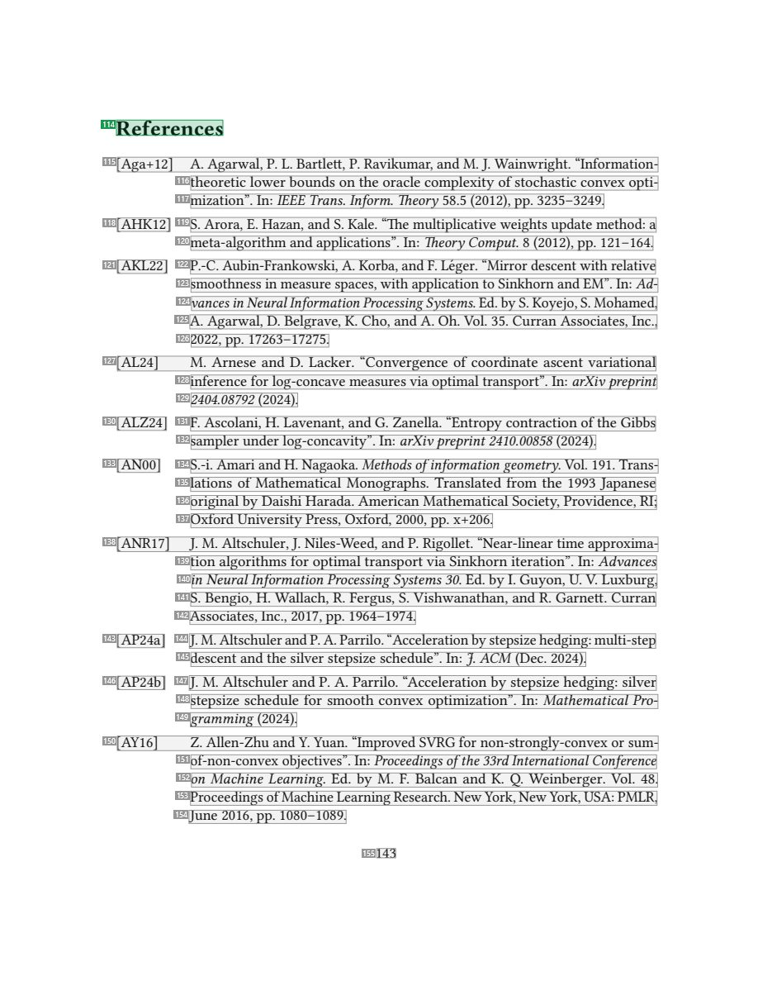

# 070 — `todo10_8/heading_corpus_100/04_giao_trinh/070_Lectures_on_Optimization_Yale.pdf`

Draft `P7_F1Q_HELDOUT_GOLD_DRAFT_V2`, status `DRAFT_REVIEWER_A_NOT_APPROVED`, draft sha256 `97858176ee1abcc457709b9b5cabc009bdd7fccc81cbd988cca903654c73288a`. Source sha256 `9e28afeacb0121b79691fadc6af9c145ccd787bffd2cf9c3f2310806112e644b`. [Back to index](README.md)

Approve or correct with `review-apply` lines: `APPROVE 070 by <reviewer> [because <note>]`, `070 <alias> -> E|R|O because <reason>`.

## Page 1 (FIRST)

| # | alias | text | font | draft | flag | rationale |
|---:|---|---|---|---|---|---|
| 1 | L0000:S0 | Lectures on Optimization | 20.7 | **ESTABLISHES** |  | Document title &quot;Lectures on Optimization&quot; (20.7pt) |
| 2 | L0001:S0 | Sinho Chewi | 14.4 | **OTHER** |  | Author name |
| 3 | L0002:S0 | 62 May 11, 2026 | 14.4 | **OTHER** |  | Date (with sidebar fragment) |
| 4 | L0003:S0 | 02 | 20 | **OTHER** |  | Default: body text, list item, table cell, page number or other non-heading content on this page |
| 5 | L0004:S0 | ay | 20 | **OTHER** |  | Default: body text, list item, table cell, page number or other non-heading content on this page |
| 6 | L0005:S0 | Contents | 17.2 | **ESTABLISHES** |  | Table-of-contents heading &quot;Contents&quot; (17.2pt) |
| 7 | L0006:S0 | M | 20 | **OTHER** |  | Default: body text, list item, table cell, page number or other non-heading content on this page |
| 8 | L0007:S0 | 7 | 20 | **OTHER** |  | Default: body text, list item, table cell, page number or other non-heading content on this page |
| 9 | L0008:S0 | 1 Introduction andbasics ofconvex functions 3 | 12 | **REPRESENTS** |  | Table-of-contents entry (navigates to a section elsewhere) |
| 10 | L0009:S0 | ] | 20 | **OTHER** |  | Default: body text, list item, table cell, page number or other non-heading content on this page |
| 11 | L0010:S0 | 1.1 Overview ofthe course . . . . . . . . . . . . . . . . . . . . . . . . . . . . | 12 | **REPRESENTS** |  | Table-of-contents entry (navigates to a section elsewhere) |
| 12 | L0010:S1 | 3 | 12 | **OTHER** |  | Default: body text, list item, table cell, page number or other non-heading content on this page |
| 13 | L0011:S0 | C | 20 | **OTHER** |  | Default: body text, list item, table cell, page number or other non-heading content on this page |
| 14 | L0012:S0 | 1.2 Preliminaries on convexity and smoothness . . . . . . . . . . . . . . . . . | 12 | **REPRESENTS** |  | Table-of-contents entry (navigates to a section elsewhere) |
| 15 | L0012:S1 | 7 | 12 | **OTHER** |  | Default: body text, list item, table cell, page number or other non-heading content on this page |
| 16 | L0013:S0 | O. | 20 | **OTHER** |  | Default: body text, list item, table cell, page number or other non-heading content on this page |
| 17 | L0014:S0 | ht | 20 | **OTHER** |  | Default: body text, list item, table cell, page number or other non-heading content on this page |
| 18 | L0015:S0 | 2 Gradient flow | 12 | **REPRESENTS** |  | Table-of-contents entry (navigates to a section elsewhere) |
| 19 | L0015:S1 | 12 | 12 | **OTHER** |  | Default: body text, list item, table cell, page number or other non-heading content on this page |
| 20 | L0016:S0 | a | 20 | **OTHER** |  | Default: body text, list item, table cell, page number or other non-heading content on this page |
| 21 | L0017:S0 | 3 Gradient descent: smooth case | 12 | **REPRESENTS** |  | Table-of-contents entry (navigates to a section elsewhere) |
| 22 | L0017:S1 | 18 | 12 | **OTHER** |  | Default: body text, list item, table cell, page number or other non-heading content on this page |
| 23 | L0018:S0 | [m | 20 | **OTHER** |  | Default: body text, list item, table cell, page number or other non-heading content on this page |
| 24 | L0019:S0 | 4 Lowerbounds for smooth optimization | 12 | **REPRESENTS** |  | Table-of-contents entry (navigates to a section elsewhere) |
| 25 | L0019:S1 | 24 | 12 | **OTHER** |  | Default: body text, list item, table cell, page number or other non-heading content on this page |
| 26 | L0020:S0 | 1v | 20 | **OTHER** |  | Default: body text, list item, table cell, page number or other non-heading content on this page |
| 27 | L0020:S1 | 4.1 Reductions between the convex and strongly convex settings . . . . . . . 24 | 12 | **REPRESENTS** |  | Table-of-contents entry (navigates to a section elsewhere) |
| 28 | L0021:S0 | 60 | 20 | **OTHER** |  | Default: body text, list item, table cell, page number or other non-heading content on this page |
| 29 | L0021:S1 | 4.2 Lower bounds . . . . . . . . . . . . . . . . . . . . . . . . . . . . . . . . . 25 | 12 | **REPRESENTS** |  | Table-of-contents entry (navigates to a section elsewhere) |
| 30 | L0022:S0 | 07 | 20 | **OTHER** |  | Default: body text, list item, table cell, page number or other non-heading content on this page |
| 31 | L0022:S1 | 5 Acceleration 29 | 12 | **REPRESENTS** |  | Table-of-contents entry (navigates to a section elsewhere) |
| 32 | L0023:S0 | 0. | 20 | **OTHER** |  | Default: body text, list item, table cell, page number or other non-heading content on this page |
| 33 | L0023:S1 | 5.1 Quadratic case: the conjugate gradient method . . . . . . . . . . . . . . . 29 | 12 | **REPRESENTS** |  | Table-of-contents entry (navigates to a section elsewhere) |
| 34 | L0024:S0 | 50 | 20 | **OTHER** |  | Default: body text, list item, table cell, page number or other non-heading content on this page |
| 35 | L0024:S1 | 5.2 General case: continuous time . . . . . . . . . . . . . . . . . . . . . . . . 33 | 12 | **REPRESENTS** |  | Table-of-contents entry (navigates to a section elsewhere) |
| 36 | L0025:S0 | 62 | 20 | **OTHER** |  | Default: body text, list item, table cell, page number or other non-heading content on this page |
| 37 | L0026:S0 | 5.3 General case: discrete time . . . . . . . . . . . . . . . . . . . . . . . . . . 36 | 12 | **REPRESENTS** |  | Table-of-contents entry (navigates to a section elsewhere) |
| 38 | L0027:S0 | : | 20 | **OTHER** |  | Default: body text, list item, table cell, page number or other non-heading content on this page |
| 39 | L0028:S0 | 6 Non-smooth convex optimization 39 | 12 | **REPRESENTS** |  | Table-of-contents entry (navigates to a section elsewhere) |
| 40 | L0029:S0 | iv | 20 | **OTHER** |  | Default: body text, list item, table cell, page number or other non-heading content on this page |
| 41 | L0030:S0 | 6.1 Convex analysis . . . . . . . . . . . . . . . . . . . . . . . . . . . . . . . . 40 | 12 | **REPRESENTS** |  | Table-of-contents entry (navigates to a section elsewhere) |
| 42 | L0031:S0 | Xr | 20 | **OTHER** |  | Default: body text, list item, table cell, page number or other non-heading content on this page |
| 43 | L0031:S1 | 6.2 Projected subgradient methods . . . . . . . . . . . . . . . . . . . . . . . . 45 | 12 | **REPRESENTS** |  | Table-of-contents entry (navigates to a section elsewhere) |
| 44 | L0032:S0 | a | 20 | **OTHER** |  | Default: body text, list item, table cell, page number or other non-heading content on this page |
| 45 | L0033:S0 | 6.3 Cutting plane methods . . . . . . . . . . . . . . . . . . . . . . . . . . . . 50 | 12 | **REPRESENTS** |  | Table-of-contents entry (navigates to a section elsewhere) |
| 46 | L0034:S0 | 6.4 Lower bounds . . . . . . . . . . . . . . . . . . . . . . . . . . . . . . . . . 52 | 12 | **REPRESENTS** |  | Table-of-contents entry (navigates to a section elsewhere) |
| 47 | L0035:S0 | 7 Frank–Wolfe 57 | 12 | **REPRESENTS** |  | Table-of-contents entry (navigates to a section elsewhere) |
| 48 | L0036:S0 | 1 | 12 | **OTHER** |  | Page number |

**OTHER rows to check for a missed heading on page 1** (body size 12pt; bold or ≥ body+1pt, ≤ 12 words): #2 `L0001:S0` Sinho Chewi (14.4), #3 `L0002:S0` 62 May 11, 2026 (14.4), #4 `L0003:S0` 02 (20), #5 `L0004:S0` ay (20), #7 `L0006:S0` M (20), #8 `L0007:S0` 7 (20), #10 `L0009:S0` ] (20), #13 `L0011:S0` C (20), #16 `L0013:S0` O. (20), #17 `L0014:S0` ht (20), #20 `L0016:S0` a (20), #23 `L0018:S0` [m (20), #26 `L0020:S0` 1v (20), #28 `L0021:S0` 60 (20), #30 `L0022:S0` 07 (20), #32 `L0023:S0` 0. (20), #34 `L0024:S0` 50 (20), #36 `L0025:S0` 62 (20), #38 `L0027:S0` : (20), #40 `L0029:S0` iv (20), #42 `L0031:S0` Xr (20), #44 `L0032:S0` a (20).

## Page 2 (TARGETED_STRUCTURE)

| # | alias | text | font | draft | flag | rationale |
|---:|---|---|---|---|---|---|
| 49 | L0037:S0 | 8 Proximal methods 61 | 12 | **REPRESENTS** |  | Table-of-contents entry (navigates to a section elsewhere) |
| 50 | L0038:S0 | 8.1 Algorithms and examples . . . . . . . . . . . . . . . . . . . . . . . . . . . 61 | 12 | **REPRESENTS** |  | Table-of-contents entry (navigates to a section elsewhere) |
| 51 | L0039:S0 | 8.2 Convergence analysis . . . . . . . . . . . . . . . . . . . . . . . . . . . . . 64 | 12 | **REPRESENTS** |  | Table-of-contents entry (navigates to a section elsewhere) |
| 52 | L0040:S0 | 9 Fenchel duality 67 | 12 | **REPRESENTS** |  | Table-of-contents entry (navigates to a section elsewhere) |
| 53 | L0041:S0 | 9.1 (Optional) Connection with classical mechanics . . . . . . . . . . . . . . 67 | 12 | **REPRESENTS** |  | Table-of-contents entry (navigates to a section elsewhere) |
| 54 | L0042:S0 | 9.2 Duality correspondences . . . . . . . . . . . . . . . . . . . . . . . . . . . 72 | 12 | **REPRESENTS** |  | Table-of-contents entry (navigates to a section elsewhere) |
| 55 | L0043:S0 | 10 Mirror methods 76 | 12 | **REPRESENTS** |  | Table-of-contents entry (navigates to a section elsewhere) |
| 56 | L0044:S0 | 10.1 Bregman divergences and relative convexity/smoothness . . . . . . . . . 78 | 12 | **REPRESENTS** |  | Table-of-contents entry (navigates to a section elsewhere) |
| 57 | L0045:S0 | 10.2 Algorithms and convergence analysis . . . . . . . . . . . . . . . . . . . . 80 | 12 | **REPRESENTS** |  | Table-of-contents entry (navigates to a section elsewhere) |
| 58 | L0046:S0 | 10.3 Online algorithms and multiplicative weights . . . . . . . . . . . . . . . . 85 | 12 | **REPRESENTS** |  | Table-of-contents entry (navigates to a section elsewhere) |
| 59 | L0047:S0 | 11 Alternating minimization 90 | 12 | **REPRESENTS** |  | Table-of-contents entry (navigates to a section elsewhere) |
| 60 | L0048:S0 | 11.1 Alternating projections . . . . . . . . . . . . . . . . . . . . . . . . . . . . 91 | 12 | **REPRESENTS** |  | Table-of-contents entry (navigates to a section elsewhere) |
| 61 | L0049:S0 | 11.2 Convergence analysis for alternating minimization . . . . . . . . . . . . 93 | 12 | **REPRESENTS** |  | Table-of-contents entry (navigates to a section elsewhere) |
| 62 | L0050:S0 | 11.3 Case study: entropic optimal transport . . . . . . . . . . . . . . . . . . . 97 | 12 | **REPRESENTS** |  | Table-of-contents entry (navigates to a section elsewhere) |
| 63 | L0051:S0 | 12 Stochastic optimization 104 | 12 | **REPRESENTS** |  | Table-of-contents entry (navigates to a section elsewhere) |
| 64 | L0052:S0 | 12.1 Stochastic mirror proximal gradient descent . . . . . . . . . . . . . . . . 104 | 12 | **REPRESENTS** |  | Table-of-contents entry (navigates to a section elsewhere) |
| 65 | L0053:S0 | 12.2 Implications for statistical generalization . . . . . . . . . . . . . . . . . . 107 | 12 | **REPRESENTS** |  | Table-of-contents entry (navigates to a section elsewhere) |
| 66 | L0054:S0 | 12.3 Central limit theorem for Polyak–Ruppert averaging . . . . . . . . . . . 110 | 12 | **REPRESENTS** |  | Table-of-contents entry (navigates to a section elsewhere) |
| 67 | L0055:S0 | 12.4 Variance reduction . . . . . . . . . . . . . . . . . . . . . . . . . . . . . . . 120 | 12 | **REPRESENTS** |  | Table-of-contents entry (navigates to a section elsewhere) |
| 68 | L0056:S0 | 13 Interior point methods 127 | 12 | **REPRESENTS** |  | Table-of-contents entry (navigates to a section elsewhere) |
| 69 | L0057:S0 | 13.1 Self-concordant analysis ofNewton’s method . . . . . . . . . . . . . . . 127 | 12 | **REPRESENTS** |  | Table-of-contents entry (navigates to a section elsewhere) |
| 70 | L0058:S0 | 13.2 Following the central path . . . . . . . . . . . . . . . . . . . . . . . . . . 133 | 12 | **REPRESENTS** |  | Table-of-contents entry (navigates to a section elsewhere) |
| 71 | L0059:S0 | 13.3 Barrier calculus and applications . . . . . . . . . . . . . . . . . . . . . . . 134 | 12 | **REPRESENTS** |  | Table-of-contents entry (navigates to a section elsewhere) |
| 72 | L0060:S0 | 13.4 Convergence analysis . . . . . . . . . . . . . . . . . . . . . . . . . . . . . 137 | 12 | **REPRESENTS** |  | Table-of-contents entry (navigates to a section elsewhere) |
| 73 | L0061:S0 | A Background on symmetric matrices | 12 | **REPRESENTS** |  | Table-of-contents entry (navigates to a section elsewhere) |
| 74 | L0061:S1 | 140 | 12 | **OTHER** |  | Default: body text, list item, table cell, page number or other non-heading content on this page |
| 75 | L0062:S0 | References | 12 | **REPRESENTS** |  | Table-of-contents entry (navigates to a section elsewhere) |
| 76 | L0062:S1 | 143 | 12 | **OTHER** |  | Default: body text, list item, table cell, page number or other non-heading content on this page |
| 77 | L0063:S0 | 2 | 12 | **OTHER** |  | Page number |

**OTHER rows to check for a missed heading on page 2** (body size 12pt; bold or ≥ body+1pt, ≤ 12 words): none.

## Page 30 (SEEDED_INTERIOR)

| # | alias | text | font | draft | flag | rationale |
|---:|---|---|---|---|---|---|
| 78 | L0877:S0 | For&#119896; &lt; &#119899;, this equals zero by the inductive hypothesis on&#119909;&#119899;, and the orthogonality of | 12 | **OTHER** |  | Default: body text, list item, table cell, page number or other non-heading content on this page |
| 79 | L0878:S0 | {&#119901;0,&#119901;1,...,&#119901;&#119899;}. We chooseℎ&#119899; to ensure that this equals zero for&#119896; =&#1198… | 12 | **OTHER** |  | Default: body text, list item, table cell, page number or other non-heading content on this page |
| 80 | L0879:S0 | ⟨∇&#119891; (&#119909;&#119899;),&#119901;&#119899;⟩ | 12 I | **OTHER** |  | Default: body text, list item, table cell, page number or other non-heading content on this page |
| 81 | L0880:S0 | ℎ&#119899; = − 2 . | 12 I | **OTHER** |  | Default: body text, list item, table cell, page number or other non-heading content on this page |
| 82 | L0881:S0 | ∥&#119901;&#119899;∥&#119860; | 8.8 I | **OTHER** |  | Default: body text, list item, table cell, page number or other non-heading content on this page |
| 83 | L0882:S0 | For the second question, we want to compute the Gram–Schmidt orthogonalization | 12 | **OTHER** |  | Default: body text, list item, table cell, page number or other non-heading content on this page |
| 84 | L0883:S0 | of∇&#119891; (&#119909;&#119899;+1) w.r.t. {&#119901;0,&#119901;1,...,&#119901;&#119899;} in the ⟨&#183;,&#183;⟩&#119860… | 12 | **OTHER** |  | Default: body text, list item, table cell, page number or other non-heading content on this page |
| 85 | L0884:S0 | already&#119860;-orthogonal to &#119901;&#119896; for&#119896; &lt;&#119899;, so that | 12 | **OTHER** |  | Default: body text, list item, table cell, page number or other non-heading content on this page |
| 86 | L0885:S0 | &#119901;&#119899; | 8.8 I | **OTHER** |  | Default: body text, list item, table cell, page number or other non-heading content on this page |
| 87 | L0886:S0 | &#119901;&#119899;+1 = ∇&#119891; (&#119909;&#119899;+1) − ⟨∇&#119891; (&#119909;&#119899;+1),&#119901;&#119899;⟩&#11986… | 12 I | **OTHER** |  | Default: body text, list item, table cell, page number or other non-heading content on this page |
| 88 | L0887:S0 | ∥&#119901;&#119899;∥&#119860; | 8.8 I | **OTHER** |  | Default: body text, list item, table cell, page number or other non-heading content on this page |
| 89 | L0888:S0 | Tojustify this, we show that for&#119896; &lt;&#119899;, &#119860;&#119901;&#119896; ∈ K&#119896;+1 , hence | 12 | **OTHER** |  | Default: body text, list item, table cell, page number or other non-heading content on this page |
| 90 | L0889:S0 | ⟨∇&#119891; (&#119909;&#119899;+1),&#119901;&#119896;⟩&#119860; = ⟨∇&#119891; (&#119909;&#119899;+1),&#119860;&#119901;&… | 12 I | **OTHER** |  | Default: body text, list item, table cell, page number or other non-heading content on this page |
| 91 | L0890:S0 | using the fact shown above that ∇&#119891; (&#119909;&#119899;+1) is orthogonal (in the usual inner product) to | 12 | **OTHER** |  | Default: body text, list item, table cell, page number or other non-heading content on this page |
| 92 | L0891:S0 | K&#119899;. Finally, the boxed equation is shown through the following lemma. | 12 | **OTHER** |  | Default: body text, list item, table cell, page number or other non-heading content on this page |
| 93 | L0892:S0 | Lemma 5.1. For all&#119899; ∈ N, | 12 | **OTHER** |  | Lemma lead-in &quot;Lemma 5.1. For all n ...&quot; (statement text) |
| 94 | L0893:S0 | K&#119899; = span{&#119901;0,&#119860;&#119901;0,...,&#119860;&#119899;&#119901;0}. | 12 I | **OTHER** |  | Default: body text, list item, table cell, page number or other non-heading content on this page |
| 95 | L0894:S0 | Proof. We proceedvia induction, where the case&#119899; = 0 is obvious. Assuming it holds at | 12 | **OTHER** |  | Default: body text, list item, table cell, page number or other non-heading content on this page |
| 96 | L0895:S0 | iteration&#119899;, let us show that&#119901;&#119899;+1 ∈ K˜&#119899;+1 := span{&#119901;0,&#119860;&#119901;0,...,&#11… | 12 | **OTHER** |  | Default: body text, list item, table cell, page number or other non-heading content on this page |
| 97 | L0896:S0 | to show that ∇&#119891; (&#119909;&#119899;+1) ∈ K˜&#119899;+1. However, as discussed above, ∇&#119891; (&#119909;&#1198… | 12 | **OTHER** |  | Default: body text, list item, table cell, page number or other non-heading content on this page |
| 98 | L0897:S0 | ℎ&#119899; &#119860;&#119901;&#119899; = &#119901;0 +ℎ0 &#119860;&#119901;0 + &#183; &#183; &#183; +ℎ&#119899; &#119860;… | 12 I | **OTHER** |  | Default: body text, list item, table cell, page number or other non-heading content on this page |
| 99 | L0898:S0 | Conversely, we must show that &#119860;&#119899;+1&#119901;0 ∈ K&#119899;+1. Since &#119860;&#119899;&#119901;0 ∈ K&#119… | 12 | **OTHER** |  | Default: body text, list item, table cell, page number or other non-heading content on this page |
| 100 | L0899:S0 | &#119860;&#119899;&#119901;0 = ∑&#119899; &#119888;&#119896;&#119901;&#119896;, thus&#119860;&#119899;+1&#119901;0 = ∑&#… | 12 | **OTHER** |  | Default: body text, list item, table cell, page number or other non-heading content on this page |
| 101 | L0900:S0 | &#119896;=0 &#119896;=0 | 8.8 | **OTHER** |  | Default: body text, list item, table cell, page number or other non-heading content on this page |
| 102 | L0901:S0 | &#119896; &lt; &#119899; belongs to K&#119899;, so it suffices to have &#119860;&#119901;&#119899; ∈ K&#119899;+1. Howev… | 12 | **OTHER** |  | Default: body text, list item, table cell, page number or other non-heading content on this page |
| 103 | L0902:S0 | &#119860;&#119901;&#119899; =ℎ&#119899;−1 (∇&#119891; (&#119909;&#119899;+1) − ∇&#119891; (&#119909;&#119899;)) ∈ K&#119… | 12 | **OTHER** |  | Default: body text, list item, table cell, page number or other non-heading content on this page |
| 104 | L0903:S0 | Definition 5.2. The subspaces {K&#119899;}&#119899;∈N are called Krylov subspaces. | 12 | **OTHER** |  | Definition lead-in &quot;Definition 5.2. ...&quot; (statement text) |
| 105 | L0904:S0 | Finally, let us write the iterations in a form which is convenient for implementation. | 12 | **OTHER** |  | Default: body text, list item, table cell, page number or other non-heading content on this page |
| 106 | L0905:S0 | Note first that ⟨∇&#119891; (&#119909;&#119899;),∇&#119891; (&#119909;&#119899;+1)⟩ = 0 (indeed, ∇&#119891; (&#119909;&#… | 12 | **OTHER** |  | Default: body text, list item, table cell, page number or other non-heading content on this page |
| 107 | L0906:S0 | ⟨∇&#119891; (&#119909;&#119899;+1),&#119901;&#119899;⟩&#119860; | 12 I | **OTHER** |  | Default: body text, list item, table cell, page number or other non-heading content on this page |
| 108 | L0906:S1 | ⟨∇&#119891; (&#119909;&#119899;+1),∇&#119891; (&#119909;&#119899;+1) − ∇&#119891; (&#119909;&#119899;)⟩ ∥∇&#119891; (&#1… | 12 I | **OTHER** |  | Default: body text, list item, table cell, page number or other non-heading content on this page |
| 109 | L0907:S0 | ∥&#119901;&#119899;∥2 | 12 I | **OTHER** |  | Default: body text, list item, table cell, page number or other non-heading content on this page |
| 110 | L0908:S0 | = | 12 | **OTHER** |  | Default: body text, list item, table cell, page number or other non-heading content on this page |
| 111 | L0908:S1 | ℎ&#119899; ∥&#119901;&#119899;∥2 = − ⟨∇&#119891; (&#119909;&#119899;),&#119901;&#119899;⟩ | 12 I | **OTHER** |  | Default: body text, list item, table cell, page number or other non-heading content on this page |
| 112 | L0909:S0 | &#119860; &#119860; | 8.8 I | **OTHER** |  | Default: body text, list item, table cell, page number or other non-heading content on this page |
| 113 | L0910:S0 | 30 | 12 | **OTHER** |  | Page number |

**OTHER rows to check for a missed heading on page 30** (body size 12pt; bold or ≥ body+1pt, ≤ 12 words): none.

## Page 143 (SEEDED_INTERIOR)

| # | alias | text | font | draft | flag | rationale |
|---:|---|---|---|---|---|---|
| 114 | L4432:S0 | References | 17.2 | **ESTABLISHES** |  | Section heading &quot;References&quot; (17.2pt) |
| 115 | L4433:S0 | [Aga+12] A. Agarwal, P. L. Bartlett, P. Ravikumar, and M.J. Wainwright. “Information- | 12 | **OTHER** |  | Default: body text, list item, table cell, page number or other non-heading content on this page |
| 116 | L4434:S0 | theoretic lower bounds on the oracle complexity ofstochastic convex opti- | 12 | **OTHER** |  | Default: body text, list item, table cell, page number or other non-heading content on this page |
| 117 | L4435:S0 | mization”. In: IEEE Trans. Inform. Theory 58.5 (2012), pp. 3235–3249. | 12 | **OTHER** |  | Default: body text, list item, table cell, page number or other non-heading content on this page |
| 118 | L4436:S0 | [AHK12] | 12 | **OTHER** |  | Default: body text, list item, table cell, page number or other non-heading content on this page |
| 119 | L4436:S1 | S. Arora, E. Hazan, and S. Kale. “The multiplicative weights update method: a | 12 | **OTHER** |  | Default: body text, list item, table cell, page number or other non-heading content on this page |
| 120 | L4437:S0 | meta-algorithm and applications”. In: Theory Comput. 8 (2012), pp. 121–164. | 12 | **OTHER** |  | Default: body text, list item, table cell, page number or other non-heading content on this page |
| 121 | L4438:S0 | [AKL22] | 12 | **OTHER** |  | Default: body text, list item, table cell, page number or other non-heading content on this page |
| 122 | L4438:S1 | P.-C. Aubin-Frankowski, A. Korba, andF. Le&#180;ger. “Mirror descentwith relative | 12 | **OTHER** |  | Default: body text, list item, table cell, page number or other non-heading content on this page |
| 123 | L4439:S0 | smoothness in measure spaces, with application to Sinkhorn andEM”. In: Ad- | 12 | **OTHER** |  | Default: body text, list item, table cell, page number or other non-heading content on this page |
| 124 | L4440:S0 | vances inNeuralInformationProcessingSystems. Ed.byS. Koyejo, S. Mohamed, | 12 I | **OTHER** |  | Default: body text, list item, table cell, page number or other non-heading content on this page |
| 125 | L4441:S0 | A. Agarwal, D. Belgrave, K. Cho, andA. Oh. Vol. 35. Curran Associates, Inc., | 12 | **OTHER** |  | Default: body text, list item, table cell, page number or other non-heading content on this page |
| 126 | L4442:S0 | 2022, pp. 17263–17275. | 12 | **OTHER** |  | Default: body text, list item, table cell, page number or other non-heading content on this page |
| 127 | L4443:S0 | [AL24] M. Arnese and D. Lacker. “Convergence of coordinate ascent variational | 12 | **OTHER** |  | Default: body text, list item, table cell, page number or other non-heading content on this page |
| 128 | L4444:S0 | inference for log-concave measures via optimal transport”. In: arXivpreprint | 12 | **OTHER** |  | Default: body text, list item, table cell, page number or other non-heading content on this page |
| 129 | L4445:S0 | 2404.08792 (2024). | 12 I | **OTHER** |  | Default: body text, list item, table cell, page number or other non-heading content on this page |
| 130 | L4446:S0 | [ALZ24] | 12 | **OTHER** |  | Default: body text, list item, table cell, page number or other non-heading content on this page |
| 131 | L4446:S1 | F. Ascolani, H. Lavenant, and G. Zanella. “Entropy contraction ofthe Gibbs | 12 | **OTHER** |  | Default: body text, list item, table cell, page number or other non-heading content on this page |
| 132 | L4447:S0 | sampler under log-concavity”. In: arXivpreprint2410.00858 (2024). | 12 | **OTHER** |  | Default: body text, list item, table cell, page number or other non-heading content on this page |
| 133 | L4448:S0 | [AN00] | 12 | **OTHER** |  | Default: body text, list item, table cell, page number or other non-heading content on this page |
| 134 | L4448:S1 | S.-i. Amari andH. Nagaoka. Methods ofinformationgeometry. Vol. 191. Trans- | 12 | **OTHER** |  | Default: body text, list item, table cell, page number or other non-heading content on this page |
| 135 | L4449:S0 | lations of Mathematical Monographs. Translated from the 1993 Japanese | 12 | **OTHER** |  | Default: body text, list item, table cell, page number or other non-heading content on this page |
| 136 | L4450:S0 | original by Daishi Harada. American Mathematical Society, Providence, RI; | 12 | **OTHER** |  | Default: body text, list item, table cell, page number or other non-heading content on this page |
| 137 | L4451:S0 | OxfordUniversity Press, Oxford, 2000, pp. x+206. | 12 | **OTHER** |  | Default: body text, list item, table cell, page number or other non-heading content on this page |
| 138 | L4452:S0 | [ANR17] J. M. Altschuler,J. Niles-Weed, and P. Rigollet. “Near-linear time approxima- | 12 | **OTHER** |  | Default: body text, list item, table cell, page number or other non-heading content on this page |
| 139 | L4453:S0 | tion algorithms for optimal transport via Sinkhorn iteration”. In: Advances | 12 | **OTHER** |  | Default: body text, list item, table cell, page number or other non-heading content on this page |
| 140 | L4454:S0 | inNeuralInformationProcessingSystems 30. Ed. by I. Guyon, U. V. Luxburg, | 12 I | **OTHER** |  | Default: body text, list item, table cell, page number or other non-heading content on this page |
| 141 | L4455:S0 | S. Bengio, H. Wallach, R. Fergus, S. Vishwanathan, and R. Garnett. Curran | 12 | **OTHER** |  | Default: body text, list item, table cell, page number or other non-heading content on this page |
| 142 | L4456:S0 | Associates, Inc., 2017, pp. 1964–1974. | 12 | **OTHER** |  | Default: body text, list item, table cell, page number or other non-heading content on this page |
| 143 | L4457:S0 | [AP24a] | 12 | **OTHER** |  | Default: body text, list item, table cell, page number or other non-heading content on this page |
| 144 | L4457:S1 | J.M.AltschulerandP.A.Parrilo. “Accelerationbystepsizehedging:multi-step | 12 | **OTHER** |  | Default: body text, list item, table cell, page number or other non-heading content on this page |
| 145 | L4458:S0 | descent and the silver stepsize schedule”. In: J. ACM (Dec. 2024). | 12 | **OTHER** |  | Default: body text, list item, table cell, page number or other non-heading content on this page |
| 146 | L4459:S0 | [AP24b] | 12 | **OTHER** |  | Default: body text, list item, table cell, page number or other non-heading content on this page |
| 147 | L4459:S1 | J. M. Altschuler and P. A. Parrilo. “Acceleration by stepsize hedging: silver | 12 | **OTHER** |  | Default: body text, list item, table cell, page number or other non-heading content on this page |
| 148 | L4460:S0 | stepsize schedule for smooth convex optimization”. In: Mathematical Pro- | 12 | **OTHER** |  | Default: body text, list item, table cell, page number or other non-heading content on this page |
| 149 | L4461:S0 | gramming (2024). | 12 I | **OTHER** |  | Default: body text, list item, table cell, page number or other non-heading content on this page |
| 150 | L4462:S0 | [AY16] Z. Allen-Zhu andY. Yuan. “Improved SVRG for non-strongly-convex or sum- | 12 | **OTHER** |  | Default: body text, list item, table cell, page number or other non-heading content on this page |
| 151 | L4463:S0 | of-non-convex objectives”. In: Proceedings ofthe 33rdInternational Conference | 12 I | **OTHER** |  | Default: body text, list item, table cell, page number or other non-heading content on this page |
| 152 | L4464:S0 | on Machine Learning. Ed. by M. F. Balcan and K. Q. Weinberger. Vol. 48. | 12 | **OTHER** |  | Default: body text, list item, table cell, page number or other non-heading content on this page |
| 153 | L4465:S0 | Proceedings ofMachineLearningResearch.NewYork,NewYork,USA: PMLR, | 12 | **OTHER** |  | Default: body text, list item, table cell, page number or other non-heading content on this page |
| 154 | L4466:S0 | June 2016, pp. 1080–1089. | 12 | **OTHER** |  | Default: body text, list item, table cell, page number or other non-heading content on this page |
| 155 | L4467:S0 | 143 | 12 | **OTHER** |  | Page number |

**OTHER rows to check for a missed heading on page 143** (body size 12pt; bold or ≥ body+1pt, ≤ 12 words): none.
