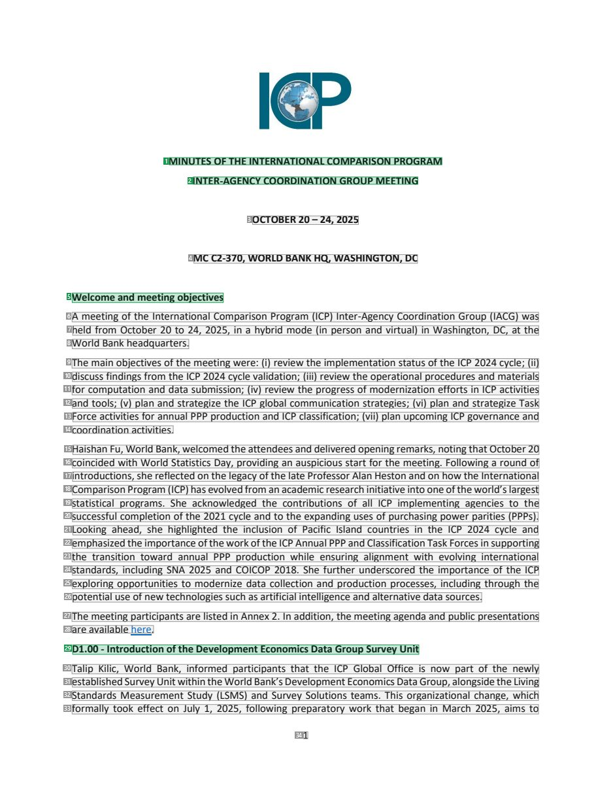
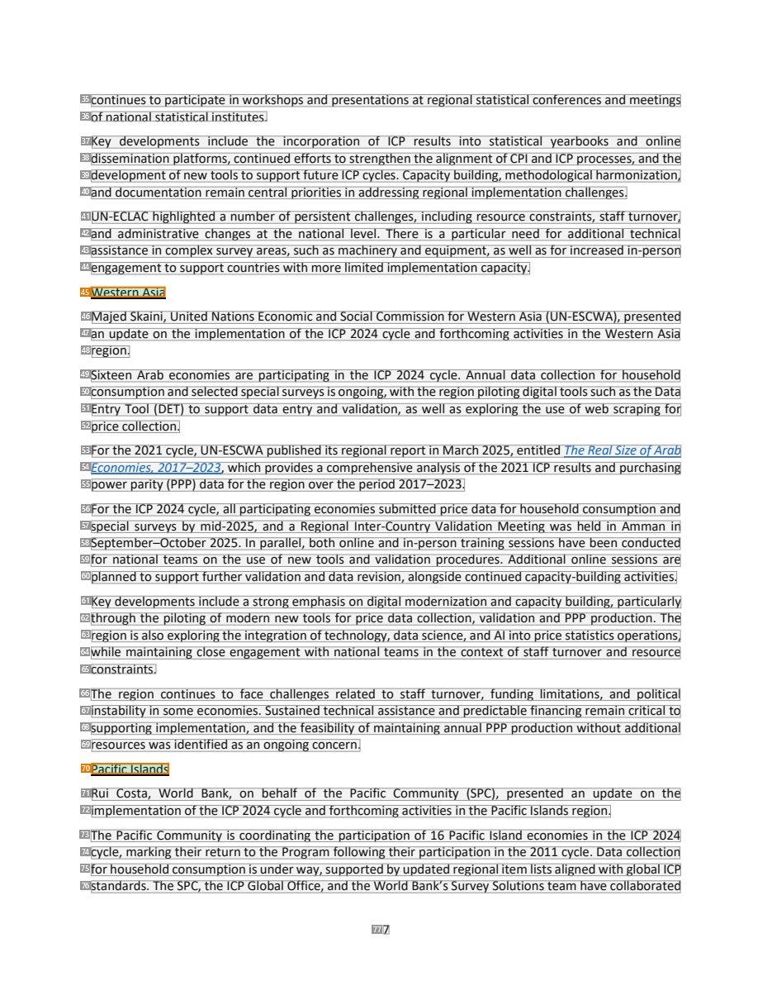
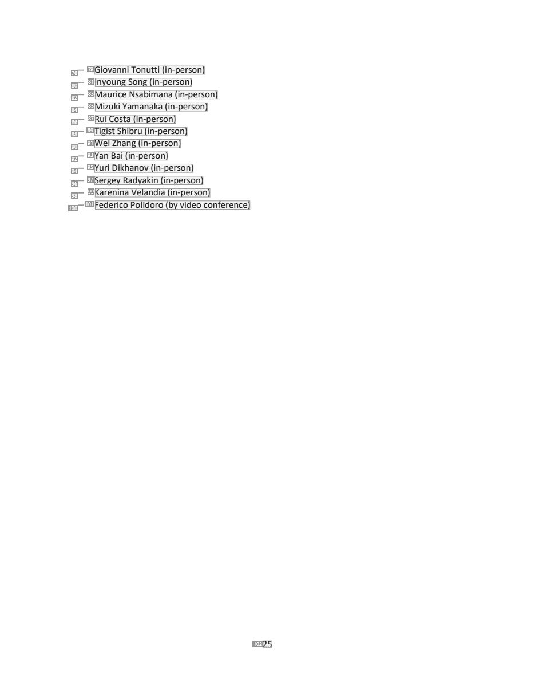

# 071 — `todo10_8/heading_corpus_100/05_bien_ban_hop/071_ICP_IACG_Minutes_Oct_2025.pdf`

Draft `P7_F1Q_HELDOUT_GOLD_DRAFT_V2`, status `DRAFT_REVIEWER_A_NOT_APPROVED`, draft sha256 `333a3a51a9e3026bacf79c6a0acaae5f85947f2d1dc3426c7abdcbc4169f1935`. Source sha256 `fe99f544b10e690812acb1362c067c520968a7e1d2cddc232c24db2d3ba790e4`. [Back to index](README.md)

Approve or correct with `review-apply` lines: `APPROVE 071 by <reviewer> [because <note>]`, `071 <alias> -> E|R|O because <reason>`.

## Page 1 (FIRST)

| # | alias | text | font | draft | flag | rationale |
|---:|---|---|---|---|---|---|
| 1 | L0000:S0 | MINUTES OFTHE INTERNATIONALCOMPARISON PROGRAM | 11 B | **ESTABLISHES** |  | Document title line 1 &quot;MINUTES OF THE INTERNATIONAL COMPARISON PROGRAM&quot; (bold, centred) |
| 2 | L0001:S0 | INTER-AGENCYCOORDINATION GROUP MEETING | 11 B | **ESTABLISHES** |  | Document title line 2 &quot;INTER-AGENCY COORDINATION GROUP MEETING&quot; (bold, centred) |
| 3 | L0002:S0 | OCTOBER 20–24, 2025 | 11 B | **OTHER** |  | Meeting dates &quot;OCTOBER 20–24, 2025&quot; in the masthead (metadata) |
| 4 | L0003:S0 | MC C2-370, WORLD BANK HQ, WASHINGTON, DC | 11 B | **OTHER** |  | Meeting venue &quot;MC C2-370, WORLD BANK HQ, WASHINGTON, DC&quot; in the masthead (metadata) |
| 5 | L0004:S0 | Welcome and meeting objectives | 11 B | **ESTABLISHES** |  | Session heading &quot;Welcome and meeting objectives&quot; (bold, own line) |
| 6 | L0005:S0 | A meeting of the International Comparison Program (ICP) Inter-Agency Coordination Group (IACG) was | 11 | **OTHER** |  | Default: body text, list item, table cell, page number or other non-heading content on this page |
| 7 | L0006:S0 | held from October 20 to 24, 2025, in a hybrid mode (in person and virtual) in Washington, DC, at the | 11 | **OTHER** |  | Default: body text, list item, table cell, page number or other non-heading content on this page |
| 8 | L0007:S0 | World Bank headquarters. | 11 | **OTHER** |  | Default: body text, list item, table cell, page number or other non-heading content on this page |
| 9 | L0008:S0 | The main objectives ofthe meeting were: (i) review the implementation status ofthe ICP 2024 cycle; (ii) | 11 | **OTHER** |  | Default: body text, list item, table cell, page number or other non-heading content on this page |
| 10 | L0009:S0 | discuss findings from the ICP 2024 cycle validation; (iii) review the operational procedures and materials | 11 | **OTHER** |  | Default: body text, list item, table cell, page number or other non-heading content on this page |
| 11 | L0010:S0 | for computation and data submission; (iv) review the progress of modernization efforts in ICP activities | 11 | **OTHER** |  | Default: body text, list item, table cell, page number or other non-heading content on this page |
| 12 | L0011:S0 | and tools; (v) plan and strategize the ICP global communication strategies; (vi) plan and strategize Task | 11 | **OTHER** |  | Default: body text, list item, table cell, page number or other non-heading content on this page |
| 13 | L0012:S0 | Force activities for annual PPP production and ICP classification; (vii) plan upcoming ICP governance and | 11 | **OTHER** |  | Default: body text, list item, table cell, page number or other non-heading content on this page |
| 14 | L0013:S0 | coordination activities. | 11 | **OTHER** |  | Default: body text, list item, table cell, page number or other non-heading content on this page |
| 15 | L0014:S0 | Haishan Fu, World Bank, welcomed the attendees and delivered opening remarks, notingthat October20 | 11 | **OTHER** |  | Default: body text, list item, table cell, page number or other non-heading content on this page |
| 16 | L0015:S0 | coincided with World Statistics Day, providing an auspicious start for the meeting. Following a round of | 11 | **OTHER** |  | Default: body text, list item, table cell, page number or other non-heading content on this page |
| 17 | L0016:S0 | introductions, she reflected on the legacy ofthe late ProfessorAlan Heston and on howthe International | 11 | **OTHER** |  | Default: body text, list item, table cell, page number or other non-heading content on this page |
| 18 | L0017:S0 | Comparison Program (ICP) hasevolvedfrom an academic research initiative intooneoftheworld’s largest | 11 | **OTHER** |  | Default: body text, list item, table cell, page number or other non-heading content on this page |
| 19 | L0018:S0 | statistical programs. She acknowledged the contributions of all ICP implementing agencies to the | 11 | **OTHER** |  | Default: body text, list item, table cell, page number or other non-heading content on this page |
| 20 | L0019:S0 | successful completion ofthe 2021 cycle and to the expanding uses of purchasing power parities (PPPs). | 11 | **OTHER** |  | Default: body text, list item, table cell, page number or other non-heading content on this page |
| 21 | L0020:S0 | Looking ahead, she highlighted the inclusion of Pacific Island countries in the ICP 2024 cycle and | 11 | **OTHER** |  | Default: body text, list item, table cell, page number or other non-heading content on this page |
| 22 | L0021:S0 | emphasized the importance oftheworkofthe ICPAnnual PPP and ClassificationTask Forces in supporting | 11 | **OTHER** |  | Default: body text, list item, table cell, page number or other non-heading content on this page |
| 23 | L0022:S0 | the transition toward annual PPP production while ensuring alignment with evolving international | 11 | **OTHER** |  | Default: body text, list item, table cell, page number or other non-heading content on this page |
| 24 | L0023:S0 | standards, including SNA 2025 and COICOP 2018. She further underscored the importance of the ICP | 11 | **OTHER** |  | Default: body text, list item, table cell, page number or other non-heading content on this page |
| 25 | L0024:S0 | exploring opportunities to modernize data collection and production processes, including through the | 11 | **OTHER** |  | Default: body text, list item, table cell, page number or other non-heading content on this page |
| 26 | L0025:S0 | potential use of new technologies such as artificial intelligence and alternative data sources. | 11 | **OTHER** |  | Default: body text, list item, table cell, page number or other non-heading content on this page |
| 27 | L0026:S0 | The meeting participants are listed in Annex 2. In addition, the meeting agenda and public presentations | 11 | **OTHER** |  | Default: body text, list item, table cell, page number or other non-heading content on this page |
| 28 | L0027:S0 | are available here. | 11 | **OTHER** |  | Default: body text, list item, table cell, page number or other non-heading content on this page |
| 29 | L0028:S0 | D1.00 - Introduction ofthe Development Economics Data Group Survey Unit | 11 B | **ESTABLISHES** |  | Session heading &quot;D1.00 - Introduction of the Development Economics Data Group Survey Unit&quot; (bold, own line) |
| 30 | L0029:S0 | Talip Kilic, World Bank, informed participants that the ICP Global Office is now part of the newly | 11 | **OTHER** |  | Default: body text, list item, table cell, page number or other non-heading content on this page |
| 31 | L0030:S0 | established Survey UnitwithintheWorld Bank’s Development Economics Data Group, alongsidethe Living | 11 | **OTHER** |  | Default: body text, list item, table cell, page number or other non-heading content on this page |
| 32 | L0031:S0 | Standards Measurement Study (LSMS) and Survey Solutions teams. This organizational change, which | 11 | **OTHER** |  | Default: body text, list item, table cell, page number or other non-heading content on this page |
| 33 | L0032:S0 | formally took effect on July 1, 2025, following preparatory work that began in March 2025, aims to | 11 | **OTHER** |  | Default: body text, list item, table cell, page number or other non-heading content on this page |
| 34 | L0033:S0 | 1 | 11 | **OTHER** |  | Default: body text, list item, table cell, page number or other non-heading content on this page |

**OTHER rows to check for a missed heading on page 1** (body size 11pt; bold or ≥ body+1pt, ≤ 12 words): #3 `L0002:S0` OCTOBER 20–24, 2025 (11 B), #4 `L0003:S0` MC C2-370, WORLD BANK HQ, WASHINGTON, DC (11 B).

## Page 7 (SEEDED_INTERIOR)

| # | alias | text | font | draft | flag | rationale |
|---:|---|---|---|---|---|---|
| 35 | L0252:S0 | continues to participate in workshops and presentations at regional statistical conferences and meetings | 11 | **OTHER** |  | Default: body text, list item, table cell, page number or other non-heading content on this page |
| 36 | L0253:S0 | of national statistical institutes. | 11 | **OTHER** |  | Default: body text, list item, table cell, page number or other non-heading content on this page |
| 37 | L0254:S0 | Key developments include the incorporation of ICP results into statistical yearbooks and online | 11 | **OTHER** |  | Default: body text, list item, table cell, page number or other non-heading content on this page |
| 38 | L0255:S0 | dissemination platforms, continued efforts to strengthen the alignment ofCPI and ICP processes, and the | 11 | **OTHER** |  | Default: body text, list item, table cell, page number or other non-heading content on this page |
| 39 | L0256:S0 | development ofnewtoolsto supportfuture ICP cycles. Capacity building, methodological harmonization, | 11 | **OTHER** |  | Default: body text, list item, table cell, page number or other non-heading content on this page |
| 40 | L0257:S0 | and documentation remain central priorities in addressing regional implementation challenges. | 11 | **OTHER** |  | Default: body text, list item, table cell, page number or other non-heading content on this page |
| 41 | L0258:S0 | UN-ECLAC highlighted a number of persistent challenges, including resource constraints, staff turnover, | 11 | **OTHER** |  | Default: body text, list item, table cell, page number or other non-heading content on this page |
| 42 | L0259:S0 | and administrative changes at the national level. There is a particular need for additional technical | 11 | **OTHER** |  | Default: body text, list item, table cell, page number or other non-heading content on this page |
| 43 | L0260:S0 | assistance in complex survey areas, such as machinery and equipment, as well as for increased in-person | 11 | **OTHER** |  | Default: body text, list item, table cell, page number or other non-heading content on this page |
| 44 | L0261:S0 | engagement to support countries with more limited implementation capacity. | 11 | **OTHER** |  | Default: body text, list item, table cell, page number or other non-heading content on this page |
| 45 | L0262:S0 | Western Asia | 11 | **ESTABLISHES** | REVIEW_FOCUS | Regional subheading &quot;Western Asia&quot; (own short line) introducing that region&#39;s update |
| 46 | L0263:S0 | Majed Skaini, United Nations Economic and Social Commission for Western Asia (UN-ESCWA), presented | 11 | **OTHER** |  | Default: body text, list item, table cell, page number or other non-heading content on this page |
| 47 | L0264:S0 | an update on the implementation of the ICP 2024 cycle and forthcoming activities in the Western Asia | 11 | **OTHER** |  | Default: body text, list item, table cell, page number or other non-heading content on this page |
| 48 | L0265:S0 | region. | 11 | **OTHER** |  | Default: body text, list item, table cell, page number or other non-heading content on this page |
| 49 | L0266:S0 | Sixteen Arab economies are participating in the ICP 2024 cycle. Annual data collection for household | 11 | **OTHER** |  | Default: body text, list item, table cell, page number or other non-heading content on this page |
| 50 | L0267:S0 | consumption and selected special surveys isongoing,with the region pilotingdigital toolssuch asthe Data | 11 | **OTHER** |  | Default: body text, list item, table cell, page number or other non-heading content on this page |
| 51 | L0268:S0 | Entry Tool (DET) to support data entry and validation, as well as exploring the use of web scraping for | 11 | **OTHER** |  | Default: body text, list item, table cell, page number or other non-heading content on this page |
| 52 | L0269:S0 | price collection. | 11 | **OTHER** |  | Default: body text, list item, table cell, page number or other non-heading content on this page |
| 53 | L0270:S0 | Forthe 2021 cycle, UN-ESCWA published its regional report in March 2025, entitled The RealSize ofArab | 11 | **OTHER** |  | Default: body text, list item, table cell, page number or other non-heading content on this page |
| 54 | L0271:S0 | Economies, 2017–2023, which provides a comprehensive analysis ofthe 2021 ICP results and purchasing | 11 | **OTHER** |  | Default: body text, list item, table cell, page number or other non-heading content on this page |
| 55 | L0272:S0 | power parity (PPP) data forthe region overthe period 2017–2023. | 11 | **OTHER** |  | Default: body text, list item, table cell, page number or other non-heading content on this page |
| 56 | L0273:S0 | For the ICP 2024 cycle, all participating economies submitted price data for household consumption and | 11 | **OTHER** |  | Default: body text, list item, table cell, page number or other non-heading content on this page |
| 57 | L0274:S0 | special surveys by mid-2025, and a Regional Inter-Country Validation Meeting was held in Amman in | 11 | **OTHER** |  | Default: body text, list item, table cell, page number or other non-heading content on this page |
| 58 | L0275:S0 | September–October 2025. In parallel, both online and in-person training sessions have been conducted | 11 | **OTHER** |  | Default: body text, list item, table cell, page number or other non-heading content on this page |
| 59 | L0276:S0 | for national teams on the use of new tools and validation procedures. Additional online sessions are | 11 | **OTHER** |  | Default: body text, list item, table cell, page number or other non-heading content on this page |
| 60 | L0277:S0 | planned to support furthervalidation and data revision, alongside continued capacity-building activities. | 11 | **OTHER** |  | Default: body text, list item, table cell, page number or other non-heading content on this page |
| 61 | L0278:S0 | Key developments include a strong emphasis on digital modernization and capacity building, particularly | 11 | **OTHER** |  | Default: body text, list item, table cell, page number or other non-heading content on this page |
| 62 | L0279:S0 | through the piloting of modern new tools for price data collection, validation and PPP production. The | 11 | **OTHER** |  | Default: body text, list item, table cell, page number or other non-heading content on this page |
| 63 | L0280:S0 | region is also exploringthe integration oftechnology, data science, and AI into price statistics operations, | 11 | **OTHER** |  | Default: body text, list item, table cell, page number or other non-heading content on this page |
| 64 | L0281:S0 | while maintaining close engagement with national teams in the context of staff turnover and resource | 11 | **OTHER** |  | Default: body text, list item, table cell, page number or other non-heading content on this page |
| 65 | L0282:S0 | constraints. | 11 | **OTHER** |  | Default: body text, list item, table cell, page number or other non-heading content on this page |
| 66 | L0283:S0 | The region continues to face challenges related to staff turnover, funding limitations, and political | 11 | **OTHER** |  | Default: body text, list item, table cell, page number or other non-heading content on this page |
| 67 | L0284:S0 | instability in some economies. Sustained technical assistance and predictable financing remain critical to | 11 | **OTHER** |  | Default: body text, list item, table cell, page number or other non-heading content on this page |
| 68 | L0285:S0 | supporting implementation, and the feasibility of maintaining annual PPP production without additional | 11 | **OTHER** |  | Default: body text, list item, table cell, page number or other non-heading content on this page |
| 69 | L0286:S0 | resources was identified as an ongoing concern. | 11 | **OTHER** |  | Default: body text, list item, table cell, page number or other non-heading content on this page |
| 70 | L0287:S0 | Pacific Islands | 11 | **ESTABLISHES** | REVIEW_FOCUS | Regional subheading &quot;Pacific Islands&quot; (own short line) introducing that region&#39;s update |
| 71 | L0288:S0 | Rui Costa, World Bank, on behalf of the Pacific Community (SPC), presented an update on the | 11 | **OTHER** |  | Default: body text, list item, table cell, page number or other non-heading content on this page |
| 72 | L0289:S0 | implementation ofthe ICP 2024 cycle and forthcoming activities in the Pacific Islands region. | 11 | **OTHER** |  | Default: body text, list item, table cell, page number or other non-heading content on this page |
| 73 | L0290:S0 | The Pacific Community is coordinating the participation of 16 Pacific Island economies in the ICP 2024 | 11 | **OTHER** |  | Default: body text, list item, table cell, page number or other non-heading content on this page |
| 74 | L0291:S0 | cycle, marking their return to the Program following their participation in the 2011 cycle. Data collection | 11 | **OTHER** |  | Default: body text, list item, table cell, page number or other non-heading content on this page |
| 75 | L0292:S0 | for household consumption is underway, supported by updated regional item lists aligned with global ICP | 11 | **OTHER** |  | Default: body text, list item, table cell, page number or other non-heading content on this page |
| 76 | L0293:S0 | standards. The SPC, the ICP Global Office, and the World Bank’s Survey Solutions team have collaborated | 11 | **OTHER** |  | Default: body text, list item, table cell, page number or other non-heading content on this page |
| 77 | L0294:S0 | 7 | 11 | **OTHER** |  | Default: body text, list item, table cell, page number or other non-heading content on this page |

**OTHER rows to check for a missed heading on page 7** (body size 11pt; bold or ≥ body+1pt, ≤ 12 words): none.

## Page 25 (SEEDED_INTERIOR)

| # | alias | text | font | draft | flag | rationale |
|---:|---|---|---|---|---|---|
| 78 | L0960:S0 | − | 11 | **OTHER** |  | Default: body text, list item, table cell, page number or other non-heading content on this page |
| 79 | L0960:S1 | Giovanni Tonutti (in-person) | 11 | **OTHER** |  | Default: body text, list item, table cell, page number or other non-heading content on this page |
| 80 | L0961:S0 | − | 11 | **OTHER** |  | Default: body text, list item, table cell, page number or other non-heading content on this page |
| 81 | L0961:S1 | Inyoung Song (in-person) | 11 | **OTHER** |  | Default: body text, list item, table cell, page number or other non-heading content on this page |
| 82 | L0962:S0 | − | 11 | **OTHER** |  | Default: body text, list item, table cell, page number or other non-heading content on this page |
| 83 | L0962:S1 | Maurice Nsabimana (in-person) | 11 | **OTHER** |  | Default: body text, list item, table cell, page number or other non-heading content on this page |
| 84 | L0963:S0 | − | 11 | **OTHER** |  | Default: body text, list item, table cell, page number or other non-heading content on this page |
| 85 | L0963:S1 | Mizuki Yamanaka (in-person) | 11 | **OTHER** |  | Default: body text, list item, table cell, page number or other non-heading content on this page |
| 86 | L0964:S0 | − | 11 | **OTHER** |  | Default: body text, list item, table cell, page number or other non-heading content on this page |
| 87 | L0964:S1 | Rui Costa (in-person) | 11 | **OTHER** |  | Default: body text, list item, table cell, page number or other non-heading content on this page |
| 88 | L0965:S0 | − | 11 | **OTHER** |  | Default: body text, list item, table cell, page number or other non-heading content on this page |
| 89 | L0965:S1 | Tigist Shibru (in-person) | 11 | **OTHER** |  | Default: body text, list item, table cell, page number or other non-heading content on this page |
| 90 | L0966:S0 | − | 11 | **OTHER** |  | Default: body text, list item, table cell, page number or other non-heading content on this page |
| 91 | L0966:S1 | Wei Zhang (in-person) | 11 | **OTHER** |  | Default: body text, list item, table cell, page number or other non-heading content on this page |
| 92 | L0967:S0 | − | 11 | **OTHER** |  | Default: body text, list item, table cell, page number or other non-heading content on this page |
| 93 | L0967:S1 | Yan Bai (in-person) | 11 | **OTHER** |  | Default: body text, list item, table cell, page number or other non-heading content on this page |
| 94 | L0968:S0 | − | 11 | **OTHER** |  | Default: body text, list item, table cell, page number or other non-heading content on this page |
| 95 | L0968:S1 | Yuri Dikhanov (in-person) | 11 | **OTHER** |  | Default: body text, list item, table cell, page number or other non-heading content on this page |
| 96 | L0969:S0 | − | 11 | **OTHER** |  | Default: body text, list item, table cell, page number or other non-heading content on this page |
| 97 | L0969:S1 | Sergey Radyakin (in-person) | 11 | **OTHER** |  | Default: body text, list item, table cell, page number or other non-heading content on this page |
| 98 | L0970:S0 | − | 11 | **OTHER** |  | Default: body text, list item, table cell, page number or other non-heading content on this page |
| 99 | L0970:S1 | Karenina Velandia (in-person) | 11 | **OTHER** |  | Default: body text, list item, table cell, page number or other non-heading content on this page |
| 100 | L0971:S0 | − | 11 | **OTHER** |  | Default: body text, list item, table cell, page number or other non-heading content on this page |
| 101 | L0971:S1 | Federico Polidoro (byvideo conference) | 11 | **OTHER** |  | Default: body text, list item, table cell, page number or other non-heading content on this page |
| 102 | L0972:S0 | 25 | 11 | **OTHER** |  | Default: body text, list item, table cell, page number or other non-heading content on this page |

**OTHER rows to check for a missed heading on page 25** (body size 11pt; bold or ≥ body+1pt, ≤ 12 words): none.
