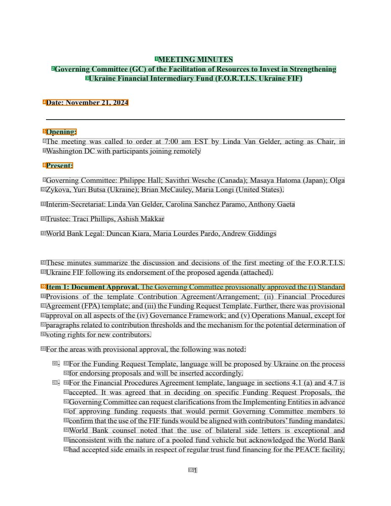
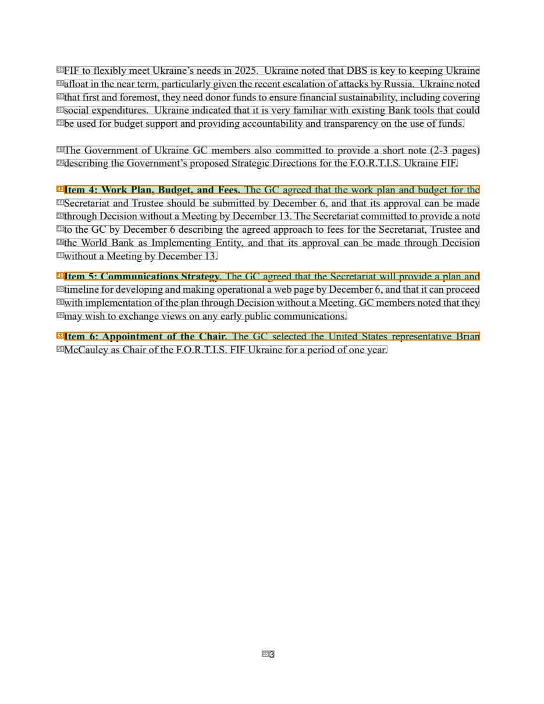
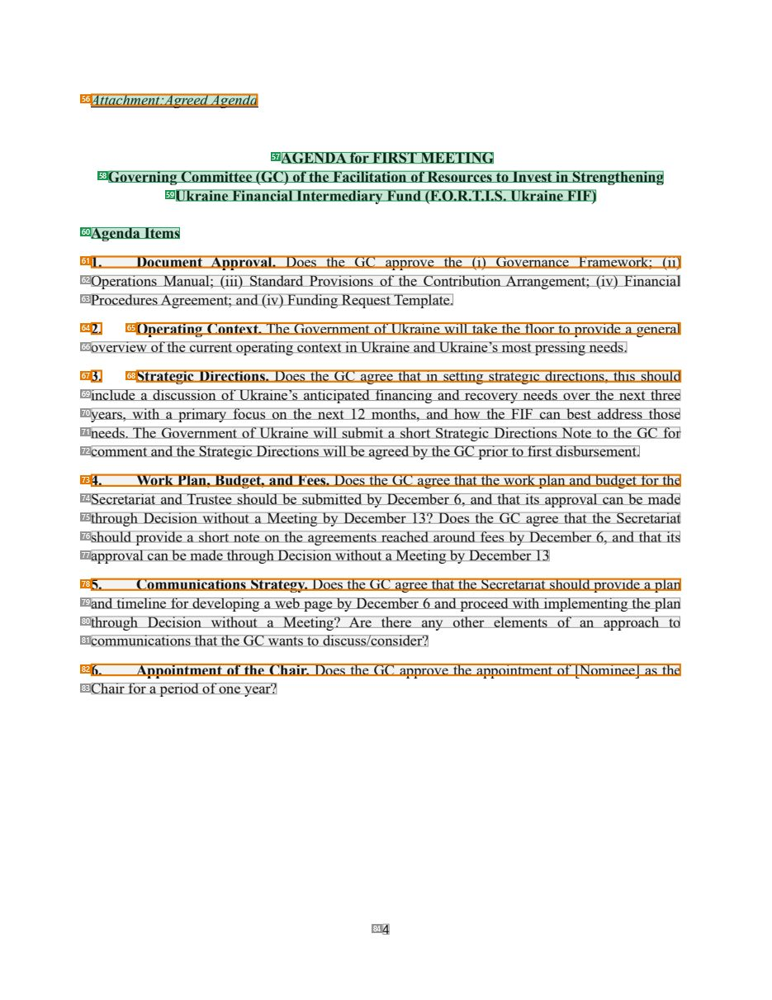

# 075 — `todo10_8/heading_corpus_100/05_bien_ban_hop/075_FORTIS_GC_Minutes_Nov21_2024.pdf`

Draft `P7_F1Q_HELDOUT_GOLD_DRAFT_V2`, status `DRAFT_REVIEWER_A_NOT_APPROVED`, draft sha256 `2a93f83dd0b3f42b8ea0d97bf92ce0edcf2bafcaffe91a14e1bb84e6a45daba2`. Source sha256 `c48a9e9ac95820685c48def8b91df697484f81996cb6c4094234ed6c8319afc3`. [Back to index](README.md)

Approve or correct with `review-apply` lines: `APPROVE 075 by <reviewer> [because <note>]`, `075 <alias> -> E|R|O because <reason>`.

## Page 1 (FIRST)

| # | alias | text | font | draft | flag | rationale |
|---:|---|---|---|---|---|---|
| 1 | L0000:S0 | MEETING MINUTES | 12 B | **ESTABLISHES** |  | Document title &quot;MEETING MINUTES&quot; (bold, centred) |
| 2 | L0001:S0 | Governing Committee (GC) of the Facilitation of Resources to Invest in Strengthening | 12 B | **ESTABLISHES** |  | Title line 2 &quot;Governing Committee (GC) of the Facilitation of Resources ...&quot; (bold, centred) |
| 3 | L0002:S0 | Ukraine Financial Intermediary Fund (F.O.R.T.I.S. Ukraine FIF) | 12 B | **ESTABLISHES** |  | Title line 3 &quot;Ukraine Financial Intermediary Fund (F.O.R.T.I.S. Ukraine FIF)&quot; (bold, centred) |
| 4 | L0003:S0 | Date: November 21, 2024 | 12 B | **OTHER** | REVIEW_FOCUS | Meeting date &quot;Date: November 21, 2024&quot; (bold label + value): metadata, not a heading |
| 5 | L0004:S0 | Opening: | 12 B | **ESTABLISHES** | REVIEW_FOCUS | Bold section label &quot;Opening:&quot; introducing the opening paragraph |
| 6 | L0005:S0 | The meeting was called to order at 7:00 am EST by Linda Van Gelder, acting as Chair, in | 12 | **OTHER** |  | Default: body text, list item, table cell, page number or other non-heading content on this page |
| 7 | L0006:S0 | Washington DC with participants joining remotely | 12 | **OTHER** |  | Default: body text, list item, table cell, page number or other non-heading content on this page |
| 8 | L0007:S0 | Present: | 12 B | **ESTABLISHES** | REVIEW_FOCUS | Bold section label &quot;Present:&quot; introducing the attendee list (label of a region vs list label: confirm) |
| 9 | L0008:S0 | Governing Committee: Philippe Hall; Savithri Wesche (Canada); Masaya Hatoma (Japan); Olga | 12 | **OTHER** |  | Default: body text, list item, table cell, page number or other non-heading content on this page |
| 10 | L0009:S0 | Zykova, Yuri Butsa (Ukraine); Brian McCauley, Maria Longi (United States). | 12 | **OTHER** |  | Default: body text, list item, table cell, page number or other non-heading content on this page |
| 11 | L0010:S0 | Interim-Secretariat: Linda Van Gelder, Carolina Sanchez Paramo, Anthony Gaeta | 12 | **OTHER** |  | Default: body text, list item, table cell, page number or other non-heading content on this page |
| 12 | L0011:S0 | Trustee: Traci Phillips, Ashish Makkar | 12 | **OTHER** |  | Default: body text, list item, table cell, page number or other non-heading content on this page |
| 13 | L0012:S0 | World Bank Legal: Duncan Kiara, Maria Lourdes Pardo, Andrew Giddings | 12 | **OTHER** |  | Default: body text, list item, table cell, page number or other non-heading content on this page |
| 14 | L0013:S0 | These minutes summarize the discussion and decisions of the first meeting of the F.O.R.T.I.S. | 12 | **OTHER** |  | Default: body text, list item, table cell, page number or other non-heading content on this page |
| 15 | L0014:S0 | Ukraine FIF following its endorsement of the proposed agenda (attached). | 12 | **OTHER** |  | Default: body text, list item, table cell, page number or other non-heading content on this page |
| 16 | L0015:S0 | Item 1: Document Approval. The Governing Committee provisionally approved the (i) Standard | 12 | **ESTABLISHES** | REVIEW_FOCUS | Run-in topic &quot;Item 1: Document Approval.&quot; + start of body text in one atom (mixed span, as 073) |
| 17 | L0016:S0 | Provisions of the template Contribution Agreement/Arrangement; (ii) Financial Procedures | 12 | **OTHER** |  | Default: body text, list item, table cell, page number or other non-heading content on this page |
| 18 | L0017:S0 | Agreement (FPA) template; and (iii) the Funding Request Template. Further, there was provisional | 12 | **OTHER** |  | Default: body text, list item, table cell, page number or other non-heading content on this page |
| 19 | L0018:S0 | approval on all aspects of the (iv) Governance Framework; and (v) Operations Manual, except for | 12 | **OTHER** |  | Default: body text, list item, table cell, page number or other non-heading content on this page |
| 20 | L0019:S0 | paragraphs related to contribution thresholds and the mechanism for the potential determination of | 12 | **OTHER** |  | Default: body text, list item, table cell, page number or other non-heading content on this page |
| 21 | L0020:S0 | voting rights for new contributors. | 12 | **OTHER** |  | Default: body text, list item, table cell, page number or other non-heading content on this page |
| 22 | L0021:S0 | For the areas with provisional approval, the following was noted: | 12 | **OTHER** |  | Default: body text, list item, table cell, page number or other non-heading content on this page |
| 23 | L0022:S0 | - | 12 | **OTHER** |  | Default: body text, list item, table cell, page number or other non-heading content on this page |
| 24 | L0022:S1 | For the Funding Request Template, language will be proposed by Ukraine on the process | 12 | **OTHER** |  | Default: body text, list item, table cell, page number or other non-heading content on this page |
| 25 | L0023:S0 | for endorsing proposals and will be inserted accordingly. | 12 | **OTHER** |  | Default: body text, list item, table cell, page number or other non-heading content on this page |
| 26 | L0024:S0 | - | 12 | **OTHER** |  | Default: body text, list item, table cell, page number or other non-heading content on this page |
| 27 | L0024:S1 | For the Financial Procedures Agreement template, language in sections 4.1 (a) and 4.7 is | 12 | **OTHER** |  | Default: body text, list item, table cell, page number or other non-heading content on this page |
| 28 | L0025:S0 | accepted. It was agreed that in deciding on specific Funding Request Proposals, the | 12 | **OTHER** |  | Default: body text, list item, table cell, page number or other non-heading content on this page |
| 29 | L0026:S0 | Governing Committee can request clarifications from the Implementing Entities in advance | 12 | **OTHER** |  | Default: body text, list item, table cell, page number or other non-heading content on this page |
| 30 | L0027:S0 | of approving funding requests that would permit Governing Committee members to | 12 | **OTHER** |  | Default: body text, list item, table cell, page number or other non-heading content on this page |
| 31 | L0028:S0 | confirm that the use of the FIF funds would be aligned with contributors’funding mandates. | 12 | **OTHER** |  | Default: body text, list item, table cell, page number or other non-heading content on this page |
| 32 | L0029:S0 | World Bank counsel noted that the use of bilateral side letters is exceptional and | 12 | **OTHER** |  | Default: body text, list item, table cell, page number or other non-heading content on this page |
| 33 | L0030:S0 | inconsistent with the nature of a pooled fund vehicle but acknowledged the World Bank | 12 | **OTHER** |  | Default: body text, list item, table cell, page number or other non-heading content on this page |
| 34 | L0031:S0 | had accepted side emails in respect of regular trust fund financing for the PEACE facility, | 12 | **OTHER** |  | Default: body text, list item, table cell, page number or other non-heading content on this page |
| 35 | L0032:S0 | 1 | 11 | **OTHER** |  | Default: body text, list item, table cell, page number or other non-heading content on this page |

**OTHER rows to check for a missed heading on page 1** (body size 12pt; bold or ≥ body+1pt, ≤ 12 words): #4 `L0003:S0` Date: November 21, 2024 (12 B).

## Page 3 (SEEDED_INTERIOR)

| # | alias | text | font | draft | flag | rationale |
|---:|---|---|---|---|---|---|
| 36 | L0075:S0 | FIF to flexibly meet Ukraine’s needs in 2025. Ukraine noted that DBS is key to keeping Ukraine | 12 | **OTHER** |  | Default: body text, list item, table cell, page number or other non-heading content on this page |
| 37 | L0076:S0 | afloat in the near term, particularly given the recent escalation of attacks by Russia. Ukraine noted | 12 | **OTHER** |  | Default: body text, list item, table cell, page number or other non-heading content on this page |
| 38 | L0077:S0 | that first and foremost, they need donor funds to ensure financial sustainability, including covering | 12 | **OTHER** |  | Default: body text, list item, table cell, page number or other non-heading content on this page |
| 39 | L0078:S0 | social expenditures. Ukraine indicated that it is very familiar with existing Bank tools that could | 12 | **OTHER** |  | Default: body text, list item, table cell, page number or other non-heading content on this page |
| 40 | L0079:S0 | be used for budget support and providing accountability and transparency on the use of funds. | 12 | **OTHER** |  | Default: body text, list item, table cell, page number or other non-heading content on this page |
| 41 | L0080:S0 | The Government of Ukraine GC members also committed to provide a short note (2-3 pages) | 12 | **OTHER** |  | Default: body text, list item, table cell, page number or other non-heading content on this page |
| 42 | L0081:S0 | describing the Government’s proposed Strategic Directions for the F.O.R.T.I.S. Ukraine FIF. | 12 | **OTHER** |  | Default: body text, list item, table cell, page number or other non-heading content on this page |
| 43 | L0082:S0 | Item 4: Work Plan, Budget, and Fees. The GC agreed that the work plan and budget for the | 12 | **ESTABLISHES** | REVIEW_FOCUS | Run-in topic &quot;Item 4: Work Plan, Budget, and Fees.&quot; + body (mixed span) |
| 44 | L0083:S0 | Secretariat and Trustee should be submitted by December 6, and that its approval can be made | 12 | **OTHER** |  | Default: body text, list item, table cell, page number or other non-heading content on this page |
| 45 | L0084:S0 | through Decision without a Meeting by December 13. The Secretariat committed to provide a note | 12 | **OTHER** |  | Default: body text, list item, table cell, page number or other non-heading content on this page |
| 46 | L0085:S0 | to the GC by December 6 describing the agreed approach to fees for the Secretariat, Trustee and | 12 | **OTHER** |  | Default: body text, list item, table cell, page number or other non-heading content on this page |
| 47 | L0086:S0 | the World Bank as Implementing Entity, and that its approval can be made through Decision | 12 | **OTHER** |  | Default: body text, list item, table cell, page number or other non-heading content on this page |
| 48 | L0087:S0 | without a Meeting by December 13. | 12 | **OTHER** |  | Default: body text, list item, table cell, page number or other non-heading content on this page |
| 49 | L0088:S0 | Item 5: Communications Strategy. The GC agreed that the Secretariat will provide a plan and | 12 | **ESTABLISHES** | REVIEW_FOCUS | Run-in topic &quot;Item 5: Communications Strategy.&quot; + body (mixed span) |
| 50 | L0089:S0 | timeline for developing and making operational a web page by December 6, and that it can proceed | 12 | **OTHER** |  | Default: body text, list item, table cell, page number or other non-heading content on this page |
| 51 | L0090:S0 | with implementation of the plan through Decision without a Meeting. GC members noted that they | 12 | **OTHER** |  | Default: body text, list item, table cell, page number or other non-heading content on this page |
| 52 | L0091:S0 | may wish to exchange views on any early public communications. | 12 | **OTHER** |  | Default: body text, list item, table cell, page number or other non-heading content on this page |
| 53 | L0092:S0 | Item 6: Appointment of the Chair. The GC selected the United States representative Brian | 12 | **ESTABLISHES** | REVIEW_FOCUS | Run-in topic &quot;Item 6: Appointment of the Chair.&quot; + body (mixed span) |
| 54 | L0093:S0 | McCauley as Chair of the F.O.R.T.I.S. FIF Ukraine for a period of one year. | 12 | **OTHER** |  | Default: body text, list item, table cell, page number or other non-heading content on this page |
| 55 | L0094:S0 | 3 | 11 | **OTHER** |  | Default: body text, list item, table cell, page number or other non-heading content on this page |

**OTHER rows to check for a missed heading on page 3** (body size 12pt; bold or ≥ body+1pt, ≤ 12 words): none.

## Page 4 (SEEDED_INTERIOR)

| # | alias | text | font | draft | flag | rationale |
|---:|---|---|---|---|---|---|
| 56 | L0095:S0 | Attachment:Agreed Agenda | 12 I | **ESTABLISHES** | REVIEW_FOCUS | Italic label &quot;Attachment: Agreed Agenda&quot; introducing the attached agenda |
| 57 | L0096:S0 | AGENDA for FIRST MEETING | 12 B | **ESTABLISHES** |  | Agenda title &quot;AGENDA for FIRST MEETING&quot; (bold, centred) |
| 58 | L0097:S0 | Governing Committee (GC) of the Facilitation of Resources to Invest in Strengthening | 12 B | **ESTABLISHES** |  | Agenda title line 2 (bold, centred) |
| 59 | L0098:S0 | Ukraine Financial Intermediary Fund (F.O.R.T.I.S. Ukraine FIF) | 12 B | **ESTABLISHES** |  | Agenda title line 3 (bold, centred) |
| 60 | L0099:S0 | Agenda Items | 12 B | **ESTABLISHES** |  | Bold heading &quot;Agenda Items&quot; |
| 61 | L0100:S0 | 1. Document Approval. Does the GC approve the (i) Governance Framework; (ii) | 12 | **OTHER** | REVIEW_FOCUS | Agenda list item &quot;1. Document Approval. Does the GC approve ...&quot; (list entry with question text) |
| 62 | L0101:S0 | Operations Manual; (iii) Standard Provisions of the Contribution Arrangement; (iv) Financial | 12 | **OTHER** |  | Default: body text, list item, table cell, page number or other non-heading content on this page |
| 63 | L0102:S0 | Procedures Agreement; and (iv) Funding Request Template. | 12 | **OTHER** |  | Default: body text, list item, table cell, page number or other non-heading content on this page |
| 64 | L0103:S0 | 2. | 12 B | **OTHER** | REVIEW_FOCUS | Bold item number &quot;2.&quot; of an agenda list entry |
| 65 | L0103:S1 | Operating Context. The Government of Ukraine will take the floor to provide a general | 12 | **OTHER** | REVIEW_FOCUS | Agenda list entry &quot;Operating Context. The Government of Ukraine will ...&quot; (run-in topic + question) |
| 66 | L0104:S0 | overview of the current operating context in Ukraine and Ukraine’s most pressing needs. | 12 | **OTHER** |  | Default: body text, list item, table cell, page number or other non-heading content on this page |
| 67 | L0105:S0 | 3. | 12 B | **OTHER** | REVIEW_FOCUS | Bold item number &quot;3.&quot; of an agenda list entry |
| 68 | L0105:S1 | Strategic Directions. Does the GC agree that in setting strategic directions, this should | 12 | **OTHER** | REVIEW_FOCUS | Agenda list entry &quot;Strategic Directions. Does the GC agree ...&quot; |
| 69 | L0106:S0 | include a discussion of Ukraine’s anticipated financing and recovery needs over the next three | 12 | **OTHER** |  | Default: body text, list item, table cell, page number or other non-heading content on this page |
| 70 | L0107:S0 | years, with a primary focus on the next 12 months, and how the FIF can best address those | 12 | **OTHER** |  | Default: body text, list item, table cell, page number or other non-heading content on this page |
| 71 | L0108:S0 | needs. The Government of Ukraine will submit a short Strategic Directions Note to the GC for | 12 | **OTHER** |  | Default: body text, list item, table cell, page number or other non-heading content on this page |
| 72 | L0109:S0 | comment and the Strategic Directions will be agreed by the GC prior to first disbursement. | 12 | **OTHER** |  | Default: body text, list item, table cell, page number or other non-heading content on this page |
| 73 | L0110:S0 | 4. Work Plan, Budget, and Fees. Does the GC agree that the work plan and budget for the | 12 | **OTHER** | REVIEW_FOCUS | Agenda list entry &quot;4. Work Plan, Budget, and Fees. Does the GC agree ...&quot; |
| 74 | L0111:S0 | Secretariat and Trustee should be submitted by December 6, and that its approval can be made | 12 | **OTHER** |  | Default: body text, list item, table cell, page number or other non-heading content on this page |
| 75 | L0112:S0 | through Decision without a Meeting by December 13? Does the GC agree that the Secretariat | 12 | **OTHER** |  | Default: body text, list item, table cell, page number or other non-heading content on this page |
| 76 | L0113:S0 | should provide a short note on the agreements reached around fees by December 6, and that its | 12 | **OTHER** |  | Default: body text, list item, table cell, page number or other non-heading content on this page |
| 77 | L0114:S0 | approval can be made through Decision without a Meeting by December 13 | 12 | **OTHER** |  | Default: body text, list item, table cell, page number or other non-heading content on this page |
| 78 | L0115:S0 | 5. Communications Strategy. Does the GC agree that the Secretariat should provide a plan | 12 | **OTHER** | REVIEW_FOCUS | Agenda list entry &quot;5. Communications Strategy. Does the GC agree ...&quot; |
| 79 | L0116:S0 | and timeline for developing a web page by December 6 and proceed with implementing the plan | 12 | **OTHER** |  | Default: body text, list item, table cell, page number or other non-heading content on this page |
| 80 | L0117:S0 | through Decision without a Meeting? Are there any other elements of an approach to | 12 | **OTHER** |  | Default: body text, list item, table cell, page number or other non-heading content on this page |
| 81 | L0118:S0 | communications that the GC wants to discuss/consider? | 12 | **OTHER** |  | Default: body text, list item, table cell, page number or other non-heading content on this page |
| 82 | L0119:S0 | 6. Appointment of the Chair. Does the GC approve the appointment of [Nominee] as the | 12 | **OTHER** | REVIEW_FOCUS | Agenda list entry &quot;6. Appointment of the Chair. Does the GC approve ...&quot; |
| 83 | L0120:S0 | Chair for a period of one year? | 12 | **OTHER** |  | Default: body text, list item, table cell, page number or other non-heading content on this page |
| 84 | L0121:S0 | 4 | 11 | **OTHER** |  | Default: body text, list item, table cell, page number or other non-heading content on this page |

**OTHER rows to check for a missed heading on page 4** (body size 12pt; bold or ≥ body+1pt, ≤ 12 words): #64 `L0103:S0` 2. (12 B), #67 `L0105:S0` 3. (12 B).
