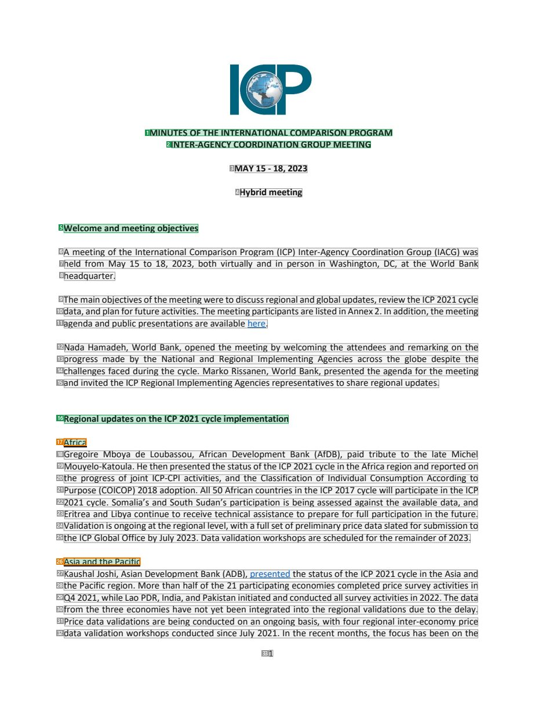
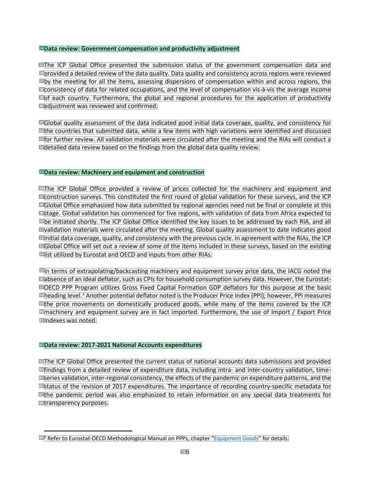
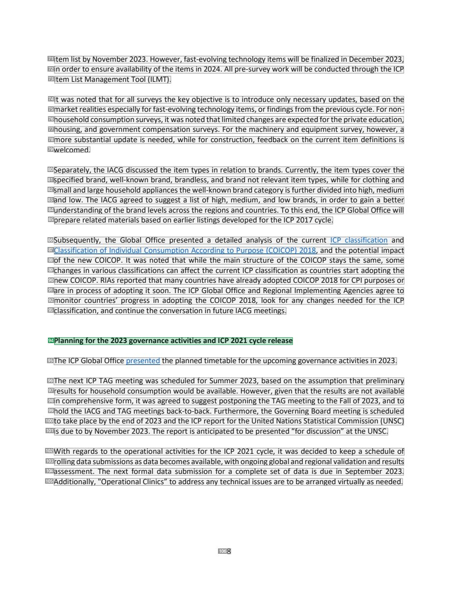

# 078 — `todo10_8/heading_corpus_100/05_bien_ban_hop/078_ICP_IACG07_Minutes_May_2023.pdf`

Draft `P7_F1Q_HELDOUT_GOLD_DRAFT_V2`, status `DRAFT_REVIEWER_A_NOT_APPROVED`, draft sha256 `b129a851248a8986db7dc04eae6d5f58f5f26266391b3dac46b76612a976e5d7`. Source sha256 `c3080d4d0c681aed636c860268eccc37b7ca0f0d2c9645f2469823e83ed92168`. [Back to index](README.md)

Approve or correct with `review-apply` lines: `APPROVE 078 by <reviewer> [because <note>]`, `078 <alias> -> E|R|O because <reason>`.

## Page 1 (FIRST)

| # | alias | text | font | draft | flag | rationale |
|---:|---|---|---|---|---|---|
| 1 | L0000:S0 | MINUTES OF THE INTERNATIONAL COMPARISON PROGRAM | 11 B | **ESTABLISHES** |  | Document title line 1 &quot;MINUTES OF THE INTERNATIONAL COMPARISON PROGRAM&quot; (bold, centred) |
| 2 | L0001:S0 | INTER-AGENCY COORDINATION GROUP MEETING | 11 B | **ESTABLISHES** |  | Document title line 2 &quot;INTER-AGENCY COORDINATION GROUP MEETING&quot; (bold, centred) |
| 3 | L0002:S0 | MAY 15 - 18, 2023 | 11 B | **OTHER** |  | Meeting dates &quot;MAY 15 - 18, 2023&quot; in the masthead (metadata) |
| 4 | L0003:S0 | Hybrid meeting | 11 B | **OTHER** |  | Meeting mode &quot;Hybrid meeting&quot; in the masthead (metadata) |
| 5 | L0004:S0 | Welcome and meeting objectives | 11 B | **ESTABLISHES** |  | Session heading &quot;Welcome and meeting objectives&quot; (bold, own line) |
| 6 | L0005:S0 | A meeting of the International Comparison Program (ICP) Inter-Agency Coordination Group (IACG) was | 11 | **OTHER** |  | Default: body text, list item, table cell, page number or other non-heading content on this page |
| 7 | L0006:S0 | held from May 15 to 18, 2023, both virtually and in person in Washington, DC, at the World Bank | 11 | **OTHER** |  | Default: body text, list item, table cell, page number or other non-heading content on this page |
| 8 | L0007:S0 | headquarter. | 11 | **OTHER** |  | Default: body text, list item, table cell, page number or other non-heading content on this page |
| 9 | L0008:S0 | The main objectives of the meeting were to discuss regional and global updates, review the ICP 2021 cycle | 11 | **OTHER** |  | Default: body text, list item, table cell, page number or other non-heading content on this page |
| 10 | L0009:S0 | data, and plan for future activities. The meeting participants are listed in Annex 2. In addition, the meeting | 11 | **OTHER** |  | Default: body text, list item, table cell, page number or other non-heading content on this page |
| 11 | L0010:S0 | agenda and public presentations are available here. | 11 | **OTHER** |  | Default: body text, list item, table cell, page number or other non-heading content on this page |
| 12 | L0011:S0 | Nada Hamadeh, World Bank, opened the meeting by welcoming the attendees and remarking on the | 11 | **OTHER** |  | Default: body text, list item, table cell, page number or other non-heading content on this page |
| 13 | L0012:S0 | progress made by the National and Regional Implementing Agencies across the globe despite the | 11 | **OTHER** |  | Default: body text, list item, table cell, page number or other non-heading content on this page |
| 14 | L0013:S0 | challenges faced during the cycle. Marko Rissanen, World Bank, presented the agenda for the meeting | 11 | **OTHER** |  | Default: body text, list item, table cell, page number or other non-heading content on this page |
| 15 | L0014:S0 | and invited the ICP Regional Implementing Agencies representatives to share regional updates. | 11 | **OTHER** |  | Default: body text, list item, table cell, page number or other non-heading content on this page |
| 16 | L0015:S0 | Regional updates on the ICP 2021 cycle implementation | 11 B | **ESTABLISHES** |  | Session heading &quot;Regional updates on the ICP 2021 cycle implementation&quot; (bold, own line) |
| 17 | L0016:S0 | Africa | 11 | **ESTABLISHES** | REVIEW_FOCUS | Regional subheading &quot;Africa&quot; (own short line, regular weight) introducing the Africa update |
| 18 | L0017:S0 | Gregoire Mboya de Loubassou, African Development Bank (AfDB), paid tribute to the late Michel | 11 | **OTHER** |  | Default: body text, list item, table cell, page number or other non-heading content on this page |
| 19 | L0018:S0 | Mouyelo-Katoula. He then presented the status of the ICP 2021 cycle in the Africa region and reported on | 11 | **OTHER** |  | Default: body text, list item, table cell, page number or other non-heading content on this page |
| 20 | L0019:S0 | the progress of joint ICP-CPI activities, and the Classification of Individual Consumption According to | 11 | **OTHER** |  | Default: body text, list item, table cell, page number or other non-heading content on this page |
| 21 | L0020:S0 | Purpose (COICOP) 2018 adoption. All 50 African countries in the ICP 2017 cycle will participate in the ICP | 11 | **OTHER** |  | Default: body text, list item, table cell, page number or other non-heading content on this page |
| 22 | L0021:S0 | 2021 cycle. Somalia’s and South Sudan’s participation is being assessed against the available data, and | 11 | **OTHER** |  | Default: body text, list item, table cell, page number or other non-heading content on this page |
| 23 | L0022:S0 | Eritrea and Libya continue to receive technical assistance to prepare for full participation in the future. | 11 | **OTHER** |  | Default: body text, list item, table cell, page number or other non-heading content on this page |
| 24 | L0023:S0 | Validation is ongoing at the regional level, with a full set of preliminary price data slated for submission to | 11 | **OTHER** |  | Default: body text, list item, table cell, page number or other non-heading content on this page |
| 25 | L0024:S0 | the ICP Global Office by July 2023. Data validation workshops are scheduled for the remainder of 2023. | 11 | **OTHER** |  | Default: body text, list item, table cell, page number or other non-heading content on this page |
| 26 | L0025:S0 | Asia and the Pacific | 11 | **ESTABLISHES** | REVIEW_FOCUS | Regional subheading &quot;Asia and the Pacific&quot; (own short line) introducing the Asia update |
| 27 | L0026:S0 | Kaushal Joshi, Asian Development Bank (ADB), presented the status of the ICP 2021 cycle in the Asia and | 11 | **OTHER** |  | Default: body text, list item, table cell, page number or other non-heading content on this page |
| 28 | L0027:S0 | the Pacific region. More than half of the 21 participating economies completed price survey activities in | 11 | **OTHER** |  | Default: body text, list item, table cell, page number or other non-heading content on this page |
| 29 | L0028:S0 | Q4 2021, while Lao PDR, India, and Pakistan initiated and conducted all survey activities in 2022. The data | 11 | **OTHER** |  | Default: body text, list item, table cell, page number or other non-heading content on this page |
| 30 | L0029:S0 | from the three economies have not yet been integrated into the regional validations due to the delay. | 11 | **OTHER** |  | Default: body text, list item, table cell, page number or other non-heading content on this page |
| 31 | L0030:S0 | Price data validations are being conducted on an ongoing basis, with four regional inter-economy price | 11 | **OTHER** |  | Default: body text, list item, table cell, page number or other non-heading content on this page |
| 32 | L0031:S0 | data validation workshops conducted since July 2021. In the recent months, the focus has been on the | 11 | **OTHER** |  | Default: body text, list item, table cell, page number or other non-heading content on this page |
| 33 | L0032:S0 | 1 | 11 | **OTHER** |  | Default: body text, list item, table cell, page number or other non-heading content on this page |

**OTHER rows to check for a missed heading on page 1** (body size 11pt; bold or ≥ body+1pt, ≤ 12 words): #3 `L0002:S0` MAY 15 - 18, 2023 (11 B), #4 `L0003:S0` Hybrid meeting (11 B).

## Page 6 (SEEDED_INTERIOR)

| # | alias | text | font | draft | flag | rationale |
|---:|---|---|---|---|---|---|
| 34 | L0200:S0 | Data review: Government compensation and productivity adjustment | 11 B | **ESTABLISHES** |  | Session heading &quot;Data review: Government compensation and productivity adjustment&quot; (bold) |
| 35 | L0201:S0 | The ICP Global Office presented the submission status of the government compensation data and | 11 | **OTHER** |  | Default: body text, list item, table cell, page number or other non-heading content on this page |
| 36 | L0202:S0 | provided a detailed review of the data quality. Data quality and consistency across regions were reviewed | 11 | **OTHER** |  | Default: body text, list item, table cell, page number or other non-heading content on this page |
| 37 | L0203:S0 | by the meeting for all the items, assessing dispersions of compensation within and across regions, the | 11 | **OTHER** |  | Default: body text, list item, table cell, page number or other non-heading content on this page |
| 38 | L0204:S0 | consistency of data for related occupations, and the level of compensation vis-&#224;-vis the average income | 11 | **OTHER** |  | Default: body text, list item, table cell, page number or other non-heading content on this page |
| 39 | L0205:S0 | of each country. Furthermore, the global and regional procedures for the application of productivity | 11 | **OTHER** |  | Default: body text, list item, table cell, page number or other non-heading content on this page |
| 40 | L0206:S0 | adjustment was reviewed and confirmed. | 11 | **OTHER** |  | Default: body text, list item, table cell, page number or other non-heading content on this page |
| 41 | L0207:S0 | Global quality assessment of the data indicated good initial data coverage, quality, and consistency for | 11 | **OTHER** |  | Default: body text, list item, table cell, page number or other non-heading content on this page |
| 42 | L0208:S0 | the countries that submitted data, while a few items with high variations were identified and discussed | 11 | **OTHER** |  | Default: body text, list item, table cell, page number or other non-heading content on this page |
| 43 | L0209:S0 | for further review. All validation materials were circulated after the meeting and the RIAs will conduct a | 11 | **OTHER** |  | Default: body text, list item, table cell, page number or other non-heading content on this page |
| 44 | L0210:S0 | detailed data review based on the findings from the global data quality review. | 11 | **OTHER** |  | Default: body text, list item, table cell, page number or other non-heading content on this page |
| 45 | L0211:S0 | Data review: Machinery and equipment and construction | 11 B | **ESTABLISHES** |  | Session heading &quot;Data review: Machinery and equipment and construction&quot; (bold) |
| 46 | L0212:S0 | The ICP Global Office provided a review of prices collected for the machinery and equipment and | 11 | **OTHER** |  | Default: body text, list item, table cell, page number or other non-heading content on this page |
| 47 | L0213:S0 | construction surveys. This constituted the first round of global validation for these surveys, and the ICP | 11 | **OTHER** |  | Default: body text, list item, table cell, page number or other non-heading content on this page |
| 48 | L0214:S0 | Global Office emphasized how data submitted by regional agencies need not be final or complete at this | 11 | **OTHER** |  | Default: body text, list item, table cell, page number or other non-heading content on this page |
| 49 | L0215:S0 | stage. Global validation has commenced for five regions, with validation of data from Africa expected to | 11 | **OTHER** |  | Default: body text, list item, table cell, page number or other non-heading content on this page |
| 50 | L0216:S0 | be initiated shortly. The ICP Global Office identified the key issues to be addressed by each RIA, and all | 11 | **OTHER** |  | Default: body text, list item, table cell, page number or other non-heading content on this page |
| 51 | L0217:S0 | validation materials were circulated after the meeting. Global quality assessment to date indicates good | 11 | **OTHER** |  | Default: body text, list item, table cell, page number or other non-heading content on this page |
| 52 | L0218:S0 | initial data coverage, quality, and consistency with the previous cycle. In agreement with the RIAs, the ICP | 11 | **OTHER** |  | Default: body text, list item, table cell, page number or other non-heading content on this page |
| 53 | L0219:S0 | Global Office will set out a review of some of the items included in these surveys, based on the existing | 11 | **OTHER** |  | Default: body text, list item, table cell, page number or other non-heading content on this page |
| 54 | L0220:S0 | list utilized by Eurostat and OECD and inputs from other RIAs. | 11 | **OTHER** |  | Default: body text, list item, table cell, page number or other non-heading content on this page |
| 55 | L0221:S0 | In terms of extrapolating/backcasting machinery and equipment survey price data, the IACG noted the | 11 | **OTHER** |  | Default: body text, list item, table cell, page number or other non-heading content on this page |
| 56 | L0222:S0 | absence of an ideal deflator, such as CPIs for household consumption survey data. However, the Eurostat- | 11 | **OTHER** |  | Default: body text, list item, table cell, page number or other non-heading content on this page |
| 57 | L0223:S0 | OECD PPP Program utilizes Gross Fixed Capital Formation GDP deflators for this purpose at the basic | 11 | **OTHER** |  | Default: body text, list item, table cell, page number or other non-heading content on this page |
| 58 | L0224:S0 | heading level.2 Another potential deflator noted is the Producer Price Index (PPI); however, PPI measures | 11 | **OTHER** |  | Default: body text, list item, table cell, page number or other non-heading content on this page |
| 59 | L0225:S0 | the price movements on domestically produced goods, while many of the items covered by the ICP | 11 | **OTHER** |  | Default: body text, list item, table cell, page number or other non-heading content on this page |
| 60 | L0226:S0 | machinery and equipment survey are in fact imported. Furthermore, the use of Import / Export Price | 11 | **OTHER** |  | Default: body text, list item, table cell, page number or other non-heading content on this page |
| 61 | L0227:S0 | Indexes was noted. | 11 | **OTHER** |  | Default: body text, list item, table cell, page number or other non-heading content on this page |
| 62 | L0228:S0 | Data review: 2017-2021 National Accounts expenditures | 11 B | **ESTABLISHES** |  | Session heading &quot;Data review: 2017-2021 National Accounts expenditures&quot; (bold) |
| 63 | L0229:S0 | The ICP Global Office presented the current status of national accounts data submissions and provided | 11 | **OTHER** |  | Default: body text, list item, table cell, page number or other non-heading content on this page |
| 64 | L0230:S0 | findings from a detailed review of expenditure data, including intra- and inter-country validation, time- | 11 | **OTHER** |  | Default: body text, list item, table cell, page number or other non-heading content on this page |
| 65 | L0231:S0 | series validation, inter-regional consistency, the effects of the pandemic on expenditure patterns, and the | 11 | **OTHER** |  | Default: body text, list item, table cell, page number or other non-heading content on this page |
| 66 | L0232:S0 | status of the revision of 2017 expenditures. The importance of recording country-specific metadata for | 11 | **OTHER** |  | Default: body text, list item, table cell, page number or other non-heading content on this page |
| 67 | L0233:S0 | the pandemic period was also emphasized to retain information on any special data treatments for | 11 | **OTHER** |  | Default: body text, list item, table cell, page number or other non-heading content on this page |
| 68 | L0234:S0 | transparency purposes. | 11 | **OTHER** |  | Default: body text, list item, table cell, page number or other non-heading content on this page |
| 69 | L0235:S0 | 2 Refer to Eurostat-OECD Methodological Manual on PPPs, chapter “Equipment Goods” for details. | 10 | **OTHER** |  | Default: body text, list item, table cell, page number or other non-heading content on this page |
| 70 | L0236:S0 | 6 | 11 | **OTHER** |  | Default: body text, list item, table cell, page number or other non-heading content on this page |

**OTHER rows to check for a missed heading on page 6** (body size 11pt; bold or ≥ body+1pt, ≤ 12 words): none.

## Page 8 (SEEDED_INTERIOR)

| # | alias | text | font | draft | flag | rationale |
|---:|---|---|---|---|---|---|
| 71 | L0275:S0 | item list by November 2023. However, fast-evolving technology items will be finalized in December 2023, | 11 | **OTHER** |  | Default: body text, list item, table cell, page number or other non-heading content on this page |
| 72 | L0276:S0 | in order to ensure availability of the items in 2024. All pre-survey work will be conducted through the ICP | 11 | **OTHER** |  | Default: body text, list item, table cell, page number or other non-heading content on this page |
| 73 | L0277:S0 | Item List Management Tool (ILMT). | 11 | **OTHER** |  | Default: body text, list item, table cell, page number or other non-heading content on this page |
| 74 | L0278:S0 | It was noted that for all surveys the key objective is to introduce only necessary updates, based on the | 11 | **OTHER** |  | Default: body text, list item, table cell, page number or other non-heading content on this page |
| 75 | L0279:S0 | market realities especially for fast-evolving technology items, or findings from the previous cycle. For non- | 11 | **OTHER** |  | Default: body text, list item, table cell, page number or other non-heading content on this page |
| 76 | L0280:S0 | household consumption surveys, it was noted that limited changes are expected for the private education, | 11 | **OTHER** |  | Default: body text, list item, table cell, page number or other non-heading content on this page |
| 77 | L0281:S0 | housing, and government compensation surveys. For the machinery and equipment survey, however, a | 11 | **OTHER** |  | Default: body text, list item, table cell, page number or other non-heading content on this page |
| 78 | L0282:S0 | more substantial update is needed, while for construction, feedback on the current item definitions is | 11 | **OTHER** |  | Default: body text, list item, table cell, page number or other non-heading content on this page |
| 79 | L0283:S0 | welcomed. | 11 | **OTHER** |  | Default: body text, list item, table cell, page number or other non-heading content on this page |
| 80 | L0284:S0 | Separately, the IACG discussed the item types in relation to brands. Currently, the item types cover the | 11 | **OTHER** |  | Default: body text, list item, table cell, page number or other non-heading content on this page |
| 81 | L0285:S0 | specified brand, well-known brand, brandless, and brand not relevant item types, while for clothing and | 11 | **OTHER** |  | Default: body text, list item, table cell, page number or other non-heading content on this page |
| 82 | L0286:S0 | small and large household appliances the well-known brand category is further divided into high, medium | 11 | **OTHER** |  | Default: body text, list item, table cell, page number or other non-heading content on this page |
| 83 | L0287:S0 | and low. The IACG agreed to suggest a list of high, medium, and low brands, in order to gain a better | 11 | **OTHER** |  | Default: body text, list item, table cell, page number or other non-heading content on this page |
| 84 | L0288:S0 | understanding of the brand levels across the regions and countries. To this end, the ICP Global Office will | 11 | **OTHER** |  | Default: body text, list item, table cell, page number or other non-heading content on this page |
| 85 | L0289:S0 | prepare related materials based on earlier listings developed for the ICP 2017 cycle. | 11 | **OTHER** |  | Default: body text, list item, table cell, page number or other non-heading content on this page |
| 86 | L0290:S0 | Subsequently, the Global Office presented a detailed analysis of the current ICP classification and | 11 | **OTHER** |  | Default: body text, list item, table cell, page number or other non-heading content on this page |
| 87 | L0291:S0 | Classification of Individual Consumption According to Purpose (COICOP) 2018, and the potential impact | 11 | **OTHER** |  | Default: body text, list item, table cell, page number or other non-heading content on this page |
| 88 | L0292:S0 | of the new COICOP. It was noted that while the main structure of the COICOP stays the same, some | 11 | **OTHER** |  | Default: body text, list item, table cell, page number or other non-heading content on this page |
| 89 | L0293:S0 | changes in various classifications can affect the current ICP classification as countries start adopting the | 11 | **OTHER** |  | Default: body text, list item, table cell, page number or other non-heading content on this page |
| 90 | L0294:S0 | new COICOP. RIAs reported that many countries have already adopted COICOP 2018 for CPI purposes or | 11 | **OTHER** |  | Default: body text, list item, table cell, page number or other non-heading content on this page |
| 91 | L0295:S0 | are in process of adopting it soon. The ICP Global Office and Regional Implementing Agencies agree to | 11 | **OTHER** |  | Default: body text, list item, table cell, page number or other non-heading content on this page |
| 92 | L0296:S0 | monitor countries’ progress in adopting the COICOP 2018, look for any changes needed for the ICP | 11 | **OTHER** |  | Default: body text, list item, table cell, page number or other non-heading content on this page |
| 93 | L0297:S0 | classification, and continue the conversation in future IACG meetings. | 11 | **OTHER** |  | Default: body text, list item, table cell, page number or other non-heading content on this page |
| 94 | L0298:S0 | Planning for the 2023 governance activities and ICP 2021 cycle release | 11 B | **ESTABLISHES** |  | Session heading &quot;Planning for the 2023 governance activities and ICP 2021 cycle release&quot; (bold) |
| 95 | L0299:S0 | The ICP Global Office presented the planned timetable for the upcoming governance activities in 2023. | 11 | **OTHER** |  | Default: body text, list item, table cell, page number or other non-heading content on this page |
| 96 | L0300:S0 | The next ICP TAG meeting was scheduled for Summer 2023, based on the assumption that preliminary | 11 | **OTHER** |  | Default: body text, list item, table cell, page number or other non-heading content on this page |
| 97 | L0301:S0 | results for household consumption would be available. However, given that the results are not available | 11 | **OTHER** |  | Default: body text, list item, table cell, page number or other non-heading content on this page |
| 98 | L0302:S0 | in comprehensive form, it was agreed to suggest postponing the TAG meeting to the Fall of 2023, and to | 11 | **OTHER** |  | Default: body text, list item, table cell, page number or other non-heading content on this page |
| 99 | L0303:S0 | hold the IACG and TAG meetings back-to-back. Furthermore, the Governing Board meeting is scheduled | 11 | **OTHER** |  | Default: body text, list item, table cell, page number or other non-heading content on this page |
| 100 | L0304:S0 | to take place by the end of 2023 and the ICP report for the United Nations Statistical Commission (UNSC) | 11 | **OTHER** |  | Default: body text, list item, table cell, page number or other non-heading content on this page |
| 101 | L0305:S0 | is due to by November 2023. The report is anticipated to be presented “for discussion” at the UNSC. | 11 | **OTHER** |  | Default: body text, list item, table cell, page number or other non-heading content on this page |
| 102 | L0306:S0 | With regards to the operational activities for the ICP 2021 cycle, it was decided to keep a schedule of | 11 | **OTHER** |  | Default: body text, list item, table cell, page number or other non-heading content on this page |
| 103 | L0307:S0 | rolling data submissions as data becomes available, with ongoing global and regional validation and results | 11 | **OTHER** |  | Default: body text, list item, table cell, page number or other non-heading content on this page |
| 104 | L0308:S0 | assessment. The next formal data submission for a complete set of data is due in September 2023. | 11 | **OTHER** |  | Default: body text, list item, table cell, page number or other non-heading content on this page |
| 105 | L0309:S0 | Additionally, &quot;Operational Clinics” to address any technical issues are to be arranged virtually as needed. | 11 | **OTHER** |  | Default: body text, list item, table cell, page number or other non-heading content on this page |
| 106 | L0310:S0 | 8 | 11 | **OTHER** |  | Default: body text, list item, table cell, page number or other non-heading content on this page |

**OTHER rows to check for a missed heading on page 8** (body size 11pt; bold or ≥ body+1pt, ≤ 12 words): none.
