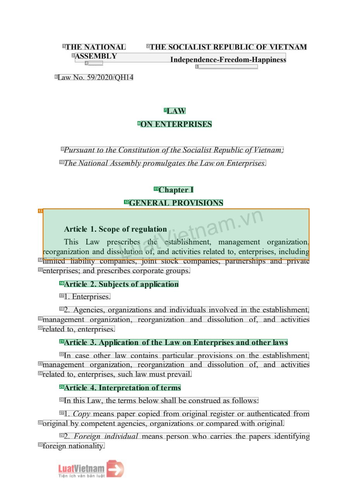
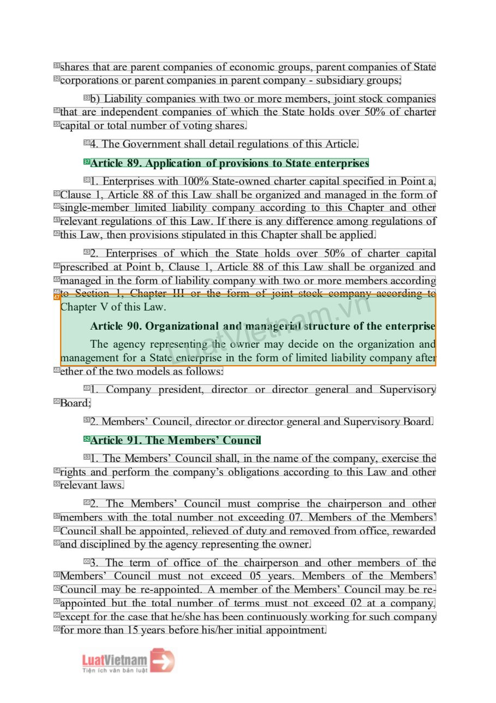
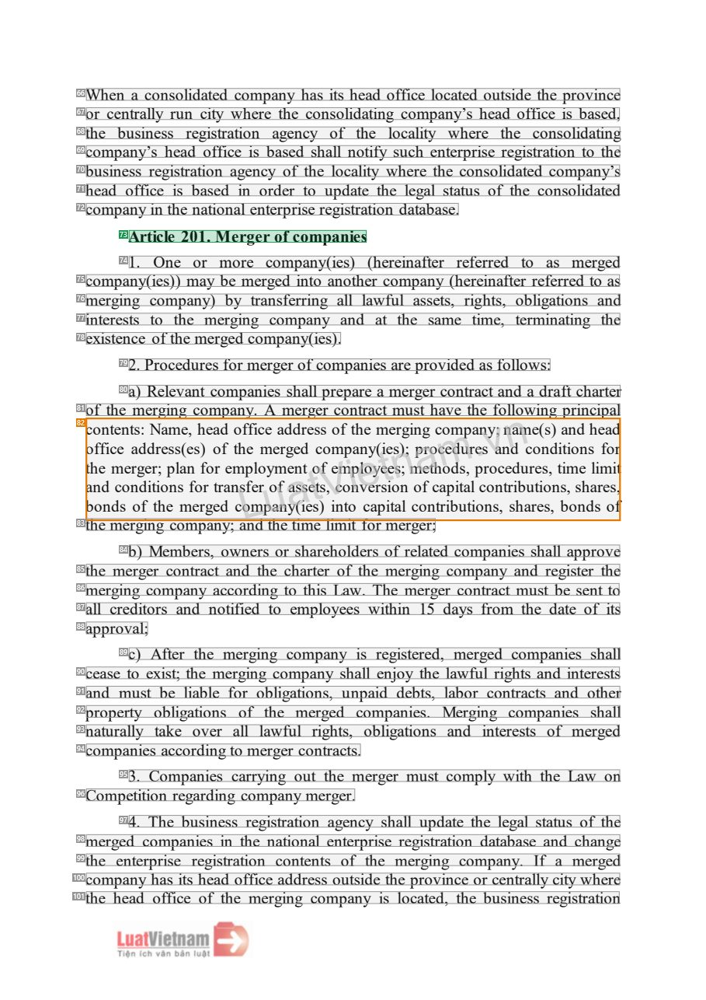

# 081 — `todo10_8/heading_corpus_100/06_dich_song_ngu/081_Luat_Doanh_nghiep_2020_EN.pdf`

Draft `P7_F1Q_HELDOUT_GOLD_DRAFT_V2`, status `DRAFT_REVIEWER_A_NOT_APPROVED`, draft sha256 `3723c1c85159a6fe3997716a1c80d97f59e52080b78ef5debfb81a62f2fd0106`. Source sha256 `aaa07d753ab59add123f3a50ebdd38f586552090b473348426809a328afccee8`. [Back to index](README.md)

Approve or correct with `review-apply` lines: `APPROVE 081 by <reviewer> [because <note>]`, `081 <alias> -> E|R|O because <reason>`.

## Page 1 (FIRST)

| # | alias | text | font | draft | flag | rationale |
|---:|---|---|---|---|---|---|
| 1 | L0000:S0 | THE NATIONAL | 13.2 B | **OTHER** |  | Issuer &quot;THE NATIONAL&quot; (letterhead) |
| 2 | L0000:S1 | THE SOCIALIST REPUBLIC OF VIETNAM | 13.2 B | **OTHER** |  | National name (letterhead) |
| 3 | L0001:S0 | ASSEMBLY Independence-Freedom-Happiness | 13.2 B | **OTHER** |  | Issuer continuation &quot;ASSEMBLY&quot; and national motto (letterhead) |
| 4 | L0002:S0 | ______ | 8.4 | **OTHER** |  | Default: body text, list item, table cell, page number or other non-heading content on this page |
| 5 | L0002:S1 | ________________________ | 8.4 | **OTHER** |  | Default: body text, list item, table cell, page number or other non-heading content on this page |
| 6 | L0003:S0 | Law No. 59/2020/QH14 | 13.2 | **OTHER** |  | Document number &quot;Law No. 59/2020/QH14&quot; |
| 7 | L0004:S0 | LAW | 13.8 B | **ESTABLISHES** |  | Document type title &quot;LAW&quot; (bold, centred) |
| 8 | L0005:S0 | ON ENTERPRISES | 13.8 B | **ESTABLISHES** |  | Document title &quot;ON ENTERPRISES&quot; (bold, centred) |
| 9 | L0006:S0 | Pursuant to the Constitution of the Socialist Republic of Vietnam; | 13.8 I | **OTHER** |  | Default: body text, list item, table cell, page number or other non-heading content on this page |
| 10 | L0007:S0 | The National Assembly promulgates the Law on Enterprises. | 13.8 I | **OTHER** |  | Default: body text, list item, table cell, page number or other non-heading content on this page |
| 11 | L0008:S0 | Chapter I | 13.8 B | **ESTABLISHES** |  | Chapter label &quot;Chapter I&quot; (bold) |
| 12 | L0009:S0 | GENERAL PROVISIONS | 13.8 B | **ESTABLISHES** |  | Chapter title &quot;GENERAL PROVISIONS&quot; (bold) |
| 13 | L0010:S0 | reorganATihrzaitsitciolenL1aaw.nSdcdpoirpseessocLolrufibtriueoesgnuaotlahf,tetiaonVnedstaacibteilvisihttimensenreta,late… | 13.8 | **ESTABLISHES** | REVIEW_FOCUS | SOURCE_CORRUPTED: garbled atom containing &quot;Article 1. Scope of regulation&quot; + body + watermark (EXCLUDE candidate) |
| 14 | L0011:S0 | limited liability companies, joint stock companies, partnerships and private | 13.8 | **OTHER** |  | Default: body text, list item, table cell, page number or other non-heading content on this page |
| 15 | L0012:S0 | enterprises; and prescribes corporate groups. | 13.8 | **OTHER** |  | Default: body text, list item, table cell, page number or other non-heading content on this page |
| 16 | L0013:S0 | Article 2. Subjects of application | 13.8 B | **ESTABLISHES** |  | Article heading &quot;Article 2. Subjects of application&quot; (bold) |
| 17 | L0014:S0 | 1. Enterprises. | 13.8 | **OTHER** |  | Default: body text, list item, table cell, page number or other non-heading content on this page |
| 18 | L0015:S0 | 2. Agencies, organizations and individuals involved in the establishment, | 13.8 | **OTHER** |  | Default: body text, list item, table cell, page number or other non-heading content on this page |
| 19 | L0016:S0 | management organization, reorganization and dissolution of, and activities | 13.8 | **OTHER** |  | Default: body text, list item, table cell, page number or other non-heading content on this page |
| 20 | L0017:S0 | related to, enterprises. | 13.8 | **OTHER** |  | Default: body text, list item, table cell, page number or other non-heading content on this page |
| 21 | L0018:S0 | Article 3. Application of the Law on Enterprises and other laws | 13.8 B | **ESTABLISHES** |  | Article heading &quot;Article 3. Application of the Law on Enterprises and other laws&quot; (bold) |
| 22 | L0019:S0 | In case other law contains particular provisions on the establishment, | 13.8 | **OTHER** |  | Default: body text, list item, table cell, page number or other non-heading content on this page |
| 23 | L0020:S0 | management organization, reorganization and dissolution of, and activities | 13.8 | **OTHER** |  | Default: body text, list item, table cell, page number or other non-heading content on this page |
| 24 | L0021:S0 | related to, enterprises, such law must prevail. | 13.8 | **OTHER** |  | Default: body text, list item, table cell, page number or other non-heading content on this page |
| 25 | L0022:S0 | Article 4. Interpretation of terms | 13.8 B | **ESTABLISHES** |  | Article heading &quot;Article 4. Interpretation of terms&quot; (bold) |
| 26 | L0023:S0 | In this Law, the terms below shall be construed as follows: | 13.8 | **OTHER** |  | Default: body text, list item, table cell, page number or other non-heading content on this page |
| 27 | L0024:S0 | 1. Copy means paper copied from original register or authenticated from | 13.8 | **OTHER** |  | Default: body text, list item, table cell, page number or other non-heading content on this page |
| 28 | L0025:S0 | original by competent agencies, organizations or compared with original. | 13.8 | **OTHER** |  | Default: body text, list item, table cell, page number or other non-heading content on this page |
| 29 | L0026:S0 | 2. Foreign individual means person who carries the papers identifying | 13.8 | **OTHER** |  | Default: body text, list item, table cell, page number or other non-heading content on this page |
| 30 | L0027:S0 | foreign nationality. | 13.8 | **OTHER** |  | Default: body text, list item, table cell, page number or other non-heading content on this page |

**OTHER rows to check for a missed heading on page 1** (body size 14pt; bold or ≥ body+1pt, ≤ 12 words): #1 `L0000:S0` THE NATIONAL (13.2 B), #2 `L0000:S1` THE SOCIALIST REPUBLIC OF VIETNAM (13.2 B), #3 `L0001:S0` ASSEMBLY Independence-Freedom-Happiness (13.2 B).

## Page 58 (SEEDED_INTERIOR)

| # | alias | text | font | draft | flag | rationale |
|---:|---|---|---|---|---|---|
| 31 | L1968:S0 | shares that are parent companies of economic groups, parent companies of State | 13.8 | **OTHER** |  | Default: body text, list item, table cell, page number or other non-heading content on this page |
| 32 | L1969:S0 | corporations or parent companies in parent company - subsidiary groups; | 13.8 | **OTHER** |  | Default: body text, list item, table cell, page number or other non-heading content on this page |
| 33 | L1970:S0 | b) Liability companies with two or more members, joint stock companies | 13.8 | **OTHER** |  | Default: body text, list item, table cell, page number or other non-heading content on this page |
| 34 | L1971:S0 | that are independent companies of which the State holds over 50% of charter | 13.8 | **OTHER** |  | Default: body text, list item, table cell, page number or other non-heading content on this page |
| 35 | L1972:S0 | capital or total number of voting shares. | 13.8 | **OTHER** |  | Default: body text, list item, table cell, page number or other non-heading content on this page |
| 36 | L1973:S0 | 4. The Government shall detail regulations of this Article. | 13.8 | **OTHER** |  | Default: body text, list item, table cell, page number or other non-heading content on this page |
| 37 | L1974:S0 | Article 89. Application of provisions to State enterprises | 13.8 B | **ESTABLISHES** |  | Article heading &quot;Article 89. Application of provisions to State enterprises&quot; (bold) |
| 38 | L1975:S0 | 1. Enterprises with 100% State-owned charter capital specified in Point a, | 13.8 | **OTHER** |  | Default: body text, list item, table cell, page number or other non-heading content on this page |
| 39 | L1976:S0 | Clause 1, Article 88 of this Law shall be organized and managed in the form of | 13.8 | **OTHER** |  | Default: body text, list item, table cell, page number or other non-heading content on this page |
| 40 | L1977:S0 | single-member limited liability company according to this Chapter and other | 13.8 | **OTHER** |  | Default: body text, list item, table cell, page number or other non-heading content on this page |
| 41 | L1978:S0 | relevant regulations of this Law. If there is any difference among regulations of | 13.8 | **OTHER** |  | Default: body text, list item, table cell, page number or other non-heading content on this page |
| 42 | L1979:S0 | this Law, then provisions stipulated in this Chapter shall be applied. | 13.8 | **OTHER** |  | Default: body text, list item, table cell, page number or other non-heading content on this page |
| 43 | L1980:S0 | 2. Enterprises of which the State holds over 50% of charter capital | 13.8 | **OTHER** |  | Default: body text, list item, table cell, page number or other non-heading content on this page |
| 44 | L1981:S0 | prescribed at Point b, Clause 1, Article 88 of this Law shall be organized and | 13.8 | **OTHER** |  | Default: body text, list item, table cell, page number or other non-heading content on this page |
| 45 | L1982:S0 | managed in the form of liability company with two or more members according | 13.8 | **OTHER** |  | Default: body text, list item, table cell, page number or other non-heading content on this page |
| 46 | L1983:S0 | to Section 1, Chapter III or the form of joint stock company according to | 13.8 | **OTHER** |  | Default: body text, list item, table cell, page number or other non-heading content on this page |
| 47 | L1984:S0 | CmhaanpatgeATermhrVeteincoaltfegfetoh9nri0cs.yaLOSarrewtagp.tareenLseieznnatutetiirnopgnariatshleteaiVnnodwthnmeieeafron… | 13.8 | **ESTABLISHES** | REVIEW_FOCUS | SOURCE_CORRUPTED: garbled atom containing &quot;Article 90. Organizational management structure ...&quot; + body + watermark (EXCLUDE candid… |
| 48 | L1985:S0 | ether of the two models as follows: | 13.8 | **OTHER** |  | Default: body text, list item, table cell, page number or other non-heading content on this page |
| 49 | L1986:S0 | 1. Company president, director or director general and Supervisory | 13.8 | **OTHER** |  | Default: body text, list item, table cell, page number or other non-heading content on this page |
| 50 | L1987:S0 | Board; | 13.8 | **OTHER** |  | Default: body text, list item, table cell, page number or other non-heading content on this page |
| 51 | L1988:S0 | 2. Members’ Council, director or director general and Supervisory Board. | 13.8 | **OTHER** |  | Default: body text, list item, table cell, page number or other non-heading content on this page |
| 52 | L1989:S0 | Article 91. The Members’ Council | 13.8 B | **ESTABLISHES** |  | Article heading &quot;Article 91. The Members&#39; Council&quot; (bold) |
| 53 | L1990:S0 | 1. The Members’ Council shall, in the name of the company, exercise the | 13.8 | **OTHER** |  | Default: body text, list item, table cell, page number or other non-heading content on this page |
| 54 | L1991:S0 | rights and perform the company’s obligations according to this Law and other | 13.8 | **OTHER** |  | Default: body text, list item, table cell, page number or other non-heading content on this page |
| 55 | L1992:S0 | relevant laws. | 13.8 | **OTHER** |  | Default: body text, list item, table cell, page number or other non-heading content on this page |
| 56 | L1993:S0 | 2. The Members’ Council must comprise the chairperson and other | 13.8 | **OTHER** |  | Default: body text, list item, table cell, page number or other non-heading content on this page |
| 57 | L1994:S0 | members with the total number not exceeding 07. Members of the Members’ | 13.8 | **OTHER** |  | Default: body text, list item, table cell, page number or other non-heading content on this page |
| 58 | L1995:S0 | Council shall be appointed, relieved of duty and removed from office, rewarded | 13.8 | **OTHER** |  | Default: body text, list item, table cell, page number or other non-heading content on this page |
| 59 | L1996:S0 | and disciplined by the agency representing the owner. | 13.8 | **OTHER** |  | Default: body text, list item, table cell, page number or other non-heading content on this page |
| 60 | L1997:S0 | 3. The term of office of the chairperson and other members of the | 13.8 | **OTHER** |  | Default: body text, list item, table cell, page number or other non-heading content on this page |
| 61 | L1998:S0 | Members’ Council must not exceed 05 years. Members of the Members’ | 13.8 | **OTHER** |  | Default: body text, list item, table cell, page number or other non-heading content on this page |
| 62 | L1999:S0 | Council may be re-appointed. A member of the Members’ Council may be re- | 13.8 | **OTHER** |  | Default: body text, list item, table cell, page number or other non-heading content on this page |
| 63 | L2000:S0 | appointed but the total number of terms must not exceed 02 at a company, | 13.8 | **OTHER** |  | Default: body text, list item, table cell, page number or other non-heading content on this page |
| 64 | L2001:S0 | except for the case that he/she has been continuously working for such company | 13.8 | **OTHER** |  | Default: body text, list item, table cell, page number or other non-heading content on this page |
| 65 | L2002:S0 | for more than 15 years before his/her initial appointment. | 13.8 | **OTHER** |  | Default: body text, list item, table cell, page number or other non-heading content on this page |

**OTHER rows to check for a missed heading on page 58** (body size 14pt; bold or ≥ body+1pt, ≤ 12 words): none.

## Page 140 (SEEDED_INTERIOR)

| # | alias | text | font | draft | flag | rationale |
|---:|---|---|---|---|---|---|
| 66 | L4829:S0 | When a consolidated company has its head office located outside the province | 13.8 | **OTHER** |  | Default: body text, list item, table cell, page number or other non-heading content on this page |
| 67 | L4830:S0 | or centrally run city where the consolidating company’s head office is based, | 13.8 | **OTHER** |  | Default: body text, list item, table cell, page number or other non-heading content on this page |
| 68 | L4831:S0 | the business registration agency of the locality where the consolidating | 13.8 | **OTHER** |  | Default: body text, list item, table cell, page number or other non-heading content on this page |
| 69 | L4832:S0 | company’s head office is based shall notify such enterprise registration to the | 13.8 | **OTHER** |  | Default: body text, list item, table cell, page number or other non-heading content on this page |
| 70 | L4833:S0 | business registration agency of the locality where the consolidated company’s | 13.8 | **OTHER** |  | Default: body text, list item, table cell, page number or other non-heading content on this page |
| 71 | L4834:S0 | head office is based in order to update the legal status of the consolidated | 13.8 | **OTHER** |  | Default: body text, list item, table cell, page number or other non-heading content on this page |
| 72 | L4835:S0 | company in the national enterprise registration database. | 13.8 | **OTHER** |  | Default: body text, list item, table cell, page number or other non-heading content on this page |
| 73 | L4836:S0 | Article 201. Merger of companies | 13.8 B | **ESTABLISHES** |  | Article heading &quot;Article 201. Merger of companies&quot; (bold) |
| 74 | L4837:S0 | 1. One or more company(ies) (hereinafter referred to as merged | 13.8 | **OTHER** |  | Default: body text, list item, table cell, page number or other non-heading content on this page |
| 75 | L4838:S0 | company(ies)) may be merged into another company (hereinafter referred to as | 13.8 | **OTHER** |  | Default: body text, list item, table cell, page number or other non-heading content on this page |
| 76 | L4839:S0 | merging company) by transferring all lawful assets, rights, obligations and | 13.8 | **OTHER** |  | Default: body text, list item, table cell, page number or other non-heading content on this page |
| 77 | L4840:S0 | interests to the merging company and at the same time, terminating the | 13.8 | **OTHER** |  | Default: body text, list item, table cell, page number or other non-heading content on this page |
| 78 | L4841:S0 | existence of the merged company(ies). | 13.8 | **OTHER** |  | Default: body text, list item, table cell, page number or other non-heading content on this page |
| 79 | L4842:S0 | 2. Procedures for merger of companies are provided as follows: | 13.8 | **OTHER** |  | Default: body text, list item, table cell, page number or other non-heading content on this page |
| 80 | L4843:S0 | a) Relevant companies shall prepare a merger contract and a draft charter | 13.8 | **OTHER** |  | Default: body text, list item, table cell, page number or other non-heading content on this page |
| 81 | L4844:S0 | of the merging company. A merger contract must have the following principal | 13.8 | **OTHER** |  | Default: body text, list item, table cell, page number or other non-heading content on this page |
| 82 | L4845:S0 | cotabhonfoefndnictdmecesnoetnarosgdd:fediNtrtrih;oeaepsmnslsma(een,fesohr)frgeoeoatrrddfaenmtochsofLpfefmeilcormpeyuoaem… | 13.8 | **OTHER** | REVIEW_FOCUS | Garbled atom (body text + watermark) - source corrupted; no heading readable |
| 83 | L4846:S0 | the merging company; and the time limit for merger; | 13.8 | **OTHER** |  | Default: body text, list item, table cell, page number or other non-heading content on this page |
| 84 | L4847:S0 | b) Members, owners or shareholders of related companies shall approve | 13.8 | **OTHER** |  | Default: body text, list item, table cell, page number or other non-heading content on this page |
| 85 | L4848:S0 | the merger contract and the charter of the merging company and register the | 13.8 | **OTHER** |  | Default: body text, list item, table cell, page number or other non-heading content on this page |
| 86 | L4849:S0 | merging company according to this Law. The merger contract must be sent to | 13.8 | **OTHER** |  | Default: body text, list item, table cell, page number or other non-heading content on this page |
| 87 | L4850:S0 | all creditors and notified to employees within 15 days from the date of its | 13.8 | **OTHER** |  | Default: body text, list item, table cell, page number or other non-heading content on this page |
| 88 | L4851:S0 | approval; | 13.8 | **OTHER** |  | Default: body text, list item, table cell, page number or other non-heading content on this page |
| 89 | L4852:S0 | c) After the merging company is registered, merged companies shall | 13.8 | **OTHER** |  | Default: body text, list item, table cell, page number or other non-heading content on this page |
| 90 | L4853:S0 | cease to exist; the merging company shall enjoy the lawful rights and interests | 13.8 | **OTHER** |  | Default: body text, list item, table cell, page number or other non-heading content on this page |
| 91 | L4854:S0 | and must be liable for obligations, unpaid debts, labor contracts and other | 13.8 | **OTHER** |  | Default: body text, list item, table cell, page number or other non-heading content on this page |
| 92 | L4855:S0 | property obligations of the merged companies. Merging companies shall | 13.8 | **OTHER** |  | Default: body text, list item, table cell, page number or other non-heading content on this page |
| 93 | L4856:S0 | naturally take over all lawful rights, obligations and interests of merged | 13.8 | **OTHER** |  | Default: body text, list item, table cell, page number or other non-heading content on this page |
| 94 | L4857:S0 | companies according to merger contracts. | 13.8 | **OTHER** |  | Default: body text, list item, table cell, page number or other non-heading content on this page |
| 95 | L4858:S0 | 3. Companies carrying out the merger must comply with the Law on | 13.8 | **OTHER** |  | Default: body text, list item, table cell, page number or other non-heading content on this page |
| 96 | L4859:S0 | Competition regarding company merger. | 13.8 | **OTHER** |  | Default: body text, list item, table cell, page number or other non-heading content on this page |
| 97 | L4860:S0 | 4. The business registration agency shall update the legal status of the | 13.8 | **OTHER** |  | Default: body text, list item, table cell, page number or other non-heading content on this page |
| 98 | L4861:S0 | merged companies in the national enterprise registration database and change | 13.8 | **OTHER** |  | Default: body text, list item, table cell, page number or other non-heading content on this page |
| 99 | L4862:S0 | the enterprise registration contents of the merging company. If a merged | 13.8 | **OTHER** |  | Default: body text, list item, table cell, page number or other non-heading content on this page |
| 100 | L4863:S0 | company has its head office address outside the province or centrally city where | 13.8 | **OTHER** |  | Default: body text, list item, table cell, page number or other non-heading content on this page |
| 101 | L4864:S0 | the head office of the merging company is located, the business registration | 13.8 | **OTHER** |  | Default: body text, list item, table cell, page number or other non-heading content on this page |

**OTHER rows to check for a missed heading on page 140** (body size 14pt; bold or ≥ body+1pt, ≤ 12 words): none.
