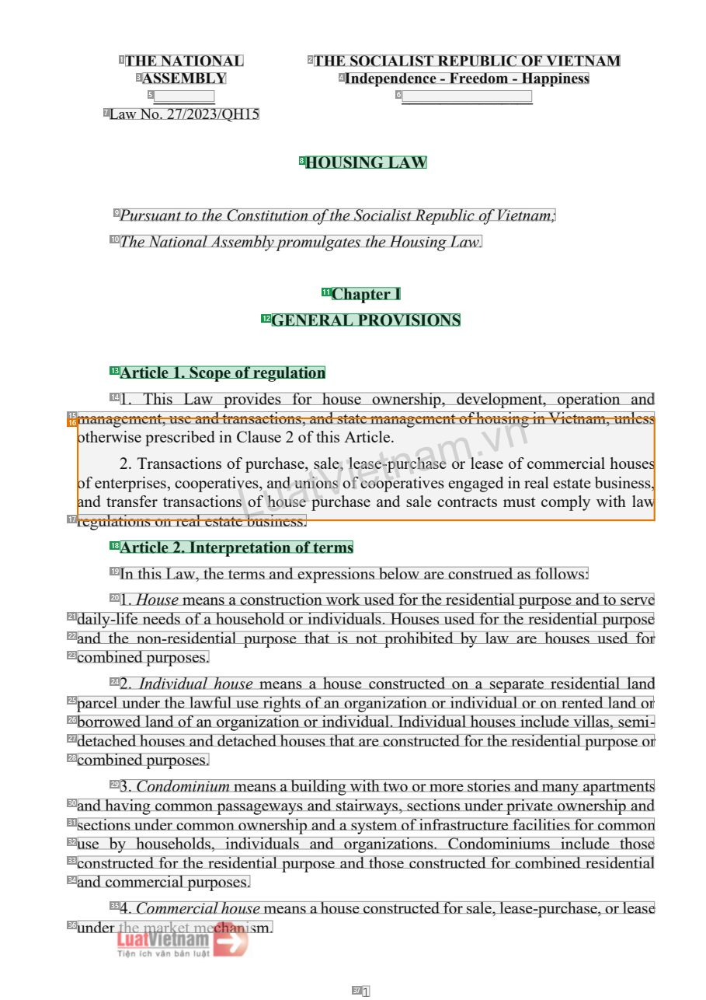
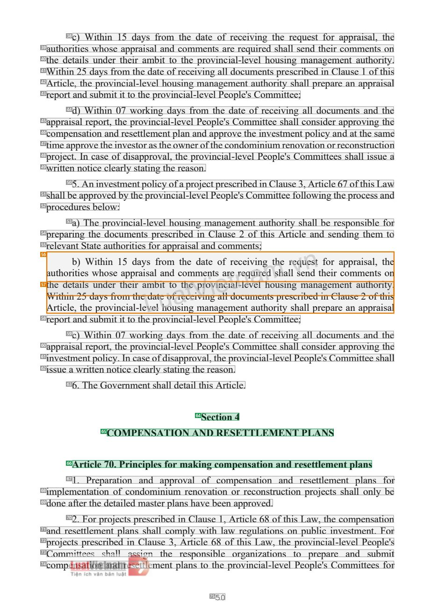
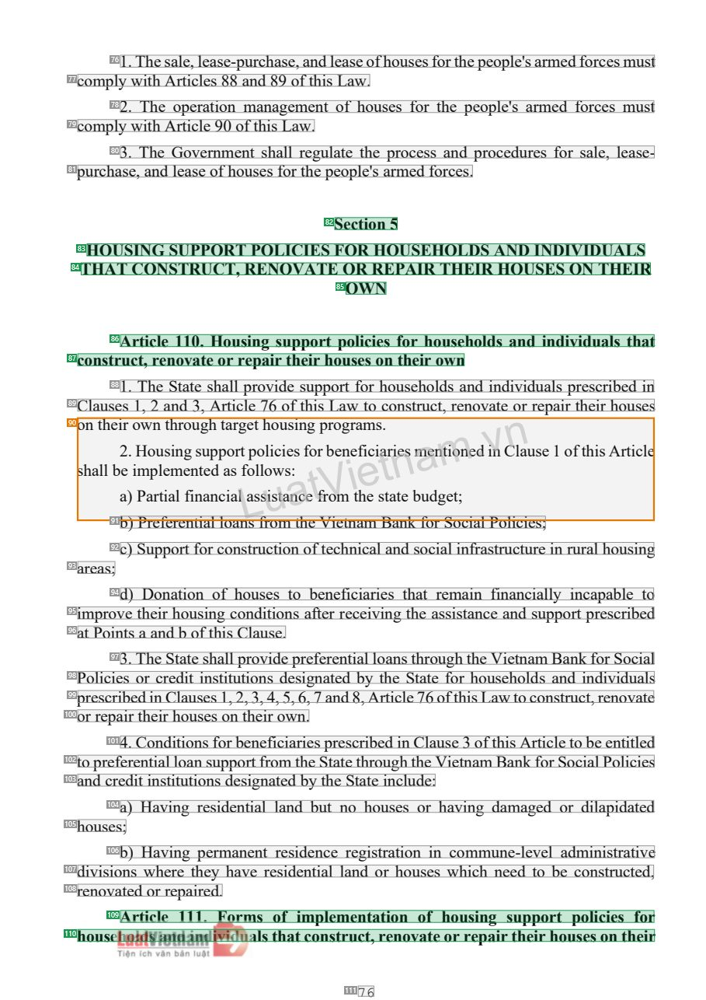

# 085 — `todo10_8/heading_corpus_100/06_dich_song_ngu/085_Luat_Nha_o_2023_EN.pdf`

Draft `P7_F1Q_HELDOUT_GOLD_DRAFT_V2`, status `DRAFT_REVIEWER_A_NOT_APPROVED`, draft sha256 `0cff9035d8ed789a09ca9c35afe7bc6c5e91fbbbe1ae6882e468092214387c4a`. Source sha256 `61762a372a48bc7474a1abee4850a1ae1ae49cb56cfb5dd0e034411892b8a30b`. [Back to index](README.md)

Approve or correct with `review-apply` lines: `APPROVE 085 by <reviewer> [because <note>]`, `085 <alias> -> E|R|O because <reason>`.

## Page 1 (FIRST)

| # | alias | text | font | draft | flag | rationale |
|---:|---|---|---|---|---|---|
| 1 | L0000:S0 | THE NATIONAL | 13 B | **OTHER** |  | Issuer &quot;THE NATIONAL&quot; (letterhead) |
| 2 | L0000:S1 | THE SOCIALIST REPUBLIC OF VIETNAM | 13 B | **OTHER** |  | National name (letterhead) |
| 3 | L0001:S0 | ASSEMBLY | 13 B | **OTHER** |  | Issuer continuation &quot;ASSEMBLY&quot; (letterhead) |
| 4 | L0001:S1 | Independence - Freedom - Happiness | 13 B | **OTHER** |  | National motto |
| 5 | L0002:S0 | ________ | 13 B | **OTHER** |  | Default: body text, list item, table cell, page number or other non-heading content on this page |
| 6 | L0002:S1 | _________________ | 13 B | **OTHER** |  | Default: body text, list item, table cell, page number or other non-heading content on this page |
| 7 | L0003:S0 | Law No. 27/2023/QH15 | 13 | **OTHER** |  | Document number &quot;Law No. 27/2023/QH15&quot; |
| 8 | L0004:S0 | HOUSING LAW | 14 B | **ESTABLISHES** |  | Document title &quot;HOUSING LAW&quot; (bold, centred) |
| 9 | L0005:S0 | Pursuant to the Constitution of the Socialist Republic of Vietnam; | 14 I | **OTHER** |  | Default: body text, list item, table cell, page number or other non-heading content on this page |
| 10 | L0006:S0 | The National Assembly promulgates the Housing Law. | 14 I | **OTHER** |  | Default: body text, list item, table cell, page number or other non-heading content on this page |
| 11 | L0007:S0 | Chapter I | 14 B | **ESTABLISHES** |  | Chapter label &quot;Chapter I&quot; (bold) |
| 12 | L0008:S0 | GENERAL PROVISIONS | 14 B | **ESTABLISHES** |  | Chapter title &quot;GENERAL PROVISIONS&quot; (bold) |
| 13 | L0009:S0 | Article 1. Scope of regulation | 14 B | **ESTABLISHES** |  | Article heading &quot;Article 1. Scope of regulation&quot; (bold) |
| 14 | L0010:S0 | 1. This Law provides for house ownership, development, operation and | 14 | **OTHER** |  | Default: body text, list item, table cell, page number or other non-heading content on this page |
| 15 | L0011:S0 | management, use and transactions, and state management of housing in Vietnam, unless | 14 | **OTHER** |  | Default: body text, list item, table cell, page number or other non-heading content on this page |
| 16 | L0012:S0 | ooantfhdeenrttwrea2rinsp.serTfiepsrraerenst,srsaccanrocistobiapoecdentrisioanotnifsCvLeploasuf,urauhcsnehodau2assueoen,f… | 14 | **OTHER** | REVIEW_FOCUS | Garbled atom (body + watermark) - source corrupted |
| 17 | L0013:S0 | regulations on real estate business. | 14 | **OTHER** |  | Default: body text, list item, table cell, page number or other non-heading content on this page |
| 18 | L0014:S0 | Article 2. Interpretation of terms | 14 B | **ESTABLISHES** |  | Article heading &quot;Article 2. Interpretation of terms&quot; (bold) |
| 19 | L0015:S0 | In this Law, the terms and expressions below are construed as follows: | 14 | **OTHER** |  | Default: body text, list item, table cell, page number or other non-heading content on this page |
| 20 | L0016:S0 | 1. House means a construction work used for the residential purpose and to serve | 14 | **OTHER** |  | Default: body text, list item, table cell, page number or other non-heading content on this page |
| 21 | L0017:S0 | daily-life needs of a household or individuals. Houses used for the residential purpose | 14 | **OTHER** |  | Default: body text, list item, table cell, page number or other non-heading content on this page |
| 22 | L0018:S0 | and the non-residential purpose that is not prohibited by law are houses used for | 14 | **OTHER** |  | Default: body text, list item, table cell, page number or other non-heading content on this page |
| 23 | L0019:S0 | combined purposes. | 14 | **OTHER** |  | Default: body text, list item, table cell, page number or other non-heading content on this page |
| 24 | L0020:S0 | 2. Individual house means a house constructed on a separate residential land | 14 | **OTHER** |  | Default: body text, list item, table cell, page number or other non-heading content on this page |
| 25 | L0021:S0 | parcel under the lawful use rights of an organization or individual or on rented land or | 14 | **OTHER** |  | Default: body text, list item, table cell, page number or other non-heading content on this page |
| 26 | L0022:S0 | borrowed land of an organization or individual. Individual houses include villas, semi- | 14 | **OTHER** |  | Default: body text, list item, table cell, page number or other non-heading content on this page |
| 27 | L0023:S0 | detached houses and detached houses that are constructed for the residential purpose or | 14 | **OTHER** |  | Default: body text, list item, table cell, page number or other non-heading content on this page |
| 28 | L0024:S0 | combined purposes. | 14 | **OTHER** |  | Default: body text, list item, table cell, page number or other non-heading content on this page |
| 29 | L0025:S0 | 3. Condominium means a building with two or more stories and many apartments | 14 | **OTHER** |  | Default: body text, list item, table cell, page number or other non-heading content on this page |
| 30 | L0026:S0 | and having common passageways and stairways, sections under private ownership and | 14 | **OTHER** |  | Default: body text, list item, table cell, page number or other non-heading content on this page |
| 31 | L0027:S0 | sections under common ownership and a system of infrastructure facilities for common | 14 | **OTHER** |  | Default: body text, list item, table cell, page number or other non-heading content on this page |
| 32 | L0028:S0 | use by households, individuals and organizations. Condominiums include those | 14 | **OTHER** |  | Default: body text, list item, table cell, page number or other non-heading content on this page |
| 33 | L0029:S0 | constructed for the residential purpose and those constructed for combined residential | 14 | **OTHER** |  | Default: body text, list item, table cell, page number or other non-heading content on this page |
| 34 | L0030:S0 | and commercial purposes. | 14 | **OTHER** |  | Default: body text, list item, table cell, page number or other non-heading content on this page |
| 35 | L0031:S0 | 4. Commercial house means a house constructed for sale, lease-purchase, or lease | 14 | **OTHER** |  | Default: body text, list item, table cell, page number or other non-heading content on this page |
| 36 | L0032:S0 | under the market mechanism. | 14 | **OTHER** |  | Default: body text, list item, table cell, page number or other non-heading content on this page |
| 37 | L0033:S0 | 1 | 12 | **OTHER** |  | Page number |

**OTHER rows to check for a missed heading on page 1** (body size 14pt; bold or ≥ body+1pt, ≤ 12 words): #1 `L0000:S0` THE NATIONAL (13 B), #2 `L0000:S1` THE SOCIALIST REPUBLIC OF VIETNAM (13 B), #3 `L0001:S0` ASSEMBLY (13 B), #4 `L0001:S1` Independence - Freedom - Happiness (13 B), #5 `L0002:S0` ________ (13 B), #6 `L0002:S1` _________________ (13 B).

## Page 50 (SEEDED_INTERIOR)

| # | alias | text | font | draft | flag | rationale |
|---:|---|---|---|---|---|---|
| 38 | L1858:S0 | c) Within 15 days from the date of receiving the request for appraisal, the | 14 | **OTHER** |  | Default: body text, list item, table cell, page number or other non-heading content on this page |
| 39 | L1859:S0 | authorities whose appraisal and comments are required shall send their comments on | 14 | **OTHER** |  | Default: body text, list item, table cell, page number or other non-heading content on this page |
| 40 | L1860:S0 | the details under their ambit to the provincial-level housing management authority. | 14 | **OTHER** |  | Default: body text, list item, table cell, page number or other non-heading content on this page |
| 41 | L1861:S0 | Within 25 days from the date of receiving all documents prescribed in Clause 1 of this | 14 | **OTHER** |  | Default: body text, list item, table cell, page number or other non-heading content on this page |
| 42 | L1862:S0 | Article, the provincial-level housing management authority shall prepare an appraisal | 14 | **OTHER** |  | Default: body text, list item, table cell, page number or other non-heading content on this page |
| 43 | L1863:S0 | report and submit it to the provincial-level People&#39;s Committee; | 14 | **OTHER** |  | Default: body text, list item, table cell, page number or other non-heading content on this page |
| 44 | L1864:S0 | d) Within 07 working days from the date of receiving all documents and the | 14 | **OTHER** |  | Default: body text, list item, table cell, page number or other non-heading content on this page |
| 45 | L1865:S0 | appraisal report, the provincial-level People&#39;s Committee shall consider approving the | 14 | **OTHER** |  | Default: body text, list item, table cell, page number or other non-heading content on this page |
| 46 | L1866:S0 | compensation and resettlement plan and approve the investment policy and at the same | 14 | **OTHER** |  | Default: body text, list item, table cell, page number or other non-heading content on this page |
| 47 | L1867:S0 | time approve the investor as the owner of the condominium renovation or reconstruction | 14 | **OTHER** |  | Default: body text, list item, table cell, page number or other non-heading content on this page |
| 48 | L1868:S0 | project. In case of disapproval, the provincial-level People&#39;s Committees shall issue a | 14 | **OTHER** |  | Default: body text, list item, table cell, page number or other non-heading content on this page |
| 49 | L1869:S0 | written notice clearly stating the reason. | 14 | **OTHER** |  | Default: body text, list item, table cell, page number or other non-heading content on this page |
| 50 | L1870:S0 | 5. An investment policy of a project prescribed in Clause 3, Article 67 of this Law | 14 | **OTHER** |  | Default: body text, list item, table cell, page number or other non-heading content on this page |
| 51 | L1871:S0 | shall be approved by the provincial-level People&#39;s Committee following the process and | 14 | **OTHER** |  | Default: body text, list item, table cell, page number or other non-heading content on this page |
| 52 | L1872:S0 | procedures below: | 14 | **OTHER** |  | Default: body text, list item, table cell, page number or other non-heading content on this page |
| 53 | L1873:S0 | a) The provincial-level housing management authority shall be responsible for | 14 | **OTHER** |  | Default: body text, list item, table cell, page number or other non-heading content on this page |
| 54 | L1874:S0 | preparing the documents prescribed in Clause 2 of this Article and sending them to | 14 | **OTHER** |  | Default: body text, list item, table cell, page number or other non-heading content on this page |
| 55 | L1875:S0 | relevant State authorities for appraisal and comments; | 14 | **OTHER** |  | Default: body text, list item, table cell, page number or other non-heading content on this page |
| 56 | L1876:S0 | athuethdoeribtta)iielssWwuitnhhdoinesre1ta5hpepidrraayaissmalbfriaotnmtdoctthoheme mdparetonevitsieonafcrieratelrnc-elee… | 14 | **OTHER** | REVIEW_FOCUS | Garbled atom (body + watermark) - source corrupted |
| 57 | L1877:S0 | WArittihcilne,2t5hedapyrosvfirnocmiatlh-leevLdealteuhoofuasriencgteiVmvianngaaglelmdoencut mauetnhtosrpitryesschraibllep… | 14 | **OTHER** | REVIEW_FOCUS | Garbled atom (body + watermark) - source corrupted |
| 58 | L1878:S0 | report and submit it to the provincial-level People&#39;s Committee; | 14 | **OTHER** |  | Default: body text, list item, table cell, page number or other non-heading content on this page |
| 59 | L1879:S0 | c) Within 07 working days from the date of receiving all documents and the | 14 | **OTHER** |  | Default: body text, list item, table cell, page number or other non-heading content on this page |
| 60 | L1880:S0 | appraisal report, the provincial-level People&#39;s Committee shall consider approving the | 14 | **OTHER** |  | Default: body text, list item, table cell, page number or other non-heading content on this page |
| 61 | L1881:S0 | investment policy. In case of disapproval, the provincial-level People&#39;s Committee shall | 14 | **OTHER** |  | Default: body text, list item, table cell, page number or other non-heading content on this page |
| 62 | L1882:S0 | issue a written notice clearly stating the reason. | 14 | **OTHER** |  | Default: body text, list item, table cell, page number or other non-heading content on this page |
| 63 | L1883:S0 | 6. The Government shall detail this Article. | 14 | **OTHER** |  | Default: body text, list item, table cell, page number or other non-heading content on this page |
| 64 | L1884:S0 | Section 4 | 14 B | **ESTABLISHES** |  | Section label &quot;Section 4&quot; (bold) |
| 65 | L1885:S0 | COMPENSATION AND RESETTLEMENT PLANS | 14 B | **ESTABLISHES** |  | Section title &quot;COMPENSATION AND RESETTLEMENT PLANS&quot; (bold) |
| 66 | L1886:S0 | Article 70. Principles for making compensation and resettlement plans | 14 B | **ESTABLISHES** |  | Article heading &quot;Article 70. Principles for making compensation and resettlement plans&quot; (bold) |
| 67 | L1887:S0 | 1. Preparation and approval of compensation and resettlement plans for | 14 | **OTHER** |  | Default: body text, list item, table cell, page number or other non-heading content on this page |
| 68 | L1888:S0 | implementation of condominium renovation or reconstruction projects shall only be | 14 | **OTHER** |  | Default: body text, list item, table cell, page number or other non-heading content on this page |
| 69 | L1889:S0 | done after the detailed master plans have been approved. | 14 | **OTHER** |  | Default: body text, list item, table cell, page number or other non-heading content on this page |
| 70 | L1890:S0 | 2. For projects prescribed in Clause 1, Article 68 of this Law, the compensation | 14 | **OTHER** |  | Default: body text, list item, table cell, page number or other non-heading content on this page |
| 71 | L1891:S0 | and resettlement plans shall comply with law regulations on public investment. For | 14 | **OTHER** |  | Default: body text, list item, table cell, page number or other non-heading content on this page |
| 72 | L1892:S0 | projects prescribed in Clause 3, Article 68 of this Law, the provincial-level People&#39;s | 14 | **OTHER** |  | Default: body text, list item, table cell, page number or other non-heading content on this page |
| 73 | L1893:S0 | Committees shall assign the responsible organizations to prepare and submit | 14 | **OTHER** |  | Default: body text, list item, table cell, page number or other non-heading content on this page |
| 74 | L1894:S0 | compensation and resettlement plans to the provincial-level People&#39;s Committees for | 14 | **OTHER** |  | Default: body text, list item, table cell, page number or other non-heading content on this page |
| 75 | L1895:S0 | 50 | 12 | **OTHER** |  | Page number |

**OTHER rows to check for a missed heading on page 50** (body size 14pt; bold or ≥ body+1pt, ≤ 12 words): none.

## Page 76 (SEEDED_INTERIOR)

| # | alias | text | font | draft | flag | rationale |
|---:|---|---|---|---|---|---|
| 76 | L2856:S0 | 1. The sale, lease-purchase, and lease of houses for the people&#39;s armed forces must | 14 | **OTHER** |  | Default: body text, list item, table cell, page number or other non-heading content on this page |
| 77 | L2857:S0 | comply with Articles 88 and 89 of this Law. | 14 | **OTHER** |  | Default: body text, list item, table cell, page number or other non-heading content on this page |
| 78 | L2858:S0 | 2. The operation management of houses for the people&#39;s armed forces must | 14 | **OTHER** |  | Default: body text, list item, table cell, page number or other non-heading content on this page |
| 79 | L2859:S0 | comply with Article 90 of this Law. | 14 | **OTHER** |  | Default: body text, list item, table cell, page number or other non-heading content on this page |
| 80 | L2860:S0 | 3. The Government shall regulate the process and procedures for sale, lease- | 14 | **OTHER** |  | Default: body text, list item, table cell, page number or other non-heading content on this page |
| 81 | L2861:S0 | purchase, and lease of houses for the people&#39;s armed forces. | 14 | **OTHER** |  | Default: body text, list item, table cell, page number or other non-heading content on this page |
| 82 | L2862:S0 | Section 5 | 14 B | **ESTABLISHES** |  | Section label &quot;Section 5&quot; (bold) |
| 83 | L2863:S0 | HOUSING SUPPORT POLICIES FOR HOUSEHOLDS AND INDIVIDUALS | 14 B | **ESTABLISHES** |  | Section title line 1 (bold) |
| 84 | L2864:S0 | THAT CONSTRUCT, RENOVATE OR REPAIR THEIR HOUSES ON THEIR | 14 B | **ESTABLISHES** |  | Section title line 2 (bold) |
| 85 | L2865:S0 | OWN | 14 B | **ESTABLISHES** |  | Section title line 3 &quot;OWN&quot; (bold) |
| 86 | L2866:S0 | Article 110. Housing support policies for households and individuals that | 14 B | **ESTABLISHES** |  | Article heading &quot;Article 110. Housing support policies ...&quot; line 1 (bold) |
| 87 | L2867:S0 | construct, renovate or repair their houses on their own | 14 B | **ESTABLISHES** |  | Article heading line 2 (bold) |
| 88 | L2868:S0 | 1. The State shall provide support for households and individuals prescribed in | 14 | **OTHER** |  | Default: body text, list item, table cell, page number or other non-heading content on this page |
| 89 | L2869:S0 | Clauses 1, 2 and 3, Article 76 of this Law to construct, renovate or repair their houses | 14 | **OTHER** |  | Default: body text, list item, table cell, page number or other non-heading content on this page |
| 90 | L2870:S0 | oshnatlhlebi2aer).oiHPmwaopnrulteistahminlreogfinunstguaehpndpctaaioasrrlgtfLeaopstlolsholiuioswctuiasesna:sicnfegotfrpr… | 14 | **OTHER** | REVIEW_FOCUS | Garbled atom (body + watermark) - source corrupted |
| 91 | L2871:S0 | b) Preferential loans from the Vietnam Bank for Social Policies; | 14 | **OTHER** |  | Default: body text, list item, table cell, page number or other non-heading content on this page |
| 92 | L2872:S0 | c) Support for construction of technical and social infrastructure in rural housing | 14 | **OTHER** |  | Default: body text, list item, table cell, page number or other non-heading content on this page |
| 93 | L2873:S0 | areas; | 14 | **OTHER** |  | Default: body text, list item, table cell, page number or other non-heading content on this page |
| 94 | L2874:S0 | d) Donation of houses to beneficiaries that remain financially incapable to | 14 | **OTHER** |  | Default: body text, list item, table cell, page number or other non-heading content on this page |
| 95 | L2875:S0 | improve their housing conditions after receiving the assistance and support prescribed | 14 | **OTHER** |  | Default: body text, list item, table cell, page number or other non-heading content on this page |
| 96 | L2876:S0 | at Points a and b of this Clause. | 14 | **OTHER** |  | Default: body text, list item, table cell, page number or other non-heading content on this page |
| 97 | L2877:S0 | 3. The State shall provide preferential loans through the Vietnam Bank for Social | 14 | **OTHER** |  | Default: body text, list item, table cell, page number or other non-heading content on this page |
| 98 | L2878:S0 | Policies or credit institutions designated by the State for households and individuals | 14 | **OTHER** |  | Default: body text, list item, table cell, page number or other non-heading content on this page |
| 99 | L2879:S0 | prescribed in Clauses 1, 2, 3, 4, 5, 6, 7 and 8, Article 76 of this Law to construct, renovate | 14 | **OTHER** |  | Default: body text, list item, table cell, page number or other non-heading content on this page |
| 100 | L2880:S0 | or repair their houses on their own. | 14 | **OTHER** |  | Default: body text, list item, table cell, page number or other non-heading content on this page |
| 101 | L2881:S0 | 4. Conditions for beneficiaries prescribed in Clause 3 of this Article to be entitled | 14 | **OTHER** |  | Default: body text, list item, table cell, page number or other non-heading content on this page |
| 102 | L2882:S0 | to preferential loan support from the State through the Vietnam Bank for Social Policies | 14 | **OTHER** |  | Default: body text, list item, table cell, page number or other non-heading content on this page |
| 103 | L2883:S0 | and credit institutions designated by the State include: | 14 | **OTHER** |  | Default: body text, list item, table cell, page number or other non-heading content on this page |
| 104 | L2884:S0 | a) Having residential land but no houses or having damaged or dilapidated | 14 | **OTHER** |  | Default: body text, list item, table cell, page number or other non-heading content on this page |
| 105 | L2885:S0 | houses; | 14 | **OTHER** |  | Default: body text, list item, table cell, page number or other non-heading content on this page |
| 106 | L2886:S0 | b) Having permanent residence registration in commune-level administrative | 14 | **OTHER** |  | Default: body text, list item, table cell, page number or other non-heading content on this page |
| 107 | L2887:S0 | divisions where they have residential land or houses which need to be constructed, | 14 | **OTHER** |  | Default: body text, list item, table cell, page number or other non-heading content on this page |
| 108 | L2888:S0 | renovated or repaired. | 14 | **OTHER** |  | Default: body text, list item, table cell, page number or other non-heading content on this page |
| 109 | L2889:S0 | Article 111. Forms of implementation of housing support policies for | 14 B | **ESTABLISHES** |  | Article heading &quot;Article 111. Forms of implementation ...&quot; line 1 (bold) |
| 110 | L2890:S0 | households and individuals that construct, renovate or repair their houses on their | 14 B | **ESTABLISHES** |  | Article heading line 2 (bold) |
| 111 | L2891:S0 | 76 | 12 | **OTHER** |  | Page number |

**OTHER rows to check for a missed heading on page 76** (body size 14pt; bold or ≥ body+1pt, ≤ 12 words): none.
