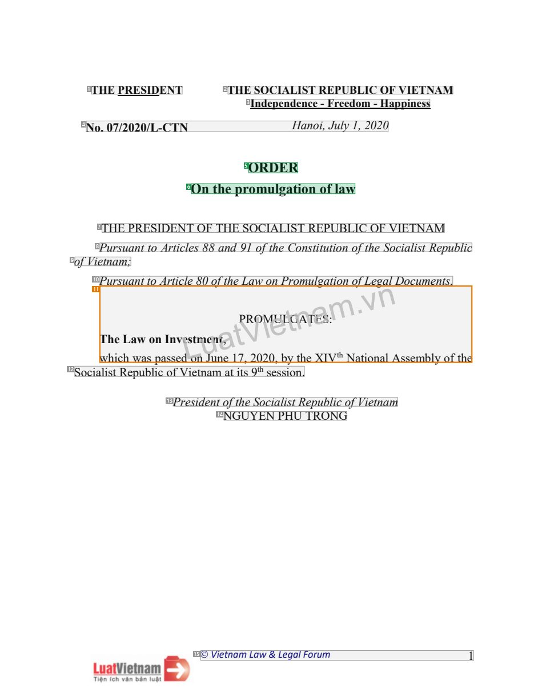
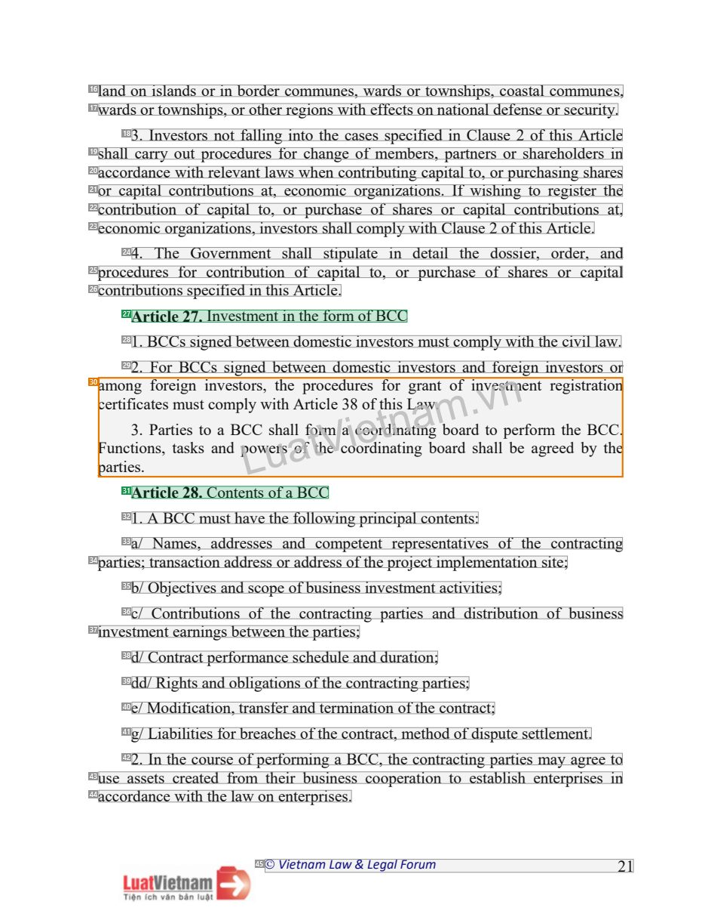
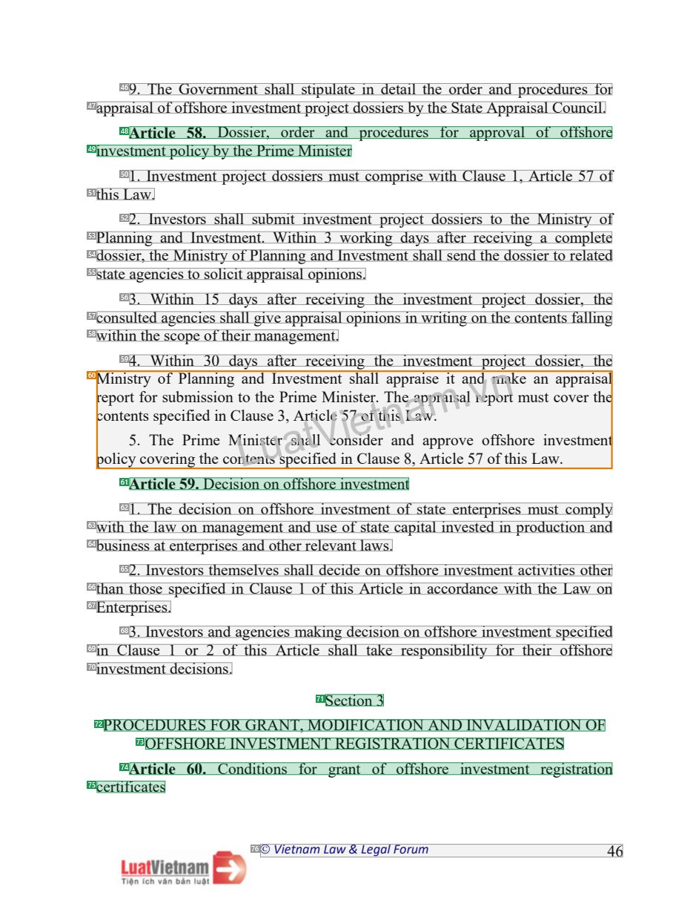

# 086 — `todo10_8/heading_corpus_100/06_dich_song_ngu/086_Luat_Dau_tu_2020_EN_alt.pdf`

Draft `P7_F1Q_HELDOUT_GOLD_DRAFT_V2`, status `DRAFT_REVIEWER_A_NOT_APPROVED`, draft sha256 `a82cb6553ea86f9929a53d386734c3cd939525fe2fef08bd25b0fb47ee80dc35`. Source sha256 `46c95bde68c1e38d7ca1ff88c2be9dea55252eaa7dff66578484a78d37437e26`. [Back to index](README.md)

Approve or correct with `review-apply` lines: `APPROVE 086 by <reviewer> [because <note>]`, `086 <alias> -> E|R|O because <reason>`.

## Page 1 (FIRST)

| # | alias | text | font | draft | flag | rationale |
|---:|---|---|---|---|---|---|
| 1 | L0000:S0 | THE PRESIDENT | 13 B | **OTHER** |  | Issuer &quot;THE PRESIDENT&quot; (letterhead) |
| 2 | L0000:S1 | THE SOCIALIST REPUBLIC OF VIETNAM | 13 B | **OTHER** |  | National name (letterhead) |
| 3 | L0001:S0 | Independence - Freedom - Happiness | 13 B | **OTHER** |  | National motto |
| 4 | L0002:S0 | No. 07/2020/L-CTN Hanoi, July 1, 2020 | 14 B I | **OTHER** |  | Document number and place/date &quot;No. 07/2020/L-CTN Hanoi, July 1, 2020&quot; |
| 5 | L0003:S0 | ORDER | 16 B | **ESTABLISHES** |  | Document type title &quot;ORDER&quot; (16pt bold) |
| 6 | L0004:S0 | On the promulgation of law | 16 B | **ESTABLISHES** |  | Document title &quot;On the promulgation of law&quot; (16pt bold) |
| 7 | L0005:S0 | THE PRESIDENT OF THE SOCIALIST REPUBLIC OF VIETNAM | 14 | **OTHER** |  | Promulgating authority line &quot;THE PRESIDENT OF THE SOCIALIST REPUBLIC OF VIETNAM&quot; (enacting formula, not a heading) |
| 8 | L0006:S0 | Pursuant to Articles 88 and 91 of the Constitution of the Socialist Republic | 14 I | **OTHER** |  | Default: body text, list item, table cell, page number or other non-heading content on this page |
| 9 | L0007:S0 | of Vietnam; | 14 I | **OTHER** |  | Default: body text, list item, table cell, page number or other non-heading content on this page |
| 10 | L0008:S0 | Pursuant to Article 80 of the Law on Promulgation of Legal Documents, | 14 I | **OTHER** |  | Default: body text, list item, table cell, page number or other non-heading content on this page |
| 11 | L0009:S0 | TwhhiecLhawwasopnaIsnsevdeLLsotmnuuJeunntaa,e 1tt7P,RVV2O02Mii0eeU, bLyttGtnnAheTEaaXSIV:mmth Na..tivvonannl Assembly of… | 14 | **OTHER** | REVIEW_FOCUS | Garbled atom (text layers interleaved) - source corrupted; no heading readable |
| 12 | L0010:S0 | Socialist Republic of Vietnam at its 9th session. | 14 | **OTHER** |  | Default: body text, list item, table cell, page number or other non-heading content on this page |
| 13 | L0011:S0 | President of the Socialist Republic of Vietnam | 14 I | **OTHER** |  | Default: body text, list item, table cell, page number or other non-heading content on this page |
| 14 | L0012:S0 | NGUYEN PHU TRONG | 14 | **OTHER** |  | Signatory name &quot;NGUYEN PHU TRONG&quot; |
| 15 | L0013:S0 |  Vietnam Law &amp; Legal Forum 1 | 12 I | **OTHER** |  | Running footer &quot;Vietnam Law &amp; Legal Forum 1&quot; |

**OTHER rows to check for a missed heading on page 1** (body size 14pt; bold or ≥ body+1pt, ≤ 12 words): #1 `L0000:S0` THE PRESIDENT (13 B), #2 `L0000:S1` THE SOCIALIST REPUBLIC OF VIETNAM (13 B), #3 `L0001:S0` Independence - Freedom - Happiness (13 B), #4 `L0002:S0` No. 07/2020/L-CTN Hanoi, July 1, 2020 (14 B I).

## Page 21 (SEEDED_INTERIOR)

| # | alias | text | font | draft | flag | rationale |
|---:|---|---|---|---|---|---|
| 16 | L0610:S0 | land on islands or in border communes, wards or townships, coastal communes, | 14 | **OTHER** |  | Default: body text, list item, table cell, page number or other non-heading content on this page |
| 17 | L0611:S0 | wards or townships, or other regions with effects on national defense or security. | 14 | **OTHER** |  | Default: body text, list item, table cell, page number or other non-heading content on this page |
| 18 | L0612:S0 | 3. Investors not falling into the cases specified in Clause 2 of this Article | 14 | **OTHER** |  | Default: body text, list item, table cell, page number or other non-heading content on this page |
| 19 | L0613:S0 | shall carry out procedures for change of members, partners or shareholders in | 14 | **OTHER** |  | Default: body text, list item, table cell, page number or other non-heading content on this page |
| 20 | L0614:S0 | accordance with relevant laws when contributing capital to, or purchasing shares | 14 | **OTHER** |  | Default: body text, list item, table cell, page number or other non-heading content on this page |
| 21 | L0615:S0 | or capital contributions at, economic organizations. If wishing to register the | 14 | **OTHER** |  | Default: body text, list item, table cell, page number or other non-heading content on this page |
| 22 | L0616:S0 | contribution of capital to, or purchase of shares or capital contributions at, | 14 | **OTHER** |  | Default: body text, list item, table cell, page number or other non-heading content on this page |
| 23 | L0617:S0 | economic organizations, investors shall comply with Clause 2 of this Article. | 14 | **OTHER** |  | Default: body text, list item, table cell, page number or other non-heading content on this page |
| 24 | L0618:S0 | 4. The Government shall stipulate in detail the dossier, order, and | 14 | **OTHER** |  | Default: body text, list item, table cell, page number or other non-heading content on this page |
| 25 | L0619:S0 | procedures for contribution of capital to, or purchase of shares or capital | 14 | **OTHER** |  | Default: body text, list item, table cell, page number or other non-heading content on this page |
| 26 | L0620:S0 | contributions specified in this Article. | 14 | **OTHER** |  | Default: body text, list item, table cell, page number or other non-heading content on this page |
| 27 | L0621:S0 | Article 27. Investment in the form of BCC | 14 | **ESTABLISHES** |  | Article heading &quot;Article 27. Investment in the form of BCC&quot; (regular weight, own line) |
| 28 | L0622:S0 | 1. BCCs signed between domestic investors must comply with the civil law. | 14 | **OTHER** |  | Default: body text, list item, table cell, page number or other non-heading content on this page |
| 29 | L0623:S0 | 2. For BCCs signed between domestic investors and foreign investors or | 14 | **OTHER** |  | Default: body text, list item, table cell, page number or other non-heading content on this page |
| 30 | L0624:S0 | acFpemaurrnottiicnfet3igsic.o.anPftesoa,srrettmiiaegsusnkssttoicnaovanmedBsptpColLLyorCsww,suueithrthhsaelaaAol fprftort… | 14 | **OTHER** | REVIEW_FOCUS | Garbled atom (interleaved text layers) - source corrupted; no heading readable |
| 31 | L0625:S0 | Article 28. Contents of a BCC | 14 | **ESTABLISHES** |  | Article heading &quot;Article 28. Contents of a BCC&quot; |
| 32 | L0626:S0 | 1. A BCC must have the following principal contents: | 14 | **OTHER** |  | Default: body text, list item, table cell, page number or other non-heading content on this page |
| 33 | L0627:S0 | a/ Names, addresses and competent representatives of the contracting | 14 | **OTHER** |  | Default: body text, list item, table cell, page number or other non-heading content on this page |
| 34 | L0628:S0 | parties; transaction address or address of the project implementation site; | 14 | **OTHER** |  | Default: body text, list item, table cell, page number or other non-heading content on this page |
| 35 | L0629:S0 | b/ Objectives and scope of business investment activities; | 14 | **OTHER** |  | Default: body text, list item, table cell, page number or other non-heading content on this page |
| 36 | L0630:S0 | c/ Contributions of the contracting parties and distribution of business | 14 | **OTHER** |  | Default: body text, list item, table cell, page number or other non-heading content on this page |
| 37 | L0631:S0 | investment earnings between the parties; | 14 | **OTHER** |  | Default: body text, list item, table cell, page number or other non-heading content on this page |
| 38 | L0632:S0 | d/ Contract performance schedule and duration; | 14 | **OTHER** |  | Default: body text, list item, table cell, page number or other non-heading content on this page |
| 39 | L0633:S0 | dd/ Rights and obligations of the contracting parties; | 14 | **OTHER** |  | Default: body text, list item, table cell, page number or other non-heading content on this page |
| 40 | L0634:S0 | e/ Modification, transfer and termination of the contract; | 14 | **OTHER** |  | Default: body text, list item, table cell, page number or other non-heading content on this page |
| 41 | L0635:S0 | g/ Liabilities for breaches of the contract, method of dispute settlement. | 14 | **OTHER** |  | Default: body text, list item, table cell, page number or other non-heading content on this page |
| 42 | L0636:S0 | 2. In the course of performing a BCC, the contracting parties may agree to | 14 | **OTHER** |  | Default: body text, list item, table cell, page number or other non-heading content on this page |
| 43 | L0637:S0 | use assets created from their business cooperation to establish enterprises in | 14 | **OTHER** |  | Default: body text, list item, table cell, page number or other non-heading content on this page |
| 44 | L0638:S0 | accordance with the law on enterprises. | 14 | **OTHER** |  | Default: body text, list item, table cell, page number or other non-heading content on this page |
| 45 | L0639:S0 |  Vietnam Law &amp; Legal Forum 21 | 12 I | **OTHER** |  | Running footer |

**OTHER rows to check for a missed heading on page 21** (body size 14pt; bold or ≥ body+1pt, ≤ 12 words): none.

## Page 46 (SEEDED_INTERIOR)

| # | alias | text | font | draft | flag | rationale |
|---:|---|---|---|---|---|---|
| 46 | L1397:S0 | 9. The Government shall stipulate in detail the order and procedures for | 14 | **OTHER** |  | Default: body text, list item, table cell, page number or other non-heading content on this page |
| 47 | L1398:S0 | appraisal of offshore investment project dossiers by the State Appraisal Council. | 14 | **OTHER** |  | Default: body text, list item, table cell, page number or other non-heading content on this page |
| 48 | L1399:S0 | Article 58. Dossier, order and procedures for approval of offshore | 14 | **ESTABLISHES** |  | Article heading &quot;Article 58. Dossier, order and procedures for approval of offshore&quot; line 1 |
| 49 | L1400:S0 | investment policy by the Prime Minister | 14 | **ESTABLISHES** |  | Article heading line 2 &quot;investment policy by the Prime Minister&quot; |
| 50 | L1401:S0 | 1. Investment project dossiers must comprise with Clause 1, Article 57 of | 14 | **OTHER** |  | Default: body text, list item, table cell, page number or other non-heading content on this page |
| 51 | L1402:S0 | this Law. | 14 | **OTHER** |  | Default: body text, list item, table cell, page number or other non-heading content on this page |
| 52 | L1403:S0 | 2. Investors shall submit investment project dossiers to the Ministry of | 14 | **OTHER** |  | Default: body text, list item, table cell, page number or other non-heading content on this page |
| 53 | L1404:S0 | Planning and Investment. Within 3 working days after receiving a complete | 14 | **OTHER** |  | Default: body text, list item, table cell, page number or other non-heading content on this page |
| 54 | L1405:S0 | dossier, the Ministry of Planning and Investment shall send the dossier to related | 14 | **OTHER** |  | Default: body text, list item, table cell, page number or other non-heading content on this page |
| 55 | L1406:S0 | state agencies to solicit appraisal opinions. | 14 | **OTHER** |  | Default: body text, list item, table cell, page number or other non-heading content on this page |
| 56 | L1407:S0 | 3. Within 15 days after receiving the investment project dossier, the | 14 | **OTHER** |  | Default: body text, list item, table cell, page number or other non-heading content on this page |
| 57 | L1408:S0 | consulted agencies shall give appraisal opinions in writing on the contents falling | 14 | **OTHER** |  | Default: body text, list item, table cell, page number or other non-heading content on this page |
| 58 | L1409:S0 | within the scope of their management. | 14 | **OTHER** |  | Default: body text, list item, table cell, page number or other non-heading content on this page |
| 59 | L1410:S0 | 4. Within 30 days after receiving the investment project dossier, the | 14 | **OTHER** |  | Default: body text, list item, table cell, page number or other non-heading content on this page |
| 60 | L1411:S0 | Mrcpeoopinlnoitciersy5tnt.rtfcsyooTrsvohpsefeeurcibPniPmflgiraeiintsmdhnseeiiionncngMoCntlaLLoiatnneuitdnshsuutteeseInr3… | 14 | **OTHER** | REVIEW_FOCUS | Garbled atom (interleaved text layers) - source corrupted; no heading readable |
| 61 | L1412:S0 | Article 59. Decision on offshore investment | 14 | **ESTABLISHES** |  | Article heading &quot;Article 59. Decision on offshore investment&quot; |
| 62 | L1413:S0 | 1. The decision on offshore investment of state enterprises must comply | 14 | **OTHER** |  | Default: body text, list item, table cell, page number or other non-heading content on this page |
| 63 | L1414:S0 | with the law on management and use of state capital invested in production and | 14 | **OTHER** |  | Default: body text, list item, table cell, page number or other non-heading content on this page |
| 64 | L1415:S0 | business at enterprises and other relevant laws. | 14 | **OTHER** |  | Default: body text, list item, table cell, page number or other non-heading content on this page |
| 65 | L1416:S0 | 2. Investors themselves shall decide on offshore investment activities other | 14 | **OTHER** |  | Default: body text, list item, table cell, page number or other non-heading content on this page |
| 66 | L1417:S0 | than those specified in Clause 1 of this Article in accordance with the Law on | 14 | **OTHER** |  | Default: body text, list item, table cell, page number or other non-heading content on this page |
| 67 | L1418:S0 | Enterprises. | 14 | **OTHER** |  | Default: body text, list item, table cell, page number or other non-heading content on this page |
| 68 | L1419:S0 | 3. Investors and agencies making decision on offshore investment specified | 14 | **OTHER** |  | Default: body text, list item, table cell, page number or other non-heading content on this page |
| 69 | L1420:S0 | in Clause 1 or 2 of this Article shall take responsibility for their offshore | 14 | **OTHER** |  | Default: body text, list item, table cell, page number or other non-heading content on this page |
| 70 | L1421:S0 | investment decisions. | 14 | **OTHER** |  | Default: body text, list item, table cell, page number or other non-heading content on this page |
| 71 | L1422:S0 | Section 3 | 14 | **ESTABLISHES** |  | Section label &quot;Section 3&quot; |
| 72 | L1423:S0 | PROCEDURES FOR GRANT, MODIFICATION AND INVALIDATION OF | 14 | **ESTABLISHES** |  | Section title line 1 &quot;PROCEDURES FOR GRANT, MODIFICATION AND INVALIDATION OF&quot; |
| 73 | L1424:S0 | OFFSHORE INVESTMENT REGISTRATION CERTIFICATES | 14 | **ESTABLISHES** |  | Section title line 2 &quot;OFFSHORE INVESTMENT REGISTRATION CERTIFICATES&quot; |
| 74 | L1425:S0 | Article 60. Conditions for grant of offshore investment registration | 14 | **ESTABLISHES** |  | Article heading &quot;Article 60. Conditions for grant of offshore investment registration&quot; line 1 |
| 75 | L1426:S0 | certificates | 14 | **ESTABLISHES** |  | Article heading line 2 &quot;certificates&quot; |
| 76 | L1427:S0 |  Vietnam Law &amp; Legal Forum 46 | 12 I | **OTHER** |  | Running footer |

**OTHER rows to check for a missed heading on page 46** (body size 14pt; bold or ≥ body+1pt, ≤ 12 words): none.
