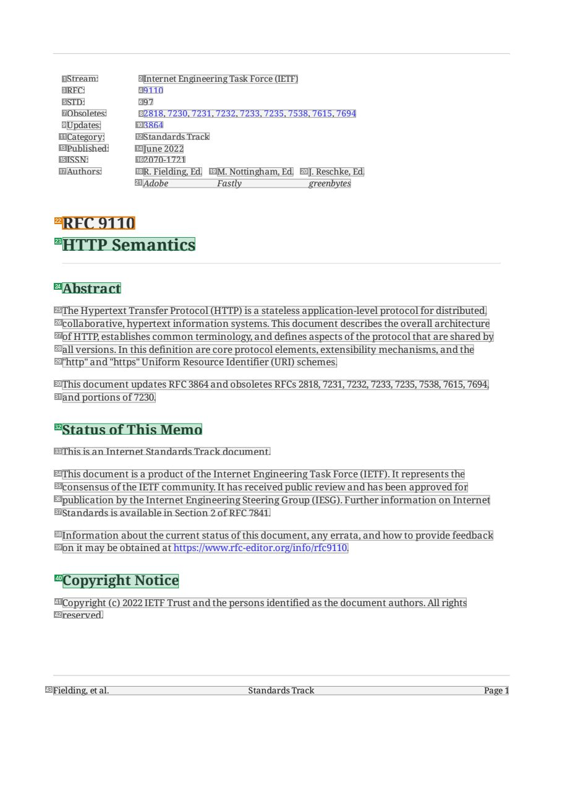
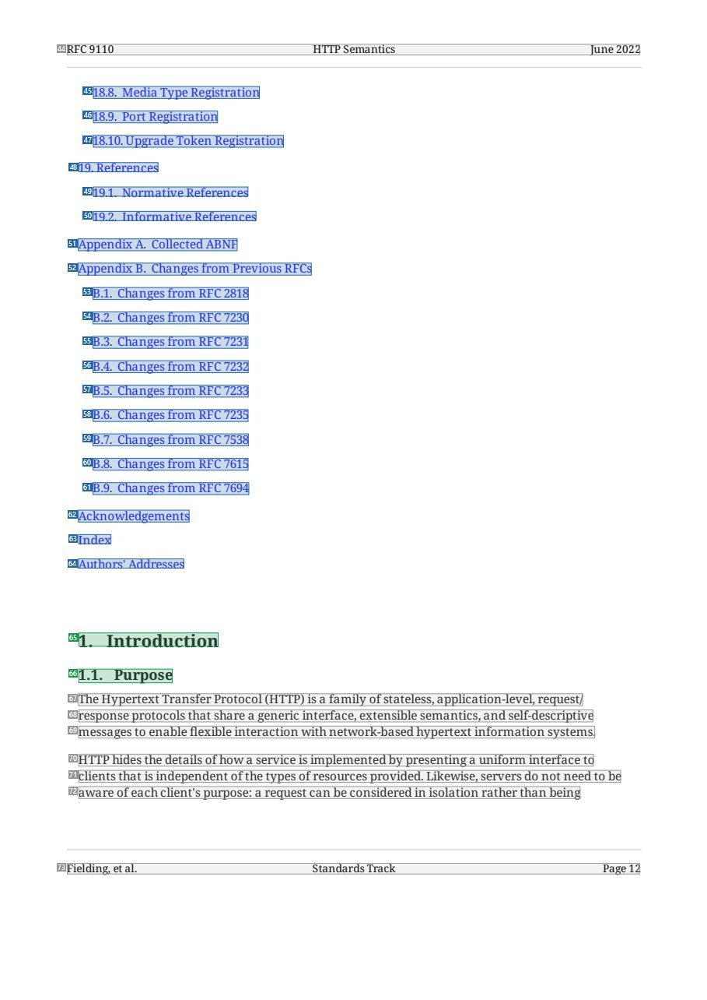
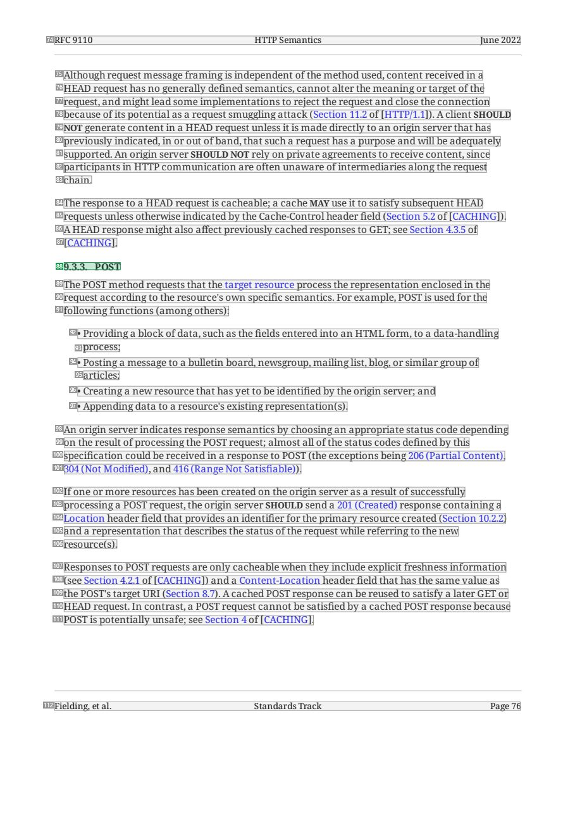
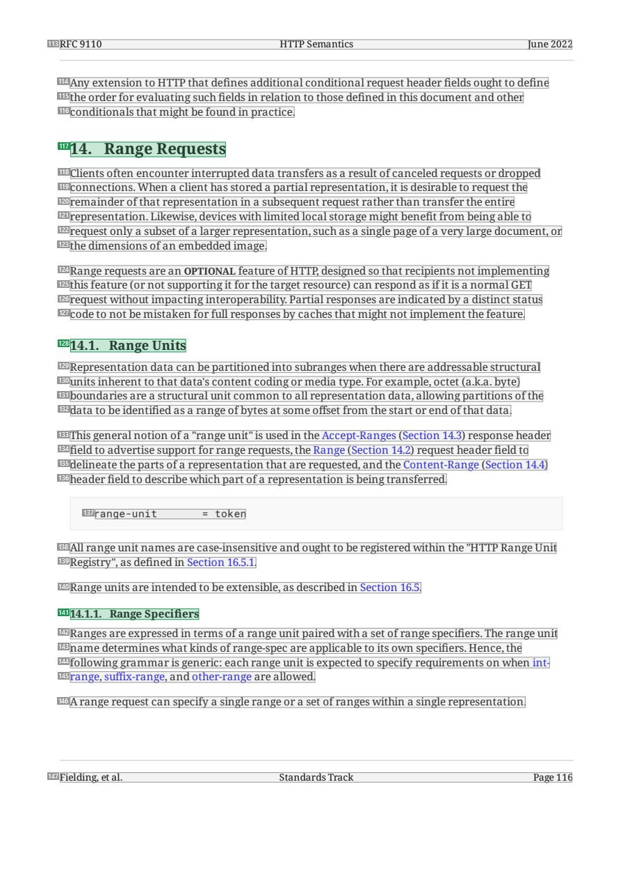

# 091 — `todo10_8/heading_corpus_100/07_system_generated/091_RFC9110_HTTP_Semantics.pdf`

Draft `P7_F1Q_HELDOUT_GOLD_DRAFT_V2`, status `DRAFT_REVIEWER_A_NOT_APPROVED`, draft sha256 `fdd99d587ce65dda360d5cd41bd6ad8c74a81045825f4bf6921927aa56a06f8a`. Source sha256 `60b30efa1048900833d1758440247fe8ac85a3134f2327388dcb24e07d814c89`. [Back to index](README.md)

Approve or correct with `review-apply` lines: `APPROVE 091 by <reviewer> [because <note>]`, `091 <alias> -> E|R|O because <reason>`.

## Page 1 (FIRST)

| # | alias | text | font | draft | flag | rationale |
|---:|---|---|---|---|---|---|
| 1 | L0000:S0 | Stream: | 9 | **OTHER** |  | Default: body text, list item, table cell, page number or other non-heading content on this page |
| 2 | L0000:S1 | Internet Engineering Task Force (IETF) | 9 | **OTHER** |  | Default: body text, list item, table cell, page number or other non-heading content on this page |
| 3 | L0001:S0 | RFC: | 9 | **OTHER** |  | Default: body text, list item, table cell, page number or other non-heading content on this page |
| 4 | L0001:S1 | 9110 | 9 | **OTHER** |  | Default: body text, list item, table cell, page number or other non-heading content on this page |
| 5 | L0002:S0 | STD: | 9 | **OTHER** |  | Default: body text, list item, table cell, page number or other non-heading content on this page |
| 6 | L0002:S1 | 97 | 9 | **OTHER** |  | Default: body text, list item, table cell, page number or other non-heading content on this page |
| 7 | L0003:S0 | Obsoletes: | 9 | **OTHER** |  | Default: body text, list item, table cell, page number or other non-heading content on this page |
| 8 | L0003:S1 | 2818, 7230, 7231, 7232, 7233, 7235, 7538, 7615, 7694 | 9 | **OTHER** |  | Default: body text, list item, table cell, page number or other non-heading content on this page |
| 9 | L0004:S0 | Updates: | 9 | **OTHER** |  | Default: body text, list item, table cell, page number or other non-heading content on this page |
| 10 | L0004:S1 | 3864 | 9 | **OTHER** |  | Default: body text, list item, table cell, page number or other non-heading content on this page |
| 11 | L0005:S0 | Category: | 9 | **OTHER** |  | Default: body text, list item, table cell, page number or other non-heading content on this page |
| 12 | L0005:S1 | Standards Track | 9 | **OTHER** |  | Default: body text, list item, table cell, page number or other non-heading content on this page |
| 13 | L0006:S0 | Published: | 9 | **OTHER** |  | Default: body text, list item, table cell, page number or other non-heading content on this page |
| 14 | L0006:S1 | June 2022 | 9 | **OTHER** |  | Default: body text, list item, table cell, page number or other non-heading content on this page |
| 15 | L0007:S0 | ISSN: | 9 | **OTHER** |  | Default: body text, list item, table cell, page number or other non-heading content on this page |
| 16 | L0007:S1 | 2070-1721 | 9 | **OTHER** |  | Default: body text, list item, table cell, page number or other non-heading content on this page |
| 17 | L0008:S0 | Authors: | 9 | **OTHER** |  | Default: body text, list item, table cell, page number or other non-heading content on this page |
| 18 | L0008:S1 | R. Fielding, Ed. | 9 | **OTHER** |  | Default: body text, list item, table cell, page number or other non-heading content on this page |
| 19 | L0008:S2 | M. Nottingham, Ed. | 9 | **OTHER** |  | Default: body text, list item, table cell, page number or other non-heading content on this page |
| 20 | L0008:S3 | J. Reschke, Ed. | 9 | **OTHER** |  | Default: body text, list item, table cell, page number or other non-heading content on this page |
| 21 | L0009:S0 | Adobe Fastly greenbytes | 9 | **OTHER** |  | Default: body text, list item, table cell, page number or other non-heading content on this page |
| 22 | L0010:S0 | RFC 9110 | 17.2 B | **OTHER** | REVIEW_FOCUS | Document number &quot;RFC 9110&quot; (17.2pt bold above the title; OTHER as in development 093/094, confirm) |
| 23 | L0011:S0 | HTTP Semantics | 17.2 B | **ESTABLISHES** |  | Document title &quot;HTTP Semantics&quot; (17.2pt bold) |
| 24 | L0012:S0 | Abstract | 14.4 B | **ESTABLISHES** |  | Front-matter heading &quot;Abstract&quot; (14.4pt bold) |
| 25 | L0013:S0 | The Hypertext Transfer Protocol (HTTP) is a stateless application-level protocol for distributed, | 10 | **OTHER** |  | Default: body text, list item, table cell, page number or other non-heading content on this page |
| 26 | L0014:S0 | collaborative, hypertext information systems. This document describes the overall architecture | 10 | **OTHER** |  | Default: body text, list item, table cell, page number or other non-heading content on this page |
| 27 | L0015:S0 | ofHTTP, establishes common terminology, and defines aspects ofthe protocol that are shared by | 10 | **OTHER** |  | Default: body text, list item, table cell, page number or other non-heading content on this page |
| 28 | L0016:S0 | all versions. In this definition are core protocol elements, extensibility mechanisms, and the | 10 | **OTHER** |  | Default: body text, list item, table cell, page number or other non-heading content on this page |
| 29 | L0017:S0 | &quot;http&quot; and &quot;https&quot; Uniform Resource Identifier (URI) schemes. | 10 | **OTHER** |  | Default: body text, list item, table cell, page number or other non-heading content on this page |
| 30 | L0018:S0 | This document updates RFC 3864 and obsoletes RFCs 2818, 7231, 7232, 7233, 7235, 7538, 7615, 7694, | 10 | **OTHER** |  | Default: body text, list item, table cell, page number or other non-heading content on this page |
| 31 | L0019:S0 | and portions of 7230. | 10 | **OTHER** |  | Default: body text, list item, table cell, page number or other non-heading content on this page |
| 32 | L0020:S0 | Status ofThis Memo | 14.4 B | **ESTABLISHES** |  | Front-matter heading &quot;Status of This Memo&quot; (14.4pt bold) |
| 33 | L0021:S0 | This is an Internet Standards Track document. | 10 | **OTHER** |  | Default: body text, list item, table cell, page number or other non-heading content on this page |
| 34 | L0022:S0 | This document is a product ofthe Internet Engineering Task Force (IETF). It represents the | 10 | **OTHER** |  | Default: body text, list item, table cell, page number or other non-heading content on this page |
| 35 | L0023:S0 | consensus ofthe IETF community. It has received public review and has been approved for | 10 | **OTHER** |  | Default: body text, list item, table cell, page number or other non-heading content on this page |
| 36 | L0024:S0 | publication by the Internet Engineering Steering Group (IESG). Further information on Internet | 10 | **OTHER** |  | Default: body text, list item, table cell, page number or other non-heading content on this page |
| 37 | L0025:S0 | Standards is available in Section 2 ofRFC 7841. | 10 | **OTHER** |  | Default: body text, list item, table cell, page number or other non-heading content on this page |
| 38 | L0026:S0 | Information about the current status ofthis document, any errata, and how to provide feedback | 10 | **OTHER** |  | Default: body text, list item, table cell, page number or other non-heading content on this page |
| 39 | L0027:S0 | on it may be obtained at https://www.rfc-editor.org/info/rfc9110. | 10 | **OTHER** |  | Default: body text, list item, table cell, page number or other non-heading content on this page |
| 40 | L0028:S0 | Copyright Notice | 14.4 B | **ESTABLISHES** |  | Front-matter heading &quot;Copyright Notice&quot; (14.4pt bold) |
| 41 | L0029:S0 | Copyright (c) 2022 IETF Trust and the persons identified as the document authors. All rights | 10 | **OTHER** |  | Default: body text, list item, table cell, page number or other non-heading content on this page |
| 42 | L0030:S0 | reserved. | 10 | **OTHER** |  | Default: body text, list item, table cell, page number or other non-heading content on this page |
| 43 | L0031:S0 | Fielding, et al. Standards Track Page 1 | 9 | **OTHER** |  | Running footer &quot;Fielding, et al. Standards Track Page 1&quot; |

**OTHER rows to check for a missed heading on page 1** (body size 9pt; bold or ≥ body+1pt, ≤ 12 words): #22 `L0010:S0` RFC 9110 (17.2 B), #25 `L0013:S0` The Hypertext Transfer Protocol (HTTP) is a stateless applic… (10), #26 `L0014:S0` collaborative, hypertext information systems. This document … (10), #29 `L0017:S0` &quot;http&quot; and &quot;https&quot; Uniform Resource Iden… (10), #31 `L0019:S0` and portions of 7230. (10), #33 `L0021:S0` This is an Internet Standards Track document. (10), #36 `L0024:S0` publication by the Internet Engineering Steering Group (IESG… (10), #37 `L0025:S0` Standards is available in Section 2 ofRFC 7841. (10), #39 `L0027:S0` on it may be obtained at https://www.rfc-editor.org/info/rfc… (10), #42 `L0030:S0` reserved. (10).

## Page 12 (TARGETED_STRUCTURE)

| # | alias | text | font | draft | flag | rationale |
|---:|---|---|---|---|---|---|
| 44 | L0352:S0 | RFC 9110 HTTP Semantics June 2022 | 9 | **OTHER** |  | Running header &quot;RFC 9110 HTTP Semantics June 2022&quot; |
| 45 | L0353:S0 | 18.8. Media Type Registration | 10 | **REPRESENTS** |  | Table-of-contents entry (navigates to a section elsewhere) |
| 46 | L0354:S0 | 18.9. Port Registration | 10 | **REPRESENTS** |  | Table-of-contents entry (navigates to a section elsewhere) |
| 47 | L0355:S0 | 18.10. Upgrade Token Registration | 10 | **REPRESENTS** |  | Table-of-contents entry (navigates to a section elsewhere) |
| 48 | L0356:S0 | 19. References | 10 | **REPRESENTS** |  | Table-of-contents entry (navigates to a section elsewhere) |
| 49 | L0357:S0 | 19.1. Normative References | 10 | **REPRESENTS** |  | Table-of-contents entry (navigates to a section elsewhere) |
| 50 | L0358:S0 | 19.2. Informative References | 10 | **REPRESENTS** |  | Table-of-contents entry (navigates to a section elsewhere) |
| 51 | L0359:S0 | Appendix A. Collected ABNF | 10 | **REPRESENTS** |  | Table-of-contents entry (navigates to a section elsewhere) |
| 52 | L0360:S0 | Appendix B. Changes from Previous RFCs | 10 | **REPRESENTS** |  | Table-of-contents entry (navigates to a section elsewhere) |
| 53 | L0361:S0 | B.1. Changes from RFC 2818 | 10 | **REPRESENTS** |  | Table-of-contents entry (navigates to a section elsewhere) |
| 54 | L0362:S0 | B.2. Changes from RFC 7230 | 10 | **REPRESENTS** |  | Table-of-contents entry (navigates to a section elsewhere) |
| 55 | L0363:S0 | B.3. Changes from RFC 7231 | 10 | **REPRESENTS** |  | Table-of-contents entry (navigates to a section elsewhere) |
| 56 | L0364:S0 | B.4. Changes from RFC 7232 | 10 | **REPRESENTS** |  | Table-of-contents entry (navigates to a section elsewhere) |
| 57 | L0365:S0 | B.5. Changes from RFC 7233 | 10 | **REPRESENTS** |  | Table-of-contents entry (navigates to a section elsewhere) |
| 58 | L0366:S0 | B.6. Changes from RFC 7235 | 10 | **REPRESENTS** |  | Table-of-contents entry (navigates to a section elsewhere) |
| 59 | L0367:S0 | B.7. Changes from RFC 7538 | 10 | **REPRESENTS** |  | Table-of-contents entry (navigates to a section elsewhere) |
| 60 | L0368:S0 | B.8. Changes from RFC 7615 | 10 | **REPRESENTS** |  | Table-of-contents entry (navigates to a section elsewhere) |
| 61 | L0369:S0 | B.9. Changes from RFC 7694 | 10 | **REPRESENTS** |  | Table-of-contents entry (navigates to a section elsewhere) |
| 62 | L0370:S0 | Acknowledgements | 10 | **REPRESENTS** |  | Table-of-contents entry (navigates to a section elsewhere) |
| 63 | L0371:S0 | Index | 10 | **REPRESENTS** |  | Table-of-contents entry (navigates to a section elsewhere) |
| 64 | L0372:S0 | Authors&#39; Addresses | 10 | **REPRESENTS** |  | Table-of-contents entry (navigates to a section elsewhere) |
| 65 | L0373:S0 | 1. Introduction | 14.4 B | **ESTABLISHES** |  | Section heading &quot;1. Introduction&quot; (14.4pt bold) |
| 66 | L0374:S0 | 1.1. Purpose | 12 B | **ESTABLISHES** |  | Section heading &quot;1.1. Purpose&quot; (12pt bold) |
| 67 | L0375:S0 | The Hypertext Transfer Protocol (HTTP) is a family ofstateless, application-level, request/ | 10 | **OTHER** |  | Default: body text, list item, table cell, page number or other non-heading content on this page |
| 68 | L0376:S0 | response protocols that share a generic interface, extensible semantics, and self-descriptive | 10 | **OTHER** |  | Default: body text, list item, table cell, page number or other non-heading content on this page |
| 69 | L0377:S0 | messages to enable flexible interaction with network-based hypertext information systems. | 10 | **OTHER** |  | Default: body text, list item, table cell, page number or other non-heading content on this page |
| 70 | L0378:S0 | HTTP hides the details ofhow a service is implemented by presenting a uniform interface to | 10 | **OTHER** |  | Default: body text, list item, table cell, page number or other non-heading content on this page |
| 71 | L0379:S0 | clients that is independent ofthe types ofresources provided. Likewise, servers do not need to be | 10 | **OTHER** |  | Default: body text, list item, table cell, page number or other non-heading content on this page |
| 72 | L0380:S0 | aware of each client&#39;s purpose: a request can be considered in isolation rather than being | 10 | **OTHER** |  | Default: body text, list item, table cell, page number or other non-heading content on this page |
| 73 | L0381:S0 | Fielding, et al. Standards Track Page 12 | 9 | **OTHER** |  | Running footer |

**OTHER rows to check for a missed heading on page 12** (body size 10pt; bold or ≥ body+1pt, ≤ 12 words): none.

## Page 76 (SEEDED_INTERIOR)

| # | alias | text | font | draft | flag | rationale |
|---:|---|---|---|---|---|---|
| 74 | L2691:S0 | RFC 9110 HTTP Semantics June 2022 | 9 | **OTHER** |  | Running header |
| 75 | L2692:S0 | Although request message framing is independent ofthe method used, content received in a | 10 | **OTHER** |  | Default: body text, list item, table cell, page number or other non-heading content on this page |
| 76 | L2693:S0 | HEAD request has no generally defined semantics, cannot alter the meaning or target ofthe | 10 | **OTHER** |  | Default: body text, list item, table cell, page number or other non-heading content on this page |
| 77 | L2694:S0 | request, and might lead some implementations to reject the request and close the connection | 10 | **OTHER** |  | Default: body text, list item, table cell, page number or other non-heading content on this page |
| 78 | L2695:S0 | because ofits potential as a request smuggling attack (Section 11.2 of [HTTP/1.1]). A client SHOULD | 10 | **OTHER** |  | Default: body text, list item, table cell, page number or other non-heading content on this page |
| 79 | L2696:S0 | NOT generate content in a HEAD request unless it is made directly to an origin server that has | 10 | **OTHER** |  | Default: body text, list item, table cell, page number or other non-heading content on this page |
| 80 | L2697:S0 | previously indicated, in or out ofband, that such a request has a purpose and will be adequately | 10 | **OTHER** |  | Default: body text, list item, table cell, page number or other non-heading content on this page |
| 81 | L2698:S0 | supported. An origin server SHOULD NOT rely on private agreements to receive content, since | 10 | **OTHER** |  | Default: body text, list item, table cell, page number or other non-heading content on this page |
| 82 | L2699:S0 | participants in HTTP communication are often unaware ofintermediaries along the request | 10 | **OTHER** |  | Default: body text, list item, table cell, page number or other non-heading content on this page |
| 83 | L2700:S0 | chain. | 10 | **OTHER** |  | Default: body text, list item, table cell, page number or other non-heading content on this page |
| 84 | L2701:S0 | The response to a HEAD request is cacheable; a cache MAY use it to satisfy subsequent HEAD | 10 | **OTHER** |  | Default: body text, list item, table cell, page number or other non-heading content on this page |
| 85 | L2702:S0 | requests unless otherwise indicated by the Cache-Control header field (Section 5.2 of [CACHING]). | 10 | **OTHER** |  | Default: body text, list item, table cell, page number or other non-heading content on this page |
| 86 | L2703:S0 | A HEAD response might also affect previously cached responses to GET; see Section 4.3.5 of | 10 | **OTHER** |  | Default: body text, list item, table cell, page number or other non-heading content on this page |
| 87 | L2704:S0 | [CACHING]. | 10 | **OTHER** |  | Default: body text, list item, table cell, page number or other non-heading content on this page |
| 88 | L2705:S0 | 9.3.3. POST | 10 B | **ESTABLISHES** |  | Section heading &quot;9.3.3. POST&quot; (bold) |
| 89 | L2706:S0 | The POST method requests that the target resource process the representation enclosed in the | 10 | **OTHER** |  | Default: body text, list item, table cell, page number or other non-heading content on this page |
| 90 | L2707:S0 | request according to the resource&#39;s own specific semantics. For example, POST is used for the | 10 | **OTHER** |  | Default: body text, list item, table cell, page number or other non-heading content on this page |
| 91 | L2708:S0 | following functions (among others): | 10 | **OTHER** |  | Default: body text, list item, table cell, page number or other non-heading content on this page |
| 92 | L2709:S0 | • Providing a block of data, such as the fields entered into an HTML form, to a data-handling | 10 | **OTHER** |  | Default: body text, list item, table cell, page number or other non-heading content on this page |
| 93 | L2710:S0 | process; | 10 | **OTHER** |  | Default: body text, list item, table cell, page number or other non-heading content on this page |
| 94 | L2711:S0 | • Posting a message to a bulletin board, newsgroup, mailing list, blog, or similar group of | 10 | **OTHER** |  | Default: body text, list item, table cell, page number or other non-heading content on this page |
| 95 | L2712:S0 | articles; | 10 | **OTHER** |  | Default: body text, list item, table cell, page number or other non-heading content on this page |
| 96 | L2713:S0 | • Creating a new resource that has yet to be identified by the origin server; and | 10 | **OTHER** |  | Default: body text, list item, table cell, page number or other non-heading content on this page |
| 97 | L2714:S0 | • Appending data to a resource&#39;s existing representation(s). | 10 | **OTHER** |  | Default: body text, list item, table cell, page number or other non-heading content on this page |
| 98 | L2715:S0 | An origin server indicates response semantics by choosing an appropriate status code depending | 10 | **OTHER** |  | Default: body text, list item, table cell, page number or other non-heading content on this page |
| 99 | L2716:S0 | on the result ofprocessing the POST request; almost all ofthe status codes defined by this | 10 | **OTHER** |  | Default: body text, list item, table cell, page number or other non-heading content on this page |
| 100 | L2717:S0 | specification could be received in a response to POST (the exceptions being 206 (Partial Content), | 10 | **OTHER** |  | Default: body text, list item, table cell, page number or other non-heading content on this page |
| 101 | L2718:S0 | 304 (Not Modified), and 416 (Range Not Satisfiable)). | 10 | **OTHER** |  | Default: body text, list item, table cell, page number or other non-heading content on this page |
| 102 | L2719:S0 | If one or more resources has been created on the origin server as a result ofsuccessfully | 10 | **OTHER** |  | Default: body text, list item, table cell, page number or other non-heading content on this page |
| 103 | L2720:S0 | processing a POST request, the origin server SHOULD send a 201 (Created) response containing a | 10 | **OTHER** |  | Default: body text, list item, table cell, page number or other non-heading content on this page |
| 104 | L2721:S0 | Location header field that provides an identifier for the primary resource created (Section 10.2.2) | 10 | **OTHER** |  | Default: body text, list item, table cell, page number or other non-heading content on this page |
| 105 | L2722:S0 | and a representation that describes the status ofthe request while referring to the new | 10 | **OTHER** |  | Default: body text, list item, table cell, page number or other non-heading content on this page |
| 106 | L2723:S0 | resource(s). | 10 | **OTHER** |  | Default: body text, list item, table cell, page number or other non-heading content on this page |
| 107 | L2724:S0 | Responses to POST requests are only cacheable when they include explicit freshness information | 10 | **OTHER** |  | Default: body text, list item, table cell, page number or other non-heading content on this page |
| 108 | L2725:S0 | (see Section 4.2.1 of [CACHING]) and a Content-Location header field that has the same value as | 10 | **OTHER** |  | Default: body text, list item, table cell, page number or other non-heading content on this page |
| 109 | L2726:S0 | the POST&#39;s target URI (Section 8.7). A cached POST response can be reused to satisfy a later GET or | 10 | **OTHER** |  | Default: body text, list item, table cell, page number or other non-heading content on this page |
| 110 | L2727:S0 | HEAD request. In contrast, a POST request cannot be satisfied by a cached POST response because | 10 | **OTHER** |  | Default: body text, list item, table cell, page number or other non-heading content on this page |
| 111 | L2728:S0 | POST is potentially unsafe; see Section 4 of [CACHING]. | 10 | **OTHER** |  | Default: body text, list item, table cell, page number or other non-heading content on this page |
| 112 | L2729:S0 | Fielding, et al. Standards Track Page 76 | 9 | **OTHER** |  | Running footer |

**OTHER rows to check for a missed heading on page 76** (body size 10pt; bold or ≥ body+1pt, ≤ 12 words): none.

## Page 116 (SEEDED_INTERIOR)

| # | alias | text | font | draft | flag | rationale |
|---:|---|---|---|---|---|---|
| 113 | L4129:S0 | RFC 9110 HTTP Semantics June 2022 | 9 | **OTHER** |  | Running header |
| 114 | L4130:S0 | Any extension to HTTP that defines additional conditional request header fields ought to define | 10 | **OTHER** |  | Default: body text, list item, table cell, page number or other non-heading content on this page |
| 115 | L4131:S0 | the order for evaluating such fields in relation to those defined in this document and other | 10 | **OTHER** |  | Default: body text, list item, table cell, page number or other non-heading content on this page |
| 116 | L4132:S0 | conditionals that might be found in practice. | 10 | **OTHER** |  | Default: body text, list item, table cell, page number or other non-heading content on this page |
| 117 | L4133:S0 | 14. Range Requests | 14.4 B | **ESTABLISHES** |  | Section heading &quot;14. Range Requests&quot; (14.4pt bold) |
| 118 | L4134:S0 | Clients often encounter interrupted data transfers as a result of canceled requests or dropped | 10 | **OTHER** |  | Default: body text, list item, table cell, page number or other non-heading content on this page |
| 119 | L4135:S0 | connections. When a client has stored a partial representation, it is desirable to request the | 10 | **OTHER** |  | Default: body text, list item, table cell, page number or other non-heading content on this page |
| 120 | L4136:S0 | remainder ofthat representation in a subsequent request rather than transfer the entire | 10 | **OTHER** |  | Default: body text, list item, table cell, page number or other non-heading content on this page |
| 121 | L4137:S0 | representation. Likewise, devices with limited local storage might benefit from being able to | 10 | **OTHER** |  | Default: body text, list item, table cell, page number or other non-heading content on this page |
| 122 | L4138:S0 | request only a subset of a larger representation, such as a single page of a very large document, or | 10 | **OTHER** |  | Default: body text, list item, table cell, page number or other non-heading content on this page |
| 123 | L4139:S0 | the dimensions of an embedded image. | 10 | **OTHER** |  | Default: body text, list item, table cell, page number or other non-heading content on this page |
| 124 | L4140:S0 | Range requests are an OPTIONAL feature ofHTTP, designed so that recipients not implementing | 10 | **OTHER** |  | Default: body text, list item, table cell, page number or other non-heading content on this page |
| 125 | L4141:S0 | this feature (or not supporting it for the target resource) can respond as ifit is a normal GET | 10 | **OTHER** |  | Default: body text, list item, table cell, page number or other non-heading content on this page |
| 126 | L4142:S0 | request without impacting interoperability. Partial responses are indicated by a distinct status | 10 | **OTHER** |  | Default: body text, list item, table cell, page number or other non-heading content on this page |
| 127 | L4143:S0 | code to not be mistaken for full responses by caches that might not implement the feature. | 10 | **OTHER** |  | Default: body text, list item, table cell, page number or other non-heading content on this page |
| 128 | L4144:S0 | 14.1. Range Units | 12 B | **ESTABLISHES** |  | Section heading &quot;14.1. Range Units&quot; (12pt bold) |
| 129 | L4145:S0 | Representation data can be partitioned into subranges when there are addressable structural | 10 | **OTHER** |  | Default: body text, list item, table cell, page number or other non-heading content on this page |
| 130 | L4146:S0 | units inherent to that data&#39;s content coding or media type. For example, octet (a.k.a. byte) | 10 | **OTHER** |  | Default: body text, list item, table cell, page number or other non-heading content on this page |
| 131 | L4147:S0 | boundaries are a structural unit common to all representation data, allowing partitions ofthe | 10 | **OTHER** |  | Default: body text, list item, table cell, page number or other non-heading content on this page |
| 132 | L4148:S0 | data to be identified as a range ofbytes at some offset from the start or end ofthat data. | 10 | **OTHER** |  | Default: body text, list item, table cell, page number or other non-heading content on this page |
| 133 | L4149:S0 | This general notion of a &quot;range unit&quot; is used in the Accept-Ranges (Section 14.3) response header | 10 | **OTHER** |  | Default: body text, list item, table cell, page number or other non-heading content on this page |
| 134 | L4150:S0 | field to advertise support for range requests, the Range (Section 14.2) request header field to | 10 | **OTHER** |  | Default: body text, list item, table cell, page number or other non-heading content on this page |
| 135 | L4151:S0 | delineate the parts of a representation that are requested, and the Content-Range (Section 14.4) | 10 | **OTHER** |  | Default: body text, list item, table cell, page number or other non-heading content on this page |
| 136 | L4152:S0 | header field to describe which part of a representation is being transferred. | 10 | **OTHER** |  | Default: body text, list item, table cell, page number or other non-heading content on this page |
| 137 | L4153:S0 | ra nge - u n it = token | 9.5 | **OTHER** |  | Default: body text, list item, table cell, page number or other non-heading content on this page |
| 138 | L4154:S0 | All range unit names are case-insensitive and ought to be registered within the &quot;HTTP Range Unit | 10 | **OTHER** |  | Default: body text, list item, table cell, page number or other non-heading content on this page |
| 139 | L4155:S0 | Registry&quot;, as defined in Section 16.5.1. | 10 | **OTHER** |  | Default: body text, list item, table cell, page number or other non-heading content on this page |
| 140 | L4156:S0 | Range units are intended to be extensible, as described in Section 16.5. | 10 | **OTHER** |  | Default: body text, list item, table cell, page number or other non-heading content on this page |
| 141 | L4157:S0 | 14.1.1. Range Specifiers | 10 B | **ESTABLISHES** |  | Section heading &quot;14.1.1. Range Specifiers&quot; (bold) |
| 142 | L4158:S0 | Ranges are expressed in terms of a range unit paired with a set ofrange specifiers. The range unit | 10 | **OTHER** |  | Default: body text, list item, table cell, page number or other non-heading content on this page |
| 143 | L4159:S0 | name determines what kinds ofrange-spec are applicable to its own specifiers. Hence, the | 10 | **OTHER** |  | Default: body text, list item, table cell, page number or other non-heading content on this page |
| 144 | L4160:S0 | following grammar is generic: each range unit is expected to specify requirements on when int- | 10 | **OTHER** |  | Default: body text, list item, table cell, page number or other non-heading content on this page |
| 145 | L4161:S0 | range, suffix-range, and other-range are allowed. | 10 | **OTHER** |  | Default: body text, list item, table cell, page number or other non-heading content on this page |
| 146 | L4162:S0 | A range request can specify a single range or a set ofranges within a single representation. | 10 | **OTHER** |  | Default: body text, list item, table cell, page number or other non-heading content on this page |
| 147 | L4163:S0 | Fielding, et al. Standards Track Page 116 | 9 | **OTHER** |  | Running footer |

**OTHER rows to check for a missed heading on page 116** (body size 10pt; bold or ≥ body+1pt, ≤ 12 words): none.
